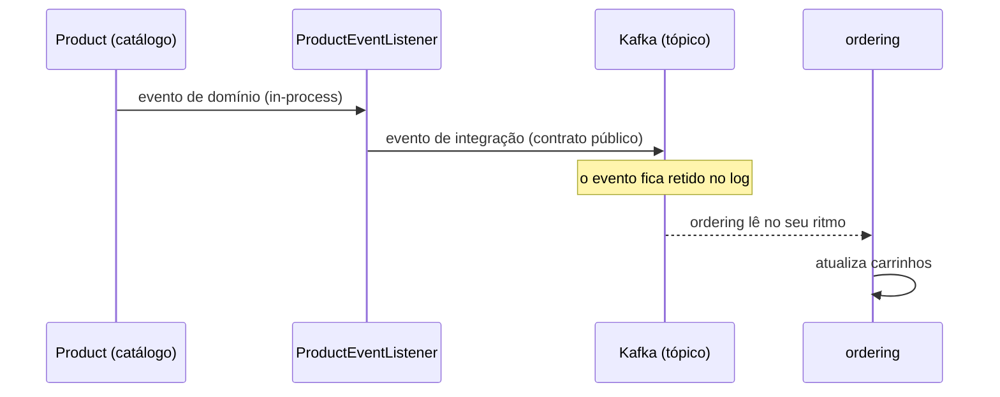

# Fundamentos de arquitetura orientada a eventos (EDA)

> **Em uma frase:** em vez de um serviço chamar o outro e esperar, ele anuncia um fato ("aconteceu isto") e quem se interessa reage por conta própria.

➡️ Próximo: [Kafka a fundo](./02-kafka-fundamentos.md) · 🧭 Trilha: [README](../README.md#trilha-de-leitura)

## O que esta trilha cobre

Os docs de mensageria foram escritos para serem lidos em ordem, cada um apoiado no anterior:

1. [01 — Fundamentos de EDA](./01-fundamentos-eda.md): o vocabulário (evento, produtor, canal, consumidor), os padrões e as decisões, antes de qualquer tecnologia.
2. [02 — Kafka a fundo](./02-kafka-fundamentos.md): como o Kafka funciona por dentro (record, partição, offset, consumer group, cluster).
3. [03 — Kafka na prática](./03-kafka-na-pratica.md): o primeiro evento de integração do AlgaShop, do catálogo para o ordering.
4. [04 — ECST e validação de eventos](./04-ecst-e-validacao-de-eventos.md): o consumidor passa a reagir, e cada lado valida o evento.
5. [05 — Contratos com AsyncAPI](./05-contratos-asyncapi.md): o contrato dos eventos escrito num documento único.
6. [06 — Resiliência no producer](./06-resiliencia-no-producer.md): como não perder evento quando o Kafka falha na hora de publicar.
7. [07 — Resiliência no consumer](./07-resiliencia-no-consumer.md): retentativa, DLQ e idempotência do lado de quem consome.
8. [08 — Outbox](./08-outbox.md): gravar no banco e publicar no broker sem perder nenhum dos dois.
9. [09 — Workflow coreografado](./09-workflow-coreografado.md): pedido → fatura → pagamento → estoque, cada serviço reagindo ao anterior.
10. [10 — Saga coreografada](./10-saga-coreografada.md): o mesmo fluxo ganhando compensações quando algo dá errado.
11. [11 — Saga orquestrada: conceito e mapa](./11-saga-orquestrada-conceito-e-mapa.md): um coordenador passa a reger o fluxo.
12. [12 — Preparando o terreno](./12-saga-orquestrada-preparando-o-terreno.md): o que muda nos serviços antes de o orquestrador existir.
13. [13 — Estado e persistência](./13-saga-orquestrada-estado-e-persistencia.md): onde a saga guarda em que passo está.
14. [14 — Comandos e respostas](./14-saga-orquestrada-comandos-e-respostas.md): o orquestrador manda comandos e escuta respostas.
15. [15 — Compensações](./15-saga-orquestrada-compensacoes.md): desfazer os passos já feitos quando um passo falha.
16. [16 — Robustez](./16-saga-orquestrada-robustez.md): os cuidados que deixam a saga confiável em produção.

## O problema

O AlgaShop já usa eventos, mas só **dentro de cada processo**. O `Order` registra um `OrderPlacedEvent` e um listener reage; o `CategoryUpdatedEvent` do catálogo atualiza a categoria copiada dentro dos produtos ([Normalizado × desnormalizado](../02-persistencia/08-desnormalizacao-mongo.md)). Tudo isso roda na memória do serviço: se o processo cair no meio, o evento morre junto e não volta.

E entre serviços, a conversa é síncrona: o `ordering` chama o catálogo por HTTP, espera a resposta e trata a falha. Cada integração nova é mais uma chamada em quem chama. Falta um jeito de o fato **atravessar a fronteira do serviço** e sobreviver a quedas.

## A ideia

Pense num mural de avisos: quem tem uma novidade cola o aviso e vai embora; quem se interessa passa e lê. Quem colou não precisa saber quem leu.

### As quatro peças

| Peça | O que é | Regra de ouro |
|---|---|---|
| **Evento** | Um fato que já aconteceu e não muda | Nome no passado: `PedidoConfirmado`, nunca `ConfirmarPedido` |
| **Produtor** | Quem origina o evento | Publica e esquece: não conhece nem espera quem consome |
| **Canal** | O caminho entre os dois | Fila, tópico ou bus — escolher é decisão de arquitetura |
| **Consumidor** | Quem reage | Decide sozinho o que o fato significa para ele |

A grande inversão: na chamada HTTP, **quem chama conhece quem atende**. No evento, o produtor só afirma um fato, e **quem quiser saber, que escute**. O `ordering` não "manda o billing faturar"; ele diz que um pedido foi feito, e o billing decide se importar.

### Evento de domínio × evento de integração

- **Evento de domínio** fala a língua interna do agregado e circula **dentro** do serviço (é o que `AbstractAggregateRoot.registerEvent()` produz). Pode mudar quando o modelo muda.
- **Evento de integração** é um **contrato público** entre serviços: estável, versionado, uma projeção pensada para consumidores que o produtor não controla. É para a mensageria o que o DTO é para a API REST — e merece o mesmo rigor do [contrato com Spring Cloud Contract](../03-testes-integracao/01-stubs-contract-tests.md).

### O que você ganha e o que paga

Ganha:
- **Desacoplamento no tempo** — o consumidor pode estar reiniciando; o evento espera no canal.
- **Consumidor novo sem mexer no produtor** — notificações, analytics, antifraude: o `ordering` nem fica sabendo.
- **Escala independente** e **amortecimento de picos** — o canal absorve a rajada que derrubaria a chamada síncrona ([teste de carga](../03-testes-integracao/04-testes-de-carga-k6.md)).

Paga:
- **Consistência eventual** — existe uma janela em que a leitura está desatualizada ([Eventos e listeners](../01-arquitetura-design/04-eventos-e-listeners.md)).
- **Observabilidade** — seguir um fluxo por três serviços exige um id de correlação.
- **Dupla escrita** — gravar no banco e publicar no broker são duas operações; sem um padrão (outbox, doc 08) uma pode acontecer sem a outra.

### Conceito, papel e produto

Aprenda os **papéis**, não os produtos: *message broker* roteia e entrega; *event broker* retém o log; *stream platform* retém e processa. RabbitMQ nasceu no primeiro papel, Kafka no segundo, e hoje cada um invade o território do outro (RabbitMQ Streams, por exemplo). Quem escolhe pelo papel sabe o que está trocando.

### Os padrões, do mais magro ao mais radical

| Padrão | O que o evento leva | Custo escondido |
|---|---|---|
| **Event notification** | Só o fato e o id | Quem precisa de mais volta e pergunta via API — e o acoplamento volta |
| **Event-carried state transfer (ECST)** | O estado que o consumidor precisa | O consumidor mantém uma cópia, que pode ficar desatualizada |
| **Event sourcing** | Os eventos **são** a fonte da verdade; o estado é projetado deles | Versionar eventos antigos, snapshots, projeções |
| **CQRS com eventos** | Cada escrita publica; a leitura se atualiza em outro banco | Dois modelos para manter em sincronia |
| **Publish-subscribe** | Cada assinante recebe a própria cópia | Escolher um canal que ofereça isso |

O AlgaShop já praticava ECST sem broker (a categoria copiada no produto). No doc 04 o padrão atravessa a fronteira: o evento de preço leva os valores e o `ordering` atualiza carrinhos sem consultar o catálogo.

> "Usar eventos" não é event sourcing. Quase todo sistema publica eventos; pouquíssimos precisam que os eventos sejam o banco.

### Fila ou tópico? Fila ou log?

| | Ponta a ponta (fila) | Publish-subscribe (tópico) |
|---|---|---|
| Entregas por mensagem | Uma — consumidores competem | Uma por assinante |
| Uso natural | Distribuir **trabalho** | Anunciar **fato** |

O projeto já tem uma fila de trabalho em Postgres: o `SKIP LOCKED` do [billing-scheduler](../04-infraestrutura/04-scheduled-jobs.md) faz instâncias competirem por linhas.

E a diferença que separa RabbitMQ de Kafka:

| | Fila (RabbitMQ) | Log (Kafka) |
|---|---|---|
| Mensagem consumida | É removida | Permanece no log |
| Quem sabe o que já foi lido | O broker | O consumidor (offset) |
| Consumidor novo | Vê só o que chegar daqui em diante | Pode reler a história retida |
| Analogia | Correio: entregou, acabou | Fita de vídeo: cada um assiste do seu ponto |

No log, a expansão de consumidores é **retroativa**: um serviço criado daqui a um ano pode ler os eventos que ainda estão retidos. Foi esse o motivo de o AlgaShop escolher o Kafka.

### Coreografia × orquestração

Um fluxo que atravessa serviços (pedido → fatura → pagamento → estoque) pode ser desenhado de dois jeitos:

- **Coreografia** — não há maestro. Cada serviço reage ao evento anterior e publica o seu; o fluxo **emerge** das assinaturas. Fácil de evoluir (passo novo = assinante novo) e sem ponto central, mas difícil de **entender**: o fluxo inteiro não está escrito em lugar nenhum.
- **Orquestração** — um coordenador conhece o fluxo e **comanda** cada passo, tratando respostas e falhas. O processo fica legível num lugar só e é mais fácil compensar, mas o coordenador conhece todos e vira gargalo de evolução.

Regra prática: **fluxo curto, linear e estável → coreografia; fluxo longo, com ramificações e compensações → orquestração.** Quando o fluxo precisa desfazer passos já feitos, entra o padrão **saga**. A trilha vive as duas formas: a coreografada em [09 — Workflow coreografado](./09-workflow-coreografado.md) (e a saga em [10](./10-saga-coreografada.md)), e a orquestrada a partir de [11 — Saga orquestrada](./11-saga-orquestrada-conceito-e-mapa.md).

## Como funciona no AlgaShop

O primeiro fato a atravessar a fronteira foi do catálogo para o ordering: o produto ficou disponível, indisponível ou mudou de preço.

1. O agregado `Product` registra um **evento de domínio**, que circula só dentro do catálogo.
2. Um listener o converte num **evento de integração** e publica no Kafka.
3. O evento fica no tópico; o catálogo não sabe nem espera quem vai ler.
4. O `ordering` consome quando puder e decide o efeito (marcar item indisponível, atualizar preço).

Os detalhes de cada passo estão nos docs 02 a 04.

## Como aplicar

1. **Nomeie o fato no passado.** Se não dá para nomear como fato consumado, provavelmente é um comando.
2. **Separe domínio de integração.** Decida quais eventos internos merecem virar contrato público — nem todos merecem.
3. **Escolha o padrão por evento:** só o id basta (notification) ou o consumidor precisa de dados (ECST)?
4. **Escolha o canal pelo papel:** trabalho a dividir (fila) ou fato a anunciar (pub-sub)? Algum consumidor futuro vai precisar do passado (log)?
5. **Resolva a dupla escrita** antes do primeiro evento importante (transação estendida ou outbox).
6. **Coloque um id de correlação** desde o primeiro evento.
7. **Decida quem rege fluxos longos:** coreografia para o simples, orquestração quando houver compensação.

## Para lembrar

- Evento é fato no passado; comando é ordem. Nome imperativo = comando disfarçado.
- O produtor publica e esquece; a dependência aponta do consumidor para o fato.
- Evento de integração é contrato público e precisa de versão e estabilidade.
- Notification é magro mas convida o consumidor a voltar e perguntar; ECST carrega o estado.
- Fila remove ao consumir; log retém e deixa reler.
- Usar eventos não é fazer event sourcing.
- Coreografia é fácil de evoluir e difícil de entender; orquestração é o contrário.

## Cuidados

- **Comando fantasiado de evento:** se o produtor só faz sentido quando um consumidor específico reage, não há desacoplamento.
- **Cópia desatualizada é o preço do ECST:** quem carrega estado no evento assume a janela de inconsistência.
- **Dupla escrita sem resposta perde evento:** commit no banco e publish no broker não são atômicos.
- **Notificação magra que todo mundo enriquece com GET** devolve o acoplamento síncrono por baixo.
- **Coreografia sem correlação** vira um fluxo que ninguém consegue explicar em produção.

## Onde ver no código

- `AbstractAggregateRoot` (entidades de persistência do ordering, como `OrderPersistenceEntity`; `DomainEventPublisher` no catálogo) — base do Spring Data que registra os eventos de domínio.
- `OrderPlacedEvent` e `OrderEventListener` (ordering) — evento de domínio in-process.
- `CategoryUpdatedEvent` e `CategoryEventListener` (catálogo) — ECST dentro do processo, atualizando a categoria copiada.
- `LocalEventPublisher` (catálogo) — porta dos eventos de domínio, que ficam no processo.
- `ProductEventListener` (catálogo) — promove eventos de domínio a eventos de integração.
- `ProductIntegrationEventPublisher` (catálogo) — porta dos eventos de integração, implementada sobre o Kafka.
- `CancelExpiredInvoicesApplicationServiceJDBCImpl` (billing-scheduler) — fila de trabalho em Postgres com `SKIP LOCKED`.
