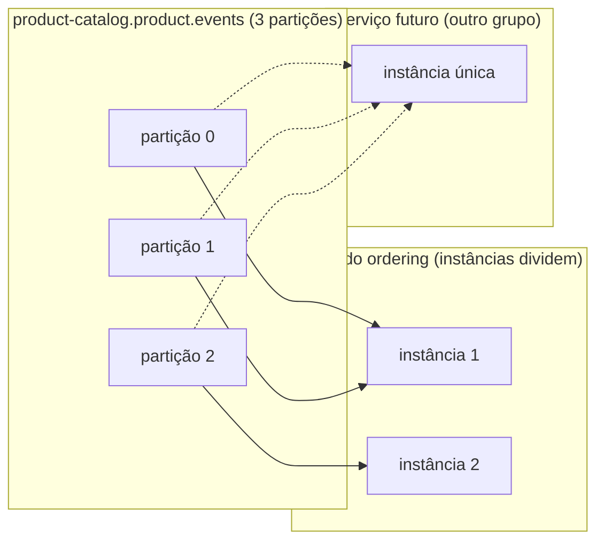

# Kafka a fundo

> **Em uma frase:** o Kafka é um log distribuído onde cada evento é anexado ao fim, fica retido por um tempo e cada consumidor lê no seu ritmo, guardando onde parou.

⬅️ Anterior: [Fundamentos de EDA](./01-fundamentos-eda.md) · ➡️ Próximo: [Kafka na prática](./03-kafka-na-pratica.md) · 🧭 Trilha: [README](../README.md#trilha-de-leitura)

## O problema

O doc 01 mostrou que o AlgaShop precisa de um **log** (e não de uma fila): consumidores futuros dos eventos de produto vão querer ler o passado. Mas para usar o Kafka bem é preciso entender o que acontece por dentro. Sem isso, as decisões mais importantes — qual key usar, quantas partições criar, quantas instâncias do `ordering` subir — viram chute, e os bugs só aparecem sob concorrência.

## A ideia

Imagine um livro-razão: cada lançamento entra numa linha nova no fim, ninguém apaga linha, e cada leitor marca com um clipe em que linha parou. Ler não muda o livro.

### Record, não message

| Message (fila) | Record (Kafka) |
|---|---|
| Nasce para ser **entregue** e descartada | Nasce para ser **gravada** no fim do log |
| O broker controla a entrega | O consumidor guarda a própria posição (offset) |

Cada record tem quatro partes:

| Campo | O que é | Por que importa |
|---|---|---|
| **key** | Identifica a entidade do fato (ex.: id do produto) | Decide a **partição** — e portanto a ordem |
| **value** | O fato em si (o payload) | É o contrato de integração |
| **timestamp** | Quando aconteceu | Pode ser carimbado pelo produtor ou pelo broker |
| **headers** | Metadados chave-valor | Tipo do evento, correlação, versão |

> "Routing key" é termo do RabbitMQ. No Kafka, a key não escolhe destino entre filas: escolhe a partição dentro do tópico.

### Tópico e partição

O **tópico** é o nome lógico. O que existe em disco são as **partições**, cada uma um log que é:
- **append-only** (só entra no fim),
- **imutável** (correção é um record novo),
- **ordenado** (a posição é o **offset**).

O offset é só uma posição, não "lido/não lido". Dez grupos podem estar em dez pontos diferentes do mesmo log.

### A ordem mora na partição

Records na **mesma partição** são lidos na ordem em que entraram. **Entre partições, não há ordem.** O Kafka faz `hash(key) % partições`, então a mesma key cai sempre na mesma partição: todos os eventos do produto 42 chegam em ordem, mas nada se promete entre o produto 42 e o 43. Sem key, o produtor espalha os records e a ordem por entidade se perde.

### Ler não apaga — a retenção apaga

Consumir não remove nada. Quem remove é a **política de retenção** (por tempo ou tamanho). O padrão do Kafka é **7 dias**, não "para sempre". O consumidor novo relê só o que a retenção deixou.

### Consumer groups: fila e pub-sub ao mesmo tempo

- **Entre grupos: pub-sub.** Cada grupo tem os próprios offsets e recebe o fluxo inteiro.
- **Dentro do grupo: fila.** As partições se dividem entre as instâncias; cada record é processado por uma só.

Regras que explicam quase todo comportamento estranho:
1. Um consumidor pode ler várias partições.
2. Uma partição nunca é lida por duas instâncias do mesmo grupo (é isso que preserva a ordem).
3. Instâncias além do número de partições ficam **ociosas** — o número de partições é o teto do paralelismo.
4. Instância entra ou sai → **rebalance**: o grupo redistribui as partições e o consumo pausa nesse meio-tempo.

### Pull, não push

O consumidor **busca** os records (pull). Isso dá backpressure natural (o lento busca menos), leitura em lote de graça e, com *long polling*, evita ficar perguntando à toa.

### O cluster

- Um **broker** é um servidor Kafka; o **cluster** é o conjunto. As partições se espalham pelos brokers.
- Cada partição tem um **replication factor** (3 é o clássico): um **leader** recebe as escritas e os **followers** copiam. Os que estão em dia formam o **ISR** (in-sync replicas).
- Leader caiu → um follower em sincronia assume. Cada partição tem seu próprio leader; não existe "servidor principal".
- **KRaft**: os metadados do cluster (quem é leader de quê) viraram um log Kafka replicado entre **controllers**, sem ZooKeeper. Em dev, cada nó pode ser broker e controller ao mesmo tempo (**modo combinado**).

### O ecossistema

- **Producer/Consumer API** — publicar e consumir (o Spring usa via `spring-kafka`).
- **Admin API** — criar tópicos e inspecionar o cluster por código.
- **Streams API** — processar o fluxo dentro da aplicação (agregações, joins, janelas).
- **Kafka Connect** — integrar sistemas por configuração (*source* traz dados para tópicos, *sink* despeja tópicos em bancos; é a porta do CDC).

Por que aguenta tanto volume? Escrita e leitura **sequenciais**, page cache do sistema operacional, **lotes** em todo lugar e **zero-copy** do disco para a rede. O broker quase não faz nada com cada record além de anexar e entregar.

## Como funciona no AlgaShop

O tópico `product-catalog.product.events` tem 3 partições, replicação 3 e key = id do produto. O `ordering` consome como um grupo.

- Dentro do grupo do `ordering`, as 3 partições se dividem entre as instâncias: trabalho repartido.
- Um serviço novo entraria com **outro grupo** e leria o tópico inteiro (o que ainda estiver retido) sem afetar o `ordering`.
- Como a key é o id do produto, todos os eventos de um mesmo produto caem na mesma partição e chegam em ordem.
- O cluster local tem **3 nós KRaft em modo combinado**, o que permite ver replicação e failover de verdade ao derrubar um broker (doc 03).

## Como aplicar

1. **Pergunte "ordem de quê?"** — a resposta é a key (pedido, produto, cliente).
2. **Dimensione as partições pelo paralelismo futuro**, não pelo atual: aumentar depois muda o mapa key → partição.
3. **Defina a retenção conscientemente** se algum consumidor for precisar reler o passado.
4. **Use um grupo por serviço consumidor**; instâncias do mesmo serviço compartilham o grupo.
5. **Replique** (fator 3 e `min.insync.replicas=2` é o par clássico) para sobreviver à queda de um broker.
6. **Monitore o consumer lag** desde o primeiro consumidor.

## Para lembrar

- Record é gravado, não entregue: ler não apaga.
- A ordem é por partição; ordem global não existe.
- A key decide a partição e, portanto, a cronologia da entidade.
- Partições = teto do paralelismo de um grupo.
- Entre grupos é pub-sub; dentro do grupo é fila.
- Retenção padrão é 7 dias.
- Cada partição tem seu leader; KRaft dispensa o ZooKeeper.

## Cuidados

- **Prometer ordem global:** ela não existe; desenhe pela key.
- **Key tratada como opcional:** sem key, eventos da mesma entidade se espalham e a ordem some.
- **Aumentar partições depois** manda as mesmas keys para partições diferentes dali em diante.
- **Mais instâncias que partições** = instâncias paradas.
- **Consumer lag** é a métrica de saúde: lag crescendo é grupo afundando em silêncio.
- **Rebalance em loop:** consumidor instável faz o grupo redistribuir partições sem parar.

## Onde ver no código

- `KafkaConfig` (catálogo) — declara o tópico de produto com 3 partições, 3 réplicas e `min.insync.replicas=2`.
- `OutboundIntegrationEvent` (catálogo) — interface cujo `getAggregateId()` vira a key do record.
- `KafkaProductIntegrationEventListener` (ordering) — consumidor do tópico, dentro do grupo do ordering.
- `docker-compose.tools.yml` — os 3 nós KRaft (`controller,broker`) e a Kafka UI.
