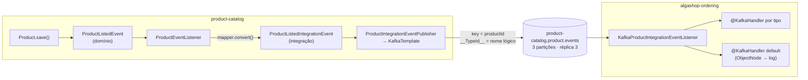

# Kafka na prática: o primeiro evento entre serviços

> **Em uma frase:** o catálogo publica no Kafka um evento de integração com a key do produto e um nome lógico de tipo, e o ordering o consome despachando por tipo, sem que um conheça os pacotes do outro.

⬅️ Anterior: [Kafka a fundo](./02-kafka-fundamentos.md) · ➡️ Próximo: [ECST e validação de eventos](./04-ecst-e-validacao-de-eventos.md) · 🧭 Trilha: [README](../README.md#trilha-de-leitura)

## O problema

Quando um produto é listado ou deslistado no catálogo, o `ordering` precisa saber, porque carrinhos podem conter esse produto. Até aqui isso só seria possível com o ordering perguntando ao catálogo por HTTP. Queremos que o catálogo **anuncie** o fato e siga a vida, e que o ordering receba o aviso mesmo se estiver fora do ar na hora.

Três perguntas práticas aparecem logo:
- Como garantir que os eventos de um mesmo produto cheguem em ordem?
- Como o ordering sabe que tipo de objeto está no JSON, sem compartilhar classes com o catálogo?
- O que acontece quando chega um evento que o ordering não conhece?

## A ideia

O evento **nasce duas vezes**, e isso é proposital:

1. **Evento de domínio** (`ProductListedEvent`) — a língua interna do agregado, entregue dentro do processo pela `LocalEventPublisher`.
2. **Evento de integração** (`ProductListedIntegrationEvent`) — o contrato público, uma projeção enxuta (id + instante) que pode evoluir sem depender do modelo interno.

Por isso existem **duas portas**: a `LocalEventPublisher` continua para eventos internos, e a `ProductIntegrationEventPublisher` leva eventos de integração ao broker. Não se trocou a porta antiga pelo Kafka, porque nem todo evento de domínio merece sair do serviço.

Três decisões completam o desenho:
- **A key nasce no evento.** Todo evento de integração do catálogo implementa `OutboundIntegrationEvent`, com `getAggregateId()`. O publisher usa esse valor como key, então eventos do mesmo produto vão para a mesma partição e chegam em ordem.
- **O tipo viaja como nome lógico.** O header `__TypeId__` leva `ProductCatalog.ProductListedIntegrationEvent`, não o nome da classe Java. Cada lado mapeia o nome para a sua classe local.
- **Evento desconhecido não quebra.** Tipo sem mapeamento vira um JSON genérico (`ObjectNode`) e cai num handler padrão que só registra log.

## Como funciona no AlgaShop



**No produtor (catálogo):**
1. O agregado salva e registra o evento de domínio.
2. O `ProductEventListener` recebe, converte com o mapper e chama a porta de integração.
3. A implementação da porta (no `KafkaConfig`) faz `kafkaTemplate.send(topico, event.getAggregateId(), event)`. O tópico vem das properties; quem chama diz **o que** aconteceu, nunca **para onde** vai.
4. O tópico é declarado por `NewTopic` com 3 partições, replicação 3 e `min.insync.replicas=2`. Com `admin.fail-fast: true`, o catálogo nem sobe sem broker.

**O mapeamento de tipo, dos dois lados:**

```
produtor   → ProductCatalog.ProductListedIntegrationEvent : com.algaworks...ProductListedIntegrationEvent
consumidor → ProductCatalog.ProductListedIntegrationEvent : com.gtech...ProductListedIntegrationEvent
```

O contrato entre os serviços passa a ser **nome lógico + forma do JSON**. O ordering mantém uma cópia própria do POJO (sem jar compartilhado). Quem lê o header e escolhe a classe é o `KafkaConsumerTypeIdIdentifier`, referenciado por `spring.json.value.type.method`.

**No consumidor (ordering):**

```java
@KafkaListener(topics = "...product-event-topic-name...")
public class KafkaProductIntegrationEventListener {
    @KafkaHandler
    public void handle(@Payload ProductListedIntegrationEvent event, ...) { ... }

    @KafkaHandler
    public void handle(@Payload ProductDelistedIntegrationEvent event, ...) { ... }

    @KafkaHandler(isDefault = true)
    public void handle(@Payload Object object, ...) { /* log e segue */ }
}
```

- `@KafkaListener` na classe e `@KafkaHandler` por método: o Spring despacha pelo tipo já desserializado.
- `ProductAddedIntegrationEvent` fica **de propósito** fora do mapeamento do ordering: é a prova viva de que o produtor pode publicar um evento novo sem quebrar o consumidor antigo.
- Todas as instâncias do ordering compartilham o mesmo grupo de consumo, então as partições se dividem entre elas. Um serviço novo usaria outro grupo e leria o tópico desde o início do que estiver retido.
- O `ErrorHandlingDeserializer` embrulha o `JacksonJsonDeserializer`: JSON malformado vira erro tratável em vez de travar o consumidor para sempre (a *poison pill*).
- Nesta primeira etapa os handlers só registravam log. O efeito de negócio chega no [doc 04](./04-ecst-e-validacao-de-eventos.md).

### O cluster local e os dois endereços

O compose sobe **3 nós KRaft** (`apache/kafka:4.3.1`, cada um `controller,broker`). É mais pesado que um nó só, mas permite replicação 3 de verdade: dá para derrubar um broker e ver o failover.

Cada broker anuncia **dois listeners**:

| Listener | Endereço anunciado | Quem usa |
|---|---|---|
| `PLAINTEXT` (interno) | `algashop-kafka-N:9081/9082/9083` | brokers entre si, serviços no compose, Kafka UI |
| `EXTERNAL` | `localhost:9092/9093/9094` | aplicações rodando no host (bootRun, IDE) |

O bootstrap é só o primeiro passo: o cliente conecta, recebe o **endereço anunciado** do leader de cada partição e passa a usar esse endereço. Por isso o perfil `docker` sobrescreve o bootstrap para o listener interno; se herdasse as portas EXTERNAL, o container receberia `localhost` e tentaria conectar em si mesmo. Os brokers têm healthcheck por TCP (a imagem não tem `curl` nem `nc`) para o `depends_on` dos serviços esperar o cluster. A **Kafka UI** (porta 9084) mostra tópicos, partições, offsets e consumer lag.

## Como aplicar

1. **Crie uma porta só para eventos de integração**, separada da de eventos de domínio.
2. **Projete o evento de integração** como DTO: só o necessário, sem vazar o modelo interno.
3. **Faça o evento carregar a própria key** (uma interface com `getAggregateId()`), e o publisher só transporta.
4. **Declare o tópico no código** (`NewTopic`) com partições, réplicas e `min.insync.replicas`; nome vindo de properties validadas.
5. **Configure `spring.json.type.mapping` dos dois lados** com nomes lógicos prefixados pelo serviço.
6. **No consumidor:** `ErrorHandlingDeserializer` + resolvedor de tipo com fallback para `ObjectNode` + `@KafkaHandler(isDefault = true)`.
7. **Um grupo por serviço**, e confira os endereços anunciados de cada ambiente (host × container).

## Para lembrar

- Evento de domínio é interno; evento de integração é contrato público. São portas diferentes.
- A key é o id do agregado e garante ordem por produto, nunca ordem global.
- O contrato é nome lógico no `__TypeId__` + forma do JSON; nenhum lado conhece o pacote do outro.
- Tipo desconhecido vira `ObjectNode` e cai no handler default: compatibilidade, não descuido.
- `ErrorHandlingDeserializer` protege contra a mensagem podre que derruba o consumidor.
- Bootstrap ≠ endereço anunciado; container e host precisam de listeners diferentes.

## Cuidados

- **Renomear campo depois do primeiro deploy é quebra de contrato.** Corrija nomes antes de o JSON circular.
- **Mapper estrito com nomes diferentes** (domínio × integração) precisa de de-para explícito, senão o campo vai nulo no JSON sem erro.
- **Cópia manual do POJO não tem rede:** campo renomeado no produtor vira `null` no consumidor sem nenhum teste falhar (o contrato escrito vem no [doc 05](./05-contratos-asyncapi.md)).
- **Nome de bean em SpEL é contrato implícito:** `#{algaShopMessagingKafkaProperties...}` quebra em runtime se a classe for renomeada; placeholder `${...}` não depende de nome de bean.
- **Publicar logo após o `save()` expõe a dupla escrita:** o banco commita e o `send()` pode falhar (resolvido nos docs 06 e 08).

## Onde ver no código

- `ProductEventListener` (catálogo) — promove eventos de domínio a eventos de integração.
- `ProductIntegrationEventPublisher` (catálogo) — porta de saída dos eventos de integração.
- `OutboundIntegrationEvent` (catálogo) — contrato com `getAggregateId()`, que vira a key.
- `KafkaConfig` (catálogo) — declara o tópico e implementa o publisher sobre o `KafkaTemplate`.
- `KafkaProductIntegrationEventListener` (ordering) — `@KafkaListener` com um `@KafkaHandler` por tipo e o default.
- `KafkaConsumerTypeIdIdentifier` (ordering) — lê o `__TypeId__` e escolhe a classe local, com fallback `ObjectNode`.
- `application-development-env.yaml` / `application-docker-env.yaml` (ordering) — `type.mapping`, deserializers e bootstrap por ambiente.
- `docker-compose.tools.yml` — os 3 brokers, os listeners e a Kafka UI.
