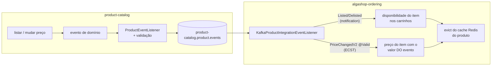

# ECST e validação de eventos: o consumidor reage

> **Em uma frase:** o ordering passa a reagir aos eventos do catálogo — uns só avisam (notification), outro carrega o novo preço (ECST) — e cada lado valida o evento com Bean Validation para não confiar no outro.

⬅️ Anterior: [Kafka na prática](./03-kafka-na-pratica.md) · ➡️ Próximo: [Contratos com AsyncAPI](./05-contratos-asyncapi.md) · 🧭 Trilha: [README](../README.md#trilha-de-leitura)

## O problema

No [doc 03](./03-kafka-na-pratica.md) o evento atravessou a fronteira e terminou num `log.info`. Nada mudava no ordering. Mas o carrinho do cliente precisa refletir o catálogo:
- Produto deslistado ou esgotado → o item no carrinho fica indisponível.
- Preço mudou → o item e o total do carrinho precisam do preço novo.

Para o preço, há uma escolha: o evento só avisa "mudou" e o ordering consulta o catálogo por HTTP, ou o evento já traz o valor? E se chegar um evento com campo nulo, quem barra?

## A ideia

Os dois padrões do [doc 01](./01-fundamentos-eda.md) aparecem **lado a lado no mesmo listener**:

| Evento | Padrão | O que carrega | Por quê |
|---|---|---|---|
| `ProductListed` / `ProductDelisted` (e `Restocked` / `SoldOut`) | **Notification** | Só o fato e o id | Disponibilidade é um sim/não que o próprio fato determina |
| `ProductPriceChangedV2` | **ECST** | Preços antigos e novos + `changedAt` | Preço é um **valor**: ou o evento leva, ou o consumidor faz uma chamada HTTP por evento |

Com ECST, o ordering atualiza os carrinhos **sem chamar o catálogo**. O preço disso é a cópia: existe uma janela em que ela está desatualizada, e propagar a mudança passa a ser responsabilidade do evento (o mesmo aprendizado da [categoria desnormalizada](../02-persistencia/08-desnormalizacao-mongo.md), agora entre serviços).

### O V2 que nasceu sem V1

O evento de preço já se chama `ProductPriceChangedV2IntegrationEvent`, e não existe V1 publicada. A versão está no nome porque **o nome é o contrato**: ele viaja no `__TypeId__` lógico (`ProductCatalog.ProductPriceChangedV2IntegrationEvent`). Uma futura V3 pode conviver no mesmo tópico; consumidores antigos seguem lendo V2, e o tipo desconhecido cai no handler default. Versionar antes de precisar é o que torna a evolução possível depois.

### Validar dos dois lados

O V2 tem campos `@NotNull`, e a validação roda em cada serviço:

| Lado | Mecanismo | O que barra |
|---|---|---|
| **Produtor** (catálogo) | `BeanValidationUtil.validate(event)` no publisher, antes do `send()` | Evento inválido nem chega ao tópico; o erro estoura onde há contexto |
| **Consumidor** (ordering) | `KafkaBeanValidationConfigurer` + `@Valid` no `@Payload` | Payload inválido vira erro antes de o método do handler rodar |

Por que validar no consumidor se o produtor já validou? Porque o consumidor **não confia** no produtor: outra versão, um replay antigo ou uma mensagem publicada à mão pela UI chegam pelo mesmo caminho. É defesa em profundidade.

> `@Valid` num `@Payload` de Kafka **não faz nada sozinho**. Diferente do `@RequestBody` do MVC, o listener não tem validator registrado por padrão. É preciso plugá-lo com um `KafkaListenerConfigurer` (`registrar.setValidator(...)`) — é só isso que o `KafkaBeanValidationConfigurer` faz.

## Como funciona no AlgaShop

1. No catálogo, mudar o preço gera o evento de domínio; o listener o converte no V2, o publisher valida e envia.
2. No ordering, o handler de Listed/Delisted chama `changeProductAvailability(productId, true/false)`.
3. O handler do V2 (com `@Valid`) chama `refreshProductPrice(productId, newSalePrice)` usando o valor que veio no evento.
4. A atualização roda numa **única transação** (`@Transactional` no application service): uma falha no meio não deixa metade dos carrinhos atualizada.
5. O preço do item e o **total do carrinho** são recalculados juntos.
6. O `ProductCacheManager` invalida o cache Redis do produto.

O cache que o ordering mantém dos produtos ([Cache](../01-arquitetura-design/05-cache.md)) dependia só de TTL, porque "o dado é de outro serviço e ele não fica sabendo quando muda". Com o evento, o ordering **fica sabendo**: a invalidação por evento é a primeira linha, e o TTL curto vira a segunda (para o evento que se perder).

## Como aplicar

1. **Escolha o padrão por evento:** se o efeito depende só do id, notification; se depende de um valor, ECST.
2. **Coloque a versão no nome lógico do evento** desde o primeiro dia (`...V2IntegrationEvent`).
3. **Anote o contrato** com Bean Validation (`@NotNull` etc.).
4. **Valide no produtor** antes do `send()`.
5. **Valide no consumidor:** registre o validator com um `KafkaListenerConfigurer` e use `@Valid` no `@Payload`.
6. **Aplique o efeito numa transação só**, com o agregado recalculando os próprios totais.
7. **Invalide o cache depois** de atualizar o banco, e proteja o evict com try/catch.
8. **Configure retry e DLQ** antes de confiar no consumidor (o padrão do spring-kafka descarta — ver Cuidados).

## Para lembrar

- Notification leva o fato; ECST leva o estado. Os dois podem morar no mesmo listener.
- ECST elimina a chamada de volta à origem, ao custo de uma cópia que pode atrasar.
- A versão do contrato viaja no nome lógico do `__TypeId__`.
- `@Valid` no `@Payload` só funciona com validator registrado no `KafkaListenerConfigurer`.
- Cada lado valida: o produtor para não publicar lixo, o consumidor para não confiar.
- Invalidação por evento é a primeira defesa do cache; TTL é a rede.

## Cuidados

- **O padrão do spring-kafka descarta em silêncio:** o `DefaultErrorHandler` padrão faz 10 tentativas sem intervalo e depois commita o offset. Evento inválido some sem DLQ (resolvido no [doc 07](./07-resiliencia-no-consumer.md)).
- **Validação precisa de teste do caminho triste:** uma condição invertida (`if (violations.isEmpty()) throw`) compila e faz o contrário do combinado.
- **Mudar o preço do item sem recalcular o total do carrinho** deixa a soma dos itens diferente do total persistido.
- **Evict antes de atualizar** abre janela para uma leitura concorrente repovoar o cache com o dado velho.
- **API programática do cache** (`cache.evictIfPresent`) não passa pelo `CacheErrorHandler` das anotações: Redis fora do ar estoura direto no handler Kafka sem o try/catch.
- **Sem idempotência**, um replay ou evento fora de ordem sobrescreve preço mais novo (resolvido no doc 07).
- **Atualizar via agregado em produto popular** é N+1 na thread do consumidor e pode estourar `max.poll.interval.ms`; o caminho em massa (UPDATE direto) evita isso.

## Onde ver no código

- `ProductPriceChangedV2IntegrationEvent` (catálogo e ordering) — o evento ECST, com preços antigos/novos e `@NotNull`.
- `BeanValidationUtil` (catálogo) — valida o evento antes do `send()`.
- `KafkaConfig` (catálogo) — o publisher que chama a validação.
- `KafkaBeanValidationConfigurer` (ordering) — registra o validator nos listeners Kafka.
- `KafkaProductIntegrationEventListener` (ordering) — handlers de notification e o de preço com `@Valid`.
- `ShoppingCartManagementApplicationService` (ordering) — `changeProductAvailability` e `refreshProductPrice`, transacionais.
- `ShoppingCartUpdateProvider` (ordering) — ajuste em massa de preço e disponibilidade, recalculando o total no banco.
- `ProductCacheManager` (ordering) — invalida o cache Redis do produto, com try/catch.
