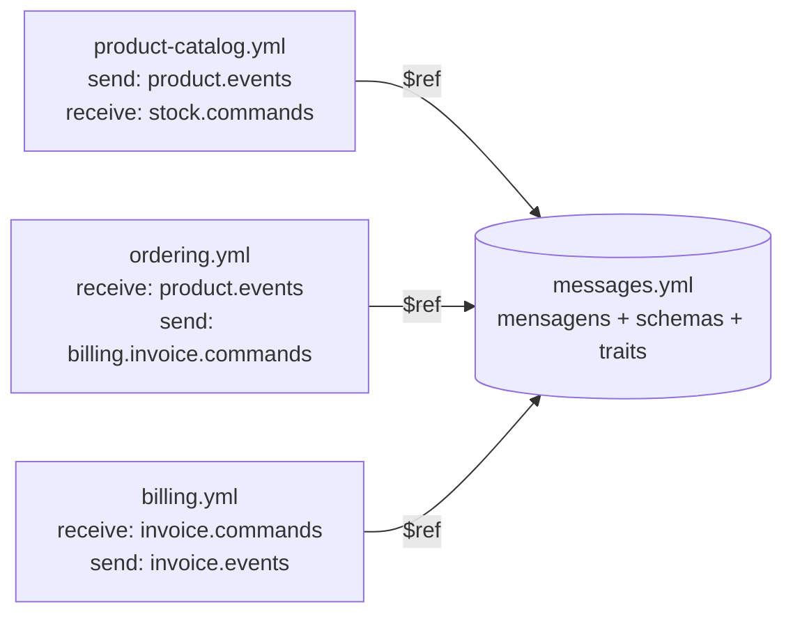

# Contratos com AsyncAPI

> **Em uma frase:** o AsyncAPI é o "OpenAPI da mensageria": um YAML por serviço que diz quais tópicos ele usa, quais mensagens passam por ali, com que forma e com que headers.

⬅️ Anterior: [ECST e validação de eventos](./04-ecst-e-validacao-de-eventos.md) · ➡️ Próximo: [Resiliência no producer](./06-resiliencia-no-producer.md) · 🧭 Trilha: [README](../README.md#trilha-de-leitura)

## O problema

Depois de alguns eventos trafegando entre o catálogo e o ordering, o contrato existia, mas **só de forma implícita**. Para saber o que passava em `product-catalog.product.events`, era preciso abrir:

- os POJOs do produtor e as cópias deles no consumidor (o projeto não usa jar compartilhado);
- as linhas de `spring.json.type.mapping` dos dois `application.yml`;
- o `KafkaConfig`, para descobrir key, partições e réplicas.

Quem fosse escrever um consumidor novo teria de "caçar" o nome lógico `ProductCatalog.ProductPriceChangedV2IntegrationEvent` no repositório do produtor. Nada disso estava escrito em um lugar feito para ser lido.

## A ideia

O **OpenAPI** descreve APIs de requisição e resposta (rotas, verbos, corpos). Ele não tem vocabulário para o mundo assíncrono: num tópico não existe "endpoint" nem "resposta". O **AsyncAPI** é a especificação irmã para esse mundo. Ele descreve:

- **servers**: o broker (host e protocolo `kafka`);
- **channels**: os tópicos e as mensagens que cada um carrega;
- **operations**: o que o serviço faz com cada canal (`send` ou `receive`);
- **components**: o que é reaproveitado (mensagens, schemas, traits).

A grande virada do AsyncAPI 3 é separar **canal** de **operação**:

- o **canal é o substantivo**: o tópico existe, tem 3 partições, carrega estas mensagens;
- a **operação é o verbo**: o catálogo faz `send` nele, o ordering faz `receive`.

O mesmo tópico aparece em dois documentos, **um por perspectiva**. É assim que a realidade é: o contrato do catálogo lista oito mensagens de produto; o do ordering declara consumir só cinco (o `ProductAdded`, por exemplo, fica de fora de propósito, porque o ordering o ignora no handler default).

Analogia curta: o contrato é a bula do remédio. O remédio (o código) funciona sem ela, mas ninguém deveria precisar abrir a cápsula para saber o que tem dentro.

## Como funciona no AlgaShop

Os contratos moram em `docs/asyncapi/`, e **não** dentro de um serviço: o contrato pertence à fronteira, não a um dos lados dela.

| Arquivo | Perspectiva |
|---|---|
| [`product-catalog.yml`](../asyncapi/product-catalog.yml) | Publica eventos de produto; recebe comandos de estoque da saga |
| [`ordering.yml`](../asyncapi/ordering.yml) | Recebe eventos de produto; publica eventos de pedido; envia comandos da saga; recebe as respostas |
| [`billing.yml`](../asyncapi/billing.yml) | Recebe comandos de fatura; publica eventos de fatura |
| [`messages.yml`](../asyncapi/messages.yml) | As mensagens em si (payload, headers, key), compartilhadas por todos via `$ref` |



O `messages.yml` é a peça mais importante: é o **primeiro artefato único** do contrato. Os POJOs são cópias e o `type.mapping` são listas paralelas; já a mensagem descrita no `messages.yml` é **uma só**, e produtor e consumidor apontam para ela com `$ref: "./messages.yml#/components/messages/..."`.

### Onde cada decisão do projeto aparece no YAML

| No YAML | O que documenta | De onde vem no código |
|---|---|---|
| `bindings.kafka`: `partitions: 3`, `replicas: 3`, `min.insync.replicas: 2` | A topologia do tópico | Os beans `NewTopic` dos `KafkaConfig` |
| `messageTraits.KafkaProductKey` / `KafkaOrderKey` | A key do record (id do agregado) | O `getAggregateId()` dos eventos e comandos |
| `headers.__TypeId__` com `const` | O nome lógico que resolve a desserialização | O `spring.json.type.mapping` de cada lado |
| `IdempotentEventHeaders` (`idempotency-key`) | A chave que o consumidor usa para deduplicar | O header gravado pelo publisher |
| `CommandHeaders` (`kafka_correlationId`, `kafka_replyTopic`) | A que saga a resposta pertence e para onde enviá-la | Os headers dos comandos da saga |
| `payload.required` + tipos | A forma do JSON | O Bean Validation dos eventos |

Com isso, o `__TypeId__` deixou de ser um "fio invisível" entre dois YAMLs de configuração: virou um `const` num documento feito para ser lido.

### Evolução de contrato: `deprecated`

O `messages.yml` traz um `ProductPriceChangedEvent` marcado `deprecated: true` ao lado do `ProductPriceChangedEventV2`. Esse V1 é **ilustrativo**: no código o evento de preço nasceu V2. Ele está lá para mostrar como um contrato envelhece: a mensagem antiga não some do documento enquanto ainda puder haver eventos dela retidos no log; ela ganha `deprecated: true` e o V2 entra ao lado. Por ser fictício, o V1 aparece só no contrato do produtor; o do ordering lista apenas o que ele consome de verdade.

## Como aplicar

1. **Um documento por serviço**, com a perspectiva dele (`send` ou `receive`), e um arquivo de mensagens compartilhado.
2. **Guarde os contratos fora dos serviços** (aqui, `docs/asyncapi/`), porque eles descrevem a fronteira.
3. **Declare o canal com o binding Kafka**: tópico, partições, réplicas e `min.insync.replicas`, iguais ao `NewTopic` do código.
4. **Descreva a mensagem inteira**: payload com `required`, key (via trait) e headers, com `const` no `__TypeId__`.
5. **Valide o YAML** com a CLI (resolve os `$ref` de disco):

   ```bash
   npx -y @asyncapi/cli validate docs/asyncapi/ordering.yml
   npx -y @asyncapi/cli generate fromTemplate docs/asyncapi/product-catalog.yml \
       @asyncapi/html-template@3.0.0 --use-new-generator -o build/asyncapi-docs
   ```

6. **Visualize**: no [AsyncAPI Studio](https://studio.asyncapi.org) (colando o YAML) ou com a extensão *asyncapi-preview* do VS Code / o suporte do IntelliJ.
7. **Mude o contrato junto com o código**: tópico novo, mensagem nova ou mensagem removida entram (ou saem) do YAML na mesma alteração.

## Para lembrar

- AsyncAPI está para a mensageria assim como OpenAPI está para REST.
- Canal = substantivo (o tópico); operação = verbo (`send`/`receive`).
- Cada serviço tem o seu documento, com a sua perspectiva do mesmo tópico.
- O `messages.yml` compartilhado é o único ponto em que produtor e consumidor leem a mesma definição.
- O `__TypeId__` com `const` é a parte mais crítica: é ele que decide para qual classe a mensagem vira.
- Mensagem antiga ganha `deprecated: true` e fica no contrato enquanto puder existir no log.
- O contrato é documentação: **nada liga o YAML ao código**.

## Cuidados

- **Contrato que mente.** O `validate` só confere a estrutura. Um `__TypeId__` digitado errado passa na CLI e manda o consumidor para o handler default sem ninguém perceber.
- **Contrato parcial é pior que nenhum.** Mensagem que existe no código e falta no YAML dá falsa sensação de completude.
- **Copy/paste destrói a perspectiva.** Ao copiar o canal de um serviço para outro, revise `action`, `summary` e a lista de mensagens.
- **O contrato também se remove.** Ao apagar um tópico ou comando do código, apague-o do AsyncAPI; senão o documento descreve algo que não existe.
- **Drift é o modo de falha padrão.** Sem um teste comparando YAML × código (consts × `type.mapping`, `required` × campos), o contrato envelhece sozinho.
- **Studio no navegador não resolve `$ref` relativo** (`./messages.yml`): para os contratos deste projeto, use a CLI ou cole as mensagens inline.

## Onde ver no código

- [`docs/asyncapi/messages.yml`](../asyncapi/messages.yml): todas as mensagens, schemas de payload e headers, e as traits de key.
- [`docs/asyncapi/product-catalog.yml`](../asyncapi/product-catalog.yml): eventos de produto (`send`) e comandos de estoque (`receive`) do catálogo.
- [`docs/asyncapi/ordering.yml`](../asyncapi/ordering.yml): o coordenador da saga, com eventos, comandos, respostas e DLTs.
- [`docs/asyncapi/billing.yml`](../asyncapi/billing.yml): comandos de fatura recebidos e eventos de fatura publicados.
- `KafkaConfig` (catálogo, ordering, billing): os `NewTopic` que o binding Kafka descreve.
- `application-development-env.yml(.yaml)` de cada serviço: o `spring.json.type.mapping` que o `const` do `__TypeId__` espelha.
- Lado REST, para comparar: [stubs e contract tests](../03-testes-integracao/01-stubs-contract-tests.md), onde o contrato **é** testado.
