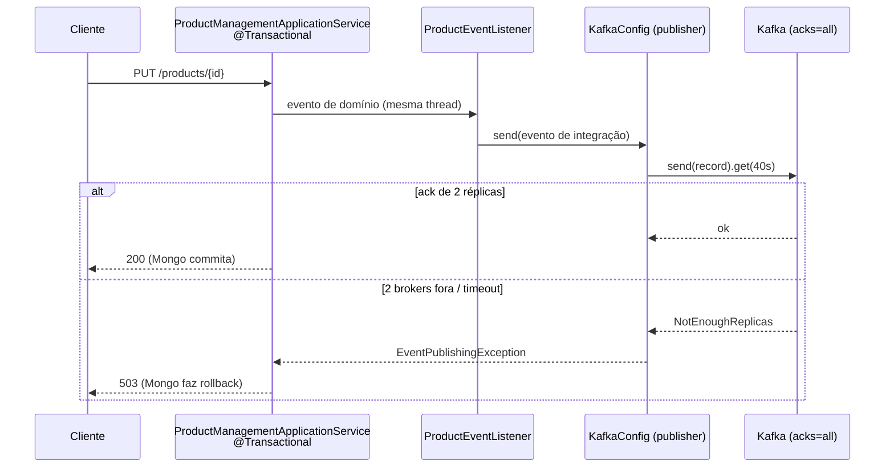

# Resiliência no producer

> **Em uma frase:** depois que o `send()` retorna, o produtor precisa poder afirmar algo de verdade ("o evento está gravado em duas réplicas") ou falhar alto, e não fingir que deu certo.

⬅️ Anterior: [Contratos com AsyncAPI](./05-contratos-asyncapi.md) · ➡️ Próximo: [Resiliência no consumer](./07-resiliencia-no-consumer.md) · 🧭 Trilha: [README](../README.md#trilha-de-leitura)

## O problema

Até aqui o catálogo publicava "com fé": `send()` assíncrono, nenhum ack exigido e a falha virando só uma linha de log. Imagine o preço de um produto mudando:

1. o Mongo grava o preço novo e commita;
2. o `send()` do evento falha em outra thread (broker fora);
3. o erro vira log, o request já respondeu 200.

Resultado: o banco diz uma coisa, o Kafka nunca soube, e o ordering continua com o preço velho no carrinho. É o **dual-write** (duas escritas, em dois sistemas, sem garantia de que as duas acontecem) na forma mais silenciosa.

## A ideia

Resiliência no produtor responde a uma pergunta: **o que posso afirmar depois que o `send()` retorna?** Quatro peças respondem juntas:

1. **`acks`**: quanto o broker precisa confirmar antes de dizer "recebi".
2. **Idempotência do producer**: retry de rede não pode duplicar mensagem no log.
3. **Cadeia de timeouts**: cada espera menor que a de fora, para a falha chegar a tempo de ser tratada.
4. **Falha na thread certa**: o erro tem de aparecer onde ainda dá para desfazer a escrita no banco.

### `acks`: o que o broker promete

| `acks` | O produtor considera enviado quando... | O que pode se perder |
|---|---|---|
| `0` | escreveu no socket | tudo: nem sabe se o broker existe |
| `1` | o **líder** gravou no log dele | se o líder cair antes de replicar, a mensagem some |
| `all` | as réplicas em sincronia (`min.insync.replicas`) confirmaram | nada; paga-se em latência |

O AlgaShop usa `acks=all` com os tópicos em 3 réplicas e `min.insync.replicas=2`: o ack só vem quando **duas cópias** existem. A conta com o cluster de 3 brokers:

- **1 broker fora**: ainda há 2 réplicas em sincronia, publica normalmente;
- **2 brokers fora**: `NotEnoughReplicasException`. O produtor não consegue afirmar durabilidade e **falha alto**, que é o comportamento desejado.

### Idempotência de transporte

`enable.idempotence=true` (default desde o Kafka 3.0) faz o broker deduplicar os reenvios do próprio producer (producer id + número de sequência). Retry interno deixa de significar mensagem duplicada no log. Atenção à direção: é a idempotência que **exige** `acks=all`, e não o contrário.

Isso **não** é a idempotência de negócio do consumidor ([próximo doc](./07-resiliencia-no-consumer.md)): esta protege contra retry de rede; aquela, contra a mesma mensagem entregue duas vezes.

### A cadeia de timeouts

```
max.block.ms (5s)            o send() esperando metadados, antes de existir future
  ⊂ request.timeout.ms (5s)    UMA ida ao broker
  ⊂ delivery.timeout.ms (30s)  o teto real: envio + retries internos + ack
    ⊂ get(40s)                 rede de segurança acima do teto do producer
      ⊂ response-timeout do gateway (60s)   o cliente ainda não desistiu
```

Cada camada é maior que a de dentro. O producer desiste aos 30s, o `get(40s)` devolve a falha **antes** de o gateway estourar aos 60s, e dá tempo de responder **503** em vez de o cliente receber um 504 com a transação pendurada. `retries` fica no default: com idempotência ligada, quem limita é o `delivery.timeout.ms`.

## Como funciona no AlgaShop

No módulo de resiliência, o catálogo amarrou a publicação à transação do Mongo: **transação estendida**. O commit passa a esperar o ack do Kafka.



Três mudanças juntas tornaram isso verdade, nenhuma suficiente sozinha:

1. `@Transactional` em `create`/`update`/`disable`/`enable`;
2. o handler do evento rodando **na mesma thread** (sem `@Async`);
3. o `get()` bloqueante, que traz a falha para a thread transacional:

```java
result = kafkaTemplate.send(record).get(40, TimeUnit.SECONDS);
// ...
} catch (TimeoutException | ExecutionException | KafkaException e) {
    throw new EventPublishingException("Failed to publish", event, e);
}
```

A `EventPublishingException` carrega a **causa** (o erro do broker) e o `ApiExceptionHandler` a traduz em `503 Service Unavailable`.

O que se compra: nunca commitar sem evento publicado. O que se paga: a latência do broker dentro do request (até ~35s com a sessão Mongo aberta) e a **janela inversa**: um ack que se perde no timeout deixa o evento **entregue** com a transação **abortada**. Isso **não é outbox**: é prevenção, não compensação.

### Como ficou depois

No [workflow coreografado](./09-workflow-coreografado.md) o catálogo trocou de estratégia: os handlers do `ProductEventListener` passaram a `@TransactionalEventListener` (fase `AFTER_COMMIT`) com `@Async`, para nunca publicar o "evento fantasma" de uma escrita que voltou atrás. O `get(40s)` e o `acks=all` continuam; o que muda é **quando** se publica. Hoje o projeto tem três desenhos convivendo:

| Estratégia | Onde | Garante | Não garante |
|---|---|---|---|
| Transação estendida | catálogo, no módulo de resiliência | não commita sem ack | janela inversa (evento sem commit) |
| After-commit | catálogo e billing, hoje | nunca há evento de algo não commitado | que o evento saia (commit feito + Kafka fora = evento perdido) |
| Outbox | ordering | banco e mensagem commitam juntos | latência baixa |

A outbox é o assunto do [doc 08](./08-outbox.md).

### O cluster com uma porta por nó

Para observar a queda de brokers, cada nó ganhou portas próprias, com mapeamento 1:1 no host:

| Nó | PLAINTEXT | CONTROLLER | EXTERNAL (host) |
|---|---|---|---|
| kafka-1 | 9081 | 9191 | 9092 |
| kafka-2 | 9082 | 9192 | 9093 |
| kafka-3 | 9083 | 9193 | 9094 |

O ganho é de diagnóstico: um `9082` no log de reconexão só pode ser o nó 2.

### A `idempotency-key`: a ponta produtora

Todo evento nasce com um `idempotencyKey` (UUIDv7) que viaja **só no header** `idempotency-key`; `@JsonIgnore` o mantém fora do payload, porque é metadado de entrega, não fato do domínio. O consumidor usa essa chave na guarda de idempotência.

## Como aplicar

1. Crie os tópicos com **3 réplicas** e `min.insync.replicas=2`.
2. Configure o producer com `acks: all` e `enable.idempotence: true`.
3. Monte a **cadeia de timeouts** de dentro para fora: `max.block.ms` e `request.timeout.ms` curtos, `delivery.timeout.ms` como teto, `get()` acima dele, timeout do gateway acima de tudo.
4. Publique com **`send().get(timeout)`** quando a falha precisar ser tratada na thread do request.
5. Embrulhe a falha numa exceção própria (`EventPublishingException`) **passando a causa** ao `super`.
6. Traduza essa exceção em **503** na borda.
7. Escolha conscientemente **quando** publicar: dentro da transação, depois do commit ou via outbox. Cada um fecha uma janela e abre outra.
8. Gere a chave de idempotência no produtor e envie-a em header.

## Para lembrar

- `acks=all` + `min.insync.replicas=2` em 3 réplicas: aguenta 1 broker fora; com 2 fora, falha alto.
- `enable.idempotence` exige `acks=all`, não o contrário.
- Idempotência do producer é de **transporte**; a do consumidor é de **negócio**.
- Cada timeout é maior que o de dentro, para a falha chegar antes do cliente desistir.
- `whenComplete` entrega a falha em outra thread; `get()` traz para a thread que pode desfazer.
- Transação estendida não é outbox: fecha "commit sem evento", mas abre "evento sem commit".
- A chave de idempotência viaja no header, fora do payload.

## Cuidados

- **Exceção que engole a causa.** Sem `super(message, cause)`, o log mostra só o embrulho e perde o erro do broker, justamente o dado que se quer ao derrubar brokers.
- **Existem duas `KafkaException`.** A do Spring (`org.springframework.kafka`) e a do Apache (`org.apache.kafka.common`), que o `send` pode lançar de forma síncrona (ex.: falha de serialização). Pegar só uma deixa a outra escapar como 500 genérico.
- **Comentário × número.** Se o comentário diz uma relação entre timeouts e o código tem outra, um dos dois mente; acerte os dois juntos.
- **`connect-timeout` não acompanha o `response-timeout`.** Abrir TCP leva milissegundos; subir o connect para 60s prende thread por um minuto num serviço morto. Veja [resiliência no gateway](../04-infraestrutura/11-resiliencia-no-gateway.md).
- **`@Builder` do Lombok ignora inicializador de campo.** Sem `@Builder.Default`, o evento sai com a chave nula e o header some em silêncio.
- **Transação Mongo tem prazo.** ~35s de sessão aberta contra o `transactionLifetimeLimitSeconds` de 60s: a folga existe, mas é finita.

## Onde ver no código

- `KafkaConfig` (product-catalog): tópicos, publisher com `send().get(40s)`, tradução para `EventPublishingException`.
- `application-development-env.yml` (product-catalog): `acks`, `enable.idempotence` e a cadeia de timeouts, comentados.
- `EventPublishingException` (product-catalog): a exceção de publicação, com a causa.
- `ApiExceptionHandler` (product-catalog): `EventPublishingException` vira 503.
- `ProductEventListener` (product-catalog): converte evento de domínio em evento de integração e publica.
- `ProductManagementApplicationService` (product-catalog): os métodos `@Transactional` que publicam.
- Eventos de integração do catálogo (ex.: `ProductAddedIntegrationEvent`): `idempotencyKey` com `@Builder.Default`.
- `docker-compose.tools.yml` (meta): o cluster com portas únicas por nó.
