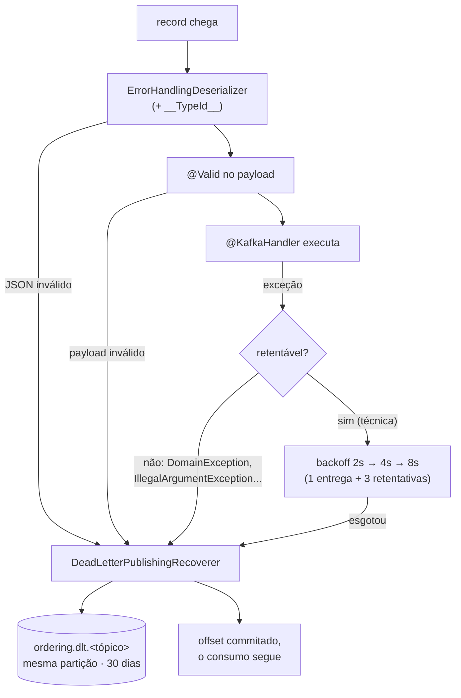

# Resiliência no consumer

> **Em uma frase:** o consumidor precisa de duas garantias: **não perder** a mensagem que falhou (retry com backoff e, no limite, Dead Letter Topic) e **não repetir** o efeito de uma mensagem entregue duas vezes (idempotência).

⬅️ Anterior: [Resiliência no producer](./06-resiliencia-no-producer.md) · ➡️ Próximo: [Outbox](./08-outbox.md) · 🧭 Trilha: [README](../README.md#trilha-de-leitura)

## O problema

O default do spring-kafka, descoberto no [doc 04](./04-ecst-e-validacao-de-eventos.md), é perigoso: exceção no handler gera **10 tentativas sem intervalo** e depois **descarte silencioso**, com o offset commitado. Se o banco do ordering cair por 5 segundos enquanto chega um `ProductPriceChangedV2`, o evento se perde para sempre e o carrinho fica com o preço antigo.

E existe o problema oposto. O Kafka entrega **pelo menos uma vez** (at-least-once): num rebalance ou reprocessamento, o mesmo evento chega duas vezes ao handler. Se o efeito não for idempotente (um e-mail, a criação de um pedido), ele acontece duas vezes.

## A ideia

Duas defesas, uma para cada problema:

1. **Não perder**: separar o erro que vale retentar do que não vale.
   - Falha **técnica** (banco fora, timeout): o mundo pode melhorar em alguns segundos. Retenta com **backoff exponencial**.
   - Falha de **regra** ou de **formato** (`DomainException`, `IllegalArgumentException`, payload inválido): esperar não muda nada. Vai **direto** para o DLT.
   - Esgotou as retentativas: a mensagem vai para um **Dead Letter Topic** (o "hospital de mensagens"), com headers contando de onde veio e por que falhou, e o consumo segue.
2. **Não repetir**: antes de aplicar o efeito, gravar "já processei esta chave" **na mesma transação** do efeito. A unicidade do banco (uma PK) decide quem passa.

## Como funciona no AlgaShop



### Desserializador e error handler trabalham juntos

- O **`ErrorHandlingDeserializer`** embrulha o `JacksonJsonDeserializer`. Se o JSON estiver podre, ele **não derruba o consumidor**: captura a falha e a entrega ao error handler. Sem ele, a mensagem ruim (*poison pill*) faria o container reiniciar, reler o mesmo offset e morrer de novo, para sempre.
- O **`DefaultErrorHandler`** recebe essa falha como qualquer outra. Erro de desserialização não melhora com o tempo, então não é retentado e vai direto para o DLT pelo recoverer.
- O `@Valid` no `@Payload` só funciona porque o `KafkaBeanValidationConfigurer` registra um `Validator` no listener; payload inválido vira erro não-retentável (`ConstraintViolationException` está na lista).

### O error handler

```java
ExponentialBackOff backOff = new ExponentialBackOff(2000L, 2);
backOff.setMaxAttempts(3);          // 3 RETENTATIVAS = 4 entregas (2s/4s/8s)
backOff.setMaxInterval(8_000L);

DefaultErrorHandler handler = new DefaultErrorHandler(recoverer, backOff);
handler.addNotRetryableExceptions(
        DomainException.class, DomainEntityNotFoundException.class,
        ConstraintViolationException.class, DataIntegrityViolationException.class,
        IllegalArgumentException.class, SagaTransitionException.class);
```

### O DLT com a mesma partição

O recoverer publica em `ordering.dlt.<tópico original>` **na mesma partição** do record original:

```java
(record, ex) -> new TopicPartition(DLT_PREFIX + record.topic(), record.partition())
```

Assim a ordem por key sobrevive dentro do DLT. Por isso o DLT é criado com as **mesmas 3 partições** do original (a auto-criação do broker não garante isso), com retenção de 30 dias. `setFailIfSendResultIsError(false)`: se até o envio ao DLT falhar, loga e segue; a última linha de defesa não pode virar loop. Catálogo (`product-catalog.dlt.`) e billing (`billing.dlt.`) seguem o mesmo desenho.

### Idempotência: uma PK como mecanismo

A porta é uma linha só:

```java
boolean runOnce(UUID idempotencyKey, Runnable work);
```

A implementação é deliberadamente simples:

```
transação {
    INSERT processed_message(idempotency_key)   ← saveAndFlush: a PK estoura AQUI
    work.run()                                   ← o efeito, NA MESMA transação
}   ← um commit: marca + efeito juntos
```

- Chave nova: o INSERT passa, o efeito roda, um commit grava os dois.
- Chave repetida: violação de PK, rollback, retorna `false`. Nada executou.

Não há `SELECT` antes: a **unicidade do banco** é o mecanismo, imune a corrida entre threads e instâncias. A chave chega no header `idempotency-key`. Se o header faltar, o handler processa **sem a guarda**, com um aviso no log.

**O que fica sem guarda, de propósito:** `Listed`/`Delisted`/`Restocked`/`SoldOut` só trocam um boolean; repetir grava o mesmo valor. Guarda-se o que tem efeito **não idempotente**.

### A limpeza da tabela

`processed_message` cresceria para sempre. O `ProcessedMessageCleaner` roda a cada 10 minutos e apaga o que tem mais de **10 dias** (mais que a retenção dos tópicos), em lotes de 200, no máximo 20 lotes por execução, cada lote numa transação curta, usando o índice de `processed_at`.

Só uma instância limpa por vez, graças ao **ShedLock** (`@SchedulerLock`, com `usingDbTime()`). Compare com o `SKIP LOCKED` do [billing](../04-infraestrutura/04-scheduled-jobs.md):

| Ferramenta | O que faz | Quando usar |
|---|---|---|
| `SKIP LOCKED` | instâncias **dividem** o trabalho (cada uma pega linhas diferentes) | trabalho paralelizável por linha |
| ShedLock | uma instância **exclui** as outras (o job roda inteiro em um lugar só) | job que precisa rodar uma vez só |

### Paralelismo

`concurrency = "3"` cria 3 threads de consumo, uma por partição: é o teto útil (uma 4ª thread ficaria ociosa). Cada listener tem `id` próprio (ex.: `ordering.product-events`), que vira o `group.id`: cada listener é um grupo com offsets próprios.

## Como aplicar

1. Use `ErrorHandlingDeserializer` em volta do desserializador JSON.
2. Registre um `Validator` no `KafkaListenerEndpointRegistrar` e use `@Payload @Valid`.
3. Declare um `DefaultErrorHandler` com `ExponentialBackOff` (conte **entregas**: 1 + retentativas).
4. Liste as exceções **não-retentáveis** (regra de negócio, payload inválido, argumento ilegal).
5. Configure um `DeadLetterPublishingRecoverer` que preserve a **partição**, e crie os tópicos DLT com as mesmas partições e uma retenção longa.
6. Envie uma `idempotency-key` no header (produtor) e guarde os efeitos não idempotentes com `runOnce` (INSERT-first na mesma transação).
7. Crie a limpeza da tabela de chaves com índice, lotes curtos e ShedLock.
8. Ajuste `concurrency` ao número de partições.

## Para lembrar

- At-least-once é o normal: o consumidor **vai** receber duplicatas.
- Retenta erro técnico; erro de regra ou de formato vai direto ao DLT.
- `setMaxAttempts(3)` são 3 retentativas, ou seja, **4 entregas**.
- O `ErrorHandlingDeserializer` transforma o *poison pill* em erro tratável, e o error handler o leva ao DLT.
- DLT na **mesma partição** preserva a ordem por key.
- Idempotência: marcar **antes**, na **mesma transação**, deixando a PK decidir.
- ShedLock exclui; `SKIP LOCKED` divide.

## Cuidados

- **Semântica de retry engana.** "3 tentativas" no comentário eram 3 retentativas; conte entregas, não tentativas.
- **`@Header` obrigatório é bomba de binding.** Sem `required = false`, mensagem sem o header falha antes do handler e vai ao DLT por um metadado.
- **Marcar depois do efeito abre janela.** Efeito commitado e marca perdida no crash = reprocessa na reentrega.
- **DLT só faz sentido onde há consumo.** Criar DLT de um tópico que o serviço só produz é simetria, não necessidade.
- **Recoverer com serializer JSON.** Em falha de desserialização, o ideal seria republicar os bytes crus (template de `byte[]`).
- **DLT sem dono.** 30 dias de retenção não adiantam se ninguém olha, alerta ou reprocessa.
- **Tunings de laboratório.** `max.poll.records: 1` e `logging.level org.apache.kafka: OFF` ajudam a estudar, mas escondem justamente os logs de retry e rebalance; não leve para produção.

## Onde ver no código

- `KafkaConfig` (ordering): DLTs, `DeadLetterPublishingRecoverer` e `DefaultErrorHandler`.
- `KafkaBeanValidationConfigurer` (ordering): registra o `Validator` que faz o `@Valid` funcionar.
- `KafkaProductIntegrationEventListener` (ordering): `concurrency`, `id` do grupo, handler com `runOnce` e fallback sem header.
- `ForGuardingIdempotency` / `ForGuardingIdempotencyJpaImpl` (ordering): a porta e o INSERT-first.
- `ProcessedMessage` e `ProcessedMessageCleaner` (ordering): a tabela de chaves e a limpeza com ShedLock.
- `SchedulingConfig` (ordering): ShedLock com `usingDbTime()`.
- Migrações V006–V008 (ordering): `processed_message`, o índice de `processed_at` e a tabela do ShedLock.
- `KafkaConfig` (product-catalog e billing): o mesmo desenho de error handler e DLT.
