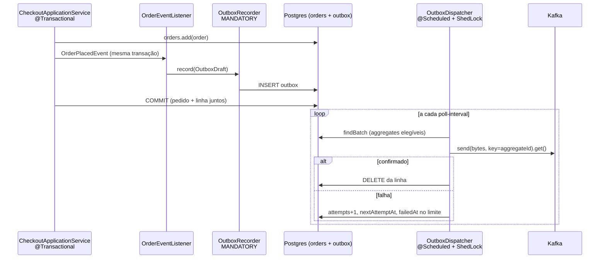

# Outbox

> **Em uma frase:** em vez de gravar no banco **e** publicar no Kafka (duas escritas que podem divergir), o serviço grava só no banco, na mesma transação, uma linha "a enviar"; um processo separado lê essas linhas e as publica.

⬅️ Anterior: [Resiliência no consumer](./07-resiliencia-no-consumer.md) · ➡️ Próximo: [Workflow coreografado](./09-workflow-coreografado.md) · 🧭 Trilha: [README](../README.md#trilha-de-leitura)

## O problema

No checkout, o ordering precisa fazer duas coisas: gravar o pedido no Postgres e publicar o `OrderPlacedIntegrationEvent` no Kafka. São dois sistemas, sem transação comum. Qualquer ordem tem um buraco:

| Ordem | Se falhar no meio |
|---|---|
| Commit, depois `send()` | pedido existe, evento nunca sai (commit sem evento) |
| `send()`, depois commit | evento saiu, commit falhou (evento de um pedido que não existe) |

Esse é o **dual-write**. O [producer](./06-resiliencia-no-producer.md) mostrou duas tentativas de contorná-lo (transação estendida e after-commit), e cada uma fecha um lado e deixa o outro aberto.

## A ideia

A outbox mata o dual-write pela raiz: **o único write síncrono é no banco**.

1. Na transação de negócio, junto com o pedido, grava-se uma linha na tabela `outbox` com a mensagem já pronta (tópico, key, tipo, payload).
2. Pedido e mensagem commitam **juntos ou nenhum dos dois**.
3. Um **relay** (aqui, um *polling publisher*) lê a tabela de tempos em tempos, publica no Kafka e apaga a linha enviada.

Analogia: em vez de sair correndo para o correio a cada carta, você deixa a carta na caixa de saída da mesa. O carteiro passa, leva tudo, e se o correio estiver fechado ele tenta de novo depois. A carta nunca some, porque nunca saiu da mesa sem ser entregue.

O preço é a garantia **at-least-once**: se o relay publicar e cair antes de apagar a linha, ela é publicada de novo. Por isso o consumidor precisa ser **idempotente** ([doc 07](./07-resiliencia-no-consumer.md)).

## Como funciona no AlgaShop



### O lado transacional: `OutboxRecorder`

A anotação mais importante do pacote:

```java
@Transactional(propagation = Propagation.MANDATORY)
public void record(OutboxDraft draft) { ... }
```

`MANDATORY` não é "abra uma transação se precisar": é **exija uma transação existente**. Gravar outbox fora da transação de negócio é justamente o bug que o padrão elimina, e o código o torna impossível (`IllegalTransactionStateException` na hora).

O recorder serializa o payload com o **mesmo** `JacksonJsonSerializer` do caminho Kafka, extrai o `__TypeId__` lógico dos headers dessa serialização e grava tudo pronto. O dispatcher depois só transporta bytes.

O publisher entrega um `OutboxDraft` (parâmetro-objeto com builder): **ele diz o quê e para onde** (canal, agregado, payload); **o recorder decide o resto** (id da linha, tipo, JSON, estado de envio).

### A tabela

| Coluna | Para quê |
|---|---|
| `id` | UUIDv7: ordenável por tempo, define a ordem de envio e vira o header `idempotency-key` |
| `channel_name` | o tópico de destino |
| `aggregate_id` | a key do record (o id do pedido) |
| `message_type` | o `__TypeId__` lógico (ex.: `Ordering.OrderPlacedIntegrationEvent`) |
| `payload` | o JSON já serializado |
| `attempts`, `next_attempt_at`, `last_error`, `failed_at` | o estado de envio |
| `correlation_id`, `reply_topic` | só para comandos da saga (ver abaixo) |

### O lado assíncrono: `OutboxDispatcher`

A cada `poll-interval` (`PT1M`), **uma** instância (ShedLock, `lockAtMostFor = PT5M`) lê um lote e envia **em série**, na ordem do `id`, com key = `aggregateId` e envio síncrono (`get(send-timeout)`, template dedicado de `byte[]`).

- Enviou: `DELETE` da linha.
- Falhou: `attempts + 1`, `nextAttemptAt = agora + backoff`; ao atingir `max-attempts` (10), `failedAt` é preenchido e a mensagem passa a exigir **intervenção manual**.
- Cada desfecho em sua própria transação curta; o envio ao Kafka fica fora de transação de banco.

As guardas do ciclo:

- **Deadline do lote (`PT3M`) menor que o lock (`PT5M`)**: o ciclo acaba antes de o lock expirar, então outra instância nunca começa em cima de um ciclo vivo.
- **`blockedAggregates`**: a primeira falha de um aggregate bloqueia as mensagens seguintes **dele** no ciclo. A mensagem N+1 de um pedido nunca passa na frente da N que falhou; os outros pedidos continuam fluindo.
- **Filtro por aggregate no `findBatch`**: o aggregate com mensagem em backoff ou com `failedAt` fica **inteiro** de fora da consulta:

```sql
WHERE m.aggregateId NOT IN (
    SELECT b.aggregateId FROM OutboxMessage b
    WHERE b.failedAt IS NOT NULL OR b.nextAttemptAt > :now)
ORDER BY m.id
```

### Liga e desliga

Tudo é condicionado a propriedades: `algashop.messaging.outbox.enabled` (gravar na outbox) e `algashop.messaging.outbox.dispatcher.enabled` (enviar). Com a outbox desligada, entram os publishers diretos (`KafkaOrderIntegrationEventPublisher`).

### Como chegamos aqui: o checkout assíncrono (já removido)

A outbox nasceu junto com um **checkout assíncrono v2**: o `POST /api/v2/customers/me/orders` respondia `202 Accepted` com um `orderId`, gravava na outbox um comando `ProcessAcceptedCheckoutIntegrationCommand` e o próprio ordering o consumia em `ordering.order.commands` (padrão *Listen to Yourself*) para só então criar o pedido.

**Isso não existe mais.** No módulo de saga orquestrada o v2 foi removido: a saga precisa começar **na mesma transação que grava o pedido**, e esse momento só existe no checkout síncrono v1 (`201 Created`). Ficou a lição: padrão bom no lugar errado vira obstáculo. A outbox continuou, publicando todos os eventos do ordering. O detalhe está em [Saga orquestrada: preparando o terreno](./12-saga-orquestrada-preparando-o-terreno.md).

### Depois: a outbox também leva comandos

Na saga orquestrada, a outbox passou a transportar **comandos** (`Billing.IssueInvoiceIntegrationCommand`, `Stock.ReserveStockIntegrationCommand`...), ganhando `correlation_id` e `reply_topic`, que viram os headers `kafka_correlationId` e `kafka_replyTopic` ([doc 14](./14-saga-orquestrada-comandos-e-respostas.md)). Mais tarde os comandos ganharam também um caminho **sem outbox**, com envio direto quando `outbox.enabled=false` ([doc 16](./16-saga-orquestrada-robustez.md)).

## Como aplicar

1. Crie a tabela `outbox` (id ordenável, tópico, key, tipo, payload, estado de envio) por migração.
2. Escreva um **recorder** com `Propagation.MANDATORY`, que serializa o payload igual ao caminho Kafka e grava tipo e headers necessários.
3. Faça o publisher da porta de saída gravar pelo recorder, dentro da transação de negócio (um `@EventListener` comum, **não** after-commit).
4. Escreva o **relay**: `@Scheduled` + ShedLock, lote ordenado por id, envio síncrono, `DELETE` no sucesso e registro de falha com backoff.
5. Preserve a **ordem por aggregate**: bloqueie o aggregate na primeira falha e filtre-o na consulta.
6. Mantenha o deadline do lote **menor** que o tempo do lock.
7. Envie o **id da linha** como `idempotency-key` e faça o consumidor deduplicar.
8. Defina o destino das mensagens com `failedAt` (alerta, replay manual).

## Para lembrar

- Outbox = o único write síncrono é no banco; o broker vem depois.
- Pedido e mensagem commitam juntos ou nenhum.
- `MANDATORY` torna impossível gravar outbox fora da transação.
- O relay entrega **at-least-once**: o consumidor tem de ser idempotente.
- O id UUIDv7 da linha é, ao mesmo tempo, a ordem de envio e a chave de idempotência.
- A ordem é por aggregate: um pedido travado não trava os outros.
- Hoje o checkout é só síncrono (v1); o 202 assíncrono foi removido.

## Cuidados

- **Fila que não filtra a si mesma trava.** Sem o `WHERE` no `findBatch`, mensagens com `failedAt` (as mais antigas) ocupam o lote para sempre e nada novo sai: *starvation*.
- **Filtrar só a linha quebra a ordem.** O filtro certo é por aggregate; tirar só a linha deixa a N+1 passar na frente da N.
- **Duas fontes de `idempotency-key`.** Pela outbox, a chave é o id da linha; pelo caminho direto, é o campo do evento. Trocar de modo muda a identidade das mensagens.
- **Validação no caminho que roda.** O `BeanValidationUtil` dos publishers diretos não roda quando a outbox está ligada; valide também no recorder.
- **Latência é do polling.** Com `PT1M`, a mensagem pode levar até um minuto para sair.
- **Backoff fixo e curto.** 10 tentativas × 5s cobrem menos de um minuto de broker fora antes de `failedAt`, e não há replay automático.
- **Remover o bean `NewTopic` não apaga o tópico.** Ao tirar um tópico do código, confira também se a outbox não tem linhas pendentes para ele.

## Onde ver no código

- `OutboxRecorder` (ordering): grava a mensagem na transação de negócio, com `MANDATORY`.
- `OutboxDraft` (ordering): o rascunho que o publisher entrega ao recorder.
- `OutboxMessage` / `OutboxMessageRepository` (ordering): a linha da tabela e o `findBatch` filtrado por aggregate.
- `OutboxDispatcher` (ordering): o polling publisher com ShedLock, deadline, `blockedAggregates` e backoff.
- `OutboxKafkaSender` (ordering): envia os bytes e reconstrói os headers a partir das colunas.
- `OutboxOrderIntegrationEventPublisher` (ordering): o publisher de eventos de pedido pela outbox.
- `OutboxConfig` e `OutboxProperties` (ordering): serializer, template de `byte[]` e as propriedades.
- Migrações V009, V011 e V012 (ordering): a tabela, o rename para `message_type` e as colunas de comando.
