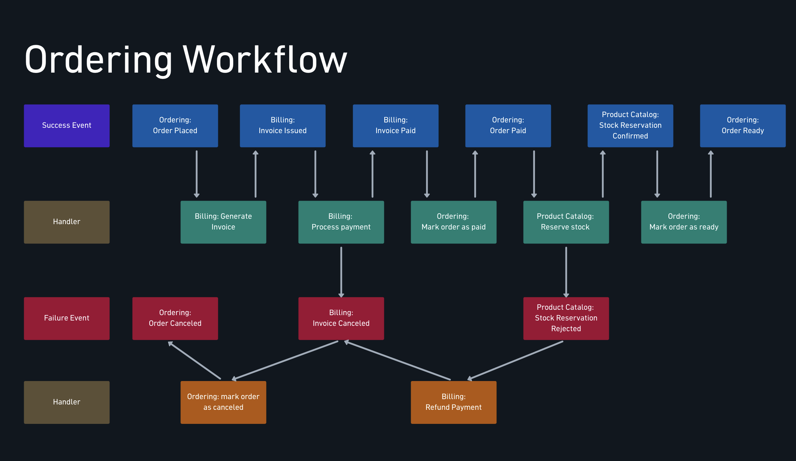
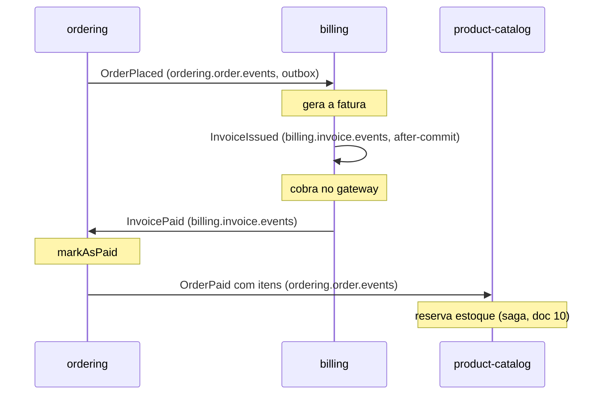

# Workflow coreografado

> **Em uma frase:** vários serviços completam um processo de negócio (pedido → fatura → pagamento → pedido pago) sem ninguém no comando: cada um escuta o fato anterior, faz a sua parte e anuncia o próximo.

⬅️ Anterior: [Outbox](./08-outbox.md) · ➡️ Próximo: [Saga coreografada](./10-saga-coreografada.md) · 🧭 Trilha: [README](../README.md#trilha-de-leitura)

> **Nota histórica:** essa corrente de eventos foi depois **removida do código**, junto com a saga coreografada, para dar lugar à saga orquestrada (ver [Saga orquestrada: preparando o terreno](./12-saga-orquestrada-preparando-o-terreno.md)). O doc continua valendo para entender o padrão, e várias peças daqui (after-commit, ECST, idempotência pela constraint, Listen to Yourself na cobrança) seguem no projeto.

## O problema

Até aqui os eventos Kafka eram **avisos isolados**: o catálogo avisava mudança de preço e quem quisesse reagia. Mas uma compra na AlgaShop é um **processo** que atravessa três serviços:

1. o ordering registra o pedido;
2. o billing emite a fatura e cobra o cartão;
3. o ordering marca o pedido como pago;
4. o catálogo reserva o estoque e o pedido fica pronto.

Como encadear esses passos sem que o ordering precise chamar o billing por HTTP, esperar a resposta, depois chamar o catálogo, e assim por diante?

## A ideia

**Event Collaboration**: os serviços colaboram trocando **fatos**, e não pedidos. Ninguém diz "billing, gere a fatura". O ordering diz "um pedido foi feito", e o billing, por conta própria, decide que isso é motivo para faturar.

É como uma linha de cozinha: quem frita não manda no garçom, só põe o prato no balcão; quem está de olho no balcão sabe o que fazer.

| | Request/Response | Event Collaboration |
|---|---|---|
| Quem decide o próximo passo | O chamador | O receptor |
| Acoplamento | O chamador conhece endereço e API do outro | O produtor conhece só o próprio tópico |
| Disponibilidade | O outro precisa estar de pé **agora** | O evento espera no tópico |
| Onde o fluxo está escrito | No código do chamador | Em lugar nenhum: emerge das assinaturas |

A última linha é o preço. "Onde parou o pedido 42?" deixa de ser uma consulta e vira uma investigação em vários serviços. Por isso **todo evento do fluxo leva o `orderId` no payload**: é ele que correlaciona as pontas.

Duas regras de desenho:

- **O evento descreve o que aconteceu, nunca o que o outro deve fazer.** `OrderPlaced`, e não `GenerateInvoice`. Um nome imperativo é um comando disfarçado, e o acoplamento volta pela porta dos fundos.
- **Cada serviço só publica fatos do próprio domínio.** O ordering fala de pedidos, o billing de faturas, o catálogo de estoque.

## Como funciona no AlgaShop



O mapa alterna **fato** (evento, em azul) e **reação** (handler, em verde): evento → handler → evento → handler. Não há outra regra. As faixas vermelha e laranja (falhas e compensações) são o assunto do [próximo doc](./10-saga-coreografada.md).



Os passos, um a um:

1. **Pedido realizado.** O `OrderPlacedIntegrationEvent` é gravado na outbox na mesma transação do pedido e sai em `ordering.order.events` com `key = orderId`. É **ECST**: leva itens, frete, cobrança e forma de pagamento congelados. Sem isso, o billing teria que chamar o ordering por HTTP para montar a fatura.
2. **Billing gera a fatura.** Um listener no grupo `billing.order-events` recebe o evento, um assembler traduz a língua do ordering para a do billing (anticorrupção: frete vira mais uma linha da fatura, nome + sobrenome viram `fullName`) e chama o **mesmo** `generate()` que a API REST já usava. O Kafka é só mais um adaptador de entrada.
3. **A fatura emitida sai do billing.** `Invoice.issue()` registra o evento de domínio; o `InvoiceEventListener`, com `@TransactionalEventListener` (after-commit), converte para `InvoiceIssuedIntegrationEvent` e publica.
4. **O billing cobra a própria fatura.** O billing consome o próprio `InvoiceIssued` (Listen to Yourself) e chama `processPayment`. Emitir (escrita local, rápida) e cobrar (HTTP externo, lento) viram duas transações com retry e DLT próprios.
5. **Pedido pago.** O pagamento confirma na hora (o `capture` já volta `PAID`) ou depois (webhook do FastPay). Os dois caminhos convergem para `Invoice.markAsPaid()` → `InvoicePaid`. O ordering (grupo `ordering.invoice-events`) marca o pedido como pago, e o `OrderEventListener` publica `OrderPaid` pela outbox, com os itens ordenados por id para o catálogo saber o que reservar.

Repare que `billing.invoice.events` tem **dois consumer groups** (`billing.invoice-events` e `ordering.invoice-events`): cada serviço lê tudo e ignora o que não é seu, graças ao `@KafkaHandler(isDefault = true)`.

### Correlação não é key

A **key** é o id do agregado de quem publica: `orderId` nos eventos do ordering, `invoiceId` nos do billing. Ela garante ordem por agregado dentro do tópico. A **correlação** é o `orderId` no payload. O ordering, ao receber `InvoicePaid`, usa `event.getOrderId()`, e não a key. Não existe ordem entre tópicos, e o workflow não precisa dela: cada passo só acontece porque o anterior o disparou.

### After-commit × outbox: os dois desenhos lado a lado

| Serviço | Estratégia | Garante | Não garante |
|---|---|---|---|
| ordering | **Outbox** (`@EventListener` dentro da tx + recorder `MANDATORY`) | Banco e evento commitam juntos | Latência baixa |
| billing, catálogo | **After-commit** (`@TransactionalEventListener`) | Nunca há evento de algo não commitado (sem "evento fantasma") | Que o evento saia |

No ordering, publicar **dentro** da transação é o objetivo, porque o destino é a tabela outbox. No billing, que publica direto no Kafka, publicar dentro da transação causaria o evento fantasma (Kafka anuncia uma fatura que deu rollback).

### Idempotência pela constraint

O Kafka entrega **pelo menos uma vez**. Duas faturas para o mesmo pedido seriam cobrança dupla. A defesa mais simples está no banco:

```sql
alter table public.invoice
    add constraint uk_invoice_order_id unique (order_id);
```

A segunda tentativa falha com `DataIntegrityViolationException`, a transação volta e, por ser não-retryable no `KafkaConfig`, a mensagem vai direto para o DLT. A fatura dupla não acontece.

## Como aplicar

1. **Desenhe o mapa antes do código**: fatos no passado, um handler por fato, e em que serviço cada um mora.
2. **Ponha o campo de correlação** (ex.: `orderId`) no payload de todo evento do fluxo.
3. **Carregue o estado necessário no evento** (ECST) para o próximo passo não precisar chamar o produtor de volta.
4. **Separe evento de domínio de evento de integração**: o de integração é contrato público (Bean Validation, `__TypeId__` lógico, versionamento).
5. **Escolha como publicar**: outbox se não pode perder evento; no mínimo after-commit para nunca anunciar o que não foi gravado.
6. **No consumidor**: handler tipado para o que interessa + `@KafkaHandler(isDefault = true)` que loga e ignora o resto; type mapping só das classes que você usa.
7. **Proteja contra duplicata** com uma constraint de unicidade no dado que o passo cria.
8. **Separe passos de risco diferente** (escrita local × chamada externa) com um tópico no meio (Listen to Yourself).
9. **Documente o fluxo no contrato AsyncAPI** de cada serviço: na coreografia, é o único lugar onde ele fica escrito.

## Para lembrar

- Coreografia = ninguém comanda; o fluxo emerge das assinaturas de tópico.
- Evento é fato no passado do próprio domínio, nunca uma ordem para outro serviço.
- `orderId` no payload correlaciona; a key é o id do agregado do produtor.
- ECST evita chamadas de volta: `OrderPlaced` leva o snapshot, `OrderPaid` leva os itens.
- After-commit evita o evento fantasma; só a outbox evita o evento perdido.
- Handler default que ignora tipos desconhecidos: evento novo do produtor não é erro do consumidor.
- Constraint `UNIQUE` é a idempotência mais barata.

## Cuidados

- **After-commit pode perder o evento.** O Spring só loga exceções lançadas após o commit; com o Kafka fora, a fatura existe e ninguém cobra. A coreografia trava em silêncio.
- **Reentrega pode cobrar de novo.** Se o passo chama um gateway antes de checar o estado (ex.: fatura já paga), retry e duplicata repetem a cobrança. A guarda vem **antes** da chamada externa.
- **Duplicata indo para o DLT** mistura falha real com "já processei". O ideal é tratar "já está no estado alvo" como sucesso idempotente.
- **`isAuthenticated()` não quer dizer "tem usuário".** Webhook `permitAll` chega com `AnonymousAuthenticationToken`; auditoria precisa tratar anônimo, máquina e pessoa (ver [Recursos /me e IDOR](../05-seguranca/12-recursos-me-e-idor.md)).
- **"Onde parou o pedido X?"** não tem resposta sem abrir os logs de vários serviços. Esse é o preço da coreografia.

## Onde ver no código

- `OrderEventListener` (ordering) — traduz eventos de domínio do pedido em eventos de integração e grava na outbox, dentro da transação.
- `OrderPaidIntegrationEventAssembler` (ordering) — monta o `OrderPaid` com os itens ordenados (ECST).
- `InvoiceEventListener` (billing) — publica os eventos de fatura com `@TransactionalEventListener` (after-commit).
- `KafkaInvoiceIntegrationEventPublisher` (billing) — adaptador que valida e envia ao `billing.invoice.events`.
- `KafkaInvoiceIntegrationEventListener` (billing) — consome o próprio `InvoiceIssued` e chama `processPayment`.
- `InvoiceManagementApplicationService` (billing) — `generate()` e `processPayment()`, os casos de uso que o fluxo aciona.
- `V0003__add-unique-constraint-invoice-order-id.sql` (billing) — a constraint de uma fatura por pedido.
- Contratos: [`billing.yml`](../asyncapi/billing.yml), [`ordering.yml`](../asyncapi/ordering.yml). Os consumidores da coreografia (`KafkaOrderIntegrationEventListener` do billing, `GenerateInvoiceInputAssembler`, o listener de faturas do ordering) já saíram do código.
