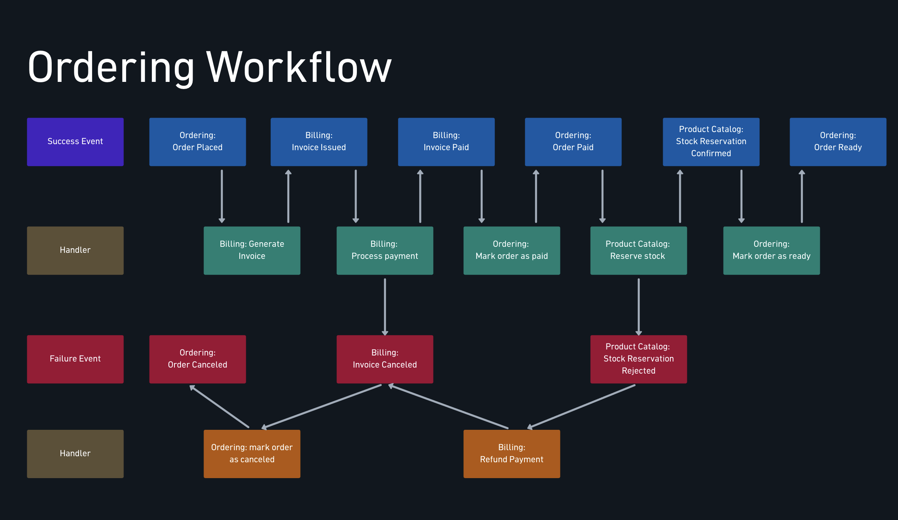
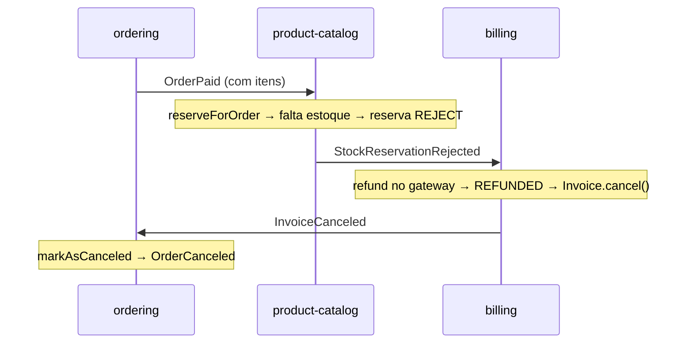

# Saga coreografada

> **Em uma frase:** quando um passo falha depois que outros serviços já commitaram, cada passo concluído é desfeito por um **passo contrário** (compensação), disparado por eventos, sem ninguém no comando.

⬅️ Anterior: [Workflow coreografado](./09-workflow-coreografado.md) · ➡️ Próximo: [Saga orquestrada: conceito e mapa](./11-saga-orquestrada-conceito-e-mapa.md) · 🧭 Trilha: [README](../README.md#trilha-de-leitura)

> **Nota histórica:** essa saga coreografada foi **substituída depois pela saga orquestrada**. Os consumidores que faziam o fluxo andar saíram dos três serviços (o porquê está em [Preparando o terreno](./12-saga-orquestrada-preparando-o-terreno.md)); ficaram as operações de trabalho (`generate`, `refundByOrderId`, `reserveForOrder`). Este doc ensina o padrão e conta a história que motivou a troca.

## O problema

O [workflow coreografado](./09-workflow-coreografado.md) cuidou do caminho feliz. Mas e se:

- o cartão for **recusado** depois que o pedido já foi registrado?
- o estoque **acabar** depois que o cliente já foi cobrado?

Num monólito seria um `rollback`. Aqui o pedido está no Postgres do ordering, a fatura no Postgres do billing e o estoque no MongoDB do catálogo: três bancos, três donos. O two-phase commit exigiria que os três segurassem locks esperando um coordenador; qualquer um fora do ar travaria os outros.

## A ideia

**Saga**: uma sequência de transações locais, cada uma commitando sozinha e na hora, mais as **compensações** que desfazem os passos já feitos quando um posterior falha.

**Compensação não é rollback.** Rollback apaga a história; compensação é um fato novo que anula o efeito do anterior, e os dois ficam registrados:

| Passo commitado | Compensação | O que fica na história |
|---|---|---|
| Pedido `PLACED` | Pedido `CANCELED` | O pedido existiu e foi cancelado |
| Pagamento capturado | Estorno (`REFUNDED`) | O cliente foi cobrado e reembolsado |
| Estoque baixado | Entrada de estoque | Dois movimentos registrados |

Por isso a compensação é **semântica**: só o dono do dado sabe desfazer o próprio passo (estornar é uma operação do gateway, não um `DELETE`).

### Os três tipos de passo

| Tipo | O que é | Na saga coreografada |
|---|---|---|
| **Compensável** | Pode ser desfeito por outro passo | Pedido realizado, fatura emitida |
| **Pivô** | Ponto de não retorno | A cobrança no gateway |
| **Reexecutável** | Depois do pivô, tem que dar certo (só retry) | Marcar o pedido como pronto |

A reserva de estoque ficou **depois** do pivô e **pode falhar**. Por isso existe o estorno: a saga anda para trás e compensa o pivô. (Reservar antes de cobrar evitaria estornos; o curso manteve depois, e o custo é o `Refund Payment`.)

### O que a saga não garante: isolamento

Os estados intermediários são **visíveis**. Entre "pago" e "estoque rejeitado", o cliente vê o pedido `PAID` e depois `CANCELED`. As contramedidas são de desenho: estados explícitos (`PAID` não quer dizer "vai chegar"; só `READY` quer), ordenar passos pelo risco e compensações idempotentes.

## Como funciona no AlgaShop

A saga mora nas faixas de baixo do mapa: **vermelho** (fato de falha: `Invoice Canceled`, `Stock Reservation Rejected`) e **laranja** (handler que compensa: `mark order as canceled`, `Refund Payment`).

| Passo | Transação local | Serviço | Se um passo posterior falhar |
|---|---|---|---|
| 1 | Pedido realizado | ordering | Cancelar o pedido |
| 2 | Fatura emitida | billing | Cancelar a fatura |
| 3 | **Pagamento capturado** (pivô) | billing | Estornar |
| 4 | Estoque reservado | catálogo | (a falha dispara as compensações) |
| 5 | Pedido pronto | ordering | Não compensa: só retry |

A falta de estoque atravessa os três serviços sem que nenhum conheça o fluxo inteiro:

As peças:

- **Cancelar o pedido pela fatura cancelada.** A fatura cancela por pagamento `FAILED` (recusado) ou `REFUNDED` (estornado), ambos em `Invoice.updatePaymentStatus`. O billing publica `InvoiceCanceled` after-commit; o ordering chama `markAsCanceled` e publica `OrderCanceled` pela outbox. Para isso a máquina de estados aceita `CANCELED(DRAFT, PLACED, PAID, READY)`: a compensação genérica pode chegar em qualquer ponto.
- **A reserva de estoque (`StockReservation`).** Agregado próprio no catálogo, separado do `Product`, que **registra o resultado** (não um processo): factories `confirmed` e `rejected`. A rejeição também é gravada, para ficar o rastro de por que o pedido foi cancelado. Índice único em `orderId` = um pedido, uma reserva.
- **A baixa "tudo ou nada" (`StockService.withdrawAll`).** Agrupa os itens por produto, valida todos antes (inexistente ou sem saldo recusa o pedido inteiro) e baixa um a um pelo ajuste atômico. A pré-validação não é garantia: quem garante é o `decrease()` condicional.
- **Falta de estoque é desfecho de negócio, não erro.** Em `reserveForOrder`, o `catch` de `InsufficientStockException`/`ProductNotFoundException` grava a reserva `REJECT` com sucesso; a mensagem não vai para retry nem DLT.
- **O estorno como compensação do pivô.** O billing reage à rejeição com `refundByOrderId`: estorna no gateway e chama `updatePaymentStatus(REFUNDED)`, que cancela a fatura. **O cancelamento do pedido não é código novo**: é a cadeia da fatura cancelada sendo reaproveitada.
- **Uma compensação, um dono.** O ordering **não** reagia à rejeição de estoque. Se reagisse, haveria duas fontes de cancelamento e um pedido cancelado com o dinheiro ainda capturado.

### Opinião sobre saga com coreografia

**O que ela entregou:**
- Passo novo = assinante novo. O catálogo entrou sem o ordering mudar uma linha.
- Compensações que se reaproveitam: o estorno cancela o pedido pela cadeia que já existia.
- Sem ponto central: o evento espera no tópico.

**O que ela cobrou:**
- O fluxo não está escrito em lugar nenhum: entender um cancelamento é seguir quatro eventos em três serviços.
- Infraestrutura de consumidor copiada em três serviços (resolver de tipo, deserializer, error handler, DLT).
- A garantia é a do elo mais fraco: billing e catálogo publicavam after-commit; uma compensação perdida não dá erro em lugar nenhum.
- Ninguém sabe se a saga terminou. Se um evento se perde, a saga não falha, ela **só para**.

Conclusão: coreografia é ótima para fluxos curtos e lineares. Com cinco passos e duas compensações, a AlgaShop já estava no limite, e o passo seguinte foi a [saga orquestrada](./11-saga-orquestrada-conceito-e-mapa.md).

## Como aplicar

1. **Liste os passos** como transações locais e marque cada um: compensável, pivô ou reexecutável.
2. **Para cada compensável, defina a compensação semântica** e quem é o dono dela (o serviço dono do dado).
3. **Ordene pelo risco**: o que mais falha vai antes do pivô sempre que possível.
4. **Desenhe a máquina de estados junto com a saga**: o estado compensado precisa ser alcançável de todo ponto onde a compensação pode chegar.
5. **Transforme falha de negócio em fato gravado** (ex.: reserva `REJECT`), não em exceção que vai para o DLT.
6. **Reaproveite cadeias existentes** em vez de criar "cancelar pedido por motivo X".
7. **Garanta uma compensação por dono**: um único serviço reage a cada fato de falha.
8. **Torne as compensações idempotentes**, com a guarda **antes** de qualquer chamada externa.
9. **Publique com garantia** (outbox): uma compensação perdida é silenciosa.

## Para lembrar

- Saga = transações locais + compensações; consistência eventual, sem 2PC.
- Compensação é um fato novo, não um rollback.
- O pivô é o ponto de não retorno; passos depois dele que podem falhar obrigam a compensá-lo.
- A saga não tem isolamento: estados intermediários são visíveis.
- Falta de estoque é desfecho de negócio, gravado como fato.
- Cada compensação tem um único dono.
- Coreografia: barata para começar, difícil de enxergar e de acompanhar.

## Cuidados

- **Agregado com `AbstractAggregateRoot` só publica eventos no `save()`.** Mudar o estado e confiar no dirty checking grava o dado, mas o evento nunca sai, e a compensação seguinte não acontece.
- **Chamada HTTP dentro da transação** prende a conexão do banco e, se o commit falhar depois, repete o efeito externo. Carregar (tx) → chamar (sem tx) → gravar (tx).
- **Estorno sem guarda** estorna duas vezes numa duplicata: cheque o estado antes de chamar o gateway.
- **Exceção que atravessa um proxy transacional participante** marca a transação como rollback-only, mesmo capturada depois.
- **Todo caminho que cancela uma etapa deve passar pelo agregado.** Um `UPDATE` direto no banco (como o job de faturas vencidas) cancela sem publicar o evento.
- **Contrato e código precisam bater** (ex.: qual campo é a key do evento); contrato sem teste mente em silêncio.

## Onde ver no código

- `StockReservation` (product-catalog) — o registro da decisão de reserva, com índice único por `orderId`; hoje sem eventos de domínio.
- `StockService.withdrawAll` (product-catalog) — baixa "tudo ou nada" dos itens de um pedido.
- `StockManagementApplicationService.reserveForOrder` (product-catalog) — reserva com o `catch` que grava a rejeição.
- `InvoiceManagementApplicationService.refundByOrderId` (billing) — o estorno, a compensação do pivô.
- `PaymentGatewayService.refund` (billing) — a porta de estorno no gateway.
- `Invoice.updatePaymentStatus` (billing) — `FAILED`/`REFUNDED` cancelam a fatura.
- `OrderStatus` (ordering) — `CANCELED` alcançável de quase todo status.
- `StockMovementEventListener` (product-catalog) — traduz movimentos em `ProductSoldOut`/`Restocked` e invalida o cache do produto. Os listeners da coreografia (estoque e fatura no ordering, rejeição no billing, `OrderPaid` no catálogo) já foram removidos.
