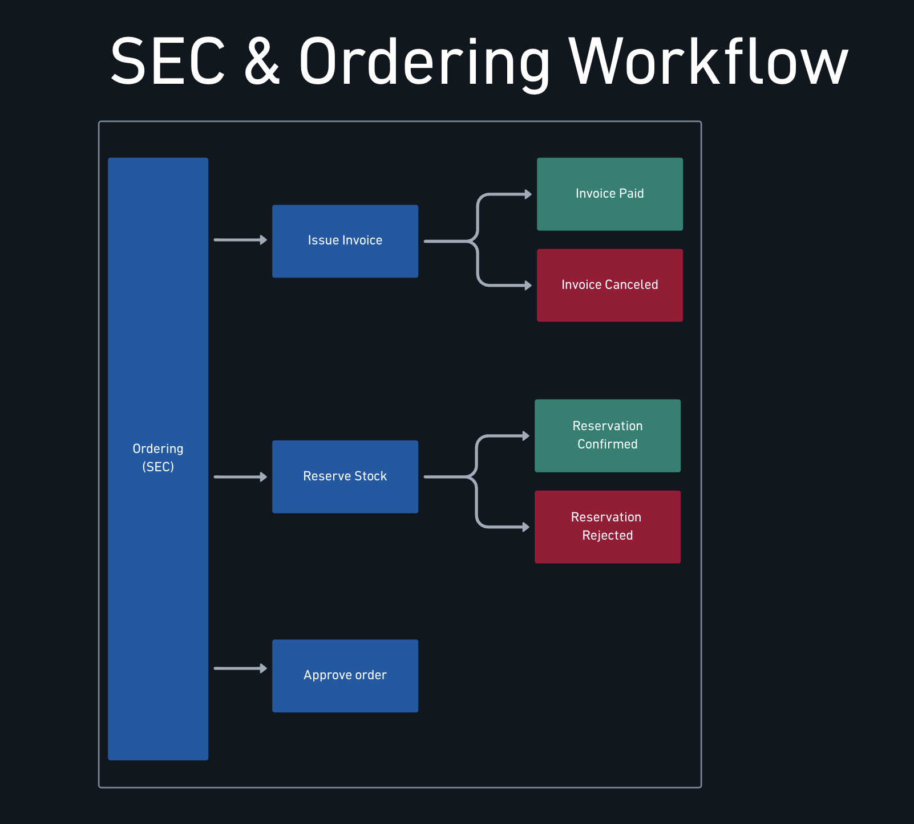
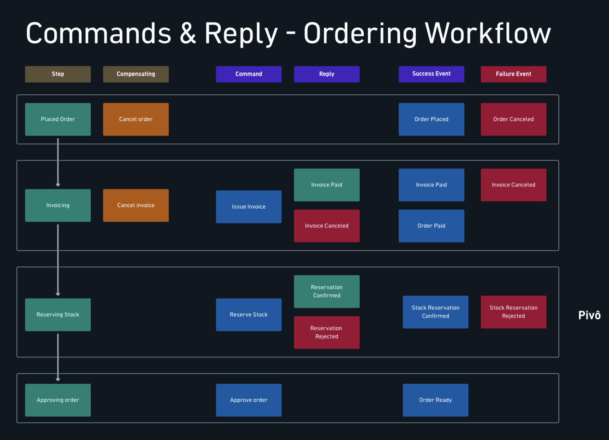
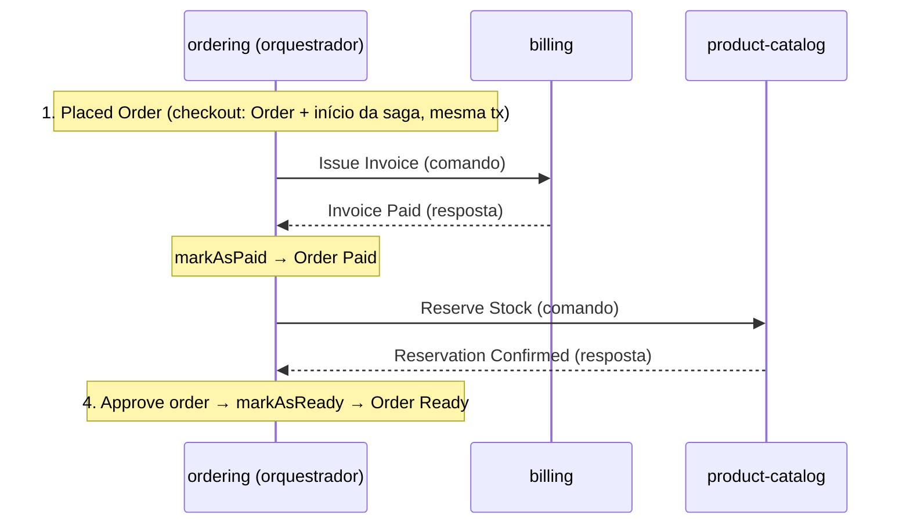
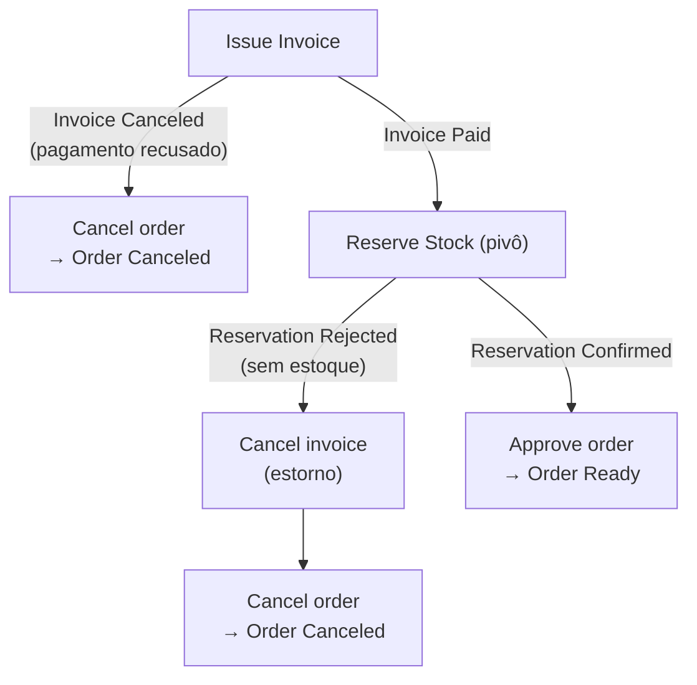

# Saga orquestrada: conceito e mapa

> **Em uma frase:** em vez de uma corrente em que cada serviço puxa o próximo, um **coordenador** (o ordering) conhece os passos, guarda em que ponto cada pedido está, manda **comandos** aos participantes e decide o que fazer com cada **resposta**.

⬅️ Anterior: [Saga coreografada](./10-saga-coreografada.md) · ➡️ Próximo: [Preparando o terreno](./12-saga-orquestrada-preparando-o-terreno.md) · 🧭 Trilha: [README](../README.md#trilha-de-leitura)

## O problema

A [saga coreografada](./10-saga-coreografada.md) terminou com um balanço honesto: funciona, mas o fluxo só existe no mapa. Para saber por que o pedido 42 foi cancelado, é preciso seguir `OrderPaid` → `StockReservationRejected` → `InvoiceCanceled` → `OrderCanceled` em três serviços. E quando um evento se perde, a saga não falha: ela **só para**, e ninguém percebe.

A pergunta que a coreografia não sabia responder é simples: **"em que passo está o pedido 42?"**

## A ideia

**Orquestração**: um lugar só (o *SEC*, Saga Execution Coordinator) que:

- conhece a sequência de passos;
- guarda o **estado da saga** de cada pedido;
- manda um **comando** a um participante ("emita a fatura") e espera a **resposta**;
- decide o próximo passo, ou as compensações, a partir da resposta.

É a diferença entre uma dança de salão (cada par reage ao vizinho) e uma orquestra (o maestro sabe a partitura inteira e dá a entrada de cada naipe).

Na AlgaShop, o coordenador é o **ordering**: ele é dono do pedido, que é o que a saga conduz.

## Como funciona no AlgaShop

O resumo mostra a mudança de forma: um coordenador manda três comandos (`Issue Invoice`, `Reserve Stock`, `Approve order`) e recebe uma resposta para cada um, sucesso (verde) ou falha (vermelho).

O detalhado é a tabela que guia o módulo. As colunas separam quatro coisas que na coreografia viviam misturadas num evento só:

| Coluna | O que é | Exemplo |
|---|---|---|
| **Step** / **Compensating** | O passo e o que o desfaz | `Invoicing` / `Cancel invoice` |
| **Command** | O pedido do orquestrador a um participante | `Issue Invoice` |
| **Reply** | A resposta endereçada ao orquestrador | `Invoice Paid` ou `Invoice Canceled` |
| **Success / Failure Event** | O fato que o serviço anuncia para quem quiser ouvir | `Order Paid`, `Invoice Canceled` |

Duas leituras para guardar:

- **Reply ≠ evento.** A resposta tem destinatário (o orquestrador) e faz a saga andar. O evento continua sendo um anúncio sem destinatário. Na coreografia, o mesmo `InvoicePaid` fazia os dois papéis.
- **O pivô mudou de lugar.** Na coreografia o pivô era a cobrança; aqui é **Reserving Stock**. Os passos antes dele têm compensação (`Cancel order`, `Cancel invoice`); o passo depois (`Approving order`) não tem, só precisa dar certo.

### O fluxo, passo a passo

| # | Passo | Comando | Respostas possíveis | Evento anunciado | Compensação |
|---|---|---|---|---|---|
| 1 | **Placed Order** | — (a saga nasce na transação do checkout) | — | `Order Placed` | `Cancel order` → `Order Canceled` |
| 2 | **Invoicing** | `Issue Invoice` → billing | `Invoice Paid` ou `Invoice Canceled` | `Invoice Paid`, `Order Paid` / `Invoice Canceled` | `Cancel invoice` |
| 3 | **Reserving Stock** (pivô) | `Reserve Stock` → catálogo | `Reservation Confirmed` ou `Reservation Rejected` | `Stock Reservation Confirmed` / `Rejected` | — (ponto de não retorno) |
| 4 | **Approving order** | `Approve order` → ordering | — | `Order Ready` | — (só precisa dar certo) |

O passo 1 não tem comando: ele **é** o checkout. Por isso a saga precisa nascer na mesma transação que grava o pedido, e foi por isso que o checkout assíncrono saiu (ver [Preparando o terreno](./12-saga-orquestrada-preparando-o-terreno.md)).

### Caminho feliz

### Caminhos de falha

- **Pagamento recusado** (`Invoice Canceled`): só o passo 1 precisa ser desfeito; o orquestrador cancela o pedido.
- **Estoque rejeitado** (`Reservation Rejected`): a saga anda para trás **na ordem inversa**: primeiro `Cancel invoice` (o estorno, pelo `refundByOrderId` do billing), depois `Cancel order`.

A diferença para a coreografia está em **quem encadeia as compensações**. Antes, a rejeição virava estorno no billing, o estorno virava `InvoiceCanceled` e o ordering reagia: três serviços, cada um sabendo só o seu pedaço. Agora o orquestrador **recebe** a rejeição e **decide** as duas compensações. A cadeia está escrita num lugar só.

### Coreografia × orquestração, no mesmo fluxo

| Pergunta | Coreografia (removida) | Orquestração |
|---|---|---|
| Quem decide o próximo passo? | Cada serviço, ao reagir ao evento anterior | O ordering, ao receber a resposta |
| Como o billing sabe que deve emitir a fatura? | Assina `OrderPlaced` | Recebe o comando `Issue Invoice` |
| Para quem vai o resultado? | Para quem quiser ouvir (evento) | Para o orquestrador (reply) e, se fizer sentido, um evento para o resto |
| Onde fica "em que passo está o pedido 42"? | Em lugar nenhum | No estado da saga, no ordering |
| Quem desfaz o quê na falha? | Emerge da cadeia de eventos | O orquestrador manda as compensações |
| Qual é o pivô? | A cobrança | A reserva de estoque |

## Como aplicar

1. **Escolha o coordenador**: em geral, o serviço dono da entidade que a saga conduz (aqui, o pedido).
2. **Monte a tabela do mapa detalhado**: para cada passo, comando, respostas possíveis, eventos anunciados e compensação.
3. **Marque o pivô** e confira: tudo antes dele tem compensação; tudo depois só precisa dar certo.
4. **Separe resposta de evento**: a resposta vai ao orquestrador; o evento continua sendo anúncio público.
5. **Defina onde a saga nasce** e garanta que esse ponto seja atômico com a criação da entidade.
6. **Desenhe os caminhos de falha** com as compensações em ordem inversa.
7. **Remova o mecanismo antigo antes de ligar o novo**, para o mesmo pedido não ser conduzido por dois caminhos.

## Para lembrar

- Orquestrador = conhece os passos, guarda o estado, manda comandos, decide pela resposta.
- Comando tem destinatário e é imperativo; evento é fato sem destinatário; reply é a resposta endereçada ao orquestrador.
- O pivô aqui é a reserva de estoque.
- Compensações em ordem inversa: estorno, depois cancelamento do pedido.
- "Em que passo está o pedido 42?" passa a ter resposta: o estado da saga.
- A saga nasce na mesma transação que grava o pedido.

## Cuidados

- **Orquestrar não elimina eventos.** Os serviços continuam anunciando fatos (`Order Paid`, `Order Ready`) para quem quiser ouvir; só o andamento da saga passa a ir por comando e resposta.
- **O coordenador concentra conhecimento**, não trabalho: emitir fatura, estornar e reservar estoque continuam nos serviços donos.
- **Dois mecanismos convivendo** (coreografia e orquestração) conduzem o mesmo pedido duas vezes: fatura dupla, reserva dupla.

## As próximas partes

- **[12 — Preparando o terreno](./12-saga-orquestrada-preparando-o-terreno.md):** por que o checkout assíncrono e a saga coreografada saíram antes de qualquer orquestrador existir.
- **[13 — Estado e persistência](./13-saga-orquestrada-estado-e-persistencia.md):** a `PlaceOrderSaga`, suas duas máquinas de estado (status × passo) e a tabela `saga_instance`.
- **[14 — Comandos e respostas](./14-saga-orquestrada-comandos-e-respostas.md):** request-reply sobre Kafka, a outbox transportando comandos e os participantes respondendo ao coordenador.
- **[15 — Compensações](./15-saga-orquestrada-compensacoes.md):** pagamento recusado e falta de estoque, com o estorno respondendo pelo `@SendTo`.
- **[16 — Robustez](./16-saga-orquestrada-robustez.md):** validar antes de começar, comandos sem outbox e validação dos payloads no consumidor.

## Onde ver no código

- `MyOrderController` (ordering) — o único caminho de criação de pedido, onde a saga nasce.
- `CheckoutApplicationService` e `BuyNowApplicationService` (ordering) — o checkout síncrono, `@Transactional`, cuja transação também abriga o início da saga.
- `OrderEventListener.onOrderPlacedStartSaga` (ordering) — ao ver o `OrderPlacedEvent`, dentro da mesma transação, pede ao coordenador que comece a saga.
- `PlaceOrderSagaCoordinator` (ordering) — o orquestrador: começa a saga, manda os comandos e decide pelas respostas.
- `PlaceOrderSaga` e `PlaceOrderSagaStep` (ordering) — o estado de uma execução da saga e os passos do mapa (detalhes no doc 13).
- `InvoiceManagementApplicationService` (billing) — `generate` e `refundByOrderId`, alvos dos comandos de emitir e estornar.
- `StockManagementApplicationService.reserveForOrder` (product-catalog) — alvo do comando de reservar estoque.
