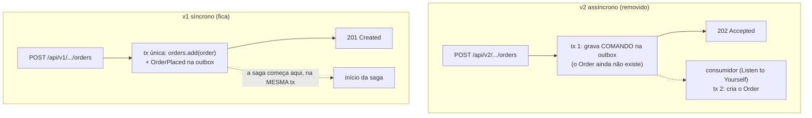
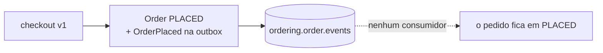

# Saga orquestrada: preparando o terreno

> **Em uma frase:** antes de construir o orquestrador, o projeto apaga duas coisas que atrapalhariam: o checkout assíncrono (porque a saga precisa nascer na mesma transação do pedido) e a saga coreografada (porque o mesmo pedido não pode ter dois condutores).

⬅️ Anterior: [Saga orquestrada: conceito e mapa](./11-saga-orquestrada-conceito-e-mapa.md) · ➡️ Próximo: [Estado e persistência](./13-saga-orquestrada-estado-e-persistencia.md) · 🧭 Trilha: [README](../README.md#trilha-de-leitura)

## O problema

O [mapa da orquestração](./11-saga-orquestrada-conceito-e-mapa.md) pede duas condições que o código ainda não cumpria:

1. **A saga começa quando o pedido é realizado, na mesma transação.** Mas existia um checkout v2 assíncrono que respondia `202 Accepted` e só criava o pedido depois, num consumidor. Nesse caminho não há pedido na transação da requisição.
2. **Só o orquestrador decide o próximo passo.** Mas os consumidores da coreografia continuavam de pé: o billing faturava ao ver `OrderPlaced`, o catálogo reservava ao ver `OrderPaid`.

Construir por cima disso daria fatura dupla, reserva dupla e dois "donos" brigando pelo estado do pedido.

## A ideia

**Demolir antes de construir**, com critério. Duas regras guiam o que sai e o que fica:

- **Padrão bom no lugar errado vira obstáculo.** O 202 resolvia um problema real (resposta rápida com processamento pesado do outro lado de um tópico). Sai porque o desenho seguinte precisa de outra coisa: um ponto de início atômico.
- **Sai quem reage e quem anuncia para outro serviço reagir; fica quem faz o trabalho.** Gerar fatura, estornar e reservar estoque continuam existindo. Só muda quem os aciona: um evento interpretado por cada serviço → um comando enviado pelo orquestrador.

## Como funciona no AlgaShop

### 1. Removendo o checkout assíncrono



No v2 haveria dois problemas para a orquestração:

1. **Não existe pedido na transação da requisição.** A primeira transação só grava um comando; o `Order` nasce na segunda, do outro lado do tópico `ordering.order.commands`. Começar a saga na primeira seria começar uma saga para um pedido que ainda pode não existir.
2. **Dois caminhos de criação = dois pontos de partida.** Com v1 e v2 convivendo, toda regra de início da saga existiria duas vezes, com transações diferentes.

A remoção sai barata porque **a corrente de eventos não muda**: o checkout v1 já publicava o `OrderPlaced` pela outbox, na mesma transação do `orders.add()`.

**O que saiu:** o `MyOrderV2Controller` e o `/api/v2/customers/**` da rota do gateway; os serviços `CheckoutAsyncApplicationService`, `BuyNowAsyncApplicationService` e `ProcessAcceptedCheckoutApplicationService` com suas portas; o `ProcessAcceptedCheckoutIntegrationCommand` com o listener e os publishers dele; os beans do tópico `ordering.order.commands` e do DLT; as propriedades e o alias no `spring.json.type.mapping`; e o `OrderSnapshot.shoppingCartId` com o `toDomain` do assembler, que só o consumidor usava para recriar o pedido.

**O que ficou, de propósito:**

| Fica | Por quê |
|---|---|
| `IntegrationCommand`, `CommandPublishingException` | Os comandos da saga vão usá-los |
| `OrderSnapshotAssembler.toSnapshot(Order)` | O snapshot do pedido volta a viajar dentro do comando de emissão de fatura |
| `ForGuardingIdempotency` | O consumidor de eventos de produto depende dela |
| A outbox inteira | Continua publicando os eventos do ordering |

### 2. Removendo a saga coreografada

Se os consumidores da coreografia continuassem de pé, o mesmo pedido seria conduzido por **dois caminhos ao mesmo tempo**. Por isso a coreografia sai antes de a saga entrar, e o sistema passa por um momento proposital em que **nada conduz o pedido**:



O pedido parado em `PLACED` **não é bug**: é o estado esperado entre a demolição e a construção. Ele prova que nenhum consumidor esquecido continua empurrando o fluxo.

| Serviço | O que saiu | O que ficou, e por quê |
|---|---|---|
| **ordering** | Os listeners de fatura e de estoque, os eventos `InvoicePaid`/`InvoiceCanceled`/`StockReservationConfirmed` e o `OrderManagementApplicationService` | `OrderEventListener` e os eventos `OrderPlaced/Paid/Canceled/Ready`: o pedido continua anunciando o que acontece com ele |
| **billing** | O listener de `OrderPlaced` (gerava a fatura), o de rejeição de estoque (estornava), as cópias do evento e dos snapshots, o `GenerateInvoiceInputAssembler` | `generate` e `refundByOrderId`: viram os alvos dos comandos "emita a fatura" e "estorne" |
| **catálogo** | O listener de `OrderPaid`, o publicador de eventos de estoque e os eventos (de integração e de domínio) da reserva | `reserveForOrder`, `DuplicateStockReservationException`, `existsByOrderId`: o comando "reserve o estoque" vai chamá-los |

Depois disso, o ordering só consome eventos de **produto**, o billing só conhece o tópico de **fatura**, e o catálogo não consome nada.

### A `StockReservation` deixa de anunciar

```java
// antes
public class StockReservation extends AbstractAggregateRoot<StockReservation> {
    public static StockReservation confirmed(...) {
        StockReservation r = new StockReservation(orderId, Status.CONFIRMED, items);
        r.registerEvent(StockReservationConfirmedEvent.builder()...build());
        return r;
    }
// agora
public class StockReservation {
    public static StockReservation confirmed(...) {
        return new StockReservation(orderId, Status.CONFIRMED, items);
    }
```

Na coreografia, a reserva anunciava o resultado para quem quisesse ouvir. Na orquestração, o resultado vira a **resposta ao comando**, endereçada ao orquestrador. O evento de domínio que existia só para virar evento de integração perde a razão de existir.

### Um detalhe que ficou: o billing ainda cobra a própria fatura

O `KafkaInvoiceIntegrationEventListener` do billing continua consumindo o próprio `InvoiceIssued` para chamar `processPayment` (o Listen to Yourself do [workflow](./09-workflow-coreografado.md)). Ele não é coreografia entre serviços, e sim um passo interno do billing: fica ocioso enquanto nada gera fatura e volta a trabalhar quando o comando de emissão chamar o `generate`.

### Os contratos acompanham

Os AsyncAPI ([`ordering.yml`](../asyncapi/ordering.yml), [`billing.yml`](../asyncapi/billing.yml), [`product-catalog.yml`](../asyncapi/product-catalog.yml), [`messages.yml`](../asyncapi/messages.yml)) perderam os canais, operações e mensagens removidos na mesma etapa, para o contrato não descrever tópicos que não existem mais. O schema `OrderSnapshot` ficou, sem `shoppingCartId`, porque volta no comando da saga.

## Como aplicar

1. **Escreva o que o desenho novo exige** (ex.: "a saga nasce na transação do pedido") e procure o que no código contradiz isso.
2. **Separe trabalho de gatilho**: casos de uso que fazem trabalho ficam; consumidores e publicadores que encadeiam o fluxo antigo saem.
3. **Faça uma lista e remova de fora para dentro** (controller → aplicação → portas → mensageria → configuração), em vez de "apagar até compilar".
4. **Procure os nomes das classes apagadas nos YAMLs** (`spring.json.type.mapping`, propriedades de tópico e grupo).
5. **Atualize os contratos AsyncAPI na mesma etapa.**
6. **Liste o que fica e por quê**, para a próxima etapa não precisar recriar o que foi apagado à toa.
7. **Aceite o estado intermediário** em que nada conduz o fluxo e use-o para provar que o mecanismo antigo morreu (o pedido fica em `PLACED`, nenhum consumer group ativo).
8. **Limpe o broker à parte**: tópicos antigos continuam lá.

## Para lembrar

- A saga orquestrada nasce na mesma transação que grava o pedido; por isso só o checkout v1 sobrou.
- Dois mecanismos conduzindo o mesmo pedido = fatura dupla e reserva dupla.
- Sai quem reage e anuncia para o outro reagir; fica quem faz o trabalho.
- `generate`, `refundByOrderId` e `reserveForOrder` viram alvos de comandos.
- O resultado da reserva deixa de ser evento e vira resposta ao orquestrador.
- Pedido parado em `PLACED` entre a demolição e a construção é o esperado.

## Cuidados

- **O compilador só reclama de quem usa uma classe apagada.** Uma classe órfã compila em silêncio; siga uma lista.
- **O compilador não lê YAML.** Um alias de `spring.json.type.mapping` para uma classe que não existe derruba a subida com `IllegalArgumentException`. E o último alias da lista não leva vírgula.
- **Remover o bean `NewTopic` não apaga o tópico.** O bean só cria se não existir; a exclusão é manual.
- **O contrato também é código a remover.** Um AsyncAPI que descreve tópico inexistente mente.
- **Remover demais quebra as aulas seguintes.** Comandos genéricos, o `toSnapshot` e os casos de uso de trabalho ficam, mesmo sem chamador.

## Onde ver no código

- `MyOrderController` (ordering) — o único caminho de criação de pedido.
- `CheckoutApplicationService` e `BuyNowApplicationService` (ordering) — checkout síncrono, `@Transactional`, que grava pedido e outbox juntos.
- `OrderSnapshotAssembler` (ordering) — só `toSnapshot(Order)`, guardado para o comando de emissão de fatura.
- `OrderEventListener` (ordering) — continua publicando os eventos do pedido.
- `InvoiceManagementApplicationService` (billing) — `generate` e `refundByOrderId`, preservados para os comandos.
- `KafkaInvoiceIntegrationEventListener` (billing) — o Listen to Yourself da cobrança, que ficou.
- `StockReservation` e `StockManagementApplicationService.reserveForOrder` (product-catalog) — a reserva sem eventos e o caso de uso preservado.
- `application-base.yml` (api-gateway-ecommerce) — a rota do ordering sem `/api/v2/customers/**`.
