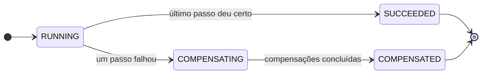
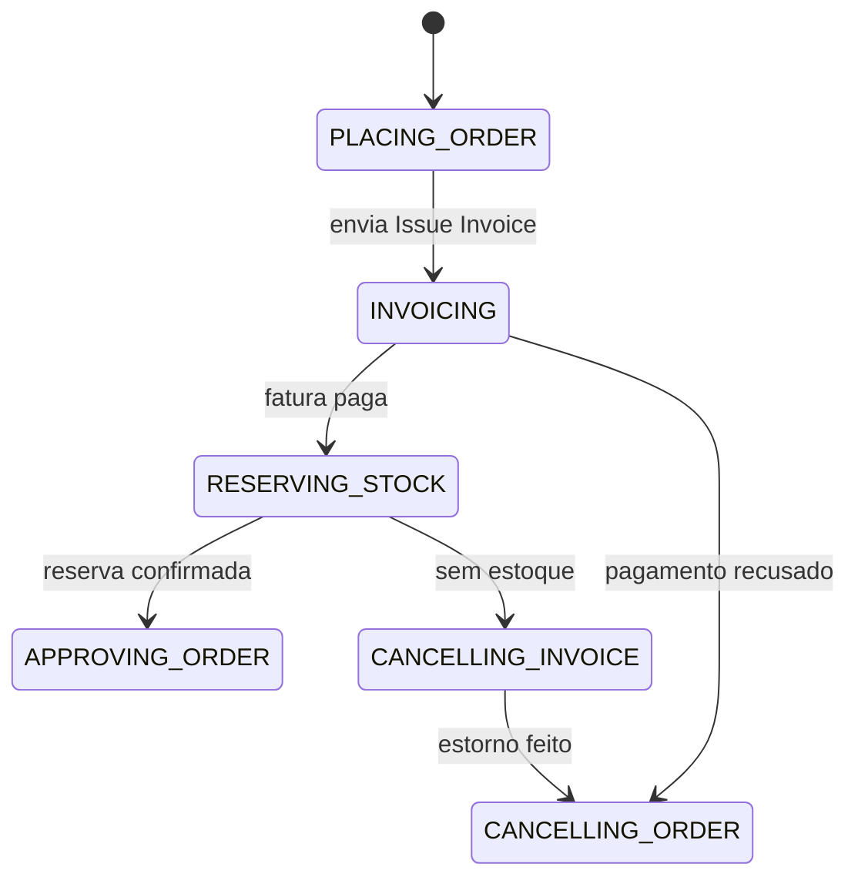
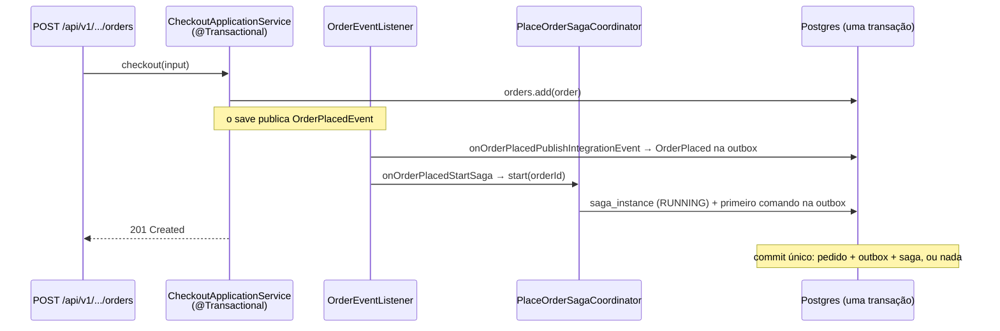
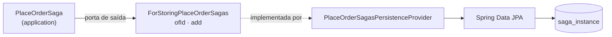
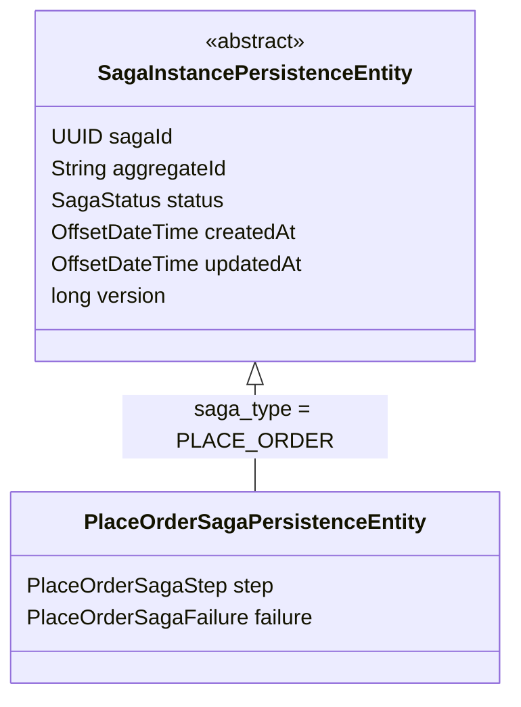

# Saga orquestrada: o estado da saga e onde ele mora

> **Em uma frase:** a saga orquestrada guarda, numa linha do banco, *em que fase* (status) e *em que passo* cada pedido está, e essa linha nasce na mesma transação que grava o pedido.

⬅️ Anterior: [Saga orquestrada: preparando o terreno](./12-saga-orquestrada-preparando-o-terreno.md) · ➡️ Próximo: [Saga orquestrada: comandos e respostas](./14-saga-orquestrada-comandos-e-respostas.md) · 🧭 Trilha: [README](../README.md#trilha-de-leitura)

---

## O problema

Na [saga coreografada](./10-saga-coreografada.md), a pergunta "em que passo está o pedido 42?" não tinha resposta. Era preciso olhar o billing (tem fatura?), o catálogo (tem reserva?) e o ordering (qual o status do pedido?) e juntar as peças. Se um evento se perdia, nada falhava: o pedido simplesmente parava, e ninguém sabia onde.

A orquestração precisa de um **lugar** que responda essa pergunta. Esse lugar é o **estado da saga**: um registro, no ordering, que diz onde cada execução está e o que ela espera receber.

## A ideia

A saga guarda **duas coisas diferentes**, e cada uma é uma máquina de estados própria:

- **Status**: *em que fase da vida* a saga está. É genérico, serve para qualquer saga: rodando, compensando, terminou bem, terminou desfeita.
- **Passo**: *onde* no fluxo **desta** saga ela está. É específico do pedido: emitindo fatura, reservando estoque, cancelando o pedido...

Pense numa viagem: o **status** é "indo", "voltando", "cheguei" ou "voltei para casa"; o **passo** é a cidade em que você está. Saber só um dos dois não basta.

Quando a saga é compensada, um terceiro dado aparece: a **falha**, que diz *por que* ela voltou atrás (`PAYMENT_REFUSED` ou `OUT_OF_STOCK`). O status diz *que* falhou; a falha diz *por quê*.

### Status: o ciclo de vida



### Passo: o fluxo do pedido



### Status × passo × falha, numa tabela

| Momento | Status | Passo | Falha |
|---|---|---|---|
| Saga acabou de nascer (checkout) | `RUNNING` | `PLACING_ORDER` → `INVOICING` | — |
| Esperando o pagamento | `RUNNING` | `INVOICING` | — |
| Esperando a reserva (o **pivô**) | `RUNNING` | `RESERVING_STOCK` | — |
| Caminho feliz terminou | `SUCCEEDED` | `APPROVING_ORDER` | — |
| Pagamento recusado | `COMPENSATING` | `INVOICING` → `CANCELLING_ORDER` | `PAYMENT_REFUSED` |
| Sem estoque, estornando | `COMPENSATING` | `CANCELLING_INVOICE` | `OUT_OF_STOCK` |
| Compensação terminou | `COMPENSATED` | `CANCELLING_ORDER` | a que causou |

Repare que, quando a saga termina, o **passo não muda mais**: ele fica como registro de onde ela parou. Quem muda para o fim é o **status**.

### Cada estado diz de onde pode vir

Os dois enums usam o mesmo truque do `OrderStatus` do domínio: cada valor declara os anteriores permitidos.

```java
public enum PlaceOrderSagaStep {
    PLACING_ORDER,
    INVOICING(PLACING_ORDER),
    RESERVING_STOCK(INVOICING),
    APPROVING_ORDER(RESERVING_STOCK),
    CANCELLING_INVOICE(RESERVING_STOCK),
    CANCELLING_ORDER(INVOICING, CANCELLING_INVOICE);
    ...
    public boolean canChangeTo(PlaceOrderSagaStep newStatus) {
        return newStatus.previousStatus.contains(this);
    }
}
```

A regra fica junto do estado, e não espalhada em `if`s. A linha do `CANCELLING_ORDER` conta a história toda: o pedido é cancelado vindo da fatura (pagamento recusado, nada a estornar) **ou** vindo do estorno (sem estoque). É a ordem inversa das compensações, escrita num lugar só.

## Como funciona no AlgaShop

A saga nasce quando o pedido nasce, **dentro da mesma transação** do checkout v1:



- **Dois ouvintes para o mesmo evento.** O `OrderEventListener` tem `onOrderPlacedPublishIntegrationEvent` (publica o `OrderPlaced`) e `onOrderPlacedStartSaga` (começa a saga). Nomes que dizem *o que* cada um faz.
- **Os dois são `@EventListener` síncronos**, não `@TransactionalEventListener`. Rodam *dentro* da transação do checkout. Se gravar a saga falhar, o checkout inteiro volta: **não existe pedido sem saga**.
- É por isso que o checkout assíncrono v2 saiu ([doc anterior](./12-saga-orquestrada-preparando-o-terreno.md)): só o v1 tem um momento em que o pedido e a saga podem commitar juntos.

### Onde o estado mora: a aplicação

`PlaceOrderSaga` fica em `core/application/order/saga`, **não** no domínio. O `Order` tem regras de negócio (o que pode ser pago, cancelado). A saga **coordena serviços**: lembra qual comando saiu e qual resposta se espera. Isso é caso de uso, o mesmo nível dos application services. O que serve a qualquer saga (`SagaStatus`, `SagaTransitionException`) fica um nível acima, em `core/application/saga`.

O objeto tem a mesma separação do `Order`:

- `PlaceOrderSaga.start(orderId)`: nasce `RUNNING` em `PLACING_ORDER`, versão 0;
- `PlaceOrderSaga.existing(...)`: reidrata o que veio do banco;
- consultas como `isRunningAt(step)`, `isCompensatingAt(step)`, `isActive()`: o orquestrador as usa para saber se uma resposta ainda é esperada;
- guardas privadas `require`, `changeStatusTo`, `changeStepTo`: lançam `SagaTransitionException` se a transição não é permitida.

### Persistência: porta, adaptador e uma tabela



É o desenho de [ports & adapters](../01-arquitetura-design/01-ports-hexagonal.md) de sempre: a aplicação só conhece a porta, e o adaptador traduz entre o objeto e a entidade JPA (`toEntity` / `toSaga`). O `PlaceOrderSaga` não sabe que existe banco.

## Por que uma classe abstrata

A entidade JPA tem duas camadas:



- **Abstrata**: não existe "saga genérica" no banco; toda linha é de um tipo concreto.
- **Na base, o que toda saga tem**: identidade, o agregado que ela conduz (`aggregateId` como texto, para servir a qualquer agregado), o status genérico, auditoria e `@Version`.
- **Na subclasse, o que é desta saga**: o passo e a falha, porque cada saga tem os seus enums.
- **`@Inheritance(SINGLE_TABLE)`** com a coluna discriminadora `saga_type`: todas as sagas do serviço dividem a tabela `saga_instance`. "Quais sagas estão ativas?" é uma consulta só, sem join (`JOINED`) nem `UNION` (`TABLE_PER_CLASS`). O preço, colunas vazias para tipos que não as usam, é baixo.

Uma saga futura (outro fluxo do ordering) ganha só uma subclasse com seu `@DiscriminatorValue`.

### A tabela `saga_instance` (V010)

| Coluna | Para quê |
|---|---|
| `saga_id` | chave primária; também será a correlação das respostas |
| `saga_type` | discriminador (`PLACE_ORDER`) |
| `aggregate_id` | id do pedido |
| `status`, `step`, `failure` | as duas máquinas de estado e o motivo da compensação |
| `created_at`, `updated_at` | auditoria do Spring Data |
| `version` | lock otimista |

Duas decisões no SQL:

- **`unique (saga_type, aggregate_id)`**: uma saga de realizar pedido por pedido. Se o início rodar duas vezes, o banco recusa a segunda.
- **Índice parcial** em `(saga_type, status) where status in ('RUNNING', 'COMPENSATING')`: só as sagas ativas entram no índice. É exatamente o conjunto que um job de recuperação ou timeout vai varrer.

## Como aplicar

1. **Liste os passos** do fluxo (os que mandam comando e os de compensação) e escreva um enum em que cada passo declara de onde pode vir.
2. **Use um status genérico** (`RUNNING`, `COMPENSATING`, `SUCCEEDED`, `COMPENSATED`), separado do passo, reaproveitável por qualquer saga.
3. **Guarde o motivo da falha** num enum próprio; ele diz depois por qual caminho a compensação entrou.
4. **Escreva métodos de transição** que mudam passo e/ou status juntos, sempre com `require(...)` antes. Cubra cada um com teste unitário.
5. **Coloque a saga na camada de aplicação**, com fábricas `start` e `existing`, e uma porta de saída para gravá-la.
6. **Persista com uma entidade base abstrata** (`SINGLE_TABLE` + discriminador), `@Version` e `unique (tipo, agregado)`.
7. **Comece a saga na transação que cria o agregado**, com um `@EventListener` síncrono: ou existem os dois, ou nenhum.

## Para lembrar

- Status = *em que fase*; passo = *onde*; falha = *por quê*.
- Ao terminar, o status vai para `SUCCEEDED`/`COMPENSATED` e o passo fica como registro de onde parou.
- Cada estado declara seus anteriores (`previousStatus`): a regra mora no enum.
- A saga é coordenação de caso de uso, por isso vive em `application`, não no domínio.
- Uma tabela para todas as sagas (`SINGLE_TABLE`), uma linha por pedido (`unique`).
- `@Version` protege contra duas respostas gravando a mesma saga ao mesmo tempo.
- A saga nasce na mesma transação do pedido: não há pedido sem saga.

## Cuidados

- **Status e passo são validados separadamente**: os enums sozinhos aceitam combinações sem sentido (`COMPENSATING` em `APPROVING_ORDER`). Quem garante a coerência são os métodos de transição e seus testes.
- **Nome de enum gravado como texto é contrato**: renomear um valor depois de persistido exige migração de dados. Revise a grafia antes da primeira gravação.
- **Com `ddl-auto: none`, nome de campo errado só aparece no primeiro `insert`**: confira que cada campo bate com a coluna (`updatedAt` → `updated_at`).
- **Adaptador que monta entidade nova a cada `add`** apaga `createdAt` no `merge`: use `@Column(updatable = false)` em colunas que só nascem uma vez.
- **Use `@EventListener`, não `@TransactionalEventListener`**, para iniciar a saga: depois do commit seria tarde para garantir "pedido e saga juntos".

## Onde ver no código

- `PlaceOrderSaga` (ordering): o estado de uma execução e os métodos de transição.
- `PlaceOrderSagaStep`, `SagaStatus`, `PlaceOrderSagaFailure` (ordering): passo, status e motivo da falha.
- `SagaTransitionException` (ordering): transição inválida.
- `ForStoringPlaceOrderSagas` e `PlaceOrderSagasPersistenceProvider` (ordering): porta de saída e adaptador.
- `SagaInstancePersistenceEntity` e `PlaceOrderSagaPersistenceEntity` (ordering): a base abstrata e a subclasse da saga de pedido.
- `V010__create-table-saga-instance.sql` (ordering): a tabela, a `unique` e o índice parcial.
- `OrderEventListener.onOrderPlacedStartSaga` e `PlaceOrderSagaCoordinator.start` (ordering): onde a saga começa.
