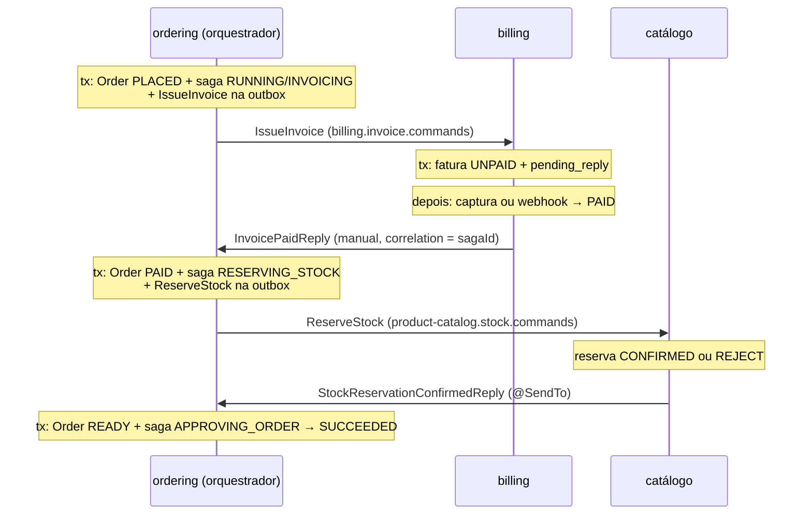

# Saga orquestrada: comandos e respostas

> **Em uma frase:** o orquestrador manda um comando dizendo "faça isto e responda para cá", o participante executa e devolve uma resposta com a mesma correlação, e cada resposta faz a saga dar o próximo passo.

⬅️ Anterior: [Saga orquestrada: estado e persistência](./13-saga-orquestrada-estado-e-persistencia.md) · ➡️ Próximo: [Saga orquestrada: compensações](./15-saga-orquestrada-compensacoes.md) · 🧭 Trilha: [README](../README.md#trilha-de-leitura)

---

## O problema

A saga já sabe onde está (`RUNNING` / `PLACING_ORDER`), mas não sai do lugar. Para andar, o ordering precisa:

1. pedir ao **billing** que emita e cobre a fatura do pedido;
2. saber quando o resultado saiu (paga ou cancelada) e **a qual saga** ele pertence;
3. pedir ao **catálogo** que reserve o estoque, e assim por diante.

Na coreografia, um evento como `InvoicePaid` fazia dois papéis: anunciava o fato e, de quebra, fazia o próximo serviço reagir. Na orquestração, os papéis se separam: o orquestrador **manda** (comando) e **recebe** (resposta), e os eventos continuam sendo só anúncios.

## A ideia

**Request-reply sobre Kafka.** O comando leva no header duas informações:

| Header | Para quê |
|---|---|
| `kafka_replyTopic` | **Para onde** responder (*Return Address*). O participante não precisa conhecer o orquestrador |
| `kafka_correlationId` | **De quem** é a resposta (*Correlation Identifier*). Volta igual na resposta e leva à saga certa |

São os nomes do Spring Kafka (`KafkaHeaders.REPLY_TOPIC`, `KafkaHeaders.CORRELATION_ID`). No AlgaShop, `kafka_correlationId = sagaId`: identifica a **execução**, não só o pedido. E todas as mensagens usam `key = orderId`, então comandos e respostas do mesmo pedido ficam na mesma partição, em ordem.

**Resposta ≠ evento.** O billing passa a ter duas saídas para o mesmo fato:

| | `InvoicePaidIntegrationEvent` (evento) | `InvoicePaidIntegrationReply` (resposta) |
|---|---|---|
| Destinatário | ninguém em particular | o orquestrador que mandou o comando |
| Tópico | `billing.invoice.events` | o de `kafka_replyTopic` (`ordering.saga.replies`) |
| Faz a saga andar? | não | sim |

### Os tópicos do contrato

| Serviço | Publica | Consome |
|---|---|---|
| ordering | eventos do pedido; comandos em `billing.invoice.commands` e `product-catalog.stock.commands` | respostas em `ordering.saga.replies` (grupo `ordering.saga-replies`) |
| billing | eventos de fatura; respostas no tópico que o comando indicou | `billing.invoice.commands` (grupo `billing.invoice-commands`) |
| catálogo | eventos de produto; respostas no tópico que o comando indicou | `product-catalog.stock.commands` (grupo `product-catalog.stock-commands`) |

Cada tópico consumido tem seu DLT. **Quem consome o tópico é quem o cria**: o billing declara `billing.invoice.commands`, o ordering declara `ordering.saga.replies`. O contrato AsyncAPI foi escrito antes do código ([contract-first](./05-contratos-asyncapi.md)); `Approve order` não tem comando, porque aprovar é interno do ordering.

### A convenção dos `__TypeId__`

| Tipo | Prefixo | Exemplos |
|---|---|---|
| Evento | serviço que **publica** o fato | `Ordering.OrderPlacedIntegrationEvent` |
| Comando | serviço que **executa** a ordem | `Billing.IssueInvoiceIntegrationCommand`, `Billing.CancelInvoiceIntegrationCommand`, `Stock.ReserveStockIntegrationCommand` |
| Resposta | serviço que **responde** | `Billing.InvoicePaidIntegrationReply`, `Stock.StockReservationConfirmedIntegrationReply` |

O fato pertence a quem o produziu; o comando pertence ao vocabulário de quem o executa. `IssueInvoice` é uma operação do billing que o ordering apenas solicita.

### Entrada × saída

Com comandos e respostas, as interfaces de integração foram separadas por **direção**: `OutboundIntegrationEvent` / `OutboundIntegrationCommand` / `OutboundIntegrationReply` exigem `getAggregateId()` (vira a key), e as `Inbound*` são só marcadores. **Quem publica escolhe a key**; quem consome já a recebe pronta.

## Como funciona no AlgaShop

O caminho feliz completo:



| Momento | Pedido | Saga (status / passo) | Vai para a outbox |
|---|---|---|---|
| checkout v1 | `PLACED` | `RUNNING` / `INVOICING` | `OrderPlaced` + `IssueInvoice` |
| `InvoicePaidReply` | `PAID` | `RUNNING` / `RESERVING_STOCK` | `OrderPaid` + `ReserveStock` |
| `StockReservationConfirmedReply` | `READY` | `SUCCEEDED` / `APPROVING_ORDER` | `OrderReady` |

Três transações locais no ordering, cada uma mudando o pedido **e** a saga **e** gravando a próxima mensagem.

### 1. O comando sai pela outbox

Mudar a saga e enviar o comando são duas escritas (Postgres e Kafka): o mesmo dual-write que a [outbox](./08-outbox.md) resolve para eventos. Então o comando também vai pela outbox, que ganhou duas colunas opcionais (é o padrão; com `outbox.enabled=false` o comando sai direto pelo Kafka — ver [robustez](./16-saga-orquestrada-robustez.md)):

| Coluna | Evento | Comando | Vira |
|---|---|---|---|
| `message_type` (antes `event_type`) | `Ordering.OrderPlacedIntegrationEvent` | `Billing.IssueInvoiceIntegrationCommand` | `__TypeId__` |
| `correlation_id` | vazio | `sagaId` | `kafka_correlationId` |
| `reply_topic` | vazio | `ordering.saga.replies` | `kafka_replyTopic` |

O `OutboxRecorder` passou a receber um `OutboxDraft` (parâmetro-objeto com builder), para não haver cinco parâmetros posicionais em que dá para trocar dois `String` de lugar. O publisher diz *o quê e para onde*; o recorder gera o id (a idempotency key), serializa e inicializa o estado de envio. O `OutboxKafkaSender` só põe os headers novos quando a coluna está preenchida: um evento sai como antes.

O comando `IssueInvoiceIntegrationCommand` carrega o **pedido inteiro** (`OrderSnapshot`, ECST): o billing emite a fatura sem chamar o ordering de volta. O `PlaceOrderSagaCommandTopics` decide o tópico de cada comando com um `switch` por tipo; comando sem rota **falha alto** e desfaz a transação.

### 2. O billing executa

O `KafkaInvoiceIntegrationCommandListener` consome `billing.invoice.commands`, exige `kafka_correlationId` e `kafka_replyTopic` (sem eles não há como responder → `IllegalArgumentException` → DLT) e chama o mesmo `InvoiceManagementApplicationService.generate` de sempre. O caso de uso não sabe se foi chamado por evento ou por comando.

O **handler default lança exceção**, ao contrário dos listeners de evento (que ignoram). Evento desconhecido é evolução normal do produtor; comando desconhecido é contrato quebrado, e ignorá-lo deixaria o orquestrador esperando para sempre.

### 3. A resposta do billing é manual (`pending_reply`)

Quando o `IssueInvoice` é processado, a fatura nasce `UNPAID`: **ninguém sabe ainda** se vai ser paga. O resultado vem depois, por outro fluxo (a captura disparada pelo `InvoiceIssued`, ou o webhook do FastPay), que não tem acesso aos headers do comando. Então o billing **guarda o endereço**:

```java
transactionTemplate.executeWithoutResult(status -> {
    UUID invoiceId = invoiceManagementApplicationService.generate(input);
    pendingReplies.register(invoiceId, command.getOrderId(), sagaCorrelationId, sagaReplyTopic);
});
```

Fatura e pendente commitam juntos: nunca uma fatura sem ter para onde responder. Quando a fatura vira `PAID` ou `CANCELED`, o `InvoiceEventListener` (`@TransactionalEventListener`, depois do commit) acha o pendente pelo `invoice_id`, envia o reply com o `KafkaInvoiceIntegrationReplyPublisher` e **só depois apaga** o pendente. `find` e `delete` usam `REQUIRES_NEW`, porque na fase `AFTER_COMMIT` a transação original não grava mais nada. A ordem "enviar, depois apagar" dá **at-least-once**: a resposta pode sair duas vezes, mas não deixa de sair.

A `pending_reply` é parecida com uma outbox, com uma diferença: a outbox guarda uma mensagem **pronta**; o pendente guarda o **endereço** de uma mensagem que ainda não pode ser escrita. Ela mora na infraestrutura, porque correlação e tópico são metadados de transporte.

### 4. O orquestrador recebe e avança

O `KafkaPlaceOrderSagaReplyListener` (grupo `ordering.saga-replies`) converte o `kafka_correlationId` em `sagaId` e chama a operação certa do `PlaceOrderSagaCoordinator`. No `onInvoicePaid`, numa transação só: o pedido vira `PAID` (e o `OrderPaid` vai para a outbox), a saga vai para `RESERVING_STOCK` e o `ReserveStock` é gravado na outbox. Não existe "pedido pago sem comando de estoque".

Resposta repetida (o at-least-once do billing) chega com a saga já adiante e é **ignorada**: é para isso que existem consultas como `isRunningAt(INVOICING)`. O `@Version` cuida de duas respostas concorrentes.

### 5. O catálogo reserva e responde com `@SendTo`

A reserva é síncrona: quando o listener termina, o resultado já existe. Então o catálogo usa o reply **automático** do Spring Kafka:

```java
@KafkaHandler
@SendTo
public OutboundIntegrationReply handle(@Payload @Valid ReserveStockIntegrationCommand command, ...) {
    UUID reservationId = stockManagementApplicationService.reserveForOrder(toInput(command));
    StockReservationOutput reservationOutput = stockReservationQueryService.findById(reservationId);
    return this.toReply(reservationOutput); // Confirmed ou Rejected
}
```

`@SendTo` sem argumento quer dizer "responda para onde o comando mandou": o Spring lê o `kafka_replyTopic` do record, publica o retorno lá e copia o `kafka_correlationId`. O Boot já liga o `KafkaTemplate` como reply template, sem configuração extra. Falta de estoque não é exceção: vira reserva `REJECT` e `StockReservationRejectedReply`.

Comando e consulta ficam separados (CQS): o `reserveForOrder` devolve só o id, e a resposta é montada a partir do que **foi gravado**.

### 6. `APPROVING_ORDER`, o passo sem comando

Depois do pivô não há o que compensar, só aprovar. É trabalho do próprio ordering, então o passo entra e sai no mesmo método:

```java
order.markAsReady();
saga.moveToApprovingOrder();   // RESERVING_STOCK → APPROVING_ORDER (passo)
saga.endSucceeded();           // RUNNING → SUCCEEDED (status)
```

## Reply manual × `@SendTo`: quando usar cada um

A pergunta é uma só: **quando o método do listener termina, a resposta já existe?**

| Comando | Quem executa | Resultado ao fim do listener? | Reply |
|---|---|---|---|
| `IssueInvoice` | billing | **Não**: a fatura nasce `UNPAID`; o pagamento se resolve depois | **manual**: guarda correlação e tópico em `pending_reply` e responde quando a fatura muda |
| `ReserveStock` | catálogo | **Sim**: confirmada ou rejeitada ali mesmo | **`@SendTo`** |
| `CancelInvoice` | billing | **Sim**: o estorno é síncrono e a fatura já está `CANCELED` | **`@SendTo`** |

| | `@SendTo` | Manual |
|---|---|---|
| Quem publica | o framework, com o **retorno** do método | o serviço, com `KafkaTemplate` |
| Destino e correlação | lidos do comando e copiados pelo Spring | guardados numa tabela e lidos depois |
| Tabela extra | nenhuma | `pending_reply` |

O mesmo serviço (billing) usa as duas formas, conforme o comando.

## Como aplicar

1. **Escreva o contrato primeiro**: tópicos de comando (um por executor), um tópico de respostas do orquestrador, DLTs, e os `__TypeId__` pela convenção acima.
2. **Grave o comando na outbox** na mesma transação que muda a saga, com `correlation_id = sagaId` e `reply_topic` do orquestrador.
3. **Roteie por tipo** num lugar só (`switch` sobre o comando) e falhe alto para comando sem rota.
4. **No participante**, exija os dois headers, valide o payload e reaproveite o caso de uso existente. Handler default de comando **lança**.
5. **Escolha a forma do reply**: resultado pronto no fim do listener → `@SendTo`; resultado futuro → guarde correlação e tópico com o dado de negócio, na mesma transação, e responda quando ele mudar.
6. **No orquestrador**, um listener só para respostas: correlação → saga → método do coordenador, que muda pedido + saga + grava o próximo comando numa transação.
7. **Torne cada handler idempotente**: se a saga não espera mais aquela resposta, ignore.

## Para lembrar

- Comando = ordem com destinatário; resposta = volta para o orquestrador; evento = anúncio para quem quiser.
- `kafka_replyTopic` diz para onde; `kafka_correlationId` diz de quem. Aqui, correlação = `sagaId`.
- Comandos passam pela outbox: estado da saga e próxima ordem commitam juntos.
- Prefixo do `__TypeId__`: evento → quem publica; comando → quem executa; resposta → quem responde.
- `@SendTo` quando a resposta existe no fim do listener; reply manual quando ela nasce depois.
- Comando desconhecido vai para o DLT; evento desconhecido é ignorado.
- Respostas chegam at-least-once: o orquestrador precisa ignorar as repetidas.

## Cuidados

- **Guarda de idempotência por "passo esperado"** (`if (!saga.isRunningAt(INVOICING)) ignore`) é mais robusta que uma lista de estados já passados, que cresce a cada passo novo.
- **`@SendTo` também é dual-write**: o dado commita antes de a resposta sair. Se o envio falhar e o comando for reentregue, o handler deve reler o que já existe e responder de novo, em vez de falhar.
- **Reply depois do evento no mesmo handler**: se publicar o evento falhar, o reply nem é tentado. Para a saga, a resposta importa mais que o anúncio.
- **Comando duplicado batendo numa `UNIQUE`** vira DLT sem resposta; se a primeira resposta se perdeu, a saga para.
- **DLT de tópico de comando precisa existir** com as mesmas partições do tópico de origem: declare o `NewTopic`, não conte com auto-criação.
- **Toda mudança de alias tem de aparecer** no `spring.json.type.mapping` dos dois lados, incluindo os YAMLs de teste.

## Onde ver no código

- `PlaceOrderSagaCoordinator` (ordering): `start`, `onInvoicePaid`, `onStockReservationConfirmed`.
- `OutboxPlaceOrderSagaIntegrationCommandPublisher`, `OutboxDraft`, `PlaceOrderSagaCommandTopics` (ordering): gravação e roteamento dos comandos.
- `KafkaPlaceOrderSagaReplyListener` (ordering): recebe as respostas e acha a saga pela correlação.
- `KafkaInvoiceIntegrationCommandListener` (billing): `IssueInvoice` com reply manual, `CancelInvoice` com `@SendTo`.
- `PendingReplies` e `V0004__create-pending-reply.sql` (billing): o endereço de resposta guardado.
- `InvoiceEventListener` e `KafkaInvoiceIntegrationReplyPublisher` (billing): envio do reply quando a fatura muda.
- `KafkaStockIntegrationCommandListener` (product-catalog): reserva e responde com `@SendTo`.
- Contratos em `docs/asyncapi/` (`ordering.yml`, `billing.yml`, `product-catalog.yml`, `messages.yml`).
