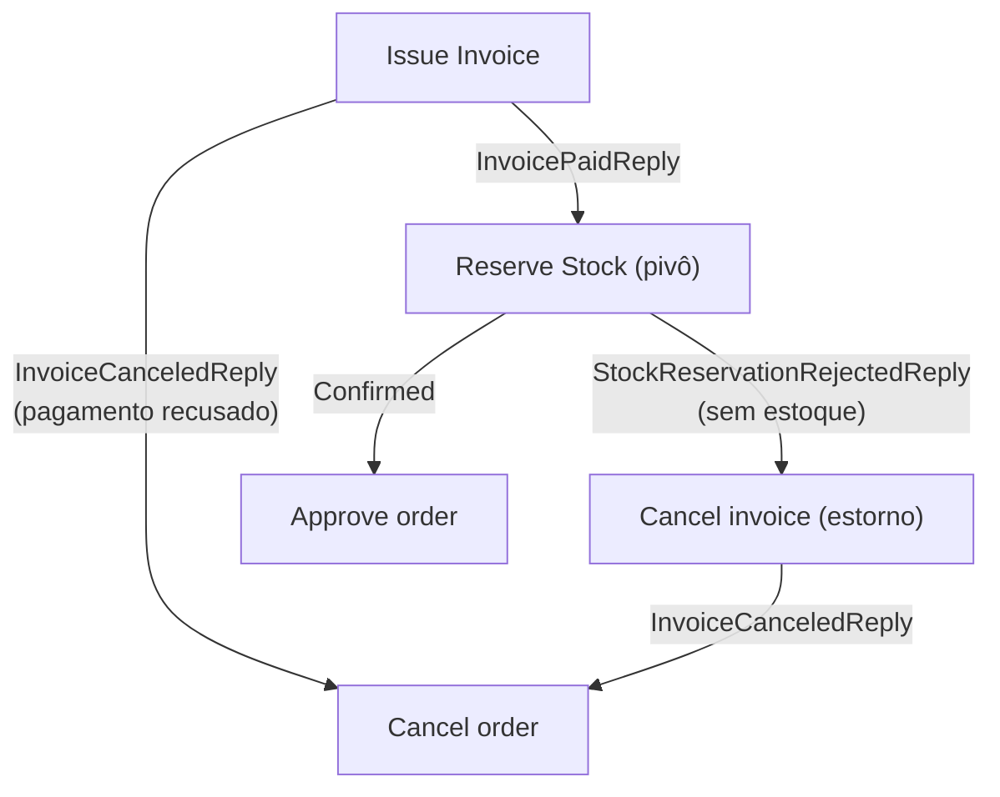
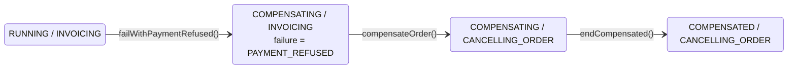
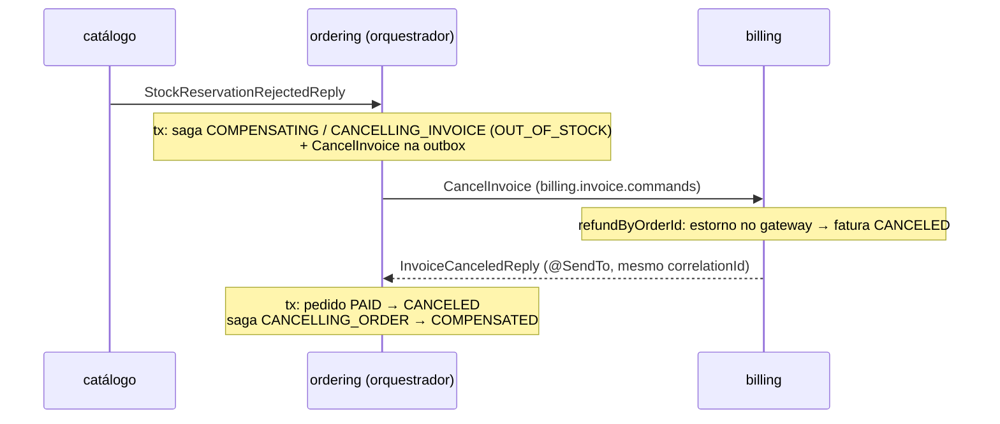

# Saga orquestrada: compensações

> **Em uma frase:** quando um passo falha, o orquestrador registra o motivo e desfaz, na ordem inversa, só os passos que já tinham sido feitos.

⬅️ Anterior: [Saga orquestrada: comandos e respostas](./14-saga-orquestrada-comandos-e-respostas.md) · ➡️ Próximo: [Saga orquestrada: robustez](./16-saga-orquestrada-robustez.md) · 🧭 Trilha: [README](../README.md#trilha-de-leitura)

---

## O problema

Uma saga não tem rollback: cada passo é uma transação local que **já commitou** num serviço diferente. Se o pagamento é recusado, o pedido já existe. Se o estoque falta, o cartão já foi cobrado. É preciso desfazer com **ações novas**, as compensações.

No AlgaShop há dois caminhos de falha:

- **Pagamento recusado**: o billing cancela a fatura e responde `InvoiceCanceledReply`. Só o pedido precisa ser desfeito.
- **Falta de estoque**: o catálogo rejeita a reserva (`StockReservationRejectedReply`) depois do pagamento capturado. É preciso **estornar** a fatura e depois cancelar o pedido.

Na coreografia, essa cadeia emergia de eventos espalhados por três serviços. Aqui o orquestrador **recebe** a falha e **decide** as compensações, num lugar só.

## A ideia

Compensar é andar para trás pelo mapa, desfazendo **só o que foi feito**, na ordem inversa:



Três dados da saga trabalham juntos ([estado da saga](./13-saga-orquestrada-estado-e-persistencia.md)):

- o **status** marca a fase: `RUNNING` → `COMPENSATING` → `COMPENSATED`;
- o **passo** marca onde: `CANCELLING_INVOICE`, `CANCELLING_ORDER`;
- a **falha** (`PlaceOrderSagaFailure`) guarda por quê: `PAYMENT_REFUSED` ou `OUT_OF_STOCK`.

O **pivô** é a reserva de estoque. Os passos antes dele têm compensação (`Cancel order`, `Cancel invoice`); o passo depois (`Approve order`) não tem, só precisa dar certo.

## Como funciona no AlgaShop

### Caminho 1: pagamento recusado



Tudo acontece no `onInvoiceCanceled`, numa transação: a saga entra em compensação e guarda o motivo, o pedido vira `CANCELED` (e o `OrderCanceled` vai para a outbox), a saga termina `COMPENSATED`. Nenhum comando sai: cancelar o pedido é interno.

### Caminho 2: falta de estoque



1. `onStockReservationRejected`: `failWithOutOfStock()` (status → `COMPENSATING`, falha `OUT_OF_STOCK`) e `compensateInvoice()` (passo → `CANCELLING_INVOICE`); grava a saga e o `CancelInvoiceIntegrationCommand` (só o `orderId`) na outbox, no mesmo tópico do `IssueInvoice`.
2. O billing executa o `CancelInvoice`: estorna e responde.
3. A volta é o **mesmo** `InvoiceCanceledReply` do pagamento recusado, tratado pelo **mesmo** `onInvoiceCanceled`.

### Uma resposta, dois caminhos

```java
if (!saga.hasFailed()) {
    saga.failWithPaymentRefused();   // só no pagamento recusado
}
if (!order.isCanceled()) {
    order.markAsCanceled();
}
saga.compensateOrder();
saga.endCompensated();
```

- **Pagamento recusado**: a saga está `RUNNING` em `INVOICING`, sem falha. O handler registra `PAYMENT_REFUSED`, e `compensateOrder()` sai de `INVOICING`.
- **Falta de estoque**: a saga já está `COMPENSATING` em `CANCELLING_INVOICE`, com `OUT_OF_STOCK`. O `hasFailed()` impede sobrescrever o motivo, e `compensateOrder()` sai de `CANCELLING_INVOICE`.

É exatamente o que o enum declara: `CANCELLING_ORDER(INVOICING, CANCELLING_INVOICE)`, duas portas de entrada. A falha guardada diz depois por qual delas o pedido entrou.

### As duas compensações lado a lado

| | Pagamento recusado | Falta de estoque |
|---|---|---|
| Resposta que dispara | `InvoiceCanceledReply` | `StockReservationRejectedReply` |
| Onde a saga estava | `RUNNING` / `INVOICING` | `RUNNING` / `RESERVING_STOCK` (pivô) |
| O que desfazer | só o pedido | a fatura paga **e** o pedido |
| Passos de compensação | `CANCELLING_ORDER` | `CANCELLING_INVOICE` → `CANCELLING_ORDER` |
| Comando de compensação | nenhum | `CancelInvoice` ao billing |
| Estado final da saga | `COMPENSATED` / `CANCELLING_ORDER` / `PAYMENT_REFUSED` | `COMPENSATED` / `CANCELLING_ORDER` / `OUT_OF_STOCK` |
| Pedido | `PLACED` → `CANCELED` | `PAID` → `CANCELED` |

### O billing estorna e responde com `@SendTo`

O `IssueInvoice` precisou de reply manual (`pending_reply`), porque o pagamento se resolve depois. O `CancelInvoice` não: o estorno no gateway é síncrono, e quando o `refundByOrderId` volta a fatura já está `CANCELED`. Então o handler simplesmente **retorna** a resposta:

```java
@KafkaHandler
@SendTo
public InvoiceCanceledIntegrationReply handle(@Payload @Valid CancelInvoiceIntegrationCommand command, ...) {
    requireHeader(correlationId, KafkaHeaders.CORRELATION_ID);
    requireHeader(replyTopic, KafkaHeaders.REPLY_TOPIC);
    invoiceManagementApplicationService.refundByOrderId(command.getOrderId());
    InvoiceOutput invoice = invoiceQueryService.findByOrderId(command.getOrderId());
    return InvoiceCanceledIntegrationReply.builder()
            .invoiceId(invoice.getId()).orderId(invoice.getOrderId())
            .canceledAt(invoice.getCanceledAt()).build();
}
```

O Spring publica o retorno no `kafka_replyTopic` do comando, com o alias `Billing.InvoiceCanceledIntegrationReply`, e copia o `kafka_correlationId`. O billing não guarda nada nem conhece o nome `ordering.saga.replies`. O mesmo serviço usa as duas formas de reply, conforme o comando (ver a [tabela do doc anterior](./14-saga-orquestrada-comandos-e-respostas.md)).

### `@Transactional` na classe

Cada método do coordenador é **uma unidade**: muda pedido, saga e grava o próximo comando. Por isso o `PlaceOrderSagaCoordinator` tem `@Transactional` na **classe**: todo método novo já nasce dentro de uma transação, e uma validação que falha no meio desfaz tudo.

## Como aplicar

1. **Para cada passo antes do pivô, defina a compensação** (o que desfaz) e se ela é interna ou um comando para outro serviço.
2. **Modele o motivo** num enum de falha e grave-o na saga ao entrar em `COMPENSATING`.
3. **Separe as transições**: "falhar" muda o status e guarda o motivo; "compensar X" muda o passo; "encerrar compensada" muda o status de novo.
4. **Declare no enum de passos todas as portas de entrada** de cada compensação (`CANCELLING_ORDER(INVOICING, CANCELLING_INVOICE)`).
5. **Reaproveite handlers** quando a mesma resposta fecha caminhos diferentes, usando o estado da saga (`hasFailed()`) para distinguir.
6. **Torne cada compensação reexecutável**: `if (!order.isCanceled()) order.markAsCanceled()`. Uma compensação precisa poder rodar de novo.
7. **Abrace cada método do coordenador numa transação** (de preferência na classe).
8. **Teste cada transição** em teste unitário da saga, incluindo as recusas (compensar uma saga ainda `RUNNING`, estornar quando não houve pagamento).

## Para lembrar

- Saga não tem rollback: compensar é executar ações novas, na ordem inversa.
- Desfaça só o que foi feito: pagamento recusado cancela só o pedido; sem estoque estorna e depois cancela.
- Status = fase, passo = onde, falha = por quê.
- O pivô (reserva) divide o fluxo: antes dele tudo é compensável; depois, só pode dar certo.
- A mesma resposta (`InvoiceCanceledReply`) fecha os dois caminhos; o estado da saga diz qual.
- `CancelInvoice` usa `@SendTo` porque o estorno é síncrono.
- Compensações têm de ser idempotentes e transacionais.

## Cuidados

- **Método do coordenador sem `@Transactional` grava pela metade**: o pedido foi cancelado e a saga ficou `RUNNING` / `INVOICING` porque uma guarda falhou depois do `orders.add`. A transação na classe evita isso.
- **Guardas de transição merecem teste**: uma condição invertida (`canNotChangeTo` no lugar de `canChangeTo`) só aparece rodando a compensação.
- **Estorno reentregue estorna de novo**: se a fatura já está `CANCELED`, pule o estorno e só monte a resposta.
- **Chamada HTTP do estorno dentro da transação** prende a conexão do banco durante a ida ao gateway.
- **Sagas presas por um bug** se recuperam reprocessando o DLT `ordering.dlt.ordering.saga.replies`, desde que a compensação seja reexecutável.

## Onde ver no código

- `PlaceOrderSagaCoordinator` (ordering): `onInvoiceCanceled` e `onStockReservationRejected`; `@Transactional` na classe.
- `PlaceOrderSaga` (ordering): `failWithPaymentRefused`, `failWithOutOfStock`, `compensateInvoice`, `compensateOrder`, `endCompensated`.
- `PlaceOrderSagaFailure` (ordering): `PAYMENT_REFUSED` e `OUT_OF_STOCK`.
- `PlaceOrderSagaStep` (ordering): as duas portas de `CANCELLING_ORDER`.
- `CancelInvoiceIntegrationCommand` (ordering e billing): o comando de compensação.
- `KafkaInvoiceIntegrationCommandListener` (billing): handler do `CancelInvoice` com `@SendTo`.
- `InvoiceManagementApplicationService.refundByOrderId` (billing): o estorno.
- `PlaceOrderSagaTest` (ordering): testes das transições e compensações.
