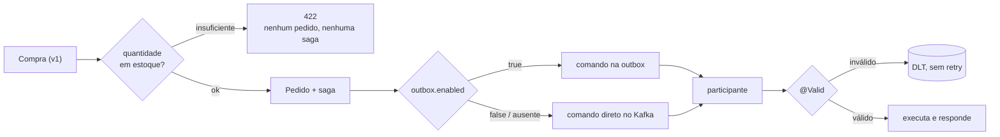

# Saga orquestrada: robustez

> **Em uma frase:** a saga fica mais robusta quando recusa cedo o que já se sabe que vai falhar, funciona com ou sem outbox sem mudar o contrato, e quando cada consumidor valida o payload antes de executar.

⬅️ Anterior: [Saga orquestrada: compensações](./15-saga-orquestrada-compensacoes.md) · ➡️ Próximo: [Diário de bordo](./99-diario-de-bordo.md) · 🧭 Trilha: [README](../README.md#trilha-de-leitura)

---

## O problema

Com o caminho feliz e as duas compensações funcionando, sobraram três fragilidades:

1. **Compensar custa caro.** Rejeitar um pedido por falta de estoque dentro da saga significa: emitir fatura, cobrar o cartão, tentar reservar, estornar, cancelar a fatura, cancelar o pedido. Seis passos, duas idas ao gateway, e o cliente vê uma cobrança e um estorno, para descobrir algo que o ordering podia ter perguntado antes.
2. **O ordering não subia com `algashop.messaging.outbox.enabled=false`**: a porta de envio de comandos só tinha a implementação de outbox.
3. **O `@Valid` dos consumidores era ignorado** no billing e no catálogo: uma mensagem incompleta chegava ao application service como se fosse válida.

## A ideia

- **Validar antes de começar.** Perguntar a quantidade em estoque na própria requisição evita **começar** uma saga que já se sabe que vai falhar. Não substitui a compensação, só reduz quantas vezes ela acontece.
- **Uma porta, duas implementações.** O coordenador conhece só `ForPublishingPlaceOrderSagaIntegrationCommands`. Qual adaptador atende (outbox ou Kafka direto) é decidido por uma propriedade, e o participante não percebe a diferença.
- **Validar na porta de entrada da mensagem.** Ligar o `Validator` do Spring nos listeners Kafka faz todo `@Valid` funcionar, e o payload inválido vai direto para a DLT, sem retry.

## Como funciona no AlgaShop



### 1. Validar a quantidade na compra

- O `Product` do ordering (a visão do produto que vem do catálogo) ganhou `quantityInStock`, lido do `ProductResponse`.
- `Product.checkForQuantity(quantity)` verifica a disponibilidade e, se a quantidade é conhecida e menor que a pedida, lança `InsufficientQuantityException`. É `DomainException`, então a API responde **422**.
- `BuyNowService` e `ShoppingCart.addItem` passaram a usar `checkForQuantity`.
- O cache do produto no Redis caiu de 5 para **1 minuto**: a validação vale tanto quanto a frescura do dado que ela lê.

| Onde a falta é descoberta | O que acontece | Custo |
|---|---|---|
| Na requisição | 422 para o cliente; nenhum pedido, nenhuma saga | uma consulta ao catálogo (já feita para o preço) |
| Na saga | fatura, cobrança, reserva rejeitada, estorno, cancelamentos | seis passos e duas idas ao gateway |

**Pré-validação não é garantia.** Entre a leitura (que pode vir do cache) e a reserva, outro pedido pode levar as últimas unidades. Quem garante de verdade é a operação atômica no dono do dado (a reserva no catálogo). Por isso a [compensação por falta de estoque](./15-saga-orquestrada-compensacoes.md) continua necessária.

### 2. Comandos da saga com ou sem outbox

| Publicador | Ativo quando | Como o comando sai |
|---|---|---|
| `OutboxPlaceOrderSagaIntegrationCommandPublisher` | `outbox.enabled = true` | grava uma linha na outbox; o dispatcher envia depois |
| `KafkaPlaceOrderSagaIntegrationCommandPublisher` | `outbox.enabled = false` **ou ausente** | `kafkaTemplate.send(...).get(40s)`, na hora |

As condições se complementam (`havingValue = "true"` × `havingValue = "false", matchIfMissing = true`), então sempre existe **exatamente uma** implementação. O contrato é o mesmo nos dois caminhos: tópico pelo **mesmo** `PlaceOrderSagaCommandTopics`, key = `orderId`, `kafka_correlationId` = `sagaId`, `kafka_replyTopic` = `ordering.saga.replies`, `__TypeId__` gerado pelo serializer. Um comando novo ganha uma linha no `switch` e funciona nos dois.

O que muda é a **garantia**:

| | Outbox ligada | Outbox desligada (Kafka direto) |
|---|---|---|
| Quando o comando sai | depois do commit, pelo dispatcher | durante a transação, antes do commit |
| Kafka fora do ar | o checkout funciona; o comando espera na outbox | o checkout **falha**: `CommandPublishingException` desfaz pedido e saga |
| Commit falha depois do envio | impossível: tudo commita junto | **comando já enviado para um pedido que não existe** |

O envio direto e bloqueante protege um lado (Kafka não confirmou → nada é gravado), mas não o outro. É o dual-write que a [outbox](./08-outbox.md) elimina, e por isso ela é o padrão (`enabled: true`).

### 3. Validando os payloads no consumidor

Em um `@KafkaHandler`, quem resolve o `@Payload` é o Spring Kafka, e ele só aplica o `@Valid` se o registrar de listeners tiver um `Validator`. Por padrão não tem. A solução é um configurer em cada serviço:

```java
@Configuration
@RequiredArgsConstructor
public class KafkaBeanValidationConfigurer implements KafkaListenerConfigurer {
    private final LocalValidatorFactoryBean validator;

    @Override
    public void configureKafkaListeners(KafkaListenerEndpointRegistrar registrar) {
        registrar.setValidator(validator);
    }
}
```

- `KafkaListenerConfigurer` é o ponto de extensão que o Spring Kafka chama ao montar os listeners. A partir dele, **todo** handler com `@Valid` valida, sem mudar os listeners.
- O `LocalValidatorFactoryBean` é o que o Boot já cria; é reaproveitado.
- A validação acontece **antes** do método: o handler nem executa. A `MethodArgumentNotValidException` já é fatal para o `DefaultErrorHandler`, então a mensagem vai para a DLT na hora, sem as esperas de retry. O header `kafka_dlt-exception-message` aponta o campo violado.

| Serviço | Listener | Payload validado | DLT |
|---|---|---|---|
| billing | `KafkaInvoiceIntegrationCommandListener` | `IssueInvoice`, `CancelInvoice` | `billing.dlt.billing.invoice.commands` |
| billing | `KafkaInvoiceIntegrationEventListener` | `InvoiceIssuedIntegrationEvent` | `billing.dlt.billing.invoice.events` |
| catálogo | `KafkaStockIntegrationCommandListener` | `ReserveStock` | `product-catalog.dlt.product-catalog.stock.commands` |

O handler default (`@Payload Object`) continua sem `@Valid`: não há o que validar num tipo desconhecido.

**Validar no consumidor só é seguro se o produtor legítimo respeita as mesmas regras.** Aqui respeita: as constraints dos snapshots do billing copiam as do `OrderSnapshot` do ordering, e o `ReserveStock` sempre sai com itens e quantidades positivas. Se um payload legítimo violar uma constraint, corrija a constraint ou o produtor, nunca desligue a validação.

## Como aplicar

1. **Valide cedo o que é barato perguntar**: se o dado já está à mão na requisição, recuse antes de criar o pedido e a saga.
2. **Não confie na pré-validação**: mantenha a compensação, e encurte o cache do dado que a validação lê.
3. **Para cada porta de saída de mensagens, tenha duas implementações** com `@ConditionalOnProperty` complementares (`havingValue` + `matchIfMissing`).
4. **Compartilhe a decisão de tópico** entre os dois caminhos (uma classe de roteamento só).
5. **No envio direto, bloqueie com timeout** e converta a falha numa exceção que desfaça a transação.
6. **Registre um `Validator` nos listeners Kafka** de cada serviço com um `KafkaListenerConfigurer`, e use `@Payload @Valid` nos handlers.
7. **Confirme que a exceção de validação é fatal** no error handler, para ir à DLT sem retry.

## Para lembrar

- Pré-validação reduz compensações; não as elimina.
- Validação vale tanto quanto a frescura do dado lido (cache de 1 minuto).
- Uma porta, duas implementações, uma propriedade: o coordenador não muda.
- Outbox desligada troca resiliência ao Kafka fora do ar por risco de comando órfão.
- `@Valid` em `@KafkaHandler` só funciona com um `Validator` registrado.
- Payload inválido vai direto para a DLT, com o campo violado no header.

## Cuidados

- **Validar só o item adicionado** deixa passar o carrinho que soma mais do que o estoque; compare com o total do item.
- **Campo novo vindo de cache ou stub antigo pode chegar nulo**: trate nulo como "desconhecido" no adaptador, não com `new Quantity(null)`.
- **Capture as duas `KafkaException`** (a do Spring e a do cliente Apache) no envio direto, para toda falha virar a mesma exceção.
- **Remover a outbox do caminho não remove o dual-write**: deixe isso explícito para quem desliga a propriedade.
- **Comentários sobre retry e DLT envelhecem**: revise-os quando a política do consumidor mudar.

## O que vem depois

Com o modelo, a persistência, os comandos, as respostas e as compensações prontos, as próximas aulas voltam às perguntas que o balanço da [saga coreografada](./10-saga-coreografada.md) deixou: onde fica o estado "em que passo está o pedido 42"? Quem decide a compensação? O que acontece com os kits de consumidor copiados em cada serviço? Os pontos em aberto de cada etapa estão no [diário de bordo](./99-diario-de-bordo.md).

## Onde ver no código

- `Product.checkForQuantity` e `InsufficientQuantityException` (ordering): a validação de quantidade na compra.
- `BuyNowService` e `ShoppingCart.addItem` (ordering): quem chama a validação.
- `RedisCacheConfig` (ordering): o TTL de 1 minuto do cache.
- `OutboxPlaceOrderSagaIntegrationCommandPublisher` e `KafkaPlaceOrderSagaIntegrationCommandPublisher` (ordering): os dois caminhos de envio.
- `PlaceOrderSagaCommandTopics` (ordering): a decisão de tópico compartilhada.
- `KafkaBeanValidationConfigurer` (billing e product-catalog): liga o `@Valid` nos listeners.
- `KafkaPlaceOrderSagaIntegrationCommandPublisherTest` e `KafkaBeanValidationConfigurerTest`: testes dos publicadores e dos configurers.
