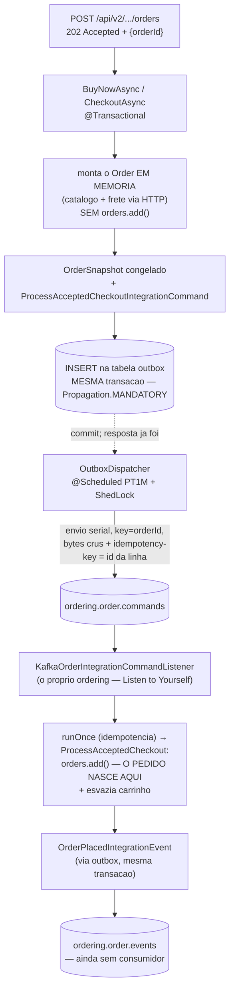

# Outbox e checkout assíncrono: o pedido que responde antes de existir

> A pendência mais antiga da mensageria — **outbox** — fecha nesta fase, e fecha grande: junto vêm o Command Message, o Listen to Yourself e um checkout inteiro redesenhado. O `POST /api/v2/customers/me/orders` responde **202 Accepted** com um `orderId` que ainda não está no banco: o pedido nasce depois, quando o próprio ordering consumir o comando que ele mesmo publicou. Este doc fecha a trilogia da resiliência — [producer](./resiliencia-producer-kafka.md) e [consumer](./resiliencia-consumer-kafka.md) são os irmãos — e mostra os dois desenhos de consistência lado a lado: o catálogo escolheu transação estendida; o ordering escolheu outbox. Compará-los é o exercício da fase.
> Código real: `algashop-ordering/.../infrastructure/adapters/out/messaging/outbox/` (Recorder, Dispatcher, KafkaSender, Message, Repository, Config, publishers), `core/application/checkout/` (async services, ProcessAccepted, `command/OrderSnapshot*`), `infrastructure/adapters/in/messaging/kafka/order/KafkaOrderIntegrationCommandListener.java`, `infrastructure/adapters/in/web/order/MyOrderV2Controller.java`, migração V009.

---

## O fluxo ponta a ponta



## Command Message: comando ≠ evento

Tudo que atravessou tópicos até aqui era **evento**: fato consumado, no passado, produtor que esquece. `ProcessAcceptedCheckoutIntegrationCommand` é outra espécie: **imperativo**, com **um destinatário** e **expectativa de execução** — "processe este checkout". Evento conta o que aconteceu; comando pede trabalho. A diferença aparece até no handler default do listener: evento desconhecido se **ignora** (evolução normal do produtor); comando desconhecido no próprio tópico da aplicação é **anomalia** e vai direto ao DLT.

O comando carrega um **`OrderSnapshot`** — o agregado inteiro desembrulhado em tipos simples: preços, frete calculado, `totalAmount`, tudo **congelado no momento do aceite**. O consumidor não rechama catálogo nem frete: reconstrói via `Order.existing()` e persiste. (O `shoppingCartId` viaja de carona no snapshot — não pertence ao Order, mas o consumidor precisa saber qual carrinho esvaziar.) É o mesmo princípio do ECST, aplicado a comando: quem transporta o estado dispensa a consulta.

## Listen to Yourself: consumir o próprio comando

Por que publicar um comando para **si mesmo**? Porque a resposta rápida e o processamento confiável são exigências em conflito, e o padrão as separa em dois papéis do mesmo serviço: a borda valida o que dá para validar cedo (cliente/produto/carrinho existem? segurança? — isso ainda falha síncrono, 422/403 no POST) e **aceita**; o processamento pesado (persistir, esvaziar carrinho, publicar o evento) acontece do outro lado do tópico, com todo o aparato de resiliência do consumidor — retry com backoff, DLT, idempotência. Falha no processamento não derruba o request, que já foi; vira redelivery, e no limite DLT com 30 dias para intervenção.

O listener tem grupo próprio (`ordering.order-commands`) e a Order nasce com **duas guardas** de idempotência: a PK de `processed_message` (via `runOnce`, chave = header) e o `orders.exists(orderId)` no service — cinto e suspensório, porque o header pode faltar.

## A Outbox — finalmente

O dual-write (banco commitado ≠ evento publicado) perseguiu o módulo desde a Fase 38. A outbox o mata pela raiz: **o único write síncrono é no banco**.

**O lado transacional** — `OutboxRecorder`, com a anotação mais importante do pacote: `@Transactional(propagation = MANDATORY)`. Não é "abra transação se precisar": é **exija transação existente** — gravar mensagem de outbox fora da transação de negócio é exatamente o bug que o padrão elimina, então o código o torna impossível (`IllegalTransactionStateException` na hora). O payload entra **já serializado** pelo mesmo `JacksonJsonSerializer` do caminho Kafka, com o mesmo `__TypeId__` lógico — o dispatcher depois só transporta bytes.

**O lado assíncrono** — `OutboxDispatcher`, um *polling publisher*: a cada `PT1M`, uma instância (ShedLock) lê um batch e envia **em série**, na ordem de inserção (id UUIDv7 é ordenável por tempo), com key = `aggregateId` e envio síncrono (`get(5s)`, template dedicado de `byte[]`). Enviou → DELETE da linha; falhou → `attempts+1`, `nextAttemptAt = now + backoff`, e no décimo erro `failedAt` — mensagem que exige **intervenção manual**.

**As guardas do ciclo** (a aula 6.32, em código): deadline de batch `PT3M` < lock `PT5M` (o ciclo acaba antes do lock expirar — outra instância nunca começa em cima de um ciclo vivo); e `blockedAggregates` — a primeira falha de um aggregate **bloqueia as mensagens seguintes dele no ciclo**. Essa é a resposta da aula 6.33 à pergunta de ordem: a mensagem N+1 de um pedido jamais ultrapassa a N que falhou; aggregates diferentes seguem fluindo.

## A armadilha central: o findBatch que não filtrava

O `findBatch` original era `SELECT ... ORDER BY m.id` — **sem WHERE**. Consequência em duas etapas: mensagens com `failedAt` nunca são deletadas; sendo as mais antigas (UUIDv7), são **sempre as primeiras do batch**. Com 100 mensagens mortas ou em backoff, o dispatcher passa a varrer só elas — e **nenhuma mensagem nova sai, nunca mais**. Starvation total do outbox, causada pelas próprias mensagens que ele prometeu não perder.

O conserto tem uma sutileza que é a lição inteira: filtrar **a linha** inelegível quebraria a ordem (a N some da query, a N+1 do mesmo pedido passa na frente). O filtro certo é **no nível do aggregate**:

```sql
WHERE m.aggregateId NOT IN (
    SELECT b.aggregateId FROM OutboxMessage b
    WHERE b.failedAt IS NOT NULL OR b.nextAttemptAt > :now)
```

— o aggregate com problema fica **inteiro** de fora (equivalente às guardas em memória, que permanecem como segunda camada), e o batch volta a enxergar trabalho real. Resiliência que não filtra a própria fila trava; filtro que ignora ordem corrompe. Os dois erros são um WHERE de distância.

## As duas chaves de idempotência

Detalhe que morde ao trocar de modo: no caminho **direto** (outbox desligado), o header `idempotency-key` vem do campo `idempotencyKey` do evento/comando; no caminho **outbox**, vem do **id da linha** (o campo do comando nem é persistido — `@JsonIgnore`, dead code nesse modo). Ambas estáveis entre reenvios, então funciona — mas são fontes diferentes: desligar a outbox muda a identidade das mensagens, e as já processadas não se reconheceriam. Registrado como decisão a unificar.

## O que NÃO fechou — dito com todas as letras

- **Notificação perdida no V2 (AGUDA).** `Order.existing()` não emite eventos de domínio → o `OrderEventListener` (que notifica o cliente) **nunca dispara** para pedidos assíncronos. Quem compra pelo V2 não recebe notificação; só o caminho V1 notifica. Regressão funcional silenciosa, documentada no código e aqui.
- **Janela de duplo-checkout.** Entre o 202 e o consumo (~1min), o carrinho ainda está cheio — um segundo POST gera **outro** `orderId` e outro comando; nada deduplica por `shoppingCartId`. Duas Orders do mesmo carrinho são possíveis por design atual.
- **Latência de 1 minuto** do 202 ao pedido existir (`poll-interval: PT1M`) — correto para estudo, inaceitável para checkout real; a resposta clássica é poll mais curto ou notificação do dispatcher.
- **Backoff fixo e curto**: 10 tentativas × 5s ≈ 50s de tolerância a outage do broker antes do `failedAt` — e não há replay automatizado nem endpoint de reprocessamento; `failedAt` é literalmente "chame um humano".
- **`ordering.order.events` sem consumidor** — o OrderPlaced sai e ecoa no vazio (billing é o candidato natural).
- **Validação ausente no caminho outbox** — o `BeanValidationUtil` só roda nos publishers diretos, que estão desligados; o `OutboxRecorder` grava sem validar.
- **Zero testes** para outbox, dispatcher, idempotência e checkout assíncrono.

## Pendências registradas

- [ ] **Notificar pedidos V2** — emitir a notificação no ProcessAcceptedCheckout (ou fazer o assembler registrar o evento de domínio)
- [ ] **Deduplicar checkout por carrinho** — a janela do duplo-POST
- [ ] **Replay do outbox** — rotina/endpoint para `failedAt`, e backoff exponencial no lugar do fixo
- [ ] **Consumidor para `ordering.order.events`** (billing) — e o contrato AsyncAPI dos tópicos novos, que [já nasceu defasado](./asyncapi-contratos.md)
- [ ] **Validar no OutboxRecorder** — a proteção de contrato precisa valer no caminho que roda
- [ ] **Unificar a fonte da idempotency-key** — id da linha × campo do comando
- [ ] **Testes**: outbox grava na transação (MANDATORY estoura fora), dispatcher preserva ordem por aggregate, starvation não volta

## Checklist de revisão

- [ ] Sei explicar comando × evento — e por que o handler default trata os dois diferente
- [ ] Sei por que o snapshot congela preço/frete — e o que o consumidor NÃO refaz
- [ ] Sei o papel do `Propagation.MANDATORY` — e o que ele torna impossível
- [ ] Consigo narrar as guardas do ciclo do dispatcher: deadline × lock, blockedAggregates, backoff, failedAt
- [ ] Entendo a starvation do findBatch — e por que o filtro é por AGGREGATE, não por linha
- [ ] Sei comparar os dois desenhos da fase: transação estendida (catálogo) × outbox (ordering) — o que cada um paga e compra

## Referências

- [Microservices.io — Transactional Outbox](https://microservices.io/patterns/data/transactional-outbox.html) · [Polling Publisher](https://microservices.io/patterns/data/polling-publisher.html)
- [Microservices.io — Command side / Messaging patterns](https://microservices.io/patterns/communication-style/messaging.html) (command message)
- [Listen to Yourself — pattern](https://medium.com/@odedia/listen-to-yourself-design-pattern-for-event-driven-microservices-16f97e3ed066)
- [Resiliência no producer](./resiliencia-producer-kafka.md) · [Resiliência no consumer](./resiliencia-consumer-kafka.md) · [Fundamentos de EDA](./fundamentos-eda.md) · [AsyncAPI: contratos](./asyncapi-contratos.md)
