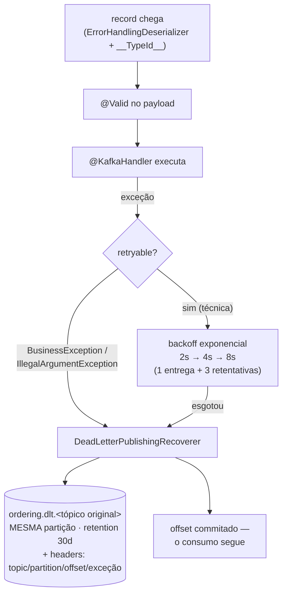

# Resiliência no consumer: não perder, não repetir

> O [produtor aprendeu a não mentir](./resiliencia-producer-kafka.md); agora o consumidor aprende a não perder e a não repetir. A [Fase 39](./ecst-e-validacao-de-eventos.md) tinha descoberto o pior default do spring-kafka — exceção no handler = 10 tentativas sem intervalo e **descarte silencioso** com offset commitado. Esta fase substitui o default por um desenho completo: backoff exponencial, distinção entre erro que vale retry e erro que não vale, Dead Letter Topic com partição preservada, e a peça que torna o at-least-once habitável: **idempotência de negócio** com uma tabela, uma PK e uma transação. Terceiro irmão: [outbox e checkout assíncrono](./outbox-e-checkout-assincrono.md).
> Código real: `algashop-ordering/.../infrastructure/config/kafka/KafkaConfig.java`, `core/ports/out/idempotency/ForGuardingIdempotency.java`, `infrastructure/adapters/out/persistence/idempotency/` (impl, entidade, cleaner), `infrastructure/config/scheduling/SchedulingConfig.java`, migrações V006–V008, `application-development-env.yaml`.

---

## O fluxo de erro, ponta a ponta



Duas decisões carregam o desenho:

- **Retryable × não-retryable.** Retentar uma falha **técnica** (banco fora, timeout) faz sentido — o mundo pode melhorar em 8 segundos. Retentar uma **`BusinessException`** é queimar tempo: a regra violada não vai mudar porque se esperou. `IllegalArgumentException` idem (payload/header malformado). As duas vão **direto** ao DLT — e de quebra o `DefaultErrorHandler` corrige a semântica do backoff: `setMaxAttempts(3)` no `ExponentialBackOff` são 3 **retentativas** (4 entregas), não "3 tentativas".
- **DLT com a MESMA partição do original.** O resolver do recoverer devolve `new TopicPartition(DLT_PREFIX + topic, record.partition())` — a ordem por key sobrevive dentro do hospital de mensagens. Retention de 30 dias: a mensagem doente não se perde, espera diagnóstico. `setFailIfSendResultIsError(false)`: se até o DLT falhar, loga e segue — a última linha de defesa não pode virar loop.

O que mudou em relação à Fase 39, dito sem rodeio: **o descarte silencioso acabou**. Falha agora tem destino com nome, retenção e headers contando de onde veio e por quê.

## Idempotência de negócio: uma PK como mecanismo

O produtor deduplica **transporte** (retry interno ≠ duplicata no log); nada disso protege contra **redelivery** — rebalance, reprocessamento, o mesmo evento entregue duas vezes ao handler. A resposta é a porta `ForGuardingIdempotency`:

```java
boolean runOnce(UUID idempotencyKey, Runnable work);
```

A implementação é deliberadamente primitiva — e é por isso que funciona:

```
transação {
    INSERT processed_message(idempotency_key)   ← saveAndFlush: a PK estoura AQUI
    work.run()                                   ← o efeito de negócio, NA MESMA transação
}   ← commit único: marca + efeito, atômicos
```

- Chave inédita → INSERT passa, work roda, **um** commit grava marca e efeito juntos.
- Chave repetida → violação de PK → rollback + `false` — nada executou, nem meio work.

A ordem importa: **marcar antes, não depois**. Marcar depois do work abre a janela clássica (efeito commitado, marca perdida no crash, redelivery reprocessa); marcar junto fecha os dois lados. Não há SELECT-antes — a **unicidade do banco** é o mecanismo, imune a race entre threads/instâncias (`concurrency=3` roda três handlers em paralelo). `Persistable.isNew()=true` poupa o SELECT prévio do Hibernate: a tabela só insere. A chave chega no header `idempotency-key` (gerada no produtor; no caminho outbox, o id da linha — [detalhe no doc irmão](./outbox-e-checkout-assincrono.md)); header ausente não derruba nada: processa sem guarda, com aviso — mensagem legada não pode virar retries + DLT por erro de binding.

**O que ficou sem guarda, de propósito:** Listed/Delisted só flipam um boolean — redelivery reescreve o mesmo valor, efeito idempotente por natureza. Guardar custaria um INSERT por evento para proteger nada. A régua: guarda-se o que tem efeito **não-idempotente** (preço com e-mail futuro, criação de pedido), não tudo.

## A tabela que cresce para sempre — e o cleaner

Cada mensagem processada é uma linha eterna em `processed_message`. O `ProcessedMessageCleaner` roda a cada 10 min: apaga o que passou de **10 dias** (mais que a retention dos tópicos — nenhuma redelivery legítima chega depois disso), em **batches de 200, teto de 20 por execução**, cada batch na própria transação curta (nada de lock longo), servido pelo índice de `processed_at` (V007 — criado junto, não depois do primeiro incidente).

E quem garante que só **uma instância** limpa por vez? **ShedLock** (`@SchedulerLock`, tabela V008, `usingDbTime()` para não depender de relógio de instância). Vale o contraste com o que o projeto já tinha: o [`SKIP LOCKED` do billing](../04-infraestrutura/scheduled-jobs.md) faz as instâncias **dividirem** o trabalho (cada uma pega linhas diferentes); o ShedLock faz uma **excluir** as outras (o job roda inteiro em um lugar só). Dois problemas de coordenação, duas ferramentas — o cleaner e o [OutboxDispatcher](./outbox-e-checkout-assincrono.md) usam a segunda.

## Paralelismo e os tunings de laboratório

`concurrency = "3"` na anotação = 3 threads de consumo, uma por partição — o teto útil (a 4ª thread ficaria ociosa: partição não se divide entre consumidores do mesmo grupo). E os listeners agora têm `id` próprio (`ordering.product-events`, `ordering.order-commands`), que por default **vira o group.id**: cada listener é um grupo, com offsets próprios — não mais o `group-id: ordering` global.

Dois tunings são explicitamente de laboratório, não de produção: `max.poll.records: 1` (um record por poll — didático para observar o fluxo, péssimo para throughput) e `logging.level org.apache.kafka: OFF` — que silencia exatamente os logs de rebalance e retry que um módulo de resiliência quer ver. Ligue-os de volta ao estudar falhas.

## Armadilhas encontradas

- **"Retry infinito" era mito; "3 tentativas" também.** A Fase 39 documentou retry infinito (errado — era descarte após 10); o comentário novo dizia "3 tentativas" (eram 3 **retentativas**, 4 entregas). Semântica de retry é traiçoeira em toda camada — conte ENTREGAS, não tentativas.
- **DLT de tópico que ninguém consome.** `ordering.dlt.ordering.order.events` existe, mas o ordering é só **produtor** de `ordering.order.events` — DLT é artefato de consumo; esse nunca receberá nada até existir um consumidor. Inofensivo, mas denuncia criação por simetria em vez de por necessidade.
- **Recoverer com serializer JSON.** O `DeadLetterPublishingRecoverer` usa o `KafkaTemplate<String, Object>` (JacksonJsonSerializer). Para falha de **desserialização**, o robusto seria um template de `byte[]` — republicar os bytes crus, não um JSON do erro. Pendência.
- **Header obrigatório é bomba de binding.** `@Header` sem `required=false` faz mensagem sem o header falhar ANTES do handler — 4 entregas inúteis e DLT por um metadado. Corrigido com o fallback "processa sem guarda".

## Pendências registradas

- [ ] **Quem olha o DLT?** — 30 dias de retenção sem consumidor, alerta ou rotina de replay: o hospital existe, o médico não
- [ ] **Template de `byte[]` para o recoverer** — republicar bytes crus em falha de desserialização
- [ ] **Métrica de consumer lag** — a pendência mais antiga do módulo segue aberta, agora com DLTs para monitorar também
- [ ] **Reverter os tunings de laboratório** (`max.poll.records`, logging OFF) quando o estudo terminar
- [ ] **Testes** — um IT com broker embarcado provando: retry → DLT, e duplicata → skip

## Checklist de revisão

- [ ] Sei contar as entregas do backoff (1 + 3) e por que `BusinessException` não retenta
- [ ] Sei por que o DLT preserva a partição do original — e o que se perderia sem isso
- [ ] Consigo explicar o INSERT-first: por que marcar ANTES, na MESMA transação, sem SELECT
- [ ] Sei o que fica sem guarda de idempotência e defender o porquê
- [ ] Sei a diferença ShedLock × SKIP LOCKED e quando cada um é o certo
- [ ] Sei quais configs são de laboratório e o que elas escondem

## Referências

- [Spring Kafka — Annotation Error Handling](https://docs.spring.io/spring-kafka/reference/kafka/annotation-error-handling.html) (DefaultErrorHandler, backoff, não-retryables)
- [Spring Kafka — Dead Letter Publishing](https://docs.spring.io/spring-kafka/reference/kafka/annotation-error-handling.html#dead-letters)
- [ShedLock](https://github.com/lukas-krecan/ShedLock) · [Microservices.io — Idempotent Consumer](https://microservices.io/patterns/communication-style/idempotent-consumer.html)
- [Resiliência no producer](./resiliencia-producer-kafka.md) · [Outbox e checkout assíncrono](./outbox-e-checkout-assincrono.md) · [ECST e validação](./ecst-e-validacao-de-eventos.md) · [Jobs agendados](../04-infraestrutura/scheduled-jobs.md)
