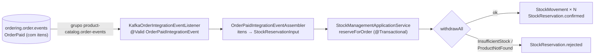
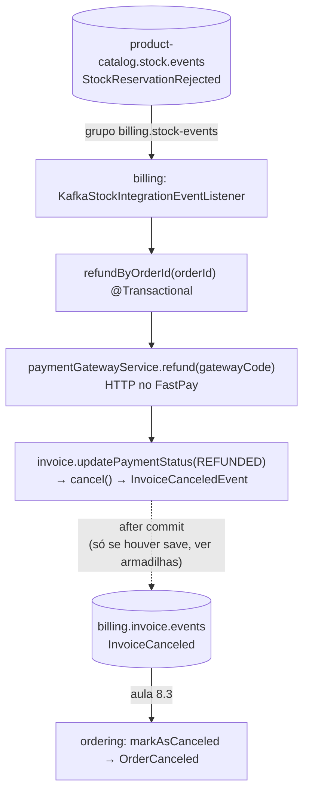
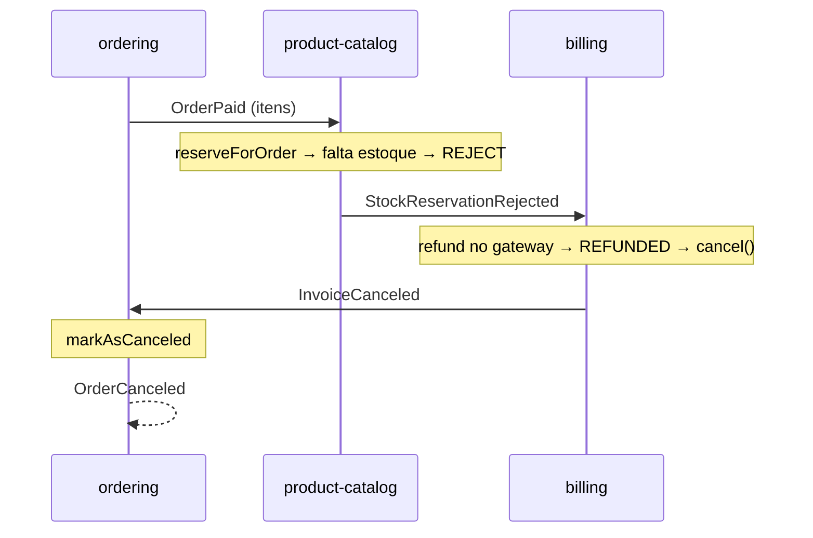

# Saga coreografada: desfazer o que já foi feito em outro serviço

> **Atualização (Fase 44, saga orquestrada):** a saga coreografada descrita aqui **foi removida do código** para dar lugar à orquestração. Os consumidores que faziam o fluxo andar saíram dos três serviços; ficaram as operações de trabalho (`generate`, `refundByOrderId`, `reserveForOrder`) e os eventos de pedido. Este doc fica como registro do desenho, das armadilhas e do balanço da 8.13. O porquê da remoção está em [Saga orquestrada](./saga-orquestrada.md#removendo-a-saga-coreografada).

> O [workflow coreografado](./workflow-coreografado.md) cuidou do caminho feliz. Este módulo cuida do outro: o pagamento é recusado, o estoque acaba depois de o cliente pagar. Num monólito isso seria um `rollback`. Aqui não existe transação que abrace ordering, billing e catálogo, então cada passo já commitado precisa de um **passo contrário**, que também é uma transação local disparada por evento. Esse conjunto de transações locais e suas compensações é uma **saga**.
> Doc do módulo 8 da trilha ("Transações distribuídas com Saga e coreografia"), **completo**: a saga inteira está no código, do caminho feliz até o estorno. O módulo 9 vai refazer o mesmo fluxo com orquestração.
> Código real:
> - **billing**: `infrastructure/listener/InvoiceEventListener.java` (publica `InvoiceCanceled`), `infrastructure/kafka/KafkaStockIntegrationEventListener.java` (consome a rejeição), `application/invoice/management/InvoiceManagementApplicationService.refundByOrderId`, `domain/model/invoice/payment/PaymentGatewayService.refund`.
> - **ordering**: `infrastructure/adapters/in/messaging/kafka/invoice/KafkaInvoiceIntegrationEventListener.java`, `infrastructure/adapters/in/messaging/kafka/stock/KafkaStockIntegrationEventListener.java`, `infrastructure/adapters/in/messaging/kafka/product/KafkaProductIntegrationEventListener.java`, `infrastructure/adapters/in/listerner/order/OrderEventListener.java`, `core/application/order/event/OrderCanceled|OrderReadyIntegrationEvent.java`.
> - **product-catalog**: `domain/stock/` (`StockReservation`, `StockService`, `StockMovement`, eventos), `application/stock/management/StockManagementApplicationService.java`, `application/stock/event/`, `infrastructure/listener/order/KafkaOrderIntegrationEventListener.java`, `infrastructure/listener/stock/` (`StockReservationEventListener`, `StockMovementEventListener`), `infrastructure/kafka/` (`KafkaConfig`, `KafkaConsumerTypeIdIdentifier`).

---

## O mapa, agora pelas faixas de baixo


No módulo 7 o olho ia para as faixas azul e verde. A saga mora nas duas de baixo:

- **Vermelho (Failure Event)**: o fato de que algo deu errado. `Invoice Canceled`, `Stock Reservation Rejected`, `Order Canceled`.
- **Laranja (Handler de compensação)**: quem desfaz um passo que **já tinha dado certo**. `mark order as canceled`, `Refund Payment`.

### Status no código

| # | Passo da saga | Serviço | Status |
|---|---|---|---|
| C1 | `InvoiceCanceled` → marcar pedido como cancelado → `OrderCanceled` | billing → ordering | ✅ aula 8.3 |
| S1 | Modelo da reserva de estoque (`StockReservation`) | catálogo | ✅ aula 8.4 |
| S2 | Baixa dos itens de um pedido (`StockService.withdrawAll`) | catálogo | ✅ aula 8.5 |
| S3 | `OrderPaid` → reservar estoque → `StockReservationConfirmed` / `Rejected` | ordering → catálogo | ✅ aulas 8.6–8.9 |
| S4 | `StockReservationConfirmed` → pedido pronto (`OrderReady`) | catálogo → ordering | ✅ aula 8.10 |
| C2 | `StockReservationRejected` → estornar pagamento → `InvoiceCanceled` → C1 | catálogo → billing → ordering | ✅ aula 8.11 (com um elo quebrado, ver [armadilhas](#o-estorno-não-publica-o-invoicecanceled)) |
| P1 | `ProductSoldOut` / `Restocked` / `PlacedOnSale` no Kafka; carrinho reage | catálogo → ordering | ✅ aula 8.12 |

---

## 8.1 — Transações distribuídas com Saga

### Por que não dá para ter uma transação só

Uma transação ACID depende de **um** gerenciador que trava os dados, decide commit ou rollback e garante que ninguém vê o meio do caminho. O pedido está no Postgres do ordering, a fatura no Postgres do billing e o estoque no MongoDB do catálogo: três bancos, três donos. O protocolo clássico para coordenar isso (two-phase commit) exige que os três segurem locks enquanto esperam um coordenador, e qualquer um fora do ar trava os outros. É o oposto do que os microsserviços buscam.

A saga aceita essa realidade: **cada passo é uma transação local, que commita sozinha e na hora**. A consistência entre serviços passa a ser eventual, e é garantida por compensações em vez de rollback.

### Compensação não é rollback

Rollback apaga o que aconteceu como se nunca tivesse existido. Compensação é **um fato novo que anula o efeito de um fato anterior**, e os dois ficam registrados:

| Passo commitado | Compensação | O que fica na história |
|---|---|---|
| Pedido `PLACED` | Pedido `CANCELED` | O pedido existiu e foi cancelado |
| Pagamento capturado | Estorno (`REFUNDED`) | O cliente foi cobrado e reembolsado |
| Estoque baixado | Estoque devolvido (entrada) | Dois movimentos em `stock_movements` |

Por isso a compensação precisa ser **semântica**: só o dono do dado sabe desfazer o próprio passo de um jeito que faça sentido para o negócio. Estornar é uma operação do gateway, não um `DELETE` na tabela de faturas.

### Os três tipos de passo

| Tipo | O que é | Na AlgaShop |
|---|---|---|
| **Compensável** | Pode ser desfeito por outro passo | Pedido realizado, fatura emitida |
| **Pivô** | O ponto de não retorno: se ele dá certo, a saga vai até o fim (ou compensa); antes dele, desistir é barato | A cobrança no gateway |
| **Reexecutável** | Depois do pivô, tem que dar certo: se falhar, tenta de novo até conseguir | Marcar o pedido como pronto |

A reserva de estoque fica **depois** do pivô e **pode falhar** (acabou o produto). É por isso que o mapa tem o `Refund Payment`: o passo posterior falhou, então a saga anda para trás e compensa o pivô.

### O que a saga não garante: isolamento

Das quatro letras de ACID, a saga entrega A (via compensação), C (eventual) e D (cada passo commita). O **I** fica de fora: os estados intermediários são **visíveis**. Entre "pagamento capturado" e "estoque rejeitado", o pedido aparece como `PAID` para o cliente, e depois vira `CANCELED`. Outro pedido pode ler o estoque nesse intervalo.

As contramedidas são de **desenho**, não de banco:

- **Estados intermediários explícitos**: `PAID` não significa "vai chegar". Só `READY` significa. A interface e as regras de negócio precisam respeitar essa diferença.
- **Ordenar os passos pelo risco**: o que mais falha vai antes do pivô sempre que possível. (Reservar o estoque **antes** de cobrar evitaria estornos; o curso mantém depois, e o custo disso é o `Refund Payment`.)
- **Compensações idempotentes**: o evento de falha pode chegar duas vezes, e estornar duas vezes é pior que não estornar.

## 8.2 — A saga da AlgaShop

| Passo | Transação local | Serviço | Se um passo **posterior** falhar |
|---|---|---|---|
| 1 | Pedido realizado | ordering | Cancelar o pedido |
| 2 | Fatura emitida | billing | Cancelar a fatura |
| 3 | **Pagamento capturado** (pivô) | billing | Estornar o pagamento |
| 4 | Estoque reservado | catálogo | (último passo que pode falhar; a falha dispara as compensações) |
| 5 | Pedido pronto | ordering | Não compensa: só tenta de novo |

Repare que as compensações **se encadeiam pelos eventos que já existem**. O estorno não cancela o pedido diretamente: o estorno vira `REFUNDED` → `Invoice.cancel()` → `InvoiceCanceled`, e o ordering já sabe reagir a isso desde a 8.3. Uma compensação nova (estorno) reaproveita outra já pronta (cancelar pedido). Em coreografia, isso é o natural: cada serviço reage a fatos, sem saber quem disparou a cadeia.

## 8.3 — Cancelando o pedido pela fatura cancelada

```mermaid
flowchart LR
    A["Invoice.updatePaymentStatus<br/>FAILED / REFUNDED"] --> B["Invoice.cancel()<br/>InvoiceCanceledEvent"]
    B -->|"after commit"| C[("billing.invoice.events<br/>InvoiceCanceledIntegrationEvent<br/>key = invoiceId")]
    C -->|"grupo ordering.invoice-events"| D["KafkaInvoiceIntegrationEventListener<br/>@KafkaHandler InvoiceCanceled"]
    D --> E["ForManagingOrders.markAsCanceled(orderId)<br/>@Transactional"]
    E --> F["Order.markAsCanceled()<br/>OrderCanceledEvent"]
    F --> G["OrderEventListener<br/>Mapper.convert → OrderCanceledIntegrationEvent"]
    G --> H[("outbox → ordering.order.events<br/>key = orderId")]
```



O desenho é o mesmo do `InvoicePaid` ([workflow, aula 7.10](./workflow-coreografado.md#710--passo-5-o-pedido-pago-e-o-próximo-evento)), com o sinal trocado:

- **No billing**, o listener de `InvoiceCanceledEvent`, que estava vazio, passou a `@TransactionalEventListener` e publica o evento de integração. A fatura cancela por duas causas, ambas em `Invoice.updatePaymentStatus`: pagamento `FAILED` (recusado) ou `REFUNDED` (estornado). A segunda é a ponte para a compensação da 8.11.
- **No ordering**, um segundo `@KafkaHandler` no mesmo listener de faturas chama `markAsCanceled`. O `OrderEventListener` publica `OrderCanceled` pela outbox, na mesma transação do cancelamento.

### Por que `CANCELED` aceita vir de quase todo status

```java
CANCELED(DRAFT, PLACED, PAID, READY); // pode vim de todos
```

Numa saga, o cancelamento é a **compensação genérica** do pedido, e ela pode chegar em qualquer ponto: fatura recusada (pedido `PLACED`), estoque rejeitado depois do pagamento (pedido `PAID`). Se a máquina de estados só deixasse cancelar a partir de `PLACED`, a compensação da 8.11 falharia com `OrderStatusCannotBeChanged` e iria para o DLT. A máquina de estados precisa ser desenhada **junto** com a saga.

### Mapper × assembler

`OrderPlaced` e `OrderPaid` usam assemblers escritos à mão. `OrderCanceled` usa `Mapper.convert(event, OrderCanceledIntegrationEvent.class)`, ou seja, ModelMapper. Faz sentido: o evento de cancelamento tem só `orderId`, `customerId` e `canceledAt`, sem snapshot nem itens. O risco está nos tipos: a origem é o record `OrderCanceledEvent(OrderId, CustomerId, OffsetDateTime)` e o destino tem `String` e `UUID`. Ver [armadilhas](#armadilhas).

## 8.4 — Modelando a reserva de estoque

O catálogo ganhou um pacote próprio, `domain/stock`, e nele um agregado novo:

```java
@Document(collection = "stock_reservations")
public class StockReservation extends AbstractAggregateRoot<StockReservation> {
    @Id private UUID id;
    @Indexed(name = "uidx_stock_reservation_by_order", unique = true)
    private String orderId;
    private Status status;            // CONFIRMED | REJECT
    private OffsetDateTime createdAt;
    private List<StockReservationItem> items;   // productId + quantity (>= 1), imutável

    public static StockReservation confirmed(String orderId, List<StockReservationItem> items) { ... }
    public static StockReservation rejected(String orderId, List<StockReservationItem> items) { ... }
}
```

Quatro decisões que valem guardar:

1. **A reserva registra o resultado, não um processo.** Não existe status "pendente" nem expiração: quando a reserva é gravada, a decisão já foi tomada. As duas factories dizem isso no nome (`confirmed`, `rejected`), e cada uma registra o seu evento de domínio (`StockReservationConfirmedEvent`, `StockReservationRejectedEvent`). Esses são os fatos verde e vermelho do mapa.
2. **A rejeição também é gravada.** Poderia ser só uma exceção, mas aí não sobraria rastro de **por que** o pedido 42 foi cancelado. Na saga, a falha é um fato do negócio e merece documento.
3. **Índice único em `orderId` = idempotência.** Um pedido, uma reserva. Se o `OrderPaid` chegar duas vezes, a segunda gravação falha no Mongo, e o `existsByOrderId` do repositório permite checar antes. É a mesma ideia do `UNIQUE (order_id)` da fatura ([workflow, 7.6](./workflow-coreografado.md#idempotência-pela-constraint)).
4. **Agregado separado do `Product`.** A reserva envolve **vários** produtos de uma vez e pertence a um **pedido**. Colocá-la dentro do `Product` obrigaria a carregar e salvar N agregados para registrar uma decisão só. O `Product` continua dono da quantidade; a `StockReservation` é dona da decisão.

## 8.5 — Retirando itens reservados do estoque

### A refatoração: estoque virou um subdomínio

| Antes (`domain/product`) | Depois (`domain/stock`) |
|---|---|
| `StockService.restock(Product, int)` | `StockService.restock(UUID, int)` |
| `StockService.withdraw(Product, int)` | `StockService.withdraw(UUID, int, String orderId)` |
| — | `StockService.withdrawAll(String orderId, List<StockReservationItem>)` |
| `QuantityInStockAdjustment.Result.isOutOfStock()` / `isRestocked()` | `StockMovementRegisteredEvent.causedSoldOut()` / `causedRestock()` |
| `StockService` publicava `ProductSoldOut`/`ProductRestocked` | `StockMovement` registra `StockMovementRegisteredEvent`; `StockMovementEventListener` traduz |
| `StockMovement` era documento simples | `StockMovement extends AbstractAggregateRoot`, com `orderId` |

O efeito é tirar do `StockService` a responsabilidade de **anunciar** o que aconteceu. Ele só calcula e devolve movimentos. Quem anuncia é o próprio `StockMovement`, que registra o evento no construtor e o publica quando é salvo, pelo mecanismo do `AbstractAggregateRoot`. O `orderId` no movimento liga cada baixa ao pedido que a causou, e isso vai ser essencial para devolver o estoque numa compensação.

### `withdrawAll`: agrupar, validar tudo, baixar

```java
// 1. agrupa: {A:2}, {A:3} → {A:5}
Map<UUID, Integer> quantityByProduct = items.stream().collect(groupingBy(..., summingInt(...)));
// busca todos numa consulta só
Map<UUID, Product> productById = productRepository.findAllById(quantityByProduct.keySet())...;
// 2. falha rápida: qualquer produto inexistente ou sem saldo recusa o pedido inteiro
quantityByProduct.forEach((id, qty) -> { ... ProductNotFoundException / InsufficientStockException });
// 3. baixa um por um, pelo withdraw() atômico
return quantityByProduct.entrySet().stream().map(e -> withdraw(e.getKey(), e.getValue(), orderId)).toList();
```

- **Agrupar** evita duas baixas do mesmo produto e uma validação errada: dois itens de 3 unidades com saldo 5 passariam um a um e falhariam juntos.
- **Validar tudo antes** é a regra "tudo ou nada" do pedido: não adianta baixar o produto A se o B não tem saldo.
- **A pré-validação não é garantia.** Entre ler o `Product` e baixar, outro pedido pode levar o estoque. Quem garante de verdade é o `decrease()` atômico do `QuantityInStockAdjustmentMongoDBImpl` (atualização condicional, ver [Concorrência e atomicidade](../02-persistencia/concorrencia-e-atomicidade.md)). A pré-checagem só evita **começar** algo que já se sabe que vai falhar.

### `MANDATORY`: o ajuste exige transação

> **Atualização (Fase 44):** o `MANDATORY` foi removido do `QuantityInStockAdjustmentMongoDBImpl`. Os testes de fatia e de concorrência chamam o ajuste sem transação, e o `findAndModify` já é atômico por documento; quem precisa de "tudo ou nada" (`reserveForOrder`, `restock`, `withdraw`) continua abrindo a transação. Com isso, a [corrida na reserva](#a-corrida-na-reserva-funciona-por-acidente) também muda: sem o proxy `MANDATORY`, a exceção do `decrease()` não marca mais a transação como rollback-only. O `catch` do `reserveForOrder` grava a rejeição e o commit leva junto as baixas parciais que já aconteceram. Detalhes em [Saga orquestrada](./saga-orquestrada.md#os-testes-que-já-estavam-quebrados).

```java
@Transactional(propagation = Propagation.MANDATORY)
public class QuantityInStockAdjustmentMongoDBImpl implements QuantityInStockAdjustment { ... }
```

É o mesmo recurso do `OutboxRecorder` do ordering: não "abra uma transação se precisar", e sim **"recuse rodar sem uma"**. A consequência para o `withdrawAll` é importante. Se o terceiro produto falhar no `decrease()`, os dois primeiros já foram baixados, mas **dentro da mesma transação do chamador**, que dá rollback em tudo (o Mongo tem transação multi-documento no replica set, ver [Transações e replica set](../02-persistencia/transacoes-mongo.md)). O "tudo ou nada" passa a valer também para a falha que a pré-validação não pegou. (Na 8.6 o chamador captura essa exceção, e a interação com o `MANDATORY` tem uma consequência sutil: ver [a corrida na reserva](#a-corrida-na-reserva-funciona-por-acidente).)

---

## 8.6 — Reservando estoque para o pedido

O caso de uso que junta as duas peças anteriores (`withdrawAll` e `StockReservation`) mora em `StockManagementApplicationService.reserveForOrder`:

```java
@Transactional
public void reserveForOrder(StockReservationInput input) {
    String orderId = input.getOrderId();
    assertReservationDoesNotExists(orderId);          // existsByOrderId → DuplicateStockReservationException

    List<StockReservationItem> items = toItems(input);
    List<StockMovement> movements;
    StockReservation reservation;
    try {
        movements = stockService.withdrawAll(orderId, items);
        reservation = StockReservation.confirmed(orderId, items);
    } catch (InsufficientStockException | ProductNotFoundException e) {
        movements = List.of();
        reservation = StockReservation.rejected(orderId, items);
    }

    if (!movements.isEmpty()) stockMovementRepository.saveAll(movements);
    stockReservationRepository.save(reservation);
}
```

A linha que mais ensina é o `catch`. Falta de estoque **não é erro do sistema**, é um desfecho de negócio, e por isso não sobe como exceção para o listener Kafka (que faria retry e DLT). Ela vira um documento `REJECT` gravado com sucesso, e o evento de domínio desse documento é o gatilho da compensação. Compare os dois caminhos:

| Desfecho | O que é gravado | Evento de domínio | O que o Kafka vê |
|---|---|---|---|
| Tem estoque | N `StockMovement` (saída, com `orderId`) + reserva `CONFIRMED` | `StockMovementRegisteredEvent` (por produto) + `StockReservationConfirmedEvent` | Mensagem processada, offset commitado |
| Falta estoque ou produto | Só a reserva `REJECT` | `StockReservationRejectedEvent` | Mensagem processada, offset commitado |
| Pedido já reservado | Nada | Nenhum | `DuplicateStockReservationException` → DLT |

Tudo isso acontece numa transação Mongo: movimentos e reserva commitam juntos. Os eventos só saem depois, pelos `@TransactionalEventListener`.

## 8.7 — O catálogo vira consumidor

Até aqui o catálogo só publicava. Para escutar `ordering.order.events` ele recebeu o mesmo kit de consumidor que o ordering e o billing já tinham:

| Peça | Arquivo | O que faz |
|---|---|---|
| Resolver de tipo | `KafkaConsumerTypeIdIdentifier` | Traduz `__TypeId__` lógico em classe local; tipo desconhecido vira `ObjectNode` e cai no handler default |
| Deserializer seguro | `application-development-env.yml` | `ErrorHandlingDeserializer` em volta do `JacksonJsonDeserializer`: JSON inválido não trava a partição |
| Retry e DLT | `KafkaConfig.defaultErrorHandler` | 2s/4s/8s, DLT `product-catalog.dlt.ordering.order.events` na mesma partição |
| Não-retryable | `KafkaConfig` | `DomainException`, `ConstraintViolationException`, `DataIntegrityViolationException`, `DuplicateKeyException`, `IllegalArgumentException` |
| Grupo | `application-development-env.yml` | `product-catalog.order-events` |
| Type mapping | `application-development-env.yml` | Só `Ordering.OrderPaidIntegrationEvent` do lado do ordering |

`ordering.order.events` agora tem **dois** consumer groups lendo tudo (`billing.order-events` e `product-catalog.order-events`), cada um reagindo a um tipo diferente e ignorando o resto. É o tópico de eventos funcionando como deveria: o ordering publica uma vez, sem saber quantos escutam.

> **Para fixar:** o mesmo kit (resolver de tipo, deserializer, error handler, DLT, lista de não-retryable) existe agora em **três** serviços, copiado. Em coreografia, cada participante carrega a infraestrutura inteira de consumo. Isso volta no balanço da [8.13](#813--opinião-sobre-saga-com-coreografia).

## 8.8 — Reservando o estoque do pedido pago



É aqui que o ECST da aula 7.10 paga a conta: o `OrderPaid` traz os itens (`productId`, `quantity`), e o catálogo não precisa chamar o ordering para saber o que reservar. O assembler faz a tradução anticorrupção de sempre: do `OrderItemSnapshot` (linguagem do pedido, com preço e nome) só sobram `productId` e `quantity`, que é tudo que importa ao estoque.

## 8.9 — Publicando o resultado da reserva

`StockReservationEventListener` escuta os dois eventos de domínio com `@TransactionalEventListener` e publica os eventos de integração em `product-catalog.stock.events`:

| Domínio | Integração | Key |
|---|---|---|
| `StockReservationConfirmedEvent` | `StockReservationConfirmedIntegrationEvent` (`reservationId`, `orderId`, `confirmedAt`) | `orderId` |
| `StockReservationRejectedEvent` | `StockReservationRejectedIntegrationEvent` (`reservationId`, `orderId`, `rejectedAt`) | `orderId` |

No `KafkaConfig`, o corpo do publisher de produto virou um método privado `publish(event, destination, ...)`, e agora dois beans (`ProductIntegrationEventPublisher` e `StockIntegrationEventPublisher`) só mudam o tópico. A porta continua separada por assunto na camada de aplicação; o transporte é um só.

O catálogo publica **after-commit**, como o billing ([workflow, 7.7](./workflow-coreografado.md#77--passo-3-a-fatura-emitida-sai-do-billing)). A reserva nunca é anunciada sem estar gravada; o preço disso está nas [armadilhas](#after-commit-também-no-catálogo).

## 8.10 — Pedido pronto para envio

No ordering, `KafkaStockIntegrationEventListener` (grupo `ordering.stock-events`) tem um único handler tipado: `StockReservationConfirmed` → `ForManagingOrders.markAsReady(orderId)`. O `Order.markAsReady()` registra o `OrderReadyEvent`, e o `OrderEventListener` publica `OrderReadyIntegrationEvent` pela outbox. É o último passo do caminho feliz: o passo **reexecutável** da tabela da 8.1, que não tem compensação, só retry.

**O ordering não mapeia `StockReservationRejected`**, e isso é desenho, não esquecimento. A rejeição não é problema do pedido: é do pagamento, que já foi capturado. Quem reage é o billing (8.11), e o pedido só fica sabendo quando a fatura for cancelada, pelo mesmo `InvoiceCanceled` da 8.3. Se o ordering cancelasse o pedido direto ao ver a rejeição, haveria **duas** fontes de cancelamento para o mesmo pedido, e um pedido cancelado com o dinheiro do cliente ainda capturado.

## 8.11 — Estornando o pagamento como compensação



É a compensação do **pivô**. O pagamento foi capturado, o passo seguinte (estoque) falhou, então a saga anda para trás desfazendo o passo de maior valor:

- A porta `PaymentGatewayService` ganhou `refund(gatewayCode)`, com implementação no FastPay (pelo `ResilientFastpayPaymentAPIClient`, com circuit breaker) e no fake.
- Depois do estorno, a fatura passa por `updatePaymentStatus(REFUNDED)`, o mesmo método que o webhook usa, que cancela a fatura com o motivo "Payment refunded".
- **O cancelamento do pedido não é código novo.** É a cadeia da 8.3 sendo reaproveitada: fatura cancelada → pedido cancelado. A saga da AlgaShop tem duas compensações, mas só uma delas é escrita para o pedido.

Juntando tudo, a falha de estoque atravessa os três serviços sem que nenhum conheça o fluxo inteiro:



## 8.12 — Eventos de produto, finalmente no Kafka

Os três eventos de produto que só eram logados agora saem como integração, em `product-catalog.product.events`:

| Evento de domínio | Integração | Quem consome |
|---|---|---|
| `ProductSoldOutEvent` | `ProductSoldOutIntegrationEvent` (`productId`, `soldOutAt`) | ordering: item indisponível no carrinho + evict do cache do produto |
| `ProductRestockedEvent` | `ProductRestockedIntegrationEvent` (`productId`, `restockedAt`) | ordering: item volta a ficar disponível + evict |
| `ProductPlacedOnSaleEvent` | `ProductPlacedOnSaleIntegrationEvent` (preço normal e promocional) | ninguém ainda (o ordering não mapeia) |

A cadeia completa de um esgotamento mostra o desenho da 8.5 funcionando:

```
reserveForOrder (tx) → StockMovement salvo → StockMovementRegisteredEvent
  → StockMovementEventListener (@EventListener, DENTRO da tx) → causedSoldOut()? → ProductSoldOutEvent
  → commit
  → ProductEventListener (@TransactionalEventListener + @Async) → Kafka
  → ordering: changeProductAvailability(false) em todos os carrinhos com o item
```

O primeiro listener é síncrono de propósito: se ele fosse after-commit, o `ProductSoldOutEvent` nasceria fora de transação e o handler seguinte (também after-commit) o ignoraria.

Duas mudanças de apoio:

- **Cache invalidado por movimento.** `StockMovementEventListener.handleEvictProductCache` faz `@CacheEvict` do produto depois do commit de **qualquer** movimento. Antes, só os endpoints `/restock` e `/withdraw` invalidavam o cache. A baixa pela saga, que não passa por eles, deixaria o detalhe do produto mostrando estoque antigo.
- **`getIdempotencyKey()` virou `default null`** no `IntegrationEvent` do catálogo: nem todo evento precisa de chave, e a interface deixou de obrigar quem não precisa.

No ordering, a lógica de "achar todos os carrinhos com o item e ajustar" saiu do `ShoppingCartManagementApplicationService` para o `ShoppingCartProductAdjustmentService`, reaproveitado por preço e disponibilidade.

## 8.13 — Opinião sobre saga com coreografia

Com a saga inteira no código, dá para fazer o balanço com exemplos do próprio projeto, e não da teoria:

**O que a coreografia entregou**
- **Passo novo = assinante novo.** O catálogo entrou na saga sem que o ordering mudasse uma linha para publicar `OrderPaid`: o evento já existia. O billing ganhou o estorno sem que o catálogo soubesse que ele existe.
- **Compensações que se reaproveitam.** O estorno cancela o pedido pela cadeia que já existia desde a 8.3. Nenhum serviço precisou de um "cancelar pedido por estoque".
- **Sem ponto central.** Nenhum serviço precisa estar de pé para os outros andarem; o evento espera no tópico.

**O que ela cobrou**
- **O fluxo não está escrito em lugar nenhum.** Para entender por que um pedido foi cancelado é preciso seguir `OrderPaid` → `StockReservationRejected` → `InvoiceCanceled` → `OrderCanceled` em três serviços e três tópicos. O único lugar onde a saga aparece inteira é o [mapa](#o-mapa-agora-pelas-faixas-de-baixo) e este documento.
- **Infraestrutura repetida.** Três serviços com o mesmo kit de consumidor e de produtor, cada um copiado do anterior (com os comentários errados copiados junto, no módulo 7).
- **A garantia é a do elo mais fraco.** O ordering usa outbox; catálogo e billing publicam after-commit. A saga só é tão confiável quanto o serviço que publica pior, e uma compensação perdida não dá erro em lugar nenhum.
- **Idempotência ainda significa DLT.** Duplicata de fatura, de pagamento, de reserva e de estorno vão para a dead letter, em vez de serem reconhecidas como "já fiz isso".
- **Ninguém sabe se a saga terminou.** Não existe um registro de "o pedido 42 está no passo 4". Se um evento se perde, a saga não falha: ela só para.

A regra prática de [Fundamentos de EDA](./fundamentos-eda.md#coreografia--orquestração-quem-rege-o-fluxo) se confirmou: coreografia é ótima enquanto o fluxo é curto e linear. A AlgaShop tem cinco passos e duas compensações, e já está no limite do que dá para entender sem um mapa na parede. O módulo 9 refaz o mesmo fluxo com um **orquestrador**: um lugar que conhece os passos, guarda em que ponto cada pedido está e decide a compensação. A comparação entre os dois vai ser o centro do próximo doc.

---

## Armadilhas

### Resolvidas durante o módulo

- ~~**O listener de movimento não estava escutando nada**~~: `StockMovementEventListener.handle` ganhou `@EventListener` (síncrono, dentro da transação), e o `ProductSoldOut` voltou a existir, a tempo da 8.12.
- ~~**`equals` do `Product` virou comparação de referência**~~: voltou a `callSuper = false`, com comentário explicando o porquê.
- ~~**Comentário do `withdrawAll` desmentido pela refatoração**~~: corrigido.
- ~~**`StockServiceTest` não compilava**~~ e ~~**duas `InsufficientStockException`**~~: corrigidos; o ajuste no Mongo usa a de `domain/stock`.

### O estorno não publica o `InvoiceCanceled`

Este é o elo mais importante da saga, e ele está quebrado:

```java
@Transactional
public void refundByOrderId(@NotBlank String orderId) {
    Invoice invoice = invoiceRepository.findByOrderId(orderId).orElseThrow(...);
    paymentGatewayService.refund(invoice.getPaymentSettings().getGatewayCode());
    invoice.updatePaymentStatus(PaymentStatus.REFUNDED);
    // sem invoiceRepository.save(invoice)
}
```

`Invoice` estende `AbstractAuditableAggregateRoot` → `AbstractAggregateRoot`. O Spring Data só publica os eventos registrados com `registerEvent` quando o agregado passa por `repository.save()`/`saveAll()`. Sem o `save`, o JPA grava a mudança pelo dirty checking no commit, a fatura fica `CANCELED` no banco, e o `InvoiceCanceledEvent` **nunca é publicado**. Resultado: o cliente é reembolsado, a fatura está cancelada e o pedido continua `PAID` para sempre. Os outros métodos do mesmo service (`generate`, `updatePaymentStatus`) chamam `saveAndFlush` exatamente por isso.

### O estorno é uma chamada HTTP dentro da transação

O comentário do `processPayment`, no mesmo arquivo, explica por que o billing **não** chama o gateway dentro de `@Transactional`: a conexão do banco fica presa durante toda a chamada HTTP, e um gateway lento esgota o pool. O `refundByOrderId` faz exatamente isso. E tem um segundo efeito: se o estorno der certo e o commit falhar depois, a mensagem é reprocessada e o estorno roda **de novo**. O desenho seguro é o mesmo do pagamento: carregar (tx) → estornar (sem tx) → gravar o status (tx).

### Estorno sem idempotência

Um `StockReservationRejected` duplicado chama `refund()` no gateway antes de qualquer verificação. Só depois o `cancel()` recusa a fatura já cancelada (`DomainException` → DLT). O DLT registra o erro, mas o gateway já recebeu dois pedidos de estorno. A guarda precisa vir **antes** da chamada externa: checar se a fatura está `PAID` e sair em silêncio se já estiver `CANCELED`.

### A corrida na reserva funciona por acidente

A pré-validação do `withdrawAll` pega quase todos os casos de falta de estoque. O caso que ela não pega é a corrida: outro pedido leva o saldo entre a checagem e o `decrease()`. Aí o `InsufficientStockException` nasce **dentro** do `QuantityInStockAdjustmentMongoDBImpl`, que é um proxy `@Transactional(MANDATORY)`. Uma exceção que atravessa um proxy transacional participante **marca a transação inteira como rollback-only**, mesmo que alguém a capture depois. Então:

1. O `catch` do `reserveForOrder` grava a reserva `REJECT` normalmente.
2. No commit, o Spring encontra a transação marcada e lança `UnexpectedRollbackException`. Nada é gravado, nem as baixas parciais nem a rejeição.
3. Como essa exceção não está na lista de não-retryable, o Kafka reentrega o `OrderPaid`. Na nova tentativa, a pré-validação já vê o saldo real e rejeita do jeito certo.

O resultado final está correto, mas por um caminho que ninguém desenhou. Validar a corrida com um teste (dois pedidos disputando a última unidade) é a forma de transformar o acidente em garantia.

### Duplicata vira DLT, agora no terceiro serviço

`DuplicateStockReservationException` é `DomainException`, portanto não-retryable: um `OrderPaid` reentregue vai para `product-catalog.dlt.ordering.order.events`. É o mesmo padrão da fatura (billing) e do pedido pago (ordering) no módulo 7. Os três serviços agora tratam "já processei" como falha.

### After-commit também no catálogo

A reserva é gravada e o evento sai depois do commit. Se o Kafka falhar nesse momento, a exceção é logada e engolida (ver [workflow](./workflow-coreografado.md#after-commit-não-é-outbox-o-evento-pode-se-perder)): o offset do `OrderPaid` é commitado, a reserva existe, e nem `StockReservationConfirmed` nem `Rejected` saem. O pedido fica `PAID` para sempre, sem estoque baixado aparente para o cliente e sem estorno. Com isso, **dois dos três serviços** da saga publicam sem garantia de entrega.

### O contrato diz uma key, o código usa outra

`messages.yml` declara o trait `KafkaStockReservationKey` (key = `reservationId`) para os eventos de reserva. O código publica com `getAggregateId()` = `orderId`. A escolha do código é defensável (ordem e correlação por pedido), mas o contrato descreve outra coisa. É a lição da Fase 40 de novo: [contrato sem teste que o trave](./asyncapi-contratos.md) mente em silêncio. Um dos dois lados precisa ser corrigido.

### Pendências que seguem abertas

- **`billing-scheduler` cancela fatura por fora da saga**: `CancelExpiredInvoicesApplicationServiceJDBCImpl` faz `UPDATE` direto no Postgres, sem `Invoice.cancel()` e sem `InvoiceCanceled`. O pedido da fatura vencida nunca é cancelado.
- **ModelMapper com `CustomerId`**: o `OrderCanceled` e agora também o `OrderReady` saem por `Mapper.convert` a partir de records com `CustomerId`. Não há converter para `UUID` no modo `STRICT`; um teste unitário da conversão tira a dúvida.
- **Billing after-commit**: um `InvoiceCanceled` perdido é uma compensação que não acontece.

### Detalhes menores

- O `KafkaStockIntegrationEventListener` do ordering importa classes que não usa (`ProcessAcceptedCheckoutIntegrationCommand`, `InvoicePaidIntegrationEvent`, `KafkaConfig`, `UUID`), sinal de cópia de outro listener.
- Nos `Product*IntegrationEvent` do catálogo, `idempotencyKey` tem inicializador mas não tem `@Builder.Default`: quem criar o evento pelo builder recebe `null`. Hoje o caminho é o `Mapper` (construtor sem argumentos), então não morde, mas o Lombok avisa.
- `ProductPlacedOnSaleIntegrationEvent` é publicado e ninguém consome.

---

## O que vem depois

**Módulo 9 — Saga com orquestração.** O mesmo fluxo, agora com um coordenador que conhece os passos, guarda o estado de cada saga e manda **comandos** em vez de reagir a eventos. Vale levar para lá as perguntas que este módulo deixou: onde fica o estado "em que passo está o pedido 42"? Quem decide a compensação? O que acontece com os três kits de consumidor copiados?

---

## Checklist da saga

- [x] Cada passo é uma transação local que commita sozinha
- [x] Falhas são fatos publicados (`InvoiceCanceled`, `StockReservationRejected`), não exceções que morrem no serviço
- [x] A máquina de estados do pedido aceita a compensação em qualquer ponto (`CANCELED` de quase todos)
- [x] A decisão da reserva (inclusive a rejeição) é gravada como fato, com idempotência por `orderId`
- [x] Baixa de estoque "tudo ou nada" (pré-validação + transação do chamador; o `MANDATORY` saiu na Fase 44)
- [x] Cada compensação tem um único dono (só o billing reage à rejeição; o pedido cancela pela fatura)
- [x] Eventos de estoque (`ProductSoldOut`/`Restocked`) saem depois da refatoração e chegam ao carrinho
- [ ] A compensação do pivô publica o próximo evento (`refundByOrderId` sem `save`)
- [ ] Chamadas externas fora da transação (o estorno está dentro)
- [ ] Compensações idempotentes (estorno duplicado chama o gateway de novo)
- [ ] Compensações publicadas com garantia (billing e catálogo publicam after-commit)
- [ ] Todo caminho que cancela uma etapa passa pelo agregado (o `billing-scheduler` não passa)
- [ ] Contrato AsyncAPI igual ao código (key dos eventos de reserva)
- [ ] Dá para saber em que passo está cada saga sem ler logs de três serviços
