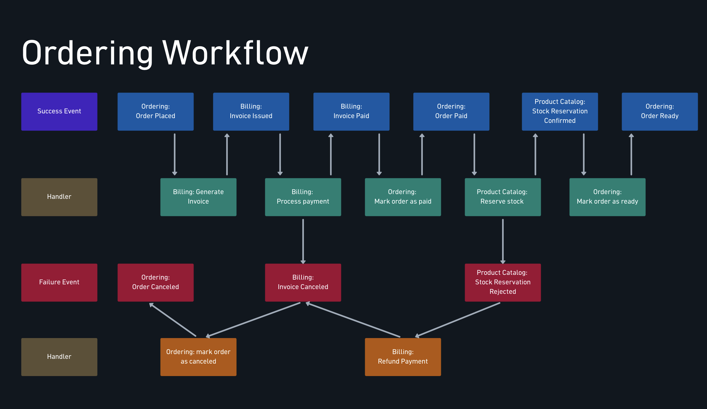

# Saga coreografada: desfazer o que já foi feito em outro serviço

> O [workflow coreografado](./workflow-coreografado.md) cuidou do caminho feliz. Este módulo cuida do outro: o pagamento é recusado, o estoque acaba depois de o cliente pagar. Num monólito isso seria um `rollback`. Aqui não existe transação que abrace ordering, billing e catálogo, então cada passo já commitado precisa de um **passo contrário**, que também é uma transação local disparada por evento. Esse conjunto de transações locais e suas compensações é uma **saga**.
> Doc vivo do módulo 8 da trilha ("Transações distribuídas com Saga e coreografia"). A tabela de status diz até onde o código chegou.
> Código real:
> - **billing**: `infrastructure/listener/InvoiceEventListener.java` (publica `InvoiceCanceled`), `application/invoice/event/InvoiceCanceledIntegrationEvent.java`.
> - **ordering**: `infrastructure/adapters/in/messaging/kafka/invoice/KafkaInvoiceIntegrationEventListener.java`, `infrastructure/adapters/in/listerner/order/OrderEventListener.java`, `core/application/order/event/OrderCanceledIntegrationEvent.java`.
> - **product-catalog**: o pacote novo `domain/stock/` (`StockReservation`, `StockReservationItem`, `StockService`, `StockMovement`, eventos), `infrastructure/listener/stock/StockMovementEventListener.java`, `infrastructure/persistence/product/QuantityInStockAdjustmentMongoDBImpl.java`.

---

## O mapa, agora pelas faixas de baixo



No módulo 7 o olho ia para as faixas azul e verde. A saga mora nas duas de baixo:

- **Vermelho (Failure Event)**: o fato de que algo deu errado. `Invoice Canceled`, `Stock Reservation Rejected`, `Order Canceled`.
- **Laranja (Handler de compensação)**: quem desfaz um passo que **já tinha dado certo**. `mark order as canceled`, `Refund Payment`.

### Status no código

| # | Passo da saga | Serviço | Status |
|---|---|---|---|
| C1 | `InvoiceCanceled` → marcar pedido como cancelado → `OrderCanceled` | billing → ordering | ✅ aula 8.3 |
| S1 | Modelo da reserva de estoque (`StockReservation`) | catálogo | ✅ aula 8.4 (só domínio) |
| S2 | Baixa dos itens de um pedido (`StockService.withdrawAll`) | catálogo | ✅ aula 8.5 (só domínio) |
| S3 | `OrderPaid` → reservar estoque → `StockReservationConfirmed` / `Rejected` | ordering → catálogo | ⏳ aulas 8.6–8.9 |
| S4 | `StockReservationConfirmed` → pedido pronto (`OrderReady`) | catálogo → ordering | ⬜ aula 8.10 |
| C2 | `StockReservationRejected` → estornar pagamento → `InvoiceCanceled` → C1 | catálogo → billing → ordering | ⬜ aula 8.11 |

---

## 8.1 — Transações distribuídas com Saga

### Por que não dá para ter uma transação só

Uma transação ACID depende de **um** gerenciador que trava os dados, decide commit ou rollback e garante que ninguém vê o meio do caminho. O pedido está no Postgres do ordering, a fatura no Postgres do billing e o estoque no MongoDB do catálogo: três bancos, três donos. O protocolo clássico para coordenar isso (two-phase commit) exige que os três segurem locks enquanto esperam um coordenador, e qualquer um fora do ar trava os outros. É o oposto do que os microsserviços buscam.

A saga aceita essa realidade: **cada passo é uma transação local, que commita sozinha e na hora**. A consistência entre serviços passa a ser eventual, e é garantida por compensações em vez de rollback.

### Compensação não é rollback

Rollback apaga o que aconteceu como se nunca tivesse existido. Compensação é **um fato novo que anula o efeito de um fato anterior**, e os dois ficam registrados:

| Passo commitado | Compensação | O que fica na história |
|---|---|---|
| Pedido `PLACED` | Pedido `CANCELED` | O pedido existiu e foi cancelado |
| Pagamento capturado | Estorno (`REFUNDED`) | O cliente foi cobrado e reembolsado |
| Estoque baixado | Estoque devolvido (entrada) | Dois movimentos em `stock_movements` |

Por isso a compensação precisa ser **semântica**: só o dono do dado sabe desfazer o próprio passo de um jeito que faça sentido para o negócio. Estornar é uma operação do gateway, não um `DELETE` na tabela de faturas.

### Os três tipos de passo

| Tipo | O que é | Na AlgaShop |
|---|---|---|
| **Compensável** | Pode ser desfeito por outro passo | Pedido realizado, fatura emitida |
| **Pivô** | O ponto de não retorno: se ele dá certo, a saga vai até o fim (ou compensa); antes dele, desistir é barato | A cobrança no gateway |
| **Reexecutável** | Depois do pivô, tem que dar certo: se falhar, tenta de novo até conseguir | Marcar o pedido como pronto |

A reserva de estoque fica **depois** do pivô e **pode falhar** (acabou o produto). É por isso que o mapa tem o `Refund Payment`: o passo posterior falhou, então a saga anda para trás e compensa o pivô.

### O que a saga não garante: isolamento

Das quatro letras de ACID, a saga entrega A (via compensação), C (eventual) e D (cada passo commita). O **I** fica de fora: os estados intermediários são **visíveis**. Entre "pagamento capturado" e "estoque rejeitado", o pedido aparece como `PAID` para o cliente, e depois vira `CANCELED`. Outro pedido pode ler o estoque nesse intervalo.

As contramedidas são de **desenho**, não de banco:

- **Estados intermediários explícitos**: `PAID` não significa "vai chegar". Só `READY` significa. A interface e as regras de negócio precisam respeitar essa diferença.
- **Ordenar os passos pelo risco**: o que mais falha vai antes do pivô sempre que possível. (Reservar o estoque **antes** de cobrar evitaria estornos; o curso mantém depois, e o custo disso é o `Refund Payment`.)
- **Compensações idempotentes**: o evento de falha pode chegar duas vezes, e estornar duas vezes é pior que não estornar.

## 8.2 — A saga da AlgaShop

| Passo | Transação local | Serviço | Se um passo **posterior** falhar |
|---|---|---|---|
| 1 | Pedido realizado | ordering | Cancelar o pedido |
| 2 | Fatura emitida | billing | Cancelar a fatura |
| 3 | **Pagamento capturado** (pivô) | billing | Estornar o pagamento |
| 4 | Estoque reservado | catálogo | (último passo que pode falhar; a falha dispara as compensações) |
| 5 | Pedido pronto | ordering | Não compensa: só tenta de novo |

Repare que as compensações **se encadeiam pelos eventos que já existem**. O estorno não cancela o pedido diretamente: o estorno vira `REFUNDED` → `Invoice.cancel()` → `InvoiceCanceled`, e o ordering já sabe reagir a isso desde a 8.3. Uma compensação nova (estorno) reaproveita outra já pronta (cancelar pedido). Em coreografia, isso é o natural: cada serviço reage a fatos, sem saber quem disparou a cadeia.

## 8.3 — Cancelando o pedido pela fatura cancelada

```mermaid
flowchart LR
    A["Invoice.updatePaymentStatus<br/>FAILED / REFUNDED"] --> B["Invoice.cancel()<br/>InvoiceCanceledEvent"]
    B -->|"after commit"| C[("billing.invoice.events<br/>InvoiceCanceledIntegrationEvent<br/>key = invoiceId")]
    C -->|"grupo ordering.invoice-events"| D["KafkaInvoiceIntegrationEventListener<br/>@KafkaHandler InvoiceCanceled"]
    D --> E["ForManagingOrders.markAsCanceled(orderId)<br/>@Transactional"]
    E --> F["Order.markAsCanceled()<br/>OrderCanceledEvent"]
    F --> G["OrderEventListener<br/>Mapper.convert → OrderCanceledIntegrationEvent"]
    G --> H[("outbox → ordering.order.events<br/>key = orderId")]
```



O desenho é o mesmo do `InvoicePaid` ([workflow, aula 7.10](./workflow-coreografado.md#710--passo-5-o-pedido-pago-e-o-próximo-evento)), com o sinal trocado:

- **No billing**, o listener de `InvoiceCanceledEvent`, que estava vazio, passou a `@TransactionalEventListener` e publica o evento de integração. A fatura cancela por duas causas, ambas em `Invoice.updatePaymentStatus`: pagamento `FAILED` (recusado) ou `REFUNDED` (estornado). A segunda é a ponte para a compensação da 8.11.
- **No ordering**, um segundo `@KafkaHandler` no mesmo listener de faturas chama `markAsCanceled`. O `OrderEventListener` publica `OrderCanceled` pela outbox, na mesma transação do cancelamento.

### Por que `CANCELED` aceita vir de quase todo status

```java
CANCELED(DRAFT, PLACED, PAID, READY); // pode vim de todos
```

Numa saga, o cancelamento é a **compensação genérica** do pedido, e ela pode chegar em qualquer ponto: fatura recusada (pedido `PLACED`), estoque rejeitado depois do pagamento (pedido `PAID`). Se a máquina de estados só deixasse cancelar a partir de `PLACED`, a compensação da 8.11 falharia com `OrderStatusCannotBeChanged` e iria para o DLT. A máquina de estados precisa ser desenhada **junto** com a saga.

### Mapper × assembler

`OrderPlaced` e `OrderPaid` usam assemblers escritos à mão. `OrderCanceled` usa `Mapper.convert(event, OrderCanceledIntegrationEvent.class)`, ou seja, ModelMapper. Faz sentido: o evento de cancelamento tem só `orderId`, `customerId` e `canceledAt`, sem snapshot nem itens. O risco está nos tipos: a origem é o record `OrderCanceledEvent(OrderId, CustomerId, OffsetDateTime)` e o destino tem `String` e `UUID`. Ver [armadilhas](#armadilhas).

## 8.4 — Modelando a reserva de estoque

O catálogo ganhou um pacote próprio, `domain/stock`, e nele um agregado novo:

```java
@Document(collection = "stock_reservations")
public class StockReservation extends AbstractAggregateRoot<StockReservation> {
    @Id private UUID id;
    @Indexed(name = "uidx_stock_reservation_by_order", unique = true)
    private String orderId;
    private Status status;            // CONFIRMED | REJECT
    private OffsetDateTime createdAt;
    private List<StockReservationItem> items;   // productId + quantity (>= 1), imutável

    public static StockReservation confirmed(String orderId, List<StockReservationItem> items) { ... }
    public static StockReservation rejected(String orderId, List<StockReservationItem> items) { ... }
}
```

Quatro decisões que valem guardar:

1. **A reserva registra o resultado, não um processo.** Não existe status "pendente" nem expiração: quando a reserva é gravada, a decisão já foi tomada. As duas factories dizem isso no nome (`confirmed`, `rejected`), e cada uma registra o seu evento de domínio (`StockReservationConfirmedEvent`, `StockReservationRejectedEvent`). Esses são os fatos verde e vermelho do mapa.
2. **A rejeição também é gravada.** Poderia ser só uma exceção, mas aí não sobraria rastro de **por que** o pedido 42 foi cancelado. Na saga, a falha é um fato do negócio e merece documento.
3. **Índice único em `orderId` = idempotência.** Um pedido, uma reserva. Se o `OrderPaid` chegar duas vezes, a segunda gravação falha no Mongo, e o `existsByOrderId` do repositório permite checar antes. É a mesma ideia do `UNIQUE (order_id)` da fatura ([workflow, 7.6](./workflow-coreografado.md#idempotência-pela-constraint)).
4. **Agregado separado do `Product`.** A reserva envolve **vários** produtos de uma vez e pertence a um **pedido**. Colocá-la dentro do `Product` obrigaria a carregar e salvar N agregados para registrar uma decisão só. O `Product` continua dono da quantidade; a `StockReservation` é dona da decisão.

## 8.5 — Retirando itens reservados do estoque

### A refatoração: estoque virou um subdomínio

| Antes (`domain/product`) | Depois (`domain/stock`) |
|---|---|
| `StockService.restock(Product, int)` | `StockService.restock(UUID, int)` |
| `StockService.withdraw(Product, int)` | `StockService.withdraw(UUID, int, String orderId)` |
| — | `StockService.withdrawAll(String orderId, List<StockReservationItem>)` |
| `QuantityInStockAdjustment.Result.isOutOfStock()` / `isRestocked()` | `StockMovementRegisteredEvent.causedSoldOut()` / `causedRestock()` |
| `StockService` publicava `ProductSoldOut`/`ProductRestocked` | `StockMovement` registra `StockMovementRegisteredEvent`; `StockMovementEventListener` traduz |
| `StockMovement` era documento simples | `StockMovement extends AbstractAggregateRoot`, com `orderId` |

O efeito é tirar do `StockService` a responsabilidade de **anunciar** o que aconteceu. Ele só calcula e devolve movimentos. Quem anuncia é o próprio `StockMovement`, que registra o evento no construtor e o publica quando é salvo, pelo mecanismo do `AbstractAggregateRoot`. O `orderId` no movimento liga cada baixa ao pedido que a causou, e isso vai ser essencial para devolver o estoque numa compensação.

### `withdrawAll`: agrupar, validar tudo, baixar

```java
// 1. agrupa: {A:2}, {A:3} → {A:5}
Map<UUID, Integer> quantityByProduct = items.stream().collect(groupingBy(..., summingInt(...)));
// busca todos numa consulta só
Map<UUID, Product> productById = productRepository.findAllById(quantityByProduct.keySet())...;
// 2. falha rápida: qualquer produto inexistente ou sem saldo recusa o pedido inteiro
quantityByProduct.forEach((id, qty) -> { ... ProductNotFoundException / InsufficientStockException });
// 3. baixa um por um, pelo withdraw() atômico
return quantityByProduct.entrySet().stream().map(e -> withdraw(e.getKey(), e.getValue(), orderId)).toList();
```

- **Agrupar** evita duas baixas do mesmo produto e uma validação errada: dois itens de 3 unidades com saldo 5 passariam um a um e falhariam juntos.
- **Validar tudo antes** é a regra "tudo ou nada" do pedido: não adianta baixar o produto A se o B não tem saldo.
- **A pré-validação não é garantia.** Entre ler o `Product` e baixar, outro pedido pode levar o estoque. Quem garante de verdade é o `decrease()` atômico do `QuantityInStockAdjustmentMongoDBImpl` (atualização condicional, ver [Concorrência e atomicidade](../02-persistencia/concorrencia-e-atomicidade.md)). A pré-checagem só evita **começar** algo que já se sabe que vai falhar.

### `MANDATORY`: o ajuste exige transação

```java
@Transactional(propagation = Propagation.MANDATORY)
public class QuantityInStockAdjustmentMongoDBImpl implements QuantityInStockAdjustment { ... }
```

É o mesmo recurso do `OutboxRecorder` do ordering: não "abra uma transação se precisar", e sim **"recuse rodar sem uma"**. A consequência para o `withdrawAll` é importante. Se o terceiro produto falhar no `decrease()`, os dois primeiros já foram baixados, mas **dentro da mesma transação do chamador**, que dá rollback em tudo (o Mongo tem transação multi-documento no replica set, ver [Transações e replica set](../02-persistencia/transacoes-mongo.md)). O "tudo ou nada" passa a valer também para a falha que a pré-validação não pegou.

---

## Armadilhas

### O listener de movimento não está escutando nada

`StockMovementEventListener.handle(StockMovementRegisteredEvent)` não tem `@EventListener` nem `@TransactionalEventListener`. Para o Spring é só um método público num `@Component`: nunca é chamado. Resultado: **`ProductSoldOut` e `ProductRestocked` deixaram de ser publicados** desde a refatoração. Hoje o estrago é pequeno, porque o `ProductEventListener` só os loga (o envio ao Kafka está comentado). Mas a aula 8.12 ("Publique eventos de Produto") vai ligar esse envio, e aí o evento simplesmente não existirá.

Ao anotar, cuidado com a fase. O `DomainEventPublisher` publica outro evento de aplicação, e os handlers de `ProductSoldOutEvent`/`ProductRestockedEvent` no `ProductEventListener` são `@TransactionalEventListener`. Se o `StockMovementEventListener` também rodar **depois do commit**, o evento que ele publica nasce **fora** de transação, e um `@TransactionalEventListener` sem `fallbackExecution = true` simplesmente o ignora. Com `@EventListener` (síncrono, dentro da transação), a cadeia funciona: o `ProductSoldOut` é publicado ainda dentro da transação, e o handler dele roda no commit.

### `equals` do `Product` virou comparação de referência

```java
@EqualsAndHashCode(onlyExplicitlyIncluded = true, callSuper = true)
public class Product extends AbstractAggregateRoot<Product> {
```

`AbstractAggregateRoot` não sobrescreve `equals`, então `callSuper = true` faz o Lombok chamar o `Object.equals`, que compara **referência**. Dois `Product` com o mesmo id, carregados em momentos diferentes, deixam de ser iguais, e o `hashCode` muda junto. O comentário logo acima da anotação diz o contrário ("a identidade é o id e mais nada"). O aviso do Lombok que motivou a troca pede justamente `callSuper = false` aqui, que era o valor anterior. `StockMovement` e `StockReservation` usam `callSuper = false`, corretamente.

### ~~Comentário que a própria refatoração desmentiu~~ (corrigido)

O passo 3 do `withdrawAll` dizia: "Sem transação em volta, uma falha no meio deixa os anteriores já baixados". Com o `MANDATORY` no ajuste, não existe "sem transação em volta": o código nem roda. O comentário agora diz o que o código faz: quem chama abre a transação, e uma falha no meio desfaz também as baixas anteriores.

### O `billing-scheduler` cancela fatura por fora da saga

`CancelExpiredInvoicesApplicationServiceJDBCImpl` cancela faturas vencidas com `UPDATE` direto no Postgres. Não passa por `Invoice.cancel()`, não registra `InvoiceCanceledEvent`, não publica nada. Fatura expirada é exatamente o caso em que o pedido deveria ser cancelado, e ele fica `PLACED` para sempre. Toda escrita que muda o estado de uma etapa da saga precisa passar pelo agregado, ou publicar o evento por conta própria.

### `OrderCanceled` pelo ModelMapper: verifique o `customerId`

O ModelMapper do ordering está em `MatchingStrategies.STRICT` com `NamingConventions.NONE`. O `orderId` sai certo porque `OrderId.toString()` devolve o TSID. Mas não há converter de `CustomerId` para `UUID`, e no modo estrito o mapeamento implícito `customerId.value → customerId` não é garantido. Se o campo sair nulo, a outbox grava assim mesmo (o `OutboxRecorder` não valida), e o erro só aparece no consumidor, como `ConstraintViolationException` → DLT. **Não confirmei rodando**: um teste unitário de `mapper.convert(new OrderCanceledEvent(...), OrderCanceledIntegrationEvent.class)` resolve a dúvida. Um assembler, como nos outros dois eventos, elimina a dúvida.

### A compensação também pode se perder

O billing continua publicando after-commit ([workflow, armadilhas](./workflow-coreografado.md#after-commit-não-é-outbox-o-evento-pode-se-perder)). Agora o problema pesa mais: um `InvoiceCanceled` perdido não é só um passo a menos, é uma **compensação que não acontece**. O pagamento foi recusado e o pedido segue `PLACED`. Uma saga só é confiável se os eventos de compensação forem pelo menos tão garantidos quanto os de sucesso.

---

## Próximas aulas (a documentar)

- **8.6 — Reservando estoque para o pedido**: o caso de uso que junta `withdrawAll` e `StockReservation.confirmed/rejected` numa transação.
- **8.7 — Catálogo consumindo eventos do ordering**: listener, grupo, DLT e type mapping de `ordering.order.events`.
- **8.8 — Reservar o estoque do pedido pago**: `OrderPaid` (com itens, ECST) → reserva.
- **8.9 — Publicar o resultado da reserva**: `StockReservationConfirmed` / `Rejected` em `product-catalog.stock.events`.
- **8.10 — Pedido pronto para envio**: ordering consome a confirmação → `OrderReady`.
- **8.11 — Estorno como compensação**: billing consome a rejeição → estorna no gateway → `REFUNDED` → `InvoiceCanceled` → pedido cancelado.
- **8.12 — Eventos de produto**: publicar e escutar os eventos do produto no novo desenho.
- **8.13 — Opinião sobre saga com coreografia**: o balanço antes da orquestração (módulo 9).

---

## Checklist da saga

- [x] Cada passo é uma transação local que commita sozinha
- [x] Falhas são fatos publicados (`InvoiceCanceled`), não exceções que morrem no serviço
- [x] A máquina de estados do pedido aceita a compensação em qualquer ponto (`CANCELED` de quase todos)
- [x] A decisão da reserva (inclusive a rejeição) é gravada como fato, com idempotência por `orderId`
- [x] Baixa de estoque "tudo ou nada" (pré-validação + `MANDATORY` + transação)
- [ ] Compensações publicadas com garantia (o billing ainda publica after-commit)
- [ ] Todo caminho que cancela uma etapa passa pelo agregado (o `billing-scheduler` não passa)
- [ ] Compensações idempotentes (estorno duplicado, cancelamento duplicado)
- [ ] Eventos de estoque (`ProductSoldOut`/`Restocked`) seguem saindo depois da refatoração
