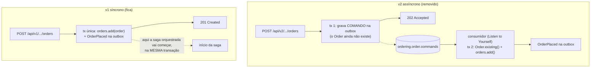

# Saga orquestrada: um lugar que sabe em que passo cada pedido está

> A [saga coreografada](./saga-coreografada.md) terminou com um balanço honesto: funciona, mas o fluxo só existe no mapa, e quando um evento se perde a saga não falha, ela só para. A orquestração troca isso por um **coordenador** que conhece os passos, guarda em que ponto cada pedido está e manda **comandos** a cada serviço. Este doc acompanha o módulo 9 da trilha ("Saga e orquestração").
> Doc vivo: começa pela preparação do terreno, antes de qualquer orquestrador existir.
> Código real (desta etapa): `algashop-ordering/.../infrastructure/adapters/in/web/order/MyOrderController.java` (único caminho de criação de pedido), `core/application/checkout/CheckoutApplicationService.java` e `BuyNowApplicationService.java`, `core/application/order/snapshot/OrderSnapshot*.java`, `infrastructure/config/kafka/`; `api-gateway-ecommerce/src/main/resources/application-base.yml`.

---

## Antes de orquestrar: removendo o checkout assíncrono

A primeira tarefa do módulo é **apagar código**. Sai o checkout assíncrono v2 que nasceu no módulo de resiliência ([Outbox e checkout assíncrono](./outbox-e-checkout-assincrono.md)): o endpoint que respondia `202 Accepted`, publicava um comando para o próprio ordering e só criava o pedido depois, num consumidor (Listen to Yourself). Depois desta etapa, os endpoints **v1** são o único caminho para criar um pedido.

### Por que remover

A saga orquestrada vai **começar quando o pedido é realizado, dentro da mesma transação que grava o pedido**. Iniciar a saga é gravar algo (o estado da saga, o primeiro comando na outbox) e isso tem de commitar **junto** com o `Order`: ou existem os dois, ou nenhum. Esse momento só existe quando o pedido nasce na própria requisição.

No v2 haveria dois problemas para a orquestração:

1. **Não existe pedido na transação da requisição.** A primeira transação só grava um comando; o `Order` nasce na segunda, do outro lado de um tópico. Começar a saga na primeira seria começar uma saga para um pedido que ainda pode não existir; começar na segunda exigiria que o consumidor do comando também fosse o ponto de partida da saga.
2. **Dois caminhos de criação = dois pontos de partida.** Com v1 e v2 convivendo, toda regra de início da saga teria de existir duas vezes, com transações diferentes. Um ponto só é mais fácil de garantir.

E a remoção sai barata porque **a corrente de eventos não muda**: o checkout síncrono já publica o `OrderPlaced` pelo `OrderEventListener`, pela outbox, na mesma transação do `orders.add()` (`CheckoutApplicationService.checkout` e `BuyNowApplicationService.buyNow`, ambos `@Transactional`). Billing e catálogo não percebem a diferença.

> **Para fixar:** o 202 do v2 resolvia um problema real (resposta rápida com processamento pesado do outro lado de um tópico). Ele sai porque o desenho seguinte precisa de outra coisa: um ponto de início atômico. Padrão bom no lugar errado vira obstáculo. Foi o que aconteceu aqui.

### O que sai, camada por camada

| Camada | Removido |
|---|---|
| Web | `MyOrderV2Controller`, `OrderAcceptedOutput`; o `POST /api/v2/customers/me/orders` com `application/vnd.order-with-product.v2+json` e `application/vnd.order-with-shopping-cart.v2+json` |
| Gateway | `/api/v2/customers/**` do `Path` da rota do ordering no `gateway-ecommerce` (os caminhos v1 da mesma rota ficam) |
| Aplicação | `CheckoutAsyncApplicationService`, `BuyNowAsyncApplicationService`, `ProcessAcceptedCheckoutApplicationService` |
| Portas de entrada | `ForBuyingWithShoppingCartAsync`, `ForBuyingProductAsync`, `ForProcessingCheckoutAccepted` |
| Comando | `ProcessAcceptedCheckoutIntegrationCommand` |
| Mensageria | `KafkaOrderIntegrationCommandListener`, `KafkaOrderIntegrationCommandPublisher`, `OutboxOrderIntegrationCommandPublisher`, porta `ForPublishingOrderIntegrationCommands` |
| Tópicos | Beans `NewTopic` de `ordering.order.commands` e `ordering.dlt.ordering.order.commands` |
| Configuração | `orderCommandTopicName` e `orderCommandsConsumerGroup` no `AlgaShopMessagingKafkaProperties` e nos YAMLs de ambiente; alias `Ordering.ProcessAcceptedCheckoutIntegrationCommand` no `spring.json.type.mapping` |
| Snapshot | `OrderSnapshot.shoppingCartId`; `OrderSnapshotAssembler.toSnapshot(Order, UUID)`, `toDomain` e os conversores privados que só ele usava |

### O `OrderSnapshot` encolhe

O snapshot tinha duas coisas que só faziam sentido para o consumidor do comando:

- **`shoppingCartId`**: o pedido não é dono do carrinho, mas o consumidor precisava saber qual carrinho esvaziar depois de criar o pedido. Sem consumidor, não há quem esvazie nada depois; o v1 esvazia o carrinho na própria transação.
- **`toDomain`** e os conversores `Billing`/`Shipping`/`Address`/`OrderItem`: reconstruíam o `Order` a partir do JSON, via `Order.existing()`. Só o consumidor recriava pedidos.

O `toSnapshot(Order)` **fica**, agora sem o segundo parâmetro e sem chamador. Ele volta quando a saga montar o conteúdo do comando de emissão de fatura: o snapshot congelado do pedido vai viajar de novo, só que dentro de um comando da saga.

### O que fica, e por quê

Remover demais quebra as aulas seguintes. Cada item abaixo fica por um motivo concreto:

| Fica | Por quê |
|---|---|
| `IntegrationCommand`, `CommandPublishingException` | Ninguém os usa agora, mas os **comandos da saga** vão usá-los. A orquestração fala por comandos |
| `OrderSnapshotAssembler.toSnapshot(Order)` | Volta no comando de emissão de fatura |
| `ForGuardingIdempotency` | O consumidor de eventos de produto depende dela (`runOnce`) |
| `OrderPlacedIntegrationEventAssembler` | O `OrderEventListener` o usa para publicar `OrderPlaced` no checkout síncrono |
| `BillingInputDisassembler`, `ShippingInputDisassembler` | Usados pelos serviços síncronos de checkout e compra direta |
| `CheckoutInput`, `BuyNowInput` | São os corpos que os endpoints v1 recebem |
| A outbox inteira | Continua publicando todos os eventos do ordering; só deixou de transportar o comando de checkout |

### Lições da remoção

- **O compilador só reclama de quem usa uma classe apagada.** Uma classe que ninguém mais usa compila em silêncio. Por isso a remoção segue uma lista, de fora para dentro (controller → aplicação → portas → mensageria → config), e não "apagar até compilar".
- **O compilador não lê YAML.** Um alias de `spring.json.type.mapping` apontando para uma classe que não existe faz o (de)serializer falhar com `IllegalArgumentException` na configuração, e o serviço nem sobe. Depois de apagar classes, procure o nome delas nos arquivos de ambiente. E o último alias da lista não leva vírgula.
- **Remover o bean `NewTopic` não apaga o tópico.** O bean só cria o tópico se ele não existir. `ordering.order.commands` e o DLT dele continuam no broker até alguém excluir pela GUI.
- **O contrato também é código a remover.** Os canais, operações e mensagens do comando saíram do AsyncAPI ([`ordering.yml`](../asyncapi/ordering.yml), [`messages.yml`](../asyncapi/messages.yml)) na mesma etapa, para o contrato não descrever um tópico que não existe mais ([a lição da Fase 40](./asyncapi-contratos.md)). O schema `OrderSnapshot` ficou no `messages.yml`, sem `shoppingCartId` e por enquanto sem referência, pelo mesmo motivo do `toSnapshot(Order)`: ele volta no comando da saga.

### Conferência do que foi feito

Comparando o working tree com a lista do desafio:

| Item | Situação |
|---|---|
| Controller, output, serviços, portas, comando, listener, publishers, porta de saída | ✅ removidos |
| Beans de tópico e DLT, propriedades, alias nos dois YAMLs | ✅ removidos |
| `OrderSnapshot` sem `shoppingCartId`; assembler sem `toSnapshot(Order, UUID)` e `toDomain` | ✅ removidos |
| Itens preservados (tabela acima) | ✅ todos existem |
| Testes Java | ✅ nenhum referencia as classes removidas |
| `OrderSnapshotAssembler` compila | ✅ corrigido: tinha recebido acessores `.value()` que não existem nos records do projeto (`Money(money)`, `Quantity(quantity)`, `Document(document)`…), `order.totalItems()` no lugar de `totalQuantity()` e um argumento a menos no `OrderItemSnapshot`. Voltaram os acessores originais; só a remoção pedida ficou |
| `KafkaStockIntegrationEventListener` compila | ✅ corrigido: tirado o import de `ProcessAcceptedCheckoutIntegrationCommand` (e os outros imports sem uso) |
| Gateway sem `/api/v2/customers/**` | ✅ removido do `Path` da rota do ordering; os caminhos v1 e o `CircuitBreaker` ficaram |
| Comentários | ✅ `OrderSnapshot.java`, `OrderSnapshotAssembler.java` e `KafkaConfig.java` não falam mais do comando |
| Testes do ordering | ✅ `./gradlew test`: 304 testes, 0 falhas, nenhum teste Java alterado |
| Ambiente | ⚠️ tópicos antigos continuam no broker; conferir se a tabela `outbox` não tem linhas pendentes para `ordering.order.commands` antes de subir |

### Roteiro de verificação

1. Testes do ordering passando, sem alterar nenhum teste Java.
2. Checkout v1 com carrinho e compra direta v1, autenticado como o cliente `6e148bd5-47f6-4022-b9da-07cfaa294f7a`, com o Visa final 1022 (`creditCardId` `0199deda-9486-7d27-b40c-761f561a24d8`, pago na captura). Na GUI do Kafka, cada pedido percorre os mesmos seis eventos do módulo 8 e termina em `Ordering.OrderReadyIntegrationEvent`, com `ready_at` preenchido.
3. `POST /api/v2/customers/me/orders` autenticado, pelo gateway e direto no ordering, com `Content-Type: application/vnd.order-with-shopping-cart.v2+json`: as duas respostas são `404 Not Found`. O media type certo garante que o 404 prova que o caminho saiu, e não que o `Content-Type` estava errado.
4. Nenhuma mensagem nova em `ordering.order.commands`; o consumer group `ordering.order-commands` sem membros ativos.

---

## Próximas aulas (a documentar)

O orquestrador, o estado da saga e os comandos entram aqui conforme o módulo avança. A comparação com a coreografia vai seguir as perguntas que o [balanço da 8.13](./saga-coreografada.md#813--opinião-sobre-saga-com-coreografia) deixou: onde fica o estado "em que passo está o pedido 42"? Quem decide a compensação? O que acontece com os três kits de consumidor copiados?
