# Saga orquestrada: um lugar que sabe em que passo cada pedido está

> A [saga coreografada](./saga-coreografada.md) terminou com um balanço honesto: funciona, mas o fluxo só existe no mapa, e quando um evento se perde a saga não falha, ela só para. A orquestração troca isso por um **coordenador** que conhece os passos, guarda em que ponto cada pedido está e manda **comandos** a cada serviço. Este doc acompanha o módulo 9 da trilha ("Saga e orquestração").
> Doc vivo: começa pela preparação do terreno, antes de qualquer orquestrador existir. Duas demolições primeiro: o checkout assíncrono e a saga coreografada.
> Código real (desta etapa): `algashop-ordering/.../infrastructure/adapters/in/web/order/MyOrderController.java` (único caminho de criação de pedido), `core/application/checkout/CheckoutApplicationService.java` e `BuyNowApplicationService.java`, `core/application/order/snapshot/OrderSnapshot*.java`, `infrastructure/config/kafka/`; `api-gateway-ecommerce/src/main/resources/application-base.yml`.

---

## O mapa da orquestração

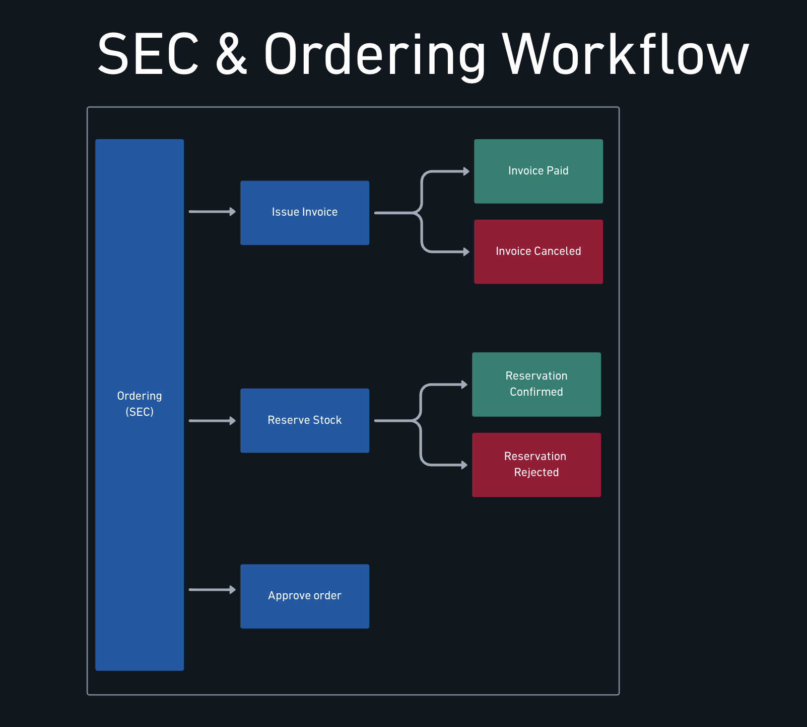

O resumo mostra a mudança de forma em uma imagem: em vez de uma corrente em que cada serviço puxa o próximo, há **um coordenador** (o ordering, como *SEC*, o coordenador de execução da saga) que manda três comandos (`Issue Invoice`, `Reserve Stock`, `Approve order`) e recebe uma **resposta** para cada um: sucesso (verde) ou falha (vermelho).

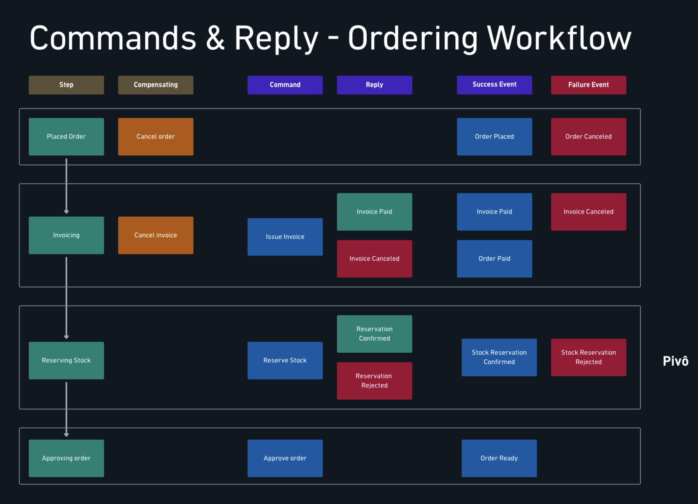

O detalhado é a tabela que guia o módulo. Cada linha é um passo da saga, e as colunas separam quatro coisas que na coreografia viviam misturadas num evento só:

| Coluna | O que é | Exemplo |
|---|---|---|
| **Step** / **Compensating** | O passo e o que o desfaz | `Invoicing` / `Cancel invoice` |
| **Command** | O pedido do orquestrador a um participante | `Issue Invoice` |
| **Reply** | A resposta endereçada ao orquestrador | `Invoice Paid` ou `Invoice Canceled` |
| **Success / Failure Event** | O fato que o serviço anuncia para quem quiser ouvir | `Order Paid`, `Invoice Canceled` |

Duas leituras para guardar desde já:

- **Reply ≠ evento.** A resposta tem um destinatário (o orquestrador) e faz a saga andar. O evento continua sendo um anúncio sem destinatário. Na coreografia, o mesmo `InvoicePaid` fazia os dois papéis.
- **O pivô mudou de lugar.** Na [saga coreografada](./saga-coreografada.md#os-três-tipos-de-passo) o pivô era a cobrança; neste mapa o pivô marcado é **Reserving Stock**. Os passos antes dele têm compensação (`Cancel order`, `Cancel invoice`); o passo depois (`Approving order`) não tem, só precisa dar certo.

### O fluxo, passo a passo

Lendo o mapa detalhado linha por linha, com o ordering no papel de orquestrador:

| # | Passo (Step) | Comando enviado | Respostas possíveis | Evento anunciado | Compensação |
|---|---|---|---|---|---|
| 1 | **Placed Order** | — (a saga começa aqui, na transação do checkout) | — | `Order Placed` | `Cancel order` → `Order Canceled` |
| 2 | **Invoicing** | `Issue Invoice` → billing | `Invoice Paid` ou `Invoice Canceled` | `Invoice Paid`, `Order Paid` / `Invoice Canceled` | `Cancel invoice` |
| 3 | **Reserving Stock** (pivô) | `Reserve Stock` → catálogo | `Reservation Confirmed` ou `Reservation Rejected` | `Stock Reservation Confirmed` / `Stock Reservation Rejected` | — (é o ponto de não retorno) |
| 4 | **Approving order** | `Approve order` → ordering | — | `Order Ready` | — (só precisa dar certo) |

Repare que o passo 1 não tem comando: ele **é** o checkout v1. É por isso que o checkout assíncrono precisou sair (próxima seção): a saga nasce na mesma transação que grava o pedido.

### Caminho feliz

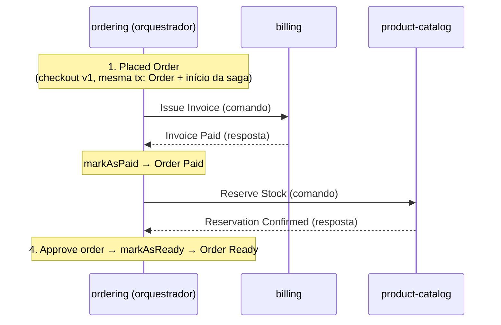

### Caminhos de falha

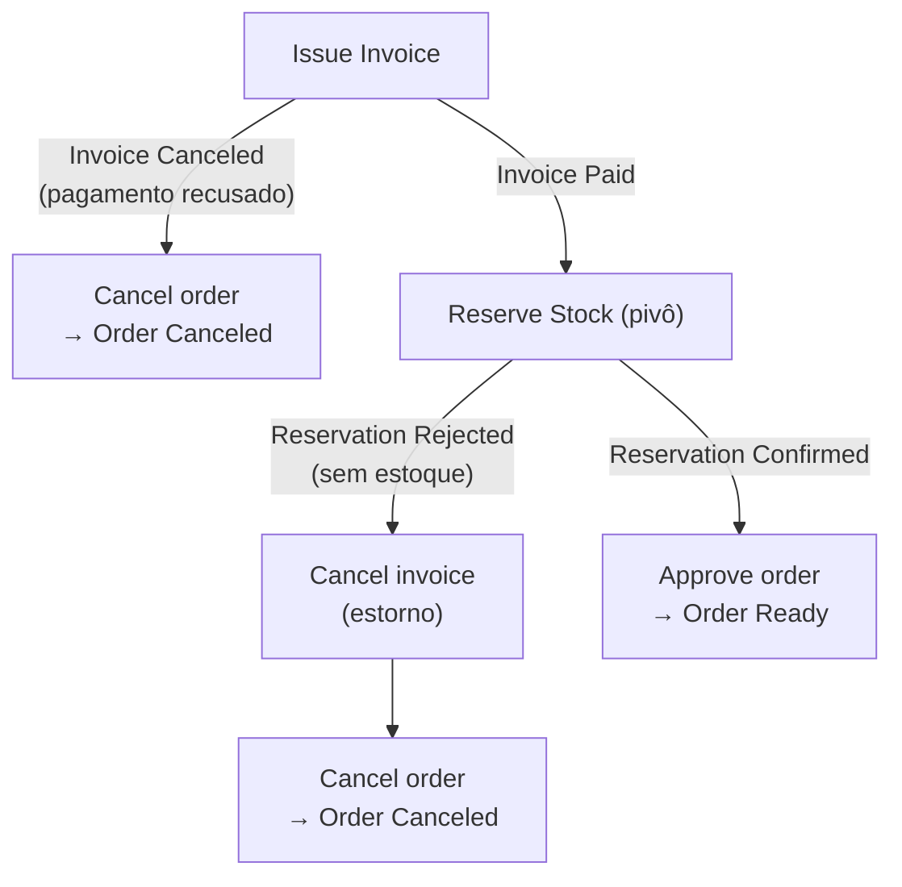

- **Pagamento recusado** (resposta `Invoice Canceled`): só o passo 1 precisa ser desfeito. O orquestrador cancela o pedido.
- **Estoque rejeitado** (resposta `Reservation Rejected`): a saga anda para trás desfazendo os passos já commitados, **na ordem inversa**: primeiro `Cancel invoice` (o estorno, que usa o `refundByOrderId` preservado no billing), depois `Cancel order`.

A diferença para a coreografia está em **quem encadeia as compensações**. Na [saga coreografada](./saga-coreografada.md#811--estornando-o-pagamento-como-compensação), a rejeição do estoque virava estorno no billing, o estorno virava `InvoiceCanceled`, e o ordering reagia cancelando o pedido: três serviços, cada um sabendo só o seu pedaço. Aqui o orquestrador **recebe** a rejeição e **decide** as duas compensações. A cadeia passa a estar escrita em um lugar só.

### Coreografia × orquestração, no mesmo fluxo

| Pergunta | Coreografia (módulo 8, removida) | Orquestração (módulo 9) |
|---|---|---|
| Quem decide o próximo passo? | Cada serviço, ao reagir ao evento anterior | O ordering, ao receber a resposta |
| Como o billing sabe que deve emitir a fatura? | Assina `OrderPlaced` | Recebe o comando `Issue Invoice` |
| Para quem vai o resultado? | Para quem quiser ouvir (evento) | Para o orquestrador (reply) **e**, se fizer sentido, um evento para o resto |
| Onde fica "em que passo está o pedido 42"? | Em lugar nenhum; é preciso correlacionar três serviços | No estado da saga, no ordering |
| Quem desfaz o quê na falha? | Emerge da cadeia de eventos | O orquestrador manda as compensações |
| Qual é o pivô? | A cobrança | A reserva de estoque |

---

## Antes de orquestrar: removendo o checkout assíncrono

A primeira tarefa do módulo é **apagar código**. Sai o checkout assíncrono v2 que nasceu no módulo de resiliência ([Outbox e checkout assíncrono](./outbox-e-checkout-assincrono.md)): o endpoint que respondia `202 Accepted`, publicava um comando para o próprio ordering e só criava o pedido depois, num consumidor (Listen to Yourself). Depois desta etapa, os endpoints **v1** são o único caminho para criar um pedido.

### Por que remover

A saga orquestrada vai **começar quando o pedido é realizado, dentro da mesma transação que grava o pedido**. Iniciar a saga é gravar algo (o estado da saga, o primeiro comando na outbox) e isso tem de commitar **junto** com o `Order`: ou existem os dois, ou nenhum. Esse momento só existe quando o pedido nasce na própria requisição.

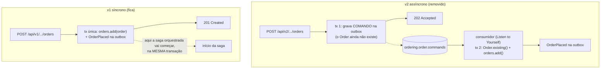

No v2 haveria dois problemas para a orquestração:

1. **Não existe pedido na transação da requisição.** A primeira transação só grava um comando; o `Order` nasce na segunda, do outro lado de um tópico. Começar a saga na primeira seria começar uma saga para um pedido que ainda pode não existir; começar na segunda exigiria que o consumidor do comando também fosse o ponto de partida da saga.
2. **Dois caminhos de criação = dois pontos de partida.** Com v1 e v2 convivendo, toda regra de início da saga teria de existir duas vezes, com transações diferentes. Um ponto só é mais fácil de garantir.

E a remoção sai barata porque **a corrente de eventos não muda**: o checkout síncrono já publica o `OrderPlaced` pelo `OrderEventListener`, pela outbox, na mesma transação do `orders.add()` (`CheckoutApplicationService.checkout` e `BuyNowApplicationService.buyNow`, ambos `@Transactional`). Billing e catálogo não percebem a diferença.

> **Para fixar:** o 202 do v2 resolvia um problema real (resposta rápida com processamento pesado do outro lado de um tópico). Ele sai porque o desenho seguinte precisa de outra coisa: um ponto de início atômico. Padrão bom no lugar errado vira obstáculo. Foi o que aconteceu aqui.

### O que sai, camada por camada

| Camada | Removido |
|---|---|
| Web | `MyOrderV2Controller`, `OrderAcceptedOutput`; o `POST /api/v2/customers/me/orders` com `application/vnd.order-with-product.v2+json` e `application/vnd.order-with-shopping-cart.v2+json` |
| Gateway | `/api/v2/customers/**` do `Path` da rota do ordering no `gateway-ecommerce` (os caminhos v1 da mesma rota ficam) |
| Aplicação | `CheckoutAsyncApplicationService`, `BuyNowAsyncApplicationService`, `ProcessAcceptedCheckoutApplicationService` |
| Portas de entrada | `ForBuyingWithShoppingCartAsync`, `ForBuyingProductAsync`, `ForProcessingCheckoutAccepted` |
| Comando | `ProcessAcceptedCheckoutIntegrationCommand` |
| Mensageria | `KafkaOrderIntegrationCommandListener`, `KafkaOrderIntegrationCommandPublisher`, `OutboxOrderIntegrationCommandPublisher`, porta `ForPublishingOrderIntegrationCommands` |
| Tópicos | Beans `NewTopic` de `ordering.order.commands` e `ordering.dlt.ordering.order.commands` |
| Configuração | `orderCommandTopicName` e `orderCommandsConsumerGroup` no `AlgaShopMessagingKafkaProperties` e nos YAMLs de ambiente; alias `Ordering.ProcessAcceptedCheckoutIntegrationCommand` no `spring.json.type.mapping` |
| Snapshot | `OrderSnapshot.shoppingCartId`; `OrderSnapshotAssembler.toSnapshot(Order, UUID)`, `toDomain` e os conversores privados que só ele usava |

### O `OrderSnapshot` encolhe

O snapshot tinha duas coisas que só faziam sentido para o consumidor do comando:

- **`shoppingCartId`**: o pedido não é dono do carrinho, mas o consumidor precisava saber qual carrinho esvaziar depois de criar o pedido. Sem consumidor, não há quem esvazie nada depois; o v1 esvazia o carrinho na própria transação.
- **`toDomain`** e os conversores `Billing`/`Shipping`/`Address`/`OrderItem`: reconstruíam o `Order` a partir do JSON, via `Order.existing()`. Só o consumidor recriava pedidos.

O `toSnapshot(Order)` **fica**, agora sem o segundo parâmetro e sem chamador. Ele volta quando a saga montar o conteúdo do comando de emissão de fatura: o snapshot congelado do pedido vai viajar de novo, só que dentro de um comando da saga.

### O que fica, e por quê

Remover demais quebra as aulas seguintes. Cada item abaixo fica por um motivo concreto:

| Fica | Por quê |
|---|---|
| `IntegrationCommand`, `CommandPublishingException` | Ninguém os usa agora, mas os **comandos da saga** vão usá-los. A orquestração fala por comandos |
| `OrderSnapshotAssembler.toSnapshot(Order)` | Volta no comando de emissão de fatura |
| `ForGuardingIdempotency` | O consumidor de eventos de produto depende dela (`runOnce`) |
| `OrderPlacedIntegrationEventAssembler` | O `OrderEventListener` o usa para publicar `OrderPlaced` no checkout síncrono |
| `BillingInputDisassembler`, `ShippingInputDisassembler` | Usados pelos serviços síncronos de checkout e compra direta |
| `CheckoutInput`, `BuyNowInput` | São os corpos que os endpoints v1 recebem |
| A outbox inteira | Continua publicando todos os eventos do ordering; só deixou de transportar o comando de checkout |

### Lições da remoção

- **O compilador só reclama de quem usa uma classe apagada.** Uma classe que ninguém mais usa compila em silêncio. Por isso a remoção segue uma lista, de fora para dentro (controller → aplicação → portas → mensageria → config), e não "apagar até compilar".
- **O compilador não lê YAML.** Um alias de `spring.json.type.mapping` apontando para uma classe que não existe faz o (de)serializer falhar com `IllegalArgumentException` na configuração, e o serviço nem sobe. Depois de apagar classes, procure o nome delas nos arquivos de ambiente. E o último alias da lista não leva vírgula.
- **Remover o bean `NewTopic` não apaga o tópico.** O bean só cria o tópico se ele não existir. `ordering.order.commands` e o DLT dele continuam no broker até alguém excluir pela GUI.
- **O contrato também é código a remover.** Os canais, operações e mensagens do comando saíram do AsyncAPI ([`ordering.yml`](../asyncapi/ordering.yml), [`messages.yml`](../asyncapi/messages.yml)) na mesma etapa, para o contrato não descrever um tópico que não existe mais ([a lição da Fase 40](./asyncapi-contratos.md)). O schema `OrderSnapshot` ficou no `messages.yml`, sem `shoppingCartId` e por enquanto sem referência, pelo mesmo motivo do `toSnapshot(Order)`: ele volta no comando da saga.

### Conferência do que foi feito

Comparando o working tree com a lista do desafio:

| Item | Situação |
|---|---|
| Controller, output, serviços, portas, comando, listener, publishers, porta de saída | ✅ removidos |
| Beans de tópico e DLT, propriedades, alias nos dois YAMLs | ✅ removidos |
| `OrderSnapshot` sem `shoppingCartId`; assembler sem `toSnapshot(Order, UUID)` e `toDomain` | ✅ removidos |
| Itens preservados (tabela acima) | ✅ todos existem |
| Testes Java | ✅ nenhum referencia as classes removidas |
| `OrderSnapshotAssembler` compila | ✅ corrigido: tinha recebido acessores `.value()` que não existem nos records do projeto (`Money(money)`, `Quantity(quantity)`, `Document(document)`…), `order.totalItems()` no lugar de `totalQuantity()` e um argumento a menos no `OrderItemSnapshot`. Voltaram os acessores originais; só a remoção pedida ficou |
| `KafkaStockIntegrationEventListener` compila | ✅ corrigido: tirado o import de `ProcessAcceptedCheckoutIntegrationCommand` (e os outros imports sem uso) |
| Gateway sem `/api/v2/customers/**` | ✅ removido do `Path` da rota do ordering; os caminhos v1 e o `CircuitBreaker` ficaram |
| Comentários | ✅ `OrderSnapshot.java`, `OrderSnapshotAssembler.java` e `KafkaConfig.java` não falam mais do comando |
| Testes do ordering | ✅ `./gradlew test`: 304 testes, 0 falhas, nenhum teste Java alterado |
| Ambiente | ⚠️ tópicos antigos continuam no broker; conferir se a tabela `outbox` não tem linhas pendentes para `ordering.order.commands` antes de subir |

### Roteiro de verificação

1. Testes do ordering passando, sem alterar nenhum teste Java.
2. Checkout v1 com carrinho e compra direta v1, autenticado como o cliente `6e148bd5-47f6-4022-b9da-07cfaa294f7a`, com o Visa final 1022 (`creditCardId` `0199deda-9486-7d27-b40c-761f561a24d8`, pago na captura). Na GUI do Kafka, cada pedido percorre os mesmos seis eventos do módulo 8 e termina em `Ordering.OrderReadyIntegrationEvent`, com `ready_at` preenchido.
3. `POST /api/v2/customers/me/orders` autenticado, pelo gateway e direto no ordering, com `Content-Type: application/vnd.order-with-shopping-cart.v2+json`: as duas respostas são `404 Not Found`. O media type certo garante que o 404 prova que o caminho saiu, e não que o `Content-Type` estava errado.
4. Nenhuma mensagem nova em `ordering.order.commands`; o consumer group `ordering.order-commands` sem membros ativos.

---

## Removendo a saga coreografada

O segundo desafio apaga a [saga coreografada](./saga-coreografada.md) inteira: a corrente de seis eventos que levava o pedido de `PLACED` a `READY`, em que cada serviço reagia ao evento do anterior e decidia sozinho o próximo passo.

### Por que remover antes de construir

Na orquestração, **quem decide o próximo passo é o ordering**: ele manda um comando a um participante, espera a resposta e decide o que vem depois. Se os consumidores da coreografia continuassem de pé, o mesmo pedido seria conduzido por **dois caminhos ao mesmo tempo**: o billing geraria a fatura ao ver o `OrderPlaced` **e** quando recebesse o comando do orquestrador; o catálogo reservaria estoque ao ver o `OrderPaid` **e** pelo comando. Fatura dupla, reserva dupla, e dois "donos" do fluxo brigando pelo estado do pedido.

Por isso a coreografia sai antes de a saga entrar, e o sistema passa por um momento proposital em que **nada conduz o pedido**:

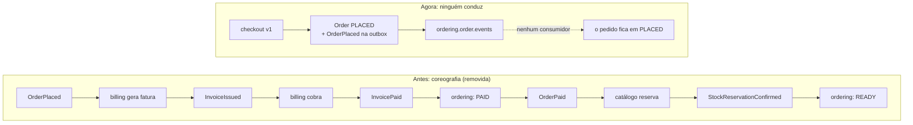

> **Para fixar:** o pedido parado em `PLACED` não é bug, é o **estado esperado** entre a demolição e a construção. Ele prova que nenhum consumidor esquecido continua empurrando o fluxo, o que é exatamente o risco de deixar os dois mecanismos convivendo.

### O que sai, serviço por serviço

| Serviço | Consumidores | Eventos e apoio | Configuração |
|---|---|---|---|
| **ordering** | `KafkaInvoiceIntegrationEventListener`, `KafkaStockIntegrationEventListener` | `InvoicePaid`, `InvoiceCanceled`, `StockReservationConfirmedIntegrationEvent`; `OrderManagementApplicationService` e a porta `ForManagingOrders` (só os consumidores usavam); `OrderManagementApplicationServiceIT` | Tópicos e grupos de fatura e estoque, os dois DLTs, três aliases |
| **billing** | `KafkaOrderIntegrationEventListener` (gerava a fatura), `KafkaStockIntegrationEventListener` (estornava) | `OrderPlacedIntegrationEvent`, os seis snapshots de `application.order.snapshot`, `GenerateInvoiceInputAssembler`, `StockReservationRejectedIntegrationEvent` | Tópicos e grupos de pedido e estoque, os dois DLTs, dois aliases |
| **catálogo** | `KafkaOrderIntegrationEventListener` (reservava o estoque) | `OrderPaidIntegrationEvent`, `OrderItemSnapshot`, o `OrderPaidIntegrationEventAssembler` **do catálogo**; `StockReservationEventListener`, `StockIntegrationEventPublisher` (interface e bean), os eventos de integração **e de domínio** da reserva | Bean do tópico `product-catalog.stock.events`, DLT do tópico de pedidos, propriedades, três aliases |

Depois disso, o ordering só consome eventos de **produto**, o billing só conhece o tópico de **fatura**, e o catálogo não consome nada.

### O que fica, e por quê

| Fica | Onde | Por quê |
|---|---|---|
| `OrderEventListener` e os eventos `OrderPlaced/Paid/Canceled/Ready` | ordering | O pedido continua anunciando o que acontece com ele. Hoje só o `OrderPlaced` sai, porque nada mais muda o estado; quando a saga voltar a chamar `markAsPaid`, `markAsReady` e `markAsCanceled`, os outros voltam a sair sozinhos |
| `OrderPaidIntegrationEventAssembler` **do ordering** | ordering | O `OrderEventListener` o usa para publicar o pedido pago (o homônimo do catálogo saiu) |
| `InvoiceManagementApplicationService.generate` e `refundByOrderId`, com `GenerateInvoiceInput` | billing | Viram os alvos dos **comandos** "emita a fatura" e "estorne" |
| `StockManagementApplicationService.reserveForOrder`, inputs, `DuplicateStockReservationException`, `existsByOrderId` | catálogo | A reserva em si não muda: só sai quem a chamava. O comando "reserve o estoque" vai chamá-la |
| `createDeadLetterTopic` no `KafkaConfig` do catálogo | catálogo | Fica sem uso, de propósito: os tópicos de comando das próximas aulas voltam a usá-lo |

Note a regra que separa os dois lados: **sai quem reage e quem anuncia para outro serviço reagir; fica quem faz o trabalho**. Gerar fatura, estornar e reservar estoque continuam existindo. Só muda quem os aciona: um evento interpretado por cada serviço → um comando enviado pelo orquestrador.

### A `StockReservation` deixa de anunciar

```java
// antes
public class StockReservation extends AbstractAggregateRoot<StockReservation> {
    public static StockReservation confirmed(...) {
        StockReservation r = new StockReservation(orderId, Status.CONFIRMED, items);
        r.registerEvent(StockReservationConfirmedEvent.builder()...build());
        return r;
    }
// agora
public class StockReservation {
    public static StockReservation confirmed(...) {
        return new StockReservation(orderId, Status.CONFIRMED, items);
    }
```

Na coreografia, a reserva **anunciava** o resultado para quem quisesse ouvir (o ordering ouvia a confirmação, o billing ouvia a rejeição). Na orquestração, o resultado vira a **resposta ao comando**, endereçada ao orquestrador. O evento de domínio que existia só para virar evento de integração perde a razão de existir, e a reserva volta a ser um documento simples.

### Um detalhe que ficou: o billing ainda cobra a própria fatura

O `KafkaInvoiceIntegrationEventListener` do billing continua consumindo o próprio `InvoiceIssued` para chamar `processPayment` (o Listen to Yourself da [aula 7.8](./workflow-coreografado.md#78--passo-4-o-billing-cobra-a-própria-fatura-e-o-webhook-fecha-o-ciclo)). Ele não está na lista de remoção. Hoje fica **ocioso**, porque nada mais gera fatura; volta a trabalhar quando o comando de emissão da saga chamar o `generate`. Vale observar nas próximas aulas se ele continua ou se a cobrança também vira um comando do orquestrador.

### Contratos

Os contratos AsyncAPI seguiram o código na mesma etapa:

- [`ordering.yml`](../asyncapi/ordering.yml): só consome `product-catalog.product.events` e publica `ordering.order.events`.
- [`billing.yml`](../asyncapi/billing.yml): só `billing.invoice.events` (publica, consome o próprio `InvoiceIssued`, e o DLT).
- [`product-catalog.yml`](../asyncapi/product-catalog.yml): só publica `product-catalog.product.events`.
- [`messages.yml`](../asyncapi/messages.yml): saíram as mensagens, headers e payloads de `StockReservationConfirmed/Rejected`, o trait `KafkaStockReservationKey` e o schema `StockReservationId`. A divergência de key que a [saga coreografada](./saga-coreografada.md#o-contrato-diz-uma-key-o-código-usa-outra) apontava desaparece junto.

### Conferência

| Item | Situação |
|---|---|
| Ordering: consumidores, três eventos, serviço, porta, IT, propriedades, DLTs, aliases | ✅ removidos; último alias sem vírgula nos dois YAMLs |
| Billing: consumidores, evento, seis snapshots, assembler, evento de estoque, propriedades, DLTs, aliases | ✅ removidos; imports órfãos no listener de fatura limpos |
| Catálogo: consumidor, evento, snapshot, assembler, publicador, eventos de integração e de domínio, tópico, DLT, propriedades, aliases | ✅ removidos; `StockReservation` sem `AbstractAggregateRoot` (o import que sobrou foi tirado) |
| Itens preservados | ✅ todos existem |
| Sobras em `src/` dos três serviços | ✅ nenhuma referência às classes e propriedades removidas |
| Testes unitários (`./gradlew test`) | ✅ ordering 304, billing 48, catálogo 117 — 0 falhas |
| Testes de contrato | ✅ ordering 12, catálogo 17 — 0 falhas |
| Testes de integração do ordering | ✅ 185, 0 falhas (já sem o `OrderManagementApplicationServiceIT`) |
| Testes de integração do billing | ✅ 20, 0 falhas — depois de corrigir três problemas anteriores a este desafio (abaixo) |
| Testes de integração do catálogo | ✅ 12, 0 falhas — idem |

### Os testes que já estavam quebrados

O primeiro `./gradlew check` depois da remoção falhou em 20 ITs do billing e 11 do catálogo. Nenhum por causa da remoção: os ITs desses dois serviços não rodavam com sucesso desde o módulo 7. Foram quatro causas:

| Serviço | Sintoma | Causa | Correção |
|---|---|---|---|
| billing | Contexto não sobe (20 ITs) | O `application-test-env.yaml` nunca ganhou Kafka: faltavam `algashop.messaging.kafka.*` (`@NotBlank`) e o `spring.json.type.mapping` que o `KafkaConsumerTypeIdIdentifier` lê por `@Value` | Bloco `spring.kafka` **no padrão do ordering** (mapping, producer, consumer) + tópico e grupo de fatura. Diferença do ordering: `spring.kafka.listener.auto-startup: false`, para o listener do `InvoiceIssued` não entrar no grupo `billing.invoice-events` do cluster de desenvolvimento durante os testes |
| billing | `shouldProcessInvoicePaymentAndCancelInvoice` | O teste verificava a chamada ao `InvoiceEventListener`, que virou `@TransactionalEventListener` (AFTER_COMMIT) na aula 8.3. O teste é `@Transactional` com rollback: o commit nunca acontece e o listener nunca roda | O teste passou a verificar o que de fato é responsabilidade do agregado: o `InvoiceCanceledEvent` publicado no save (`ApplicationEvents`, que a classe já registrava) |
| billing | `PaymentGatewayServiceFastpayImplIT` passa sozinho, falha na suíte | Cada classe parava e subia o WireMock na porta 8788; o contexto Spring em cache guardava no pool uma conexão com o servidor anterior → `NoHttpResponseException` | Um WireMock só para a JVM: `startMock` não sobe de novo se já estiver rodando, `stopMock` não para. O reset de cenários do `@BeforeEach` continua isolando os testes |
| catálogo | `StockTransactionIT` não sobe | O `KafkaConsumerTypeIdIdentifier` (aula 8.7) exige o mapping, ausente na configuração de teste | Bloco `spring.kafka` no `application-test-env.yml`, no padrão do ordering |
| catálogo | 7 ITs de `QuantityInStockAdjustment` | `@Transactional(propagation = MANDATORY)` (aula 8.5) recusa a chamada direta dos testes de fatia e de concorrência | `MANDATORY` removido (ver abaixo) |

**Por que tirar o `MANDATORY` em vez de abrir transação nos testes.** O ajuste é um `findAndModify` condicional: já é atômico por documento, sem transação. Quando o chamador abre uma (`restock`, `withdraw`, `reserveForOrder`, todos `@Transactional`), o `MongoOperations` participa dela e o ajuste commita junto com o movimento, com ou sem a anotação. O `MANDATORY` era só uma trava contra chamadas sem transação. Envolver cada chamada do teste de concorrência numa transação Mongo, ao contrário, mudaria o que ele testa: transações concorrentes no mesmo documento disputam com `WriteConflict` em vez de exercitar a atomicidade do `findAndModify`. Perdeu-se a trava; ficou a atomicidade, e os testes Java do catálogo não mudaram.

### Roteiro de verificação

1. Subir os três serviços e ver que iniciam sem erro (um alias apontando para classe apagada derruba a subida com `IllegalArgumentException`).
2. Checkout v1 com carrinho, autenticado como o cliente `6e148bd5-47f6-4022-b9da-07cfaa294f7a`, Visa final 1022 (`creditCardId` `0199deda-9486-7d27-b40c-761f561a24d8`). O pedido deve **parar em `PLACED`**:
   - em `ordering.order.events` chega só `Ordering.OrderPlacedIntegrationEvent`; nada novo em `billing.invoice.events` nem em `product-catalog.stock.events`;
   - `select id, status, placed_at, paid_at, ready_at from public."order" where id = '<orderId>';` (banco `ordering`): `PLACED`, `paid_at` e `ready_at` vazios;
   - `select id, status from public.invoice where order_id = '<orderId>';` (banco `billing`): nenhuma linha;
   - `db.stock_reservations.find({ orderId: "<orderId>" })` (mongosh, catálogo): nenhum documento.
3. Consumer groups na GUI do Kafka:

| Consumer group | Esperado |
|---|---|
| `ordering.invoice-events` | sem membros ativos |
| `ordering.stock-events` | sem membros ativos |
| `billing.order-events` | sem membros ativos |
| `billing.stock-events` | sem membros ativos |
| `product-catalog.order-events` | sem membros ativos |
| `ordering.product-events` | continua ativo |

4. Limpeza opcional do broker (remover o bean não apaga o tópico): `product-catalog.stock.events`, `ordering.dlt.billing.invoice.events`, `ordering.dlt.product-catalog.stock.events`, `billing.dlt.ordering.order.events`, `billing.dlt.product-catalog.stock.events`, `product-catalog.dlt.ordering.order.events`.

---

## Modelando a saga: `PlaceOrderSaga`

Com o terreno limpo, a primeira peça da orquestração é **o estado da saga**: o registro que responde "em que passo está o pedido 42?", a pergunta que a coreografia não sabia responder. Por enquanto é só o modelo, sem persistência, sem comandos e sem métodos de transição.

| Arquivo | Pacote | Papel |
|---|---|---|
| `SagaStatus` | `core/application/saga` | Ciclo de vida **genérico** de qualquer saga |
| `SagaTransitionException` | `core/application/saga` | Erro de transição inválida, com fábricas por tipo de violação |
| `PlaceOrderSagaStep` | `core/application/order/saga` | Os passos **desta** saga, a de realizar pedido |
| `PlaceOrderSaga` | `core/application/order/saga` | O estado de uma execução: `sagaId`, `orderId`, `status`, `step`, `version` |

### Por que em `application`, e não no domínio

O `Order` é domínio: tem regras de negócio (o que pode ser pago, cancelado, aprovado). A saga **coordena** serviços: lembra qual comando foi enviado e qual resposta se espera. Isso é orquestração de caso de uso, o mesmo nível dos application services. Por isso `PlaceOrderSaga` mora em `core/application/order/saga`, ao lado do que vai usá-la, e o que é reaproveitável por qualquer saga futura (`SagaStatus`, `SagaTransitionException`) fica um nível acima, em `core/application/saga`.

### Duas máquinas de estado: status × passo

A saga guarda duas coisas diferentes, e cada uma é uma máquina de estados própria:

- **Status**: *em que fase da vida* a saga está. Genérico, igual para qualquer saga.
- **Passo**: *onde* no fluxo desta saga ela está. Específico do pedido.

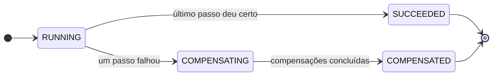

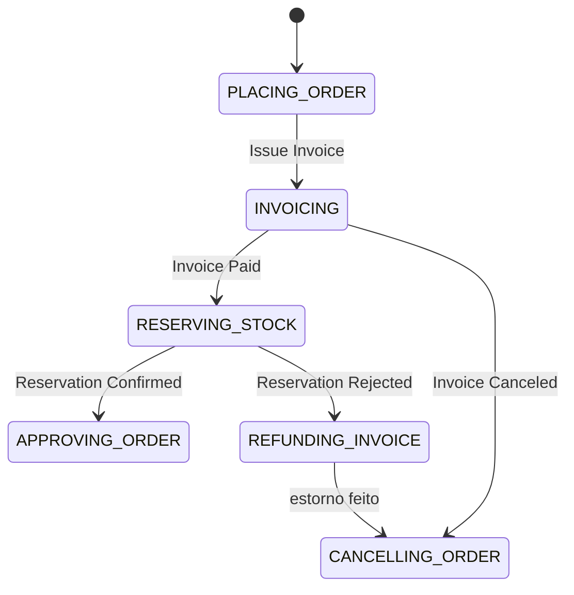

Cada passo corresponde a uma linha do [mapa detalhado](#o-mapa-da-orquestração):

| Passo | Linha do mapa | Status em que aparece |
|---|---|---|
| `PLACING_ORDER` | Placed Order (início, na transação do checkout) | `RUNNING` |
| `INVOICING` | Invoicing (comando `Issue Invoice`) | `RUNNING` |
| `RESERVING_STOCK` | Reserving Stock, o **pivô** (comando `Reserve Stock`) | `RUNNING` |
| `APPROVING_ORDER` | Approving order (comando `Approve order`) | `RUNNING` → `SUCCEEDED` |
| `REFUNDING_INVOICE` | Compensação `Cancel invoice` (a fatura já está paga, então cancelar é estornar) | `COMPENSATING` |
| `CANCELLING_ORDER` | Compensação `Cancel order` | `COMPENSATING` → `COMPENSATED` |

Dois caminhos levam ao cancelamento do pedido, e o enum declara os dois: `CANCELLING_ORDER(INVOICING, REFUNDING_INVOICE)`. Se a fatura é recusada, não há o que estornar e a saga cancela direto. Se o estoque é rejeitado, ela estorna primeiro. É a ordem inversa das compensações, escrita em um lugar só.

### O padrão `previousStatus`, de novo

Os dois enums usam o mesmo truque do `OrderStatus` do domínio: **cada estado declara de onde pode vir**.

```java
public enum PlaceOrderSagaStep {
    PLACING_ORDER,
    INVOICING(PLACING_ORDER),
    RESERVING_STOCK(INVOICING),
    APPROVING_ORDER(RESERVING_STOCK),
    REFUNDING_INVOICE(RESERVING_STOCK),
    CANCELLING_ORDER(INVOICING, REFUNDING_INVOICE);
    ...
    public boolean canChangeTo(PlaceOrderSagaStep newStatus) {
        return newStatus.previousStatus.contains(this);
    }
}
```

A regra de transição fica junto da definição do estado, e não espalhada em `if`s. Para saber de onde se chega em `CANCELLING_ORDER`, basta ler a linha dele.

### `PlaceOrderSaga`: o estado de uma execução

```java
public static PlaceOrderSaga start(OrderId orderId)      // RUNNING em PLACING_ORDER, version 0
public static PlaceOrderSaga existing(UUID sagaId, OrderId orderId,
                                      SagaStatus status, PlaceOrderSagaStep step, long version)
```

- **`start` × `existing`**: a mesma separação do `Order` (`draft` para nascer, `existing` para reidratar do banco). Só `start` decide o estado inicial; `existing` aceita o que vier persistido.
- **`version`**: preparada para lock otimista. Quando duas respostas do mesmo pedido chegarem ao mesmo tempo, a segunda gravação vai falhar em vez de sobrescrever a primeira.
- **Consultas `isRunningAt(step)`, `isCompensatingAt(step)`, `isActive()`**: é com elas que o orquestrador vai decidir se uma resposta ainda é esperada. Um `Invoice Paid` só faz sentido se a saga está `RUNNING` em `INVOICING`; se chegar de novo (reentrega), a saga já estará em `RESERVING_STOCK` e a resposta pode ser ignorada com segurança. É a base da idempotência das replies, aquilo que a coreografia resolvia mandando duplicatas para o DLT.
- **Guardas privadas `require`, `changeStatusTo`, `changeStepTo`**: validam pré-condição, status e passo, lançando `SagaTransitionException`. Ainda não têm chamador; os métodos de transição das próximas aulas vão usá-las.

### Revisão desta etapa

- **Corrigido**: `APPORVING_ORDER` → `APPROVING_ORDER`. O enum vai ser gravado como texto na tabela da saga, e renomear um valor depois de persistido exige migração de dados.
- **Corrigido**: import sem uso de `OrderStatus` em `SagaStatus`.
- **Para ficar de olho**: status e passo são validados **separadamente**. Os enums sozinhos não impedem combinações sem sentido, como `COMPENSATING` em `APPROVING_ORDER` ou `RUNNING` em `REFUNDING_INVOICE`. Quem vai garantir a coerência entre os dois são os métodos de transição (cada um mudando passo e status juntos, com `require` antes). Um teste unitário por transição é o lugar natural para travar isso.

---

## Persistindo a saga

O modelo da seção anterior só existia em memória. Esta etapa dá a ele uma tabela, sem mudar uma linha do `PlaceOrderSaga`: tudo o que é banco fica na infraestrutura.

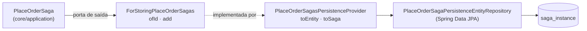

É o mesmo desenho de [ports & adapters](../01-arquitetura-design/ports-hexagonal.md) do `Orders`: a aplicação conhece a porta `ForStoringPlaceOrderSagas` (`core/ports/out/order/saga`), e o adaptador traduz entre o objeto da aplicação e a entidade JPA.

### A classe abstrata `SagaInstancePersistenceEntity`

O centro da etapa é uma entidade **abstrata** que serve de base para todas as sagas do serviço, presentes e futuras:

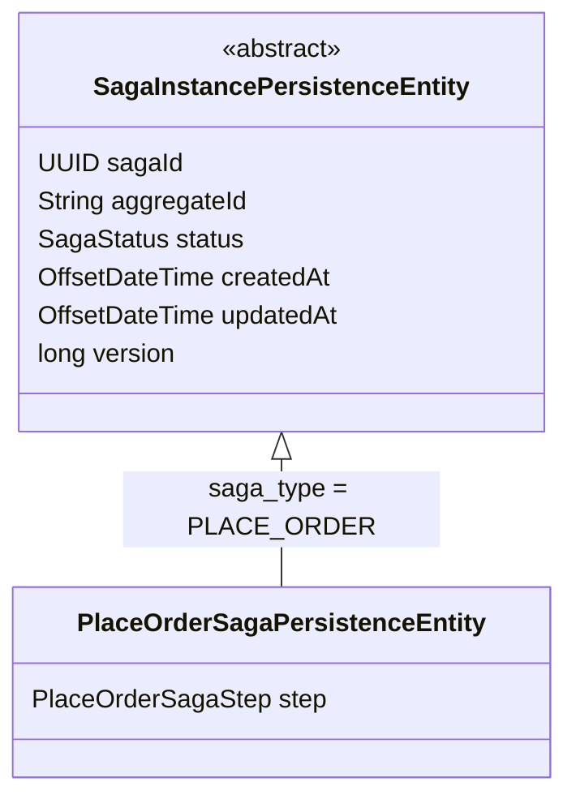

Como ela foi construída, peça por peça:

| Peça | O que faz | Por quê |
|---|---|---|
| `abstract` + `@Entity` | É uma entidade JPA, mas não pode ser instanciada | Não existe "saga genérica" no banco: toda linha é de um tipo concreto |
| `@Inheritance(SINGLE_TABLE)` | Base e subclasses gravam na **mesma** tabela | Uma consulta por status atende qualquer tipo de saga, sem join |
| `@DiscriminatorColumn(name = "saga_type")` + `@DiscriminatorValue("PLACE_ORDER")` na subclasse | Cada linha diz de que tipo é | Ao ler a linha, o Hibernate sabe qual subclasse instanciar |
| Campos na base: `sagaId`, `aggregateId`, `status` | O que **toda** saga tem | Identidade, o agregado que ela conduz e o ciclo de vida genérico (`SagaStatus`) |
| Campo na subclasse: `step` | O que é **desta** saga | Cada saga tem seu próprio enum de passos |
| `@CreatedDate`, `@LastModifiedDate` + `AuditingEntityListener` | Datas preenchidas pelo Spring Data | A mesma auditoria das outras entidades, com o `DateTimeProvider` de `OffsetDateTime` do projeto |
| `@Version` | Lock otimista | Duas respostas do mesmo pedido gravando ao mesmo tempo: a segunda falha em vez de sobrescrever |
| `aggregateId` como `String` | Serve a qualquer agregado | Hoje guarda o TSID do pedido; amanhã pode ser outro id |

**Por que `SINGLE_TABLE` e não as outras estratégias.** `JOINED` separaria os campos comuns e os específicos em tabelas diferentes, com join a cada leitura. `TABLE_PER_CLASS` daria uma tabela por saga, e "quais sagas estão ativas?" viraria um `UNION`. Com single table, o preço é que colunas específicas de uma saga ficam vazias nas linhas das outras. Com poucos campos por saga, é um preço baixo.

### A tabela `saga_instance` (V010)

| Coluna | Origem | Observação |
|---|---|---|
| `saga_id` | base | PK |
| `saga_type` | discriminador | `PLACE_ORDER` |
| `aggregate_id` | base | id do pedido |
| `status` | base | `RUNNING`, `COMPENSATING`, `SUCCEEDED`, `COMPENSATED` |
| `step` | subclasse | `not null`: toda saga do serviço precisa ter passo |
| `failure` | — | reservada, ainda sem campo na entidade |
| `created_at`, `updated_at` | auditoria | |
| `version` | `@Version` | |

Duas decisões no SQL valem a leitura:

- **`unique (saga_type, aggregate_id)`**: uma saga de realizar pedido por pedido. Se o início da saga for executado duas vezes para o mesmo pedido, o banco recusa a segunda.
- **Índice parcial `idx_saga_instance_active`** em `(saga_type, status)` `where status in ('RUNNING', 'COMPENSATING')`: só as sagas ativas entram no índice. As terminadas (a grande maioria, com o tempo) não pesam. É exatamente o conjunto que um job de recuperação ou de timeout vai varrer.

### O adaptador

`PlaceOrderSagasPersistenceProvider` converte nos dois sentidos:

- `toEntity(saga)`: cria a `PlaceOrderSagaPersistenceEntity` e copia `sagaId`, `orderId` (como texto), `status`, `step` e `version`.
- `toSaga(entity)`: reidrata com `PlaceOrderSaga.existing(...)`, a fábrica que a seção anterior preparou para isso.

A classe é `@Transactional(readOnly = true)` por padrão, e só o `add` abre escrita.

### Revisão desta etapa

- **Corrigido**: o campo se chamava `updateAt`, mas a coluna é `updated_at`. A estratégia de nomes do Spring Boot transformaria o campo em `update_at`, e como o projeto usa `ddl-auto: none`, nada acusaria na subida: o primeiro `insert` de uma saga falharia com "column update_at does not exist". Renomeado para `updatedAt`. Nenhum teste grava saga ainda, por isso a suíte não pegou.
- **Corrigido**: import sem uso (`LastModifiedBy`).
- **Para quando as transições chegarem**: o `add` monta uma entidade nova a cada chamada. Para inserir, funciona. Para **atualizar** uma saga já gravada, dois problemas vão aparecer:
  1. a entidade nova chega com `createdAt` nulo, o `merge` copia o nulo por cima e viola o `not null`;
  2. a `version` incrementada pelo banco não volta para o objeto `PlaceOrderSaga`, e a gravação seguinte, com a versão velha, daria `OptimisticLockException`.

  O `OrderPersistenceProvider` já resolve os dois: `findById` decide entre `update` e `insert`, a atualização copia os campos para a entidade carregada, e o `updateVersion` devolve a versão ao agregado por reflexão. É o padrão a reaproveitar.
- **Testes**: `./gradlew check` do ordering verde (304 unitários, 12 de contrato, 185 de integração, com a V010 aplicada no Postgres de teste). Um IT do `PlaceOrderSagasPersistenceProvider` (gravar, ler, gravar de novo) é o que pegaria os itens acima.

---

## Onde a saga começa

A primeira seção deste doc explicou **por que** o checkout assíncrono saiu: a saga precisa nascer na mesma transação que grava o pedido. Esta etapa é o **como**.

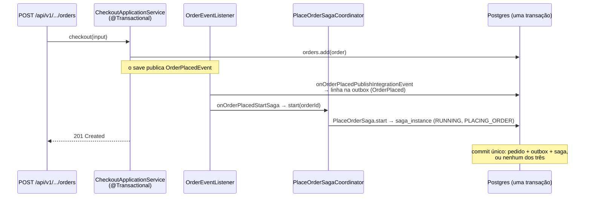

As peças:

| Peça | Onde | Papel |
|---|---|---|
| `ForCoordinatingPlaceOrderSaga.start(rawOrderId)` | `core/ports/in/order/saga` | Porta de **entrada** do orquestrador |
| `PlaceOrderSagaCoordinator` | `core/application/order/saga` | Implementação: cria a saga com `PlaceOrderSaga.start` e grava pela porta de saída `ForStoringPlaceOrderSagas` |
| `OrderEventListener.onOrderPlacedStartSaga` | `infrastructure/adapters/in/listerner/order` | Adaptador de entrada: traduz o evento de domínio em chamada à porta |

Três detalhes que fazem a diferença:

- **Dois ouvintes para o mesmo evento.** O antigo `listen(OrderPlacedEvent)` virou `onOrderPlacedPublishIntegrationEvent` e ganhou um irmão, `onOrderPlacedStartSaga`. Nomes que dizem *o que* cada um faz são mais legíveis que dois `listen` sobrecarregados, e cada responsabilidade pode evoluir sozinha.
- **Os dois são `@EventListener` síncronos**, e não `@TransactionalEventListener`. Rodam *dentro* da transação do checkout, e o `@Transactional` do coordenador apenas participa dela. Se gravar a saga falhar, o checkout inteiro volta: não existe pedido sem saga. É o mesmo raciocínio da outbox: com escrita local, publicar dentro da transação é o objetivo.
- **Uma saga por pedido** fica garantida pela constraint `unique (saga_type, aggregate_id)` da V010.

O efeito colateral mais visível: todo checkout v1 agora grava uma linha em `saga_instance`. O `CheckoutApplicationServiceIT` passou a exercitar a persistência da saga, e foi ele que confirmou, no Postgres de teste, a correção do `updatedAt` da seção anterior. O teste também foi ajustado para verificar os dois ouvintes.

> **Para fixar:** a saga começa e... para. O coordenador ainda não envia o comando `Issue Invoice`. Um pedido novo fica `PLACED`, com a saga `RUNNING` em `PLACING_ORDER`. Agora há um registro dizendo onde ele parou, o que a coreografia nunca teve.

## Entrada × saída: as interfaces de integração

O mesmo nome, `IntegrationEvent`, servia para duas coisas opostas: o evento que o serviço **publica** e o que ele **consome**. No consumidor, o `getAggregateId()` existia só por simetria, e nenhum código o chamava. Com comandos e respostas chegando, a ambiguidade ia piorar. A interface foi separada por **direção**:

| Interface | Direção | O que exige | Quem implementa |
|---|---|---|---|
| `OutboundIntegrationEvent` | sai do serviço | `getAggregateId()` (vira a **key**) e `getIdempotencyKey()` (default `null`) | ordering: eventos de pedido; billing: de fatura; catálogo: de produto |
| `InboundIntegrationEvent` | entra no serviço | nada (marcador) | ordering: os eventos de produto que consome |
| `OutboundIntegrationCommand` | sai do serviço | `getAggregateId()` e `getIdempotencyKey()` (agora default `null`) | os comandos da saga, quando existirem |

A regra por trás: **quem publica escolhe a key**. No consumo, a key já chega pronta no header `KafkaHeaders.RECEIVED_KEY`, e o evento de entrada não precisa saber calculá-la. Por isso os eventos de produto do ordering perderam o `getAggregateId()`.

As portas e os adaptadores acompanharam nos três serviços (`ForPublishingOrderIntegrationEvents`, `InvoiceIntegrationEventPublisher`, `ProductIntegrationEventPublisher`, os publishers Kafka e de outbox, as `*PublishingException`). Billing e catálogo fizeram só o rename, porque hoje apenas publicam.

## O contrato da orquestração

Os contratos AsyncAPI foram reescritos **antes** do código dos comandos (contract-first): o desenho está escrito e validado, e as próximas aulas o implementam.

| Serviço | Publica | Consome |
|---|---|---|
| ordering | `ordering.order.events`; comandos em `billing.invoice.commands` (`IssueInvoice`, `CancelInvoice`) e `product-catalog.stock.commands` (`ReserveStock`) | `product-catalog.product.events`; respostas em `ordering.saga.replies` (grupo `ordering.saga-replies`) |
| billing | `billing.invoice.events`; respostas no tópico indicado pelo comando | `billing.invoice.commands` (grupo `billing.invoice-commands`); o próprio `InvoiceIssued` |
| catálogo | `product-catalog.product.events`; respostas no tópico indicado pelo comando | `product-catalog.stock.commands` (grupo `product-catalog.stock-commands`) |

Cada tópico consumido tem seu DLT (`ordering.dlt.ordering.saga.replies`, `billing.dlt.billing.invoice.commands`, `product-catalog.dlt.product-catalog.stock.commands`).

### Request-reply sobre Kafka

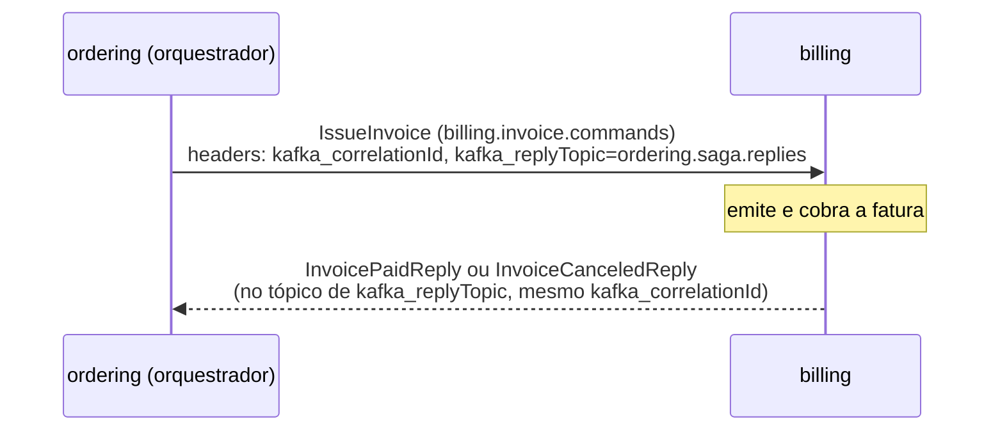

Os headers carregam o mecanismo:

| Header | Em | Para quê |
|---|---|---|
| `kafka_replyTopic` | comando | Diz **para onde** responder. O participante não precisa conhecer o orquestrador: responde onde o comando mandou. No contrato do billing e do catálogo, o `reply.address` aponta para `$message.header#/kafka_replyTopic` |
| `kafka_correlationId` | comando **e** resposta | Liga a resposta ao comando que a originou |
| `idempotency-key` | comando | Presente quando o comando sai pela outbox |

São os nomes que o Spring Kafka usa em `KafkaHeaders.REPLY_TOPIC` e `KafkaHeaders.CORRELATION_ID`. Todas as mensagens novas usam `key = orderId` (trait `KafkaOrderKey`): comandos e respostas do mesmo pedido ficam na mesma partição, em ordem.

### Eventos × respostas

O billing passa a ter **duas** saídas para o mesmo fato:

| | `InvoicePaidEvent` (evento) | `InvoicePaidReply` (resposta) |
|---|---|---|
| Destinatário | ninguém em particular | o orquestrador que mandou o comando |
| Tópico | `billing.invoice.events` | o de `kafka_replyTopic` |
| Faz a saga andar? | não | sim |

É a separação que o [mapa detalhado](#o-mapa-da-orquestração) mostra nas colunas *Reply* e *Success/Failure Event*, agora escrita no contrato.

### Revisão do contrato

- ~~**Corrigido**: `CancelInvoiceCommand` passou a `Ordering.`~~ **Revertido na etapa "O billing executa o comando"**: a convenção do projeto para comandos é prefixo = serviço que **executa** (`Billing.CancelInvoiceIntegrationCommand`). O prefixo do produtor vale para eventos. Ver [a convenção dos `__TypeId__`](#a-convenção-dos-__typeid__).
- **Não há comando para `Approve order`**: aprovar é um passo interno do ordering, que não sai do serviço.
- **O contrato está à frente do código**: nenhum comando nem resposta existe em Java ainda. Quando existirem, os `__TypeId__` do contrato têm de bater com os aliases do `spring.json.type.mapping`, e é aí que um contrato sem validação costuma começar a mentir ([Fase 40](./asyncapi-contratos.md)).
- `$ref` dos quatro arquivos: nenhum quebrado.

### Revisão do código

- Comentários corrigidos: as `OutboundIntegrationEvent` de billing e catálogo diziam "eventos de integração **do order**" (copiado do ordering); a do catálogo tinha perdido a explicação de key → partição → ordem por agregado; a do ordering ainda descrevia o lado consumidor. O `InboundIntegrationEvent` ganhou comentário próprio.
- Testes: ordering `check` verde (304 unitários, 12 de contrato, 185 de integração); billing e catálogo compilam e os unitários passam.

---

## A outbox aprende a transportar comandos

O orquestrador vai mudar o estado da saga **e** enviar um comando a cada passo: "saga agora em `INVOICING`" + "billing, emita a fatura". São duas escritas, uma no Postgres e outra no Kafka: o mesmo **dual-write** que a [outbox da Fase 41](./outbox-e-checkout-assincrono.md) resolveu para eventos. A saída é a mesma: o comando também passa pela outbox, gravado na transação que muda a saga. Se a transição commitar, o comando sai em algum momento; se ela voltar, o comando nunca existiu.

A outbox, porém, foi escrita para eventos. Esta etapa a prepara para levar as duas coisas.

### Evento × comando na mesma tabela

Um comando precisa de duas informações que um evento não tem: **a que conversa a resposta pertence** e **para onde respondê-la**. Viraram duas colunas novas, opcionais:

| Coluna | Evento (`OrderPlaced`) | Comando (`IssueInvoice`, em breve) | Vira o header |
|---|---|---|---|
| `channel_name` | `ordering.order.events` | `billing.invoice.commands` | (tópico do record) |
| `aggregate_id` | id do pedido | id do pedido | (key do record) |
| `message_type` | `Ordering.OrderPlacedIntegrationEvent` | `Billing.IssueInvoiceIntegrationCommand` | `__TypeId__` |
| `id` | UUIDv7 da linha | UUIDv7 da linha | `idempotency-key` |
| `correlation_id` | vazio | id que liga comando e resposta | `kafka_correlationId` |
| `reply_topic` | vazio | `ordering.saga.replies` | `kafka_replyTopic` |

Os dois headers novos são exatamente os do `CommandHeaders` do [contrato](#o-contrato-da-orquestração), com os nomes que o Spring Kafka usa (`KafkaHeaders.CORRELATION_ID` e `KafkaHeaders.REPLY_TOPIC`). O `OutboxKafkaSender` só os adiciona quando a coluna está preenchida, então um evento sai exatamente como antes.

### `event_type` → `message_type`

A V011 só renomeia uma coluna, e o motivo é de vocabulário: a coluna passa a guardar o tipo de **comandos** também, e `event_type` começaria a mentir. O mesmo rename vale para o campo `OutboxMessage.messageType` e para o método `readMessageType` do recorder. Linhas pendentes continuam válidas, porque só o nome mudou. Como toda migração de schema, ela deve rodar com o serviço parado.

### `OutboxDraft`: o rascunho da mensagem

```java
@Builder
public record OutboxDraft(String channelName, String aggregateId,
                          String correlationId, String replyTopic,
                          Object payload) { }
```

Antes, `OutboxRecorder.record(channelName, aggregateId, message)` tinha três parâmetros posicionais. Com comandos seriam cinco, dois deles opcionais: uma assinatura em que é fácil trocar dois `String` de lugar sem o compilador perceber. O `OutboxDraft` é um **parâmetro-objeto** com builder: cada campo vai pelo nome, e o que não se aplica simplesmente não é preenchido.

A divisão de responsabilidades ficou explícita:

- **O publisher diz o quê e para onde**: canal, agregado, payload e, se for comando, correlação e tópico de resposta.
- **O recorder decide o resto**: gera o id da linha (UUIDv7, que também é a idempotency key), serializa o payload com o mesmo `JacksonJsonSerializer` do caminho Kafka, extrai o `__TypeId__` lógico dos headers da serialização e inicializa o estado de envio (tentativas, próximo envio). Continua `@Transactional(propagation = MANDATORY)`: gravar fora da transação de negócio é recusado.

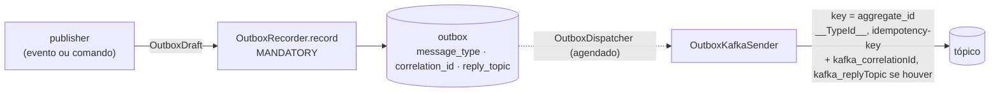

O `OutboxOrderIntegrationEventPublisher` foi o primeiro a usar o draft: monta um `OutboxDraft` só com canal, agregado e payload, sem correlação nem resposta.

### Revisão desta etapa

- **Corrigido**: o comentário do `OutboxKafkaSender` ainda dizia `__TypeId__ = eventType` e não citava os headers novos. O `OutboxDraft` ganhou comentário explicando o papel do rascunho.
- **Ainda não há publisher de comando**: a outbox está pronta para comandos, mas nenhum código grava um com `correlationId`/`replyTopic`. Isso vem com o envio do `IssueInvoice`.
- **Testes**: `./gradlew check` do ordering verde (304 unitários, 12 de contrato, 185 de integração). O `CheckoutApplicationServiceIT` grava o `OrderPlaced` na outbox, o que exercita a gravação com as colunas da V011/V012. O envio com os headers novos não tem teste: um IT do `OutboxKafkaSender` com correlação e resposta preenchidas é o que travaria esse caminho.

---

## O primeiro comando: emitir a fatura

Até aqui a saga nascia e parava em `PLACING_ORDER`. Agora ela dá o primeiro passo do [mapa](#o-fluxo-passo-a-passo): manda o comando `Issue Invoice` ao billing e passa a esperar a resposta em `INVOICING`.

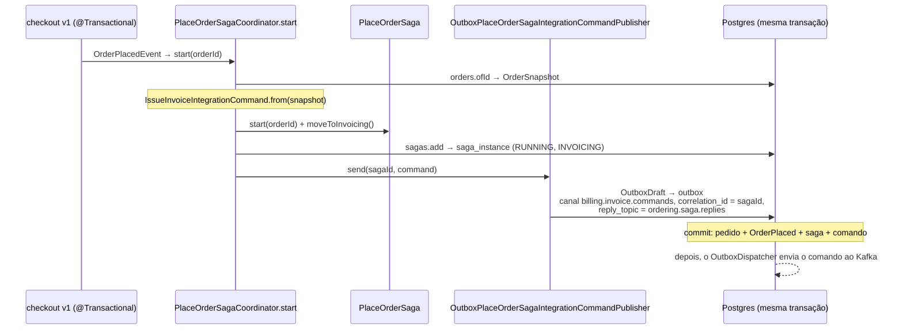

### As peças, por camada

| Camada | Peça | O que faz |
|---|---|---|
| aplicação | `IssueInvoiceIntegrationCommand` | O comando: pedido congelado (itens, frete, cobrança, `PaymentSnapshot` com método e cartão). Implementa `OutboundIntegrationCommand`, key = `orderId` |
| aplicação | `PlaceOrderSaga.moveToInvoicing()` | Primeira transição: `require(isRunningAt(PLACING_ORDER))` e `changeStepTo(INVOICING)`. O status continua `RUNNING` |
| aplicação | `PlaceOrderSagaCoordinator.start` | Carrega o pedido, monta o comando, inicia e avança a saga, grava, envia |
| porta de saída | `ForPublishingPlaceOrderSagaIntegrationCommands.send(correlationId, command)` | O coordenador diz *qual* comando e de *qual* saga; o resto é do adaptador |
| adaptador | `OutboxPlaceOrderSagaIntegrationCommandPublisher` | Monta o `OutboxDraft` com canal, agregado, `correlationId` e `replyTopic` e grava na outbox |
| adaptador | `PlaceOrderSagaCommandTopics.of(command)` | Roteia cada comando para o tópico do participante, por pattern matching de tipo |
| config | `AlgaShopMessagingKafkaProperties` + `KafkaConfig` (ordering) | `billing-invoice-commands-topic-name`, `saga-replies-topic-name`; cria `ordering.saga.replies` e seu DLT |
| config | `AlgaShopMessagingKafkaProperties` + `KafkaConfig` (billing) | `invoice-commands-topic-name`, `invoice-commands-consumer-group`; cria `billing.invoice.commands` |

### Três decisões para guardar

**1. O comando reaproveita o snapshot.** O `toSnapshot(Order)` que [ficou sem chamador](#o-ordersnapshot-encolhe) quando o checkout assíncrono saiu volta aqui, como estava previsto. O comando carrega o pedido inteiro (ECST): o billing emite a fatura sem chamar o ordering de volta. Os itens são ordenados por id, para o mesmo pedido gerar sempre o mesmo JSON.

**2. `correlationId = sagaId`.** A resposta do billing vai voltar com o mesmo `kafka_correlationId`, e o orquestrador vai usá-lo para achar a saga, checar com `isRunningAt(INVOICING)` se ainda espera aquela resposta, e avançar. O `orderId` também identificaria o pedido, mas o `sagaId` identifica a **execução**: se um dia houver mais de uma saga por pedido (outro tipo, ou uma nova tentativa), a correlação continua sem ambiguidade.

**3. Quem cria cada tópico é quem o consome.** O billing executa os comandos de fatura, então ele declara `billing.invoice.commands`. O ordering consome as respostas, então ele declara `ordering.saga.replies` e o DLT dela. O ordering só conhece o *nome* do tópico de comandos, pela property, e não o cria. É a mesma regra dos tópicos de eventos (cada dono declara o seu), aplicada ao lado de quem recebe.

### O roteamento de tópico

```java
return switch (command) {
    case IssueInvoiceIntegrationCommand ignored -> properties.getBillingInvoiceCommandsTopicName();
    default -> throw new IllegalArgumentException("Unsupported saga command " + ...);
};
```

O publisher não precisa saber para onde vai cada comando: pergunta ao `PlaceOrderSagaCommandTopics`. Cada comando novo (`ReserveStock`, `CancelInvoice`) ganha uma linha no `switch`. Um comando sem rota **falha alto** no envio: melhor uma exceção (que desfaz a transação inteira) do que um comando gravado para um tópico que ninguém consome.

### Revisão desta etapa

- ~~**Corrigido**: o alias `Billing.IssueInvoiceIntegrationCommand` foi trocado por `Ordering.`~~ **Revertido**: `Billing.` estava certo. Os dois lados (ordering e billing) usam `Billing.IssueInvoiceIntegrationCommand`, e o contrato foi alinhado a eles. Ver [a convenção dos `__TypeId__`](#a-convenção-dos-__typeid__).
- **Corrigido**: os `application-test-env.yaml` do ordering e do billing não tinham as properties novas (`@NotBlank`). O contexto dos testes de integração não subiria. Adicionadas, e o ordering ganhou também o alias do comando.
- **Comentários**: cada classe nova ou alterada ganhou um comentário curto explicando seu papel.
- **Testes**: ordering `check` verde (304 unitários, 12 de contrato, 185 de integração); billing `check` verde (48 unitários, 20 de integração). O `CheckoutApplicationServiceIT` agora executa o caminho inteiro: grava pedido, saga em `INVOICING` e o comando na outbox.
- **Pendências**:
  - o billing ainda não **consome** o comando, não tem listener nem DLT para `billing.invoice.commands`, e não responde. O comando fica no tópico até a próxima aula;
  - a pendência da [persistência da saga](#revisão-desta-etapa-1) continua (atualizar uma saga já gravada perde `createdAt` e a `version`). Ainda não morde, porque a saga só é inserida, mas a primeira resposta vai exigir um `update`;
  - o comando não passa por Bean Validation antes de ir para a outbox (o `OutboxRecorder` não valida). As anotações do `IssueInvoiceIntegrationCommand` só protegem o lado de quem consome.

---

## O billing executa o comando

O comando `IssueInvoice` que o ordering grava na outbox agora tem quem o consuma. Do lado do billing, ele vira uma fatura pelo mesmo caso de uso que sempre existiu: o `generate`.

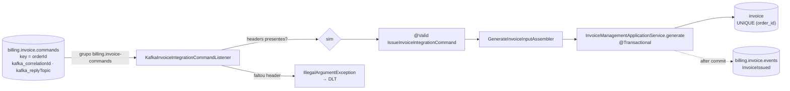

### As peças

| Peça | O que é |
|---|---|
| `InboundIntegrationCommand` | Marcador dos comandos que o billing **recebe**. Simétrico ao `OutboundIntegrationCommand` do ordering: quem recebe não precisa de key |
| `invoice/command/IssueInvoiceIntegrationCommand` | Cópia local do contrato, com Bean Validation. É o mesmo pedido congelado que o ordering montou |
| `application/order/snapshot/*` (seis records) | Voltaram: tinham saído junto com o `OrderPlacedIntegrationEvent` na remoção da coreografia, e agora chegam dentro do comando |
| `GenerateInvoiceInputAssembler` | Voltou, agora a partir do comando. A tradução é a mesma de antes: itens viram linhas, frete maior que zero vira a linha "Shipping", o payer vem do `BillingSnapshot` |
| `KafkaInvoiceIntegrationCommandListener` | Consome `billing.invoice.commands` no grupo `billing.invoice-commands`, valida e chama `generate` |
| `KafkaConfig` | Ganhou o DLT `billing.dlt.billing.invoice.commands` |

A peça que **não** mudou é a mais importante: o `InvoiceManagementApplicationService.generate`. Ele ficou preservado na remoção da coreografia exatamente para isto. Na coreografia, quem o chamava era um evento (`OrderPlaced`); agora é um comando. O caso de uso não sabe a diferença.

### Comando desconhecido é erro; evento desconhecido, não

O handler default do listener de comandos **lança** exceção:

```java
@KafkaHandler(isDefault = true)
public void handle(@Payload Object command, ...) {
    throw new IllegalArgumentException("Unsupported invoice command type " + ...);
}
```

Os listeners de **evento** do projeto fazem o contrário: logam e ignoram. A diferença é de natureza:

- Um **evento** novo é evolução normal do produtor. O consumidor que não se interessa por ele ignora, e nada está errado.
- Um **comando** é uma ordem endereçada a este serviço. Se ele chegou e o billing não sabe executá-lo, o contrato quebrou. Ignorar em silêncio deixaria o orquestrador esperando uma resposta que nunca vem. Lançar manda a mensagem para o DLT, onde alguém vai vê-la.

### Os headers são obrigatórios

Antes de executar, o listener confere `kafka_correlationId` e `kafka_replyTopic`. Sem eles não há como responder ao orquestrador, então a falta é tratada como mensagem inválida (`IllegalArgumentException`, não-retryable, DLT). Hoje o listener só **valida** os headers; a resposta (`InvoicePaidReply`/`InvoiceCanceledReply` no tópico do `kafka_replyTopic`) vem na próxima etapa.

### A convenção dos `__TypeId__`

Esta etapa fixou a regra que estava ambígua no contrato:

| Tipo de mensagem | Prefixo | Exemplos |
|---|---|---|
| **Evento** | serviço que **publica** o fato | `Ordering.OrderPlacedIntegrationEvent`, `Billing.InvoicePaidIntegrationEvent` |
| **Comando** | serviço (ou subdomínio) que **executa** a ordem | `Billing.IssueInvoiceIntegrationCommand`, `Billing.CancelInvoiceIntegrationCommand`, `Stock.ReserveStockIntegrationCommand` (o estoque, dentro do catálogo) |
| **Resposta** | serviço que **responde** | `Billing.InvoicePaidIntegrationReply`, `ProductCatalog.StockReservationConfirmedIntegrationReply` |

O fato pertence a quem o produziu; o comando pertence ao vocabulário de quem o executa. `IssueInvoice` é uma operação do billing, e o ordering apenas a solicita. Ordering e billing já usavam `Billing.IssueInvoiceIntegrationCommand`; o contrato (`messages.yml`) foi alinhado a eles, e as duas "correções" para `Ordering.` feitas nas etapas anteriores deste doc foram revertidas. O YAML de teste do ordering, que tinha ficado com `Ordering.`, também foi corrigido, e o do billing ganhou o alias.

### Revisão desta etapa

- **Testes**: billing `check` verde (48 unitários, 20 de integração); ordering `check` verde (304, 12, 185). Nos testes do billing o listener não sobe (`auto-startup: false`), então o consumo do comando ainda não tem teste próprio. Um IT que envie o comando e verifique a fatura gerada fecharia esse buraco.
- **Comentários**: o listener, o `InboundIntegrationCommand` e o assembler ganharam comentários curtos.
- **Pendências**:
  - **duplicata vira DLT de novo**: um `IssueInvoice` reentregue bate no `UNIQUE (order_id)`, lança `DataIntegrityViolationException` (não-retryable) e vai para o DLT. Na coreografia isso só poluía o DLT. Na orquestração é pior: se a primeira execução já gerou a fatura e a resposta se perdeu, a reentrega deveria **responder de novo**, e não falhar. Quando a resposta existir, o caso "fatura já existe para este pedido" precisa reenviar o reply;
  - o `generate` publica `InvoiceIssued` depois do commit, e o próprio billing ainda consome esse evento para cobrar (o Listen to Yourself da aula 7.8). É a cobrança, por esse caminho, que vai produzir o `InvoicePaid`/`InvoiceCanceled` que a resposta precisa;
  - a resposta ao orquestrador ainda não existe.

---

## Resposta assíncrona: guardando o reply pendente

Request-reply costuma ser desenhado assim: chega o comando, o serviço executa, responde. No billing, isso não funciona. Quando o `IssueInvoice` é processado, a fatura nasce `UNPAID`, e **ninguém sabe ainda** se ela vai ser paga ou cancelada. O resultado depende de um pagamento que acontece depois, por um de dois caminhos:

- a cobrança disparada pelo próprio `InvoiceIssued` (o Listen to Yourself da [aula 7.8](./workflow-coreografado.md#78--passo-4-o-billing-cobra-a-própria-fatura-e-o-webhook-fecha-o-ciclo)), segundos depois;
- o webhook do FastPay, minutos depois, quando o pagamento não é confirmado na hora.

Ou seja: a resposta (`InvoicePaidReply` ou `InvoiceCanceledReply`) vai ser enviada por **outro** fluxo, em **outro** momento. Mas quem sabe *para onde* e *com qual correlação* responder é só o comando, nos headers `kafka_replyTopic` e `kafka_correlationId`. Se o billing não guardar essas duas informações, quando o pagamento se resolver não haverá a quem responder.

### A solução: guardar o endereço de resposta junto com a fatura

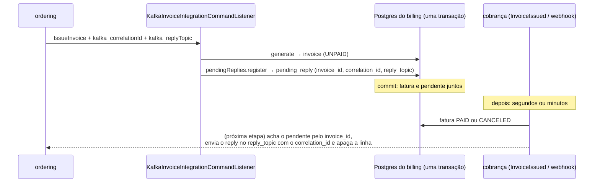

No listener, as duas escritas ficam dentro de um `TransactionTemplate`:

```java
transactionTemplate.executeWithoutResult(status -> {
    UUID invoiceId = invoiceManagementApplicationService.generate(input);
    pendingReplies.register(invoiceId, command.getOrderId(), sagaCorrelationId, sagaReplyTopic);
});
```

O `@Transactional` do `generate` e o do `register` não abrem transações próprias: **participam** da que o template abriu. A fatura e o pendente commitam juntos, ou nenhum dos dois. O caso que isso evita é o pior possível para a saga: uma fatura gerada (e logo cobrada) sem registro de para onde responder. O orquestrador ficaria esperando em `INVOICING` para sempre.

Por que um `TransactionTemplate` no listener, e não um `@Transactional` no método? Porque o método também valida headers e monta o input. O template delimita a transação exatamente no trecho que escreve no banco, e deixa explícito, no código, que as duas linhas são uma unidade.

### A tabela `pending_reply` (V0004)

| Coluna | Para quê |
|---|---|
| `invoice_id` | PK e FK para `invoice`. No máximo um pendente por fatura, e é pela fatura que ele vai ser achado quando ela for paga ou cancelada |
| `order_id` | O pedido, para log e para montar a resposta |
| `correlation_id` | O `kafka_correlationId` do comando (o `sagaId`), que volta na resposta |
| `reply_topic` | O `kafka_replyTopic` do comando (`ordering.saga.replies`) |
| `created_at` | Quando o pendente nasceu. Ainda sem uso; vai servir para achar respostas atrasadas demais |

### Os padrões por trás

São dois padrões clássicos de integração (Enterprise Integration Patterns), aqui **persistidos**:

- **Correlation Identifier**: um id que liga a resposta ao pedido que a originou. Normalmente ele só atravessa a mensagem; aqui ele precisa sobreviver no banco até a resposta existir.
- **Return Address**: o pedido diz para onde responder, e o executor não precisa conhecer quem pediu. O billing nunca tem o nome `ordering.saga.replies` na configuração dele: lê do comando e guarda.

O comentário da migração chama a tabela de "como se fosse um outbox", e a comparação ajuda, com uma diferença: a outbox guarda uma mensagem **pronta** para sair, e o pendente guarda o **endereço** de uma mensagem que ainda não pode ser escrita.

### Por que na infraestrutura

`PendingReplies`, a entidade e o repositório moram em `infrastructure/persistence/reply`, e o listener os usa direto, sem uma porta. Correlação e tópico de resposta são **metadados de transporte**: o domínio da fatura não tem nada a dizer sobre eles. Se o billing respondesse por HTTP em vez de Kafka, mudariam esses dados, e não a fatura.

### Revisão desta etapa

- **Corrigido**: o comentário do listener dizia "inicia transactional paralelo". É o contrário, uma transação só, compartilhada pelas duas escritas. Os comentários das classes novas explicam o papel de cada uma.
- **Testes**: billing `check` verde (48 unitários, 20 de integração, com a V0004 aplicada). O registro do pendente não tem teste próprio, porque o listener não sobe nos testes.
- **Pendências**:
  - ainda **não há quem leia** o pendente. A próxima etapa precisa, quando a fatura for paga ou cancelada, achar o pendente pelo `invoice_id`, enviar o reply e apagar a linha. Se o envio sair depois do commit (como os eventos do billing hoje), a resposta pode se perder e a saga para em `INVOICING`. O mais seguro é enviar pela mesma garantia transacional que gravou o pendente;
  - um `IssueInvoice` duplicado continua falhando no `UNIQUE (order_id)` **antes** de registrar o pendente, e vai para o DLT. Se a primeira resposta tiver se perdido, a reentrega não a recupera;
  - o `created_at` ainda não é usado. Pendentes antigos são, por definição, respostas que não saíram.

---

## Enviando o reply ao coordenador

A etapa anterior guardou o endereço da resposta. Esta etapa a envia: quando a fatura é paga ou cancelada, o billing procura o pendente, responde ao orquestrador e apaga o pendente.

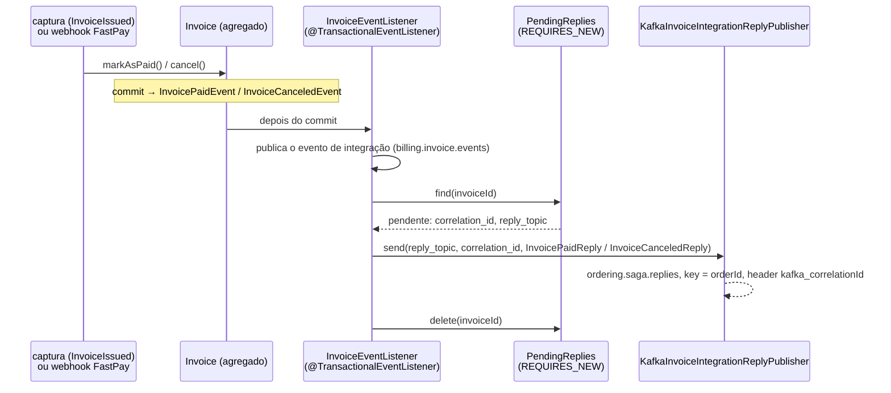

### As peças

| Peça | O que é |
|---|---|
| `OutboundIntegrationReply` | Contrato das respostas que o billing envia; `getAggregateId()` = key (o `orderId`, a mesma do comando) |
| `InvoicePaidIntegrationReply`, `InvoiceCanceledIntegrationReply` | As duas respostas possíveis ao `IssueInvoice`: `invoiceId`, `orderId` e `paidAt`/`canceledAt`. `__TypeId__` `Billing.Invoice*IntegrationReply`, como no contrato |
| `InvoiceIntegrationReplyPublisher` | Porta de saída. Recebe o tópico e a correlação **de fora**: quem decide para onde responder é o comando |
| `KafkaInvoiceIntegrationReplyPublisher` | Valida a resposta, monta o `ProducerRecord` no tópico do pendente, põe o header `kafka_correlationId` e espera o ack (`send().get(40s)`) |
| `ReplyPublishingException` | A falha de envio, com a causa encadeada |
| `PendingReplies.find` / `delete` | Leem e apagam o pendente, cada um em transação própria |

### Por que o reply é "manual"

O Spring Kafka sabe responder sozinho: um listener anotado com `@SendTo` devolve um valor, e o framework publica esse valor no `kafka_replyTopic` do comando, copiando o `kafka_correlationId`. Isso só funciona quando a resposta sai **no retorno do listener do comando**.

No billing, quando o listener do comando retorna, a fatura ainda está `UNPAID`: não há resposta para devolver. A resposta nasce depois, em outro fluxo (captura ou webhook), sem acesso aos headers do comando. Por isso o envio é manual: o billing monta o record e copia o correlation id **do pendente**. A tabela `pending_reply` existe exatamente para fazer a ponte entre o fluxo que recebeu o comando e o fluxo que conhece o resultado.

### Por que `REQUIRES_NEW`

O handler roda em `@TransactionalEventListener`, na fase `AFTER_COMMIT`: a transação que mudou a fatura **já commitou**. O Spring ainda considera aquela transação "ativa" durante a fase, mas ela não grava mais nada. Um `delete` que apenas participasse dela seria ignorado em silêncio. `find` e `delete` usam `Propagation.REQUIRES_NEW`: cada um abre e commita a própria transação.

### Enviar, depois apagar

A ordem é proposital:

| Falha | Consequência |
|---|---|
| O envio do reply falha | O pendente **fica**. Um job que varra pendentes antigos (o `created_at` existe para isso) pode reenviar |
| O envio funciona e o `delete` falha | O reply já saiu; o pendente fica e um reenvio geraria duplicata |

É **at-least-once**: a resposta pode sair duas vezes, mas não deixa de sair. O orquestrador vai precisar ser idempotente ao recebê-la, e é para isso que existem as consultas `isRunningAt(INVOICING)` da `PlaceOrderSaga`: uma segunda `InvoicePaidReply` chega quando a saga já saiu de `INVOICING` e pode ser ignorada.

### Os dois caminhos de pagamento, uma resposta só

Captura e webhook terminam no mesmo lugar: `Invoice.markAsPaid()` ou `Invoice.cancel()`, que registram o mesmo evento de domínio, tratado pelo mesmo handler. O reply não precisa saber por onde o pagamento chegou. E uma fatura gerada pela API REST, sem comando de saga, não tem pendente: o `find` volta vazio e nada é respondido.

### Revisão desta etapa

- **Corrigido**: o comentário de `OutboundIntegrationReply` falava em "eventos de uma mesma fatura", mas a key da resposta é o `orderId` e o tipo é resposta, não evento. As classes novas ganharam comentários sobre o envio manual e o `REQUIRES_NEW`. O YAML de teste do billing ganhou os aliases das respostas.
- **Testes**: billing `check` verde (48 unitários, 20 de integração). O envio do reply não tem teste: os ITs rodam em transação com rollback, e o `AFTER_COMMIT` nunca dispara neles.
- **Ponto frágil: a resposta depende do evento.** No mesmo handler, o evento de integração é publicado **antes** do reply. Se o Kafka falhar no evento, a exceção é engolida (é `AFTER_COMMIT`) e o reply nem é tentado. O pendente fica, mas a saga para em `INVOICING` até alguém reenviar. Separar o reply num `@TransactionalEventListener` próprio, ou enviá-lo antes do evento, tira essa dependência: para a saga, a resposta importa mais que o anúncio.
- **Limpeza sugerida**: o `KafkaInvoiceIntegrationReplyPublisher` tem um bloco comentado com o código antigo do publisher de eventos.
- **Próximo passo**: o ordering ainda não consome `ordering.saga.replies`. As respostas chegam ao tópico e ficam lá até o listener de replies existir.

---

## O orquestrador recebe a resposta e avança

Com o billing respondendo, falta o outro lado: o ordering ouvir `ordering.saga.replies` e **decidir o próximo passo**. É aqui que a orquestração aparece de verdade, porque a decisão "fatura paga → agora reserve o estoque" passa a estar escrita em um método só.

```mermaid
sequenceDiagram
    participant K as ordering.saga.replies
    participant L as KafkaPlaceOrderSagaReplyListener
    participant C as PlaceOrderSagaCoordinator.onInvoicePaid
    participant DB as Postgres do ordering (uma transação)
    K->>L: InvoicePaidReply + kafka_correlationId (= sagaId)
    L->>L: correlationId vira UUID; sem ele → DLT
    L->>C: onInvoicePaid(sagaId)
    C->>DB: sagas.ofId(sagaId), orders.ofId(orderId)
    alt saga já em RESERVING_STOCK (resposta repetida)
        C-->>L: ignora
    else saga em INVOICING
        C->>DB: order.markAsPaid() → pedido PAID + OrderPaid na outbox
        C->>DB: saga.moveToReservingStock() → saga_instance (RESERVING_STOCK)
        C->>DB: ReserveStock na outbox (product-catalog.stock.commands, correlation = sagaId)
        Note over DB: commit único: pedido, evento, saga e comando
    end
```

### As peças

| Peça | Papel |
|---|---|
| `KafkaPlaceOrderSagaReplyListener` | Grupo `ordering.saga-replies`. Converte o `kafka_correlationId` em `sagaId` (UUID); sem o header, ou com valor inválido, `IllegalArgumentException` → DLT. Handler default **lança**: o tópico é só de respostas da saga |
| `InboundIntegrationReply`, `InvoicePaidIntegrationReply` | Marcador e cópia local da resposta do billing |
| `ForCoordinatingPlaceOrderSaga.onInvoicePaid(sagaId)` | Nova operação da porta de entrada do orquestrador |
| `PlaceOrderSaga.moveToReservingStock()` | Segunda transição: só a partir de `RUNNING` em `INVOICING` |
| `ReserveStockIntegrationCommand` | Segundo comando: `orderId` + itens (produto, quantidade). Alias `Stock.ReserveStockIntegrationCommand` |
| `PlaceOrderSagaCommandTopics` | Nova rota: `ReserveStock` → `product-catalog.stock.commands` |
| `PlaceOrderSagaNotFoundException` | Resposta para uma saga que não existe |
| catálogo: `stock-commands-topic-name` + bean do tópico | O executor cria o tópico dos seus comandos |

### Uma transação, quatro escritas

O `onInvoicePaid` é `@Transactional`, e tudo o que ele faz é escrita local:

1. o pedido vira `PAID` (e o `OrderEventListener` grava o `OrderPaid` na outbox, como sempre);
2. a saga vai para `RESERVING_STOCK`;
3. o `ReserveStock` é gravado na outbox.

Ou acontecem as três coisas, ou nenhuma, e a mensagem do Kafka é reprocessada. Não existe "pedido pago sem comando de estoque" nem "saga avançada sem pedido pago". É o ganho da outbox para comandos da etapa anterior: o orquestrador muda o estado e manda a próxima ordem no mesmo commit.

### A pendência da persistência, resolvida

Esta é a primeira vez que uma saga já gravada é **atualizada**. A [pendência registrada](#revisão-desta-etapa-1) tinha dois itens:

- **`createdAt` nulo no merge**: resolvido com `@Column(updatable = false)` na entidade. O adaptador continua montando uma entidade nova, mas o `UPDATE` não inclui mais a coluna.
- **`version` desatualizada no objeto**: na prática não morde. Cada resposta recarrega a saga do banco com a versão atual, e o objeto não é reaproveitado depois do `add`. O lock otimista funciona: duas respostas concorrentes para a mesma saga, e a segunda falha no `UPDATE ... where version = ?`.

### Idempotência: a resposta repetida

O billing envia a resposta em **at-least-once**, então ela pode chegar duas vezes. A guarda atual:

```java
if (saga.isReservingStock()) { logIgnored(saga); return; }
```

Funciona para o caso mais comum: a reentrega chega logo depois da primeira, com a saga em `RESERVING_STOCK`. Mas é **estreita**: se a saga já tiver ido além (aprovando, compensando, terminada), a resposta repetida passa pela guarda, cai no `moveToReservingStock()`, e o `require(isRunningAt(INVOICING))` lança `SagaTransitionException`. Ela está na lista de não-retryable do `KafkaConfig`, então a mensagem vai para o DLT. Não corrompe nada, mas polui o DLT com algo que é só uma duplicata. A guarda robusta pergunta o contrário: *"a saga ainda espera esta resposta?"*, ou seja, `if (!saga.isRunningAt(INVOICING)) ignore`. De quebra, ela pode vir antes de carregar o pedido, que hoje é buscado mesmo quando a resposta vai ser ignorada.

---

## Como está o fluxo da saga

O ponta a ponta, como o código está hoje:

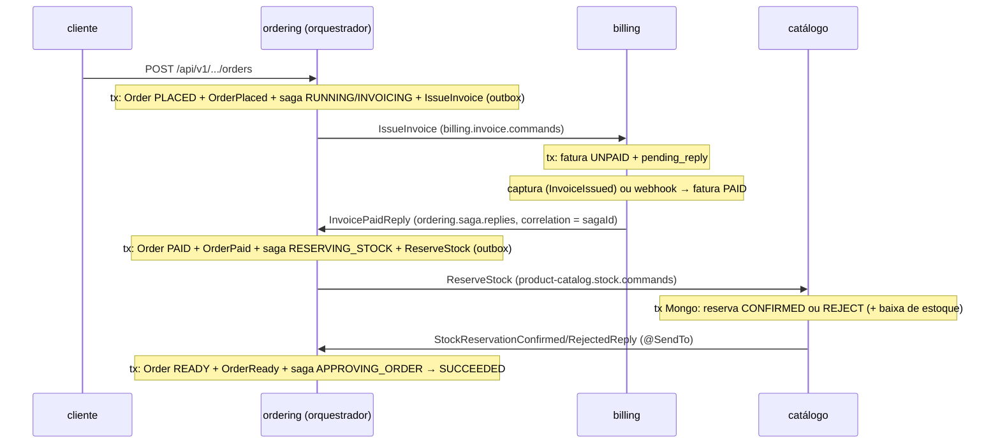

| Passo do mapa | Comando | Resposta | Situação |
|---|---|---|---|
| Placed Order | — | — | ✅ saga nasce na transação do checkout |
| Invoicing | `IssueInvoice` ✅ | `InvoicePaidReply` ✅ · `InvoiceCanceledReply` ✅ (dispara a compensação) | ✅ caminho feliz e pagamento recusado |
| Reserving Stock (pivô) | `ReserveStock` ✅ enviado e executado pelo catálogo | `StockReservationConfirmedReply` ✅ · `StockReservationRejectedReply` ✅ (dispara a compensação) | ✅ |
| Approving Order | — (interno) | — | ✅ pedido `READY`, saga `SUCCEEDED` ([detalhes](#caminho-feliz-completo)) |
| Compensação: Cancel invoice (estorno) | `CancelInvoice` ✅ | `InvoiceCanceledReply` ✅ (`@SendTo` no billing) | ✅ ([detalhes](#o-billing-estorna-e-responde-sendto)) |
| Compensação: Cancel order | — (interno) | — | ✅ pagamento recusado · ✅ depois do estorno |

O que o desenho já entrega, olhando para trás: cada passo é uma transação local que muda o estado **e** grava a próxima mensagem na outbox; a saga diz a qualquer momento onde cada pedido está (`saga_instance`); e as respostas são correlacionadas pelo `sagaId`, não pelo pedido.

### Revisão desta etapa

- **Corrigido**:
  - os YAMLs de teste do ordering (sem `saga-replies-consumer-group`, `product-catalog-commands-topic-name` e os dois aliases) e do catálogo (sem `stock-commands-topic-name`, que o `StockTransactionIT` exige ao subir o contexto completo). Os testes de integração não subiriam;
  - o contrato: `ReserveStock` passou a `Stock.ReserveStockIntegrationCommand`, como no código;
  - o comentário "ignora o command" (é uma resposta, não um comando). As classes novas ganharam comentários curtos.
- **Testes**: ordering `check` verde (304 unitários, 12 de contrato, 185 de integração); catálogo `check` verde (117, 17, 12). O `onInvoicePaid` não tem teste: um IT que grave uma saga em `INVOICING`, chame o método e confira pedido `PAID`, saga em `RESERVING_STOCK` e o comando na outbox travaria a transição. Outro, chamando duas vezes, travaria a idempotência.
- **Pendências**:
  - guarda de idempotência estreita (acima);
  - `InvoiceCanceledReply` sem handler e sem alias: um pagamento recusado vai parar no DLT do ordering, e o pedido fica `PLACED`. É a compensação que vem a seguir;
  - `PlaceOrderSagaNotFoundException` estende `RuntimeException`, então é **retryable**: três tentativas com backoff antes do DLT, para uma saga que não vai passar a existir;
  - o catálogo ainda não consome `ReserveStock`.

---

## O catálogo reserva e responde (`@SendTo`)

O `ReserveStock` agora tem quem o execute. E, diferente do billing, o catálogo responde **sem tabela de pendentes**: usa o reply automático do Spring Kafka.

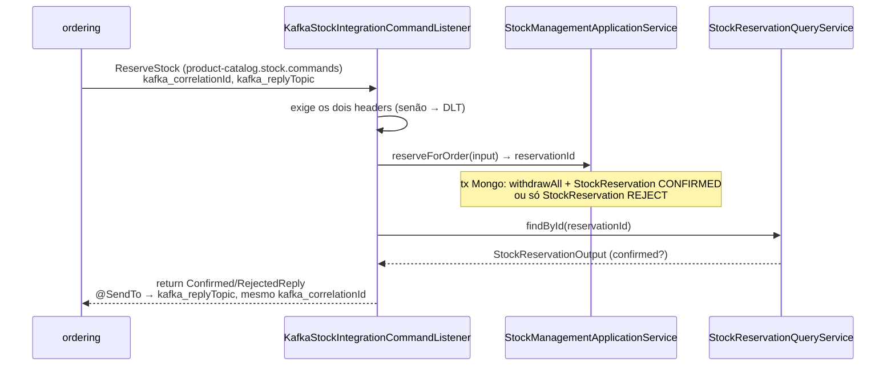

### Reply automático × reply manual

| | Catálogo (`@SendTo`) | Billing (manual) |
|---|---|---|
| Quando o resultado existe | No fim do listener: a reserva é síncrona | Depois: o pagamento vem da captura ou do webhook |
| Quem publica o reply | O framework, com o **retorno** do método | O próprio billing, com `KafkaTemplate` |
| Destino e correlação | Lidos dos headers do comando e copiados pelo Spring | Guardados em `pending_reply` e lidos depois |
| Tabela extra | Nenhuma | `pending_reply` |

O `@SendTo` sem argumento quer dizer "responda para onde o comando mandou": o Spring lê o `kafka_replyTopic` do record recebido, publica o retorno do método lá e copia o `kafka_correlationId`. O Boot já configura o `KafkaTemplate` como reply template da fábrica de listeners, então não há configuração extra. A regra prática: **se a resposta existe quando o listener termina, use `@SendTo`; se ela depende de algo que ainda vai acontecer, guarde o endereço e responda depois**.

### As peças

| Peça | Papel |
|---|---|
| `InboundIntegrationCommand`, `OutboundIntegrationReply` | Marcadores de entrada (comando) e saída (resposta) do catálogo, iguais aos do billing |
| `stock/command/ReserveStockIntegrationCommand` | Cópia local do comando: `orderId` + itens |
| `stock/reply/StockReservationConfirmed/RejectedIntegrationReply` | As duas respostas: `reservationId`, `orderId`, `confirmedAt`/`rejectedAt`. Alias `Stock.*` |
| `StockManagementApplicationService.reserveForOrder` | O mesmo caso de uso do módulo 8 (preservado na remoção da coreografia), agora devolvendo o id da reserva |
| `StockReservationQueryService` + `StockReservationOutput` + `StockReservationQueryServiceImpl` | Lado de leitura: busca a reserva pelo id |
| `StockReservationNotFoundException` | `DomainEntityNotFoundException`, portanto não-retryable |
| `KafkaStockIntegrationCommandListener` | Grupo `product-catalog.stock-commands`; executa, consulta, responde. Default handler lança |
| `KafkaConfig.stockCommandsDlt` | DLT `product-catalog.dlt.product-catalog.stock.commands` |

**Comando e consulta separados (CQS).** O `reserveForOrder` muda estado e devolve só o id; os dados da resposta vêm do query service. O listener poderia montar a resposta com o que o comando já tinha, mas lendo do lado de leitura a resposta reflete o que **foi gravado**, inclusive se a reserva foi confirmada ou rejeitada.

Como no módulo 8, falta de estoque não é exceção: vira uma reserva `REJECT` e, agora, um `StockReservationRejectedReply`. É essa resposta que vai disparar a compensação (estorno) no orquestrador.

### Revisão desta etapa

- **Corrigido**:
  - config de teste do catálogo sem `stock-commands-consumer-group` (`@NotBlank`) e sem os aliases: o `StockTransactionIT` não subiria;
  - o contrato declarava `ProductCatalog.StockReservation*IntegrationReply`; alinhado ao código: `Stock.*`, o mesmo prefixo do `ReserveStock`;
  - **DLT do tópico de comandos não declarado**: o recoverer publica na *mesma partição* do record original, então o DLT precisa existir com as mesmas 3 partições. Sem o `NewTopic`, ele nasceria por auto-criação do broker, sem garantia de partições, e o envio ao DLT poderia falhar. Declarado com o `createDeadLetterTopic`, deixado para isso na remoção da coreografia;
  - comentários no listener (o `@SendTo`), no query service e no `OutboundIntegrationReply`.
- **Testes**: catálogo `check` verde (117 unitários, 17 de contrato, 12 de integração). O listener não tem teste próprio.
- **Pendências**:
  - **o reply pode se perder (dual-write)**: a reserva commita no Mongo, e o reply só é publicado depois que o método retorna. Se o envio falhar, o Kafka reentrega o comando, o `reserveForOrder` esbarra no `DuplicateStockReservationException` (não-retryable) e a mensagem vai para o DLT, **sem** resposta. A saga fica em `RESERVING_STOCK`. A mesma correção resolve as reentregas comuns: se a reserva do pedido já existe, reler e responder de novo, em vez de falhar;
  - `beanValidationUtil.validate(reservationOutput)` valida o output, que não tem constraints. Quem tem constraints, e deveria ser validado antes de sair, é o reply;
  - **a key do reply**: com `@SendTo`, quem monta o record é o framework, e ninguém chama `getAggregateId()`. O comentário de `OutboundIntegrationReply` promete key = `orderId`; vale conferir na GUI do Kafka qual key a resposta realmente leva;
  - o ordering ainda não trata `StockReservationConfirmed/RejectedReply`: as respostas caem no handler default do listener de replies e vão para o DLT do ordering.

---

## Caminho feliz completo

Com o `StockReservationConfirmedReply` tratado, a saga chega ao fim pela primeira vez. É o último passo do [mapa](#o-fluxo-passo-a-passo): depois do pivô (a reserva), não há mais o que compensar, só aprovar.

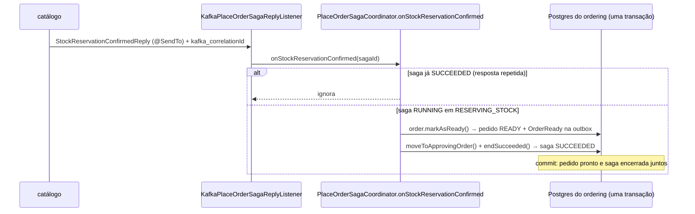

### `APPROVING_ORDER`, o passo sem comando

Os outros passos mandam um comando e esperam uma resposta. Aprovar o pedido é trabalho do **próprio** ordering, então o passo entra e sai no mesmo método:

```java
saga.moveToApprovingOrder();   // RESERVING_STOCK → APPROVING_ORDER  (passo)
saga.endSucceeded();           // RUNNING → SUCCEEDED                 (status)
```

As duas máquinas de estado da [modelagem](#duas-máquinas-de-estado-status--passo) aparecem aqui chegando ao fim juntas: o **passo** avança para `APPROVING_ORDER` e fica lá, como registro de onde a saga terminou; o **status** sai de `RUNNING` para `SUCCEEDED`. O `endSucceeded()` só aceita `RUNNING` em `APPROVING_ORDER` (`require(canEndSucceeded())`), então não é possível encerrar com sucesso uma saga que pulou passos.

### A saga de ponta a ponta, em uma tabela

Para um pedido pago e com estoque, as linhas de `saga_instance` e do pedido passam por:

| Momento | Pedido | Saga (status / passo) | O que vai para a outbox |
|---|---|---|---|
| checkout v1 | `PLACED` | `RUNNING` / `INVOICING` | `OrderPlaced` + `IssueInvoice` |
| `InvoicePaidReply` | `PAID` | `RUNNING` / `RESERVING_STOCK` | `OrderPaid` + `ReserveStock` |
| `StockReservationConfirmedReply` | `READY` | `SUCCEEDED` / `APPROVING_ORDER` | `OrderReady` |

Três transações locais no ordering, cada uma mudando o pedido **e** a saga **e** gravando a próxima mensagem. Entre elas, o trabalho acontece no billing (fatura e pagamento) e no catálogo (reserva). A qualquer momento, `select status, step from saga_instance where aggregate_id = '<pedido>'` responde onde o pedido está, a pergunta que a coreografia não sabia responder.

### Revisão desta etapa

- **Corrigido: faltava `@Transactional` no `onStockReservationConfirmed`** (o `onInvoicePaid` tinha). Funcionava, porque `orders.add` e `sagas.add` abrem cada um a própria transação, mas o pedido `READY` e a saga `SUCCEEDED` eram gravados **separados**. Se a gravação da saga falhasse depois (um lock otimista, por exemplo), a reentrega encontraria a saga ainda em `RESERVING_STOCK` e chamaria `markAsReady()` num pedido já `READY`. Resultado: `OrderStatusCannotBeChanged` (não-retryable), DLT, pedido pronto e saga travada para sempre. Com a anotação, os dois commitam juntos.
- **Corrigido**: o YAML de teste do ordering ganhou o alias da resposta nova. Os métodos novos ganharam comentários.
- **Dados de teste**: o `afterMigrate.sql` passou a limpar `saga_instance` (ordering) e `pending_reply` (billing; redundante com o `TRUNCATE invoice CASCADE`, que já apaga os pendentes pela FK, mas inofensivo e explícito).
- **Testes**: ordering `check` verde (304, 12, 185); billing `check` verde (48, 20). As transições do coordenador seguem sem teste próprio.
- **Idempotência**: as guardas cresceram por lista (`isReservingStock() || hasSucceeded()` no `onInvoicePaid`, `hasSucceeded()` no `onStockReservationConfirmed`). Com as compensações, a lista vai crescer de novo (`COMPENSATING`, `COMPENSATED`). A forma que não precisa de manutenção pergunta pelo passo esperado: "se a saga não está `RUNNING` em `INVOICING`, esta `InvoicePaidReply` não é esperada; ignore".
- **Falta a compensação**: `InvoiceCanceledReply` (pagamento recusado) e `StockReservationRejectedReply` (sem estoque) ainda caem no handler default do listener de respostas e vão para o DLT. São os caminhos `CANCELLING_ORDER` e `REFUNDING_INVOICE` do mapa.

---

## Compensação: pagamento recusado

A primeira compensação da saga. Quando o pagamento é recusado, o billing cancela a fatura e responde `InvoiceCanceledReply`. Nada foi cobrado e nada foi reservado, então **só o pedido** precisa ser desfeito: é o caminho `INVOICING → CANCELLING_ORDER` do [mapa](#caminhos-de-falha).

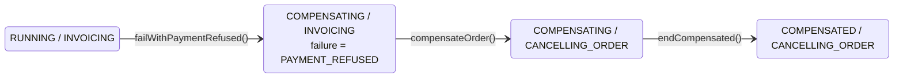

Tudo acontece no `onInvoiceCanceled`, numa transação só: a saga entra em compensação e guarda o motivo, o pedido vira `CANCELED` (e o `OrderCanceled` vai para a outbox), e a saga termina `COMPENSATED`.

### As peças

| Peça | Papel |
|---|---|
| `InvoiceCanceledIntegrationReply` + handler no listener de respostas | A resposta de pagamento recusado. Alias `Billing.InvoiceCanceledIntegrationReply` |
| `PlaceOrderSagaFailure` (`PAYMENT_REFUSED`, `OUT_OF_STOCK`) | **Por que** a saga foi compensada. O status diz *que* falhou; a falha diz *por quê*. Gravada na coluna `failure` que a V010 tinha deixado reservada |
| `failWithPaymentRefused()` | Só a partir de `RUNNING` em `INVOICING`. Muda o **status** para `COMPENSATING` e guarda a falha; o passo continua `INVOICING` |
| `compensateOrder()` | Muda o **passo** para `CANCELLING_ORDER`, só durante `COMPENSATING` |
| `endCompensated()` | Muda o **status** para `COMPENSATED`, só em `COMPENSATING` / `CANCELLING_ORDER` |
| `isCompensated()`, `hasFailed()` | Guardas do coordenador: resposta repetida e compensação já iniciada |

De novo as duas máquinas de estado trabalham separadas: **status** marca a fase (rodando → compensando → compensada), **passo** marca onde (fatura → cancelando o pedido). A falha é um terceiro dado, que só existe no caminho triste.

### O bug: pedido cancelado, saga parada em `RUNNING` / `INVOICING`

Na primeira versão, depois de processar a resposta, o pedido aparecia `CANCELED` no banco e a saga continuava `RUNNING` / `INVOICING`. Eram dois defeitos se somando.

**1. A condição de `canCompensateOrder()` estava invertida.**

```java
// antes
return status == COMPENSATING && step.canNotChangeTo(CANCELLING_ORDER);
// depois
return status == COMPENSATING && step.canChangeTo(CANCELLING_ORDER);
```

`CANCELLING_ORDER(INVOICING, REFUNDING_INVOICE)` declara que ele pode vir de `INVOICING`. Então, em `INVOICING`, `canNotChangeTo(CANCELLING_ORDER)` é **falso**, o `require` falhava e `compensateOrder()` lançava `SagaTransitionException`. A guarda só deixava compensar a partir de passos que **não** levam ao cancelamento: o contrário da regra.

**2. O método não tinha `@Transactional`.** A ordem de execução era:

| # | O que acontecia | Commitou? |
|---|---|---|
| 1 | `failWithPaymentRefused()` | não: só em memória |
| 2 | `order.markAsCanceled()` + `orders.add(order)` | **sim**: o `add` do provider abre a própria transação |
| 3 | `compensateOrder()` lança `SagaTransitionException` | — |
| 4 | `sagas.add(saga)` | nunca rodou |

O pedido ficou cancelado porque foi gravado **sozinho**, antes da falha. A saga não mudou porque a exceção veio antes da gravação dela. E a mensagem foi direto para o DLT (`SagaTransitionException` está na lista de não-retryable).

A lição é a mesma do `onStockReservationConfirmed` da etapa anterior, agora com consequência visível: **cada método do coordenador é uma unidade, e precisa de uma transação que a abrace**. Sem ela, uma validação que falha no meio deixa metade do trabalho gravado.

**As correções**:

- a condição invertida;
- `@Transactional` no `onInvoiceCanceled`: se qualquer passo falhar, o cancelamento do pedido também volta;
- **compensação idempotente**: `if (!order.isCanceled()) order.markAsCanceled()`. Sem isso, reprocessar a mensagem esbarraria no pedido já cancelado (`OrderStatusCannotBeChanged`), e as sagas que ficaram presas não teriam como ser recuperadas pelo DLT. Uma compensação precisa poder rodar de novo;
- o typo `canEndCompesated` → `canEndCompensated`;
- o alias da resposta no YAML de teste;
- **um teste unitário novo**, `PlaceOrderSagaTest`, cobrindo o caminho feliz, a compensação por pagamento recusado e a recusa de compensar uma saga ainda `RUNNING`. Com a condição antiga, `shouldCompensateWhenPaymentIsRefused` falha; com a correção, passa. Era a primeira transição da saga sem nenhum teste, e o defeito estava justamente nela.

### Recuperando as sagas que ficaram presas

Pedidos processados antes da correção estão `CANCELED`, com a saga `RUNNING` / `INVOICING` e a resposta no DLT `ordering.dlt.ordering.saga.replies`. Duas saídas:

- **Reprocessar o DLT** (preferível): republicar a mensagem em `ordering.saga.replies`. Com a correção, a saga entra em compensação, o pedido já cancelado é preservado e a saga termina `COMPENSATED`.
- **Corrigir no banco**, só em ambiente de desenvolvimento:

```sql
update public.saga_instance
   set status = 'COMPENSATED', step = 'CANCELLING_ORDER', failure = 'PAYMENT_REFUSED',
       version = version + 1, updated_at = now()
 where status = 'RUNNING' and step = 'INVOICING'
   and aggregate_id in (select id::text from public."order" where status = 'CANCELED');
```

### Revisão desta etapa

- **Testes**: ordering `check` verde, agora com o `PlaceOrderSagaTest`.
- **Verificação manual**: checkout com um cartão que o FastPay recusa → `select status, step, failure from saga_instance where aggregate_id = '<pedido>'` deve mostrar `COMPENSATED`, `CANCELLING_ORDER`, `PAYMENT_REFUSED`, com o pedido `CANCELED`.
- **Pendências**:
  - o outro caminho de falha: `StockReservationRejectedReply` → `failWith(OUT_OF_STOCK)` → `REFUNDING_INVOICE` (comando `CancelInvoice` ao billing, que estorna) → resposta → `CANCELLING_ORDER` → `COMPENSATED`. O enum `OUT_OF_STOCK` e a transição `CANCELLING_ORDER(REFUNDING_INVOICE)` já estão prontos;
  - as guardas de resposta repetida seguem crescendo por lista (`isCompensated()` aqui); a forma por "passo esperado" continua sendo a mais robusta.

---

## Compensação: falta de estoque

A segunda compensação, e a mais completa. Quando o catálogo rejeita a reserva, o pagamento **já foi capturado**: a reserva é o pivô, o passo depois do qual a saga só podia ir para frente. Agora ela anda para trás desfazendo dois passos, na ordem inversa: primeiro a fatura (estorno), depois o pedido.

> **Renomeado:** o passo que as seções anteriores chamam de `REFUNDING_INVOICE` virou `CANCELLING_INVOICE`. É o nome do comando que ele envia (`CancelInvoice`) e o mesmo padrão do `CANCELLING_ORDER`. Nenhuma saga chegou a gravar o nome antigo, então não houve migração de dados.

```mermaid
stateDiagram-v2
    direction LR
    state "RUNNING / RESERVING_STOCK" as A
    state "COMPENSATING / CANCELLING_INVOICE<br/>failure = OUT_OF_STOCK" as B
    state "COMPENSATING / CANCELLING_ORDER" as C
    state "COMPENSATED / CANCELLING_ORDER" as D
    A --> B: StockReservationRejectedReply<br/>failWithOutOfStock() + compensateInvoice()<br/>→ CancelInvoice
    B --> C: InvoiceCanceledReply<br/>pedido CANCELED
    C --> D: endCompensated()
```

```mermaid
sequenceDiagram
    participant C as catálogo
    participant O as ordering (orquestrador)
    participant B as billing
    C->>O: StockReservationRejectedReply
    Note over O: tx: saga COMPENSATING / CANCELLING_INVOICE (OUT_OF_STOCK)<br/>+ CancelInvoice na outbox
    O->>B: CancelInvoice (billing.invoice.commands)
    Note over B: estorna no gateway → fatura CANCELED (@SendTo responde)
    B-->>O: InvoiceCanceledReply
    Note over O: tx: pedido PAID → CANCELED<br/>saga CANCELLING_ORDER → COMPENSATED
```

### As peças

| Peça | Papel |
|---|---|
| `StockReservationRejectedIntegrationReply` + handler | A resposta "sem estoque". Alias `Stock.StockReservationRejectedIntegrationReply` |
| `failWithOutOfStock()` | Só a partir de `RUNNING` em `RESERVING_STOCK`. Status → `COMPENSATING`, falha `OUT_OF_STOCK` |
| `compensateInvoice()` | Passo → `CANCELLING_INVOICE`, só durante `COMPENSATING` |
| `wasStockRejected()` | Guarda contra a resposta repetida |
| `CancelInvoiceIntegrationCommand` | O comando de compensação: só o `orderId`. Vai para `billing.invoice.commands` (mesmo tópico do `IssueInvoice`), alias `Billing.CancelInvoiceIntegrationCommand`, como no contrato |
| `onStockReservationRejected` | Falha + passo + grava + `CancelInvoice` na outbox, numa transação |

### Uma resposta, dois caminhos

O ordering não ganhou um handler novo para a volta do estorno. O `InvoiceCanceledReply` é o mesmo do pagamento recusado, e o `onInvoiceCanceled` da etapa anterior já estava preparado para os dois casos:

```java
if (!saga.hasFailed()) {
    saga.failWithPaymentRefused();   // só no pagamento recusado
}
// pedido CANCELED, compensateOrder(), endCompensated()
```

- **Pagamento recusado**: a saga ainda está `RUNNING` em `INVOICING`, sem falha. O `onInvoiceCanceled` registra `PAYMENT_REFUSED`, e o `compensateOrder()` sai de `INVOICING`.
- **Falta de estoque**: a saga já está `COMPENSATING` em `CANCELLING_INVOICE`, com `OUT_OF_STOCK`. O `hasFailed()` impede que o motivo seja sobrescrito, e o `compensateOrder()` sai de `CANCELLING_INVOICE`.

O `CANCELLING_ORDER(INVOICING, CANCELLING_INVOICE)` do enum é exatamente isto: o cancelamento do pedido tem duas portas de entrada, e a máquina de estados declara as duas. A **falha** guardada na saga é o que permite saber depois por qual delas o pedido entrou.

### As duas compensações lado a lado

| | Pagamento recusado | Falta de estoque |
|---|---|---|
| Resposta que dispara | `InvoiceCanceledReply` | `StockReservationRejectedReply` |
| Onde a saga estava | `RUNNING` / `INVOICING` | `RUNNING` / `RESERVING_STOCK` (o pivô) |
| Passos já feitos a desfazer | só o pedido | a fatura (paga) **e** o pedido |
| Compensações | `CANCELLING_ORDER` | `CANCELLING_INVOICE` → `CANCELLING_ORDER` |
| Comandos de compensação | nenhum (cancelar o pedido é interno) | `CancelInvoice` ao billing |
| Estado final | `COMPENSATED` / `CANCELLING_ORDER` / `PAYMENT_REFUSED` | `COMPENSATED` / `CANCELLING_ORDER` / `OUT_OF_STOCK` |
| Estado do pedido | `PLACED` → `CANCELED` | `PAID` → `CANCELED` |

### `@Transactional` na classe

O coordenador passou a ter `@Transactional` na **classe**, em vez de método a método. É a lição das duas etapas anteriores consolidada: duas vezes um método novo nasceu sem a anotação, e nas duas o pedido e a saga podiam ficar gravados pela metade. Na classe, todo método novo já nasce dentro de uma transação.

### Revisão desta etapa

- **Testes**: ordering `check` verde. O `PlaceOrderSagaTest` ganhou `shouldCompensateWhenStockIsRejected` (o caminho inteiro até `COMPENSATED` com `OUT_OF_STOCK`) e `shouldNotCancelInvoiceWhenPaymentWasRefused` (sem pagamento não há fatura a estornar: a transição para `CANCELLING_INVOICE` é recusada). São 5 testes agora.
- **Comentários**: nos métodos novos e no `@Transactional` da classe.
- **O ciclo ainda não fecha: o billing não executa o `CancelInvoice`.** O `KafkaInvoiceIntegrationCommandListener` só tem handler para `IssueInvoice`, e o default lança. Hoje o comando vai para o DLT do billing, a saga fica `COMPENSATING` / `CANCELLING_INVOICE` e o pedido fica `PAID`, com o cliente cobrado. Para fechar, o billing precisa de:
  1. handler para `CancelInvoiceIntegrationCommand` e o alias `Billing.CancelInvoiceIntegrationCommand`;
  2. chamar o `refundByOrderId`, corrigindo o que o [módulo 8](./saga-coreografada.md#o-estorno-não-publica-o-invoicecanceled) já apontava: ele não chama `save`, então o `InvoiceCanceledEvent` nunca é publicado, e faz a chamada HTTP do estorno dentro da transação;
  3. **registrar um novo `pending_reply`** com o `kafka_correlationId` e o `kafka_replyTopic` do `CancelInvoice`, na mesma transação do estorno. O pendente do `IssueInvoice` foi apagado quando o `InvoicePaidReply` saiu. Sem um novo registro, a fatura seria cancelada e o `InvoiceEventListener` não acharia para quem responder;
  4. idempotência: um `CancelInvoice` repetido não pode estornar duas vezes (fatura já `CANCELED` → só responder de novo).
- **Detalhe**: o `onStockReservationRejected` chama `findOrder(...)` e descarta o resultado. Só confirma que o pedido existe, ao custo de uma consulta.

---

## O billing estorna e responde (`@SendTo`)

O último elo da compensação por falta de estoque. O billing passou a executar o `CancelInvoice`, e escolheu responder com o reply **automático**, o mesmo `@SendTo` do catálogo, e não com o `pending_reply` que ele usa para o `IssueInvoice`.

```java
@KafkaHandler
@SendTo
public InvoiceCanceledIntegrationReply handle(@Payload @Valid CancelInvoiceIntegrationCommand command, ...) {
    requireHeader(correlationId, KafkaHeaders.CORRELATION_ID);
    requireHeader(replyTopic, KafkaHeaders.REPLY_TOPIC);

    invoiceManagementApplicationService.refundByOrderId(command.getOrderId()); // estorno + CANCELED
    InvoiceOutput invoice = invoiceQueryService.findByOrderId(command.getOrderId());

    return InvoiceCanceledIntegrationReply.builder()
            .invoiceId(invoice.getId())
            .orderId(invoice.getOrderId())
            .canceledAt(invoice.getCanceledAt())
            .build();
}
```

### Como o `@SendTo` funciona

1. O listener recebe o record do comando, que traz nos headers o `kafka_replyTopic` (`ordering.saga.replies`) e o `kafka_correlationId` (o `sagaId`), gravados pela outbox do ordering.
2. O método executa e **retorna** um objeto, em vez de `void`.
3. Como o `@SendTo` não tem destino fixo, o Spring Kafka usa o `kafka_replyTopic` do record recebido como destino.
4. Ele serializa o retorno com o `KafkaTemplate` (o Spring Boot já liga o template da aplicação como *reply template* da fábrica de listeners), com o `__TypeId__` do alias `Billing.InvoiceCanceledIntegrationReply`.
5. Copia o `kafka_correlationId` do comando para a resposta. É ele que, no ordering, leva a resposta à saga certa.

O billing não escreve o nome do tópico de respostas em lugar nenhum, nem guarda a correlação: os dois vêm do comando e voltam na resposta sozinhos.

### `@SendTo` ou reply manual: a regra, com os três casos do projeto

A pergunta é uma só: **quando o método do listener termina, a resposta já existe?**

| Comando | Quem executa | Resultado ao fim do listener? | Reply |
|---|---|---|---|
| `IssueInvoice` | billing | **Não**: a fatura nasce `UNPAID`, e o pagamento se resolve depois (captura disparada pelo `InvoiceIssued` ou webhook) | **manual**: guarda correlação e tópico em `pending_reply` e responde quando a fatura for paga ou cancelada |
| `ReserveStock` | catálogo | **Sim**: a reserva é confirmada ou rejeitada ali mesmo | **`@SendTo`** |
| `CancelInvoice` | billing | **Sim**: o estorno no gateway é síncrono, e quando o `refundByOrderId` volta a fatura já está `CANCELED` | **`@SendTo`** |

O mesmo serviço usa as duas formas, conforme o comando. Na etapa anterior este doc listava "registrar um novo `pending_reply` para o `CancelInvoice`" como necessário: com o `@SendTo`, não é. O pendente só existe para respostas que dependem de algo futuro.

### O ciclo da falta de estoque, fechado

```mermaid
sequenceDiagram
    participant C as catálogo
    participant O as ordering
    participant B as billing
    C->>O: StockReservationRejectedReply
    Note over O: saga COMPENSATING / CANCELLING_INVOICE (OUT_OF_STOCK)
    O->>B: CancelInvoice + kafka_replyTopic + kafka_correlationId
    Note over B: refundByOrderId: estorno no gateway, fatura CANCELED
    B->>O: InvoiceCanceledReply (@SendTo, mesmo correlationId)
    Note over O: pedido PAID → CANCELED, saga COMPENSATED / CANCELLING_ORDER
```

### Revisão desta etapa

- **Corrigido**: o YAML de teste do billing ganhou o alias `Billing.CancelInvoiceIntegrationCommand`. O handler ganhou um comentário com o `@SendTo` e o contraste com o `IssueInvoice`.
- **Testes**: billing `check` verde (48 unitários, 20 de integração). O handler não tem teste próprio.
- **Pendências**:
  - **reentrega estorna de novo**: é o dual-write de todo `@SendTo`. A fatura cancelada commita, e a resposta só sai depois que o método retorna. Se o envio falhar, ou se o `CancelInvoice` chegar duplicado, o handler chama `refund` no gateway **outra vez**, e só depois o `cancel()` lança "already canceled" (`DomainException`, não-retryable): DLT, sem resposta, e o cliente pode ter sido estornado duas vezes. A guarda é simples: se a fatura já está `CANCELED`, pular o estorno e só montar a resposta;
  - o `refundByOrderId` continua **sem `save`**: a fatura é gravada pelo dirty checking, mas o `InvoiceCanceledEvent` não é publicado, e o `billing.invoice.events` não recebe o `InvoiceCanceled` do estorno. A saga não depende mais disso (a resposta vem pelo `@SendTo`), mas outros assinantes do evento ficariam sem ele;
  - a chamada HTTP do estorno continua dentro da transação do `refundByOrderId`.

---

## Validar antes de começar: quantidade na compra

As compensações funcionam, mas custam caro. Rejeitar um pedido por falta de estoque **dentro** da saga significa: emitir a fatura, cobrar o cartão, tentar reservar, estornar, cancelar a fatura, cancelar o pedido. Seis passos e duas chamadas ao gateway de pagamento para descobrir algo que o ordering podia ter perguntado antes de começar.

Esta etapa move essa pergunta para a frente: o ordering verifica a **quantidade** em estoque na hora da compra e recusa o pedido na própria requisição.

| Onde a falta de estoque é descoberta | O que acontece | Custo |
|---|---|---|
| **Na requisição** (agora) | `InsufficientQuantityException` → 422 para o cliente; nenhum pedido, nenhuma saga | uma consulta ao catálogo (já feita para o preço) |
| **Na saga** (continua possível) | fatura, cobrança, reserva rejeitada, estorno, fatura e pedido cancelados | seis passos, duas idas ao gateway, o cliente vê uma cobrança e um estorno |

### O que mudou

- O `Product` do ordering (a visão do produto que vem do catálogo) ganhou `quantityInStock`, e o `ProductResponse` passou a ler o campo, que o catálogo já expunha no `ProductDetailOutput`.
- `Product.checkForQuantity(quantity)`: verifica a disponibilidade (`checkOutOfStock()`, como antes) e, se a quantidade do catálogo é conhecida, lança `InsufficientQuantityException` quando ela é menor que a pedida. É `DomainException`, então o handler da API responde 422.
- `BuyNowService` e `ShoppingCart.addItem` trocaram `checkOutOfStock()` por `checkForQuantity(quantity)`.
- O cache do produto no Redis caiu de 5 para 1 minuto: a validação vale tanto quanto a frescura do dado que ela lê.

### Pré-validação não é garantia

A saga **continua** precisando da compensação por falta de estoque. Entre a leitura do produto (que pode vir do cache, com até 1 minuto de idade) e a reserva no catálogo, outro pedido pode levar as últimas unidades. É o mesmo raciocínio da pré-checagem do `withdrawAll` no [módulo 8](./saga-coreografada.md#withdrawall-agrupar-validar-tudo-baixar): validar antes evita **começar** algo que já se sabe que vai falhar; quem garante de verdade é a operação atômica no dono do dado. A validação reduz a frequência das compensações, não a necessidade delas.

### Correções desta etapa

- **NPE no mapeamento**: o adaptador fazia `new Quantity(productResponse.getQuantityInStock())`, e `Quantity` não aceita nulo. Bastava o campo faltar na resposta para a compra quebrar com `NullPointerException`: nas respostas antigas guardadas no Redis antes desta mudança, e no stub WireMock dos testes. O domínio já tratava `quantityInStock == null` como "quantidade desconhecida, valide só a disponibilidade"; o adaptador passou a fazer o mesmo.
- **Stub WireMock**: o `get-product-by-id-v1.json` ganhou `"quantityInStock": 100`, para os testes de integração exercitarem a validação nova com um valor real.
- **Teste que não compilava**: o `ProductCatalogServiceIT` montava o `ProductResponse` com o construtor antigo (4 argumentos); passou a informar a quantidade.
- **Testes**: ordering `check` verde (309 unitários, 12 de contrato, 185 de integração).

### Pendências

- **O carrinho valida só o que está sendo adicionado.** Se o item já tem 3 unidades no carrinho, o estoque é 4 e o cliente adiciona mais 3, a checagem compara 3 com 4 e passa, e o item fica com 6. A comparação deveria ser com o total do item depois da soma.
- **O checkout do carrinho não valida quantidade.** O `CheckoutService` monta o produto a partir do item do carrinho com `quantityInStock = null`, então só a disponibilidade é conferida. Um carrinho montado ontem passa direto para a saga, e quem barra é a compensação.
- `Product.isOutOfStock()` (privado) ficou sem uso.

---

## Comandos da saga sem outbox

Desde que a saga passou a enviar comandos, o ordering **não subia** com `algashop.messaging.outbox.enabled=false`: a porta `ForPublishingPlaceOrderSagaIntegrationCommands` só tinha a implementação de outbox. Os eventos de pedido sempre tiveram as duas (`OutboxOrderIntegrationEventPublisher` e `KafkaOrderIntegrationEventPublisher`); agora os comandos também têm.

### Dois publicadores, uma propriedade

| Publicador | Ativo quando | Como o comando sai |
|---|---|---|
| `OutboxPlaceOrderSagaIntegrationCommandPublisher` | `outbox.enabled = true` | Grava uma linha na outbox; o dispatcher envia depois |
| `KafkaPlaceOrderSagaIntegrationCommandPublisher` | `outbox.enabled = false` **ou ausente** | `kafkaTemplate.send(...).get(40s)`, na hora |

As duas condições se complementam (`havingValue = "true"` × `havingValue = "false", matchIfMissing = true`), então a porta tem sempre exatamente uma implementação, qualquer que seja a configuração. O coordenador não muda uma linha: ele só conhece a porta.

### O mesmo contrato, por outro caminho

O participante (billing ou catálogo) não pode perceber qual publicador enviou o comando:

| | Outbox | Kafka direto |
|---|---|---|
| Tópico | `PlaceOrderSagaCommandTopics.of(command)` | o **mesmo** `PlaceOrderSagaCommandTopics.of(command)` |
| Key | `aggregate_id` da linha (`orderId`) | `command.getAggregateId()` (`orderId`) |
| `kafka_correlationId` | coluna `correlation_id` | o `correlationId` recebido (o `sagaId`) |
| `kafka_replyTopic` | coluna `reply_topic` | `saga-replies-topic-name` da configuração |
| `__TypeId__` | coluna `message_type`, gerada pelo serializer na gravação | gerado pelo serializer do `KafkaTemplate` no envio |
| `idempotency-key` | sempre (id da linha) | só se o comando tiver chave; hoje nenhum tem |

Reaproveitar o `PlaceOrderSagaCommandTopics` é o que garante "uma decisão só" sobre o tópico: um comando novo ganha uma linha no `switch` e passa a funcionar nos dois caminhos. E, como o tópico é calculado ao montar o `ProducerRecord`, um comando que a saga não conhece lança `IllegalArgumentException` **antes** de qualquer envio.

### O que muda na garantia

| | Outbox | Kafka direto |
|---|---|---|
| Quando o comando sai | depois do commit, pelo dispatcher (até um `poll-interval`) | durante a transação, antes do commit |
| Kafka fora do ar | o checkout funciona; o comando espera na outbox | o checkout **falha**: `CommandPublishingException` desfaz pedido e saga |
| Commit falha depois do envio | impossível: a linha e o resto commitam juntos | **comando já enviado para um pedido que não existe** |

O envio direto, bloqueante e dentro da transação, protege um lado: se o Kafka não confirmar em 40 segundos, nada é gravado. Mas não protege o outro: se o envio funcionar e o commit falhar depois, o billing recebe um `IssueInvoice` de um pedido que voltou atrás. É o dual-write que a outbox existe para eliminar, e é por isso que ela é o padrão (`enabled: true`). O publicador direto é a alternativa para quem desliga a outbox, com essa troca explícita.

### Testes

`KafkaPlaceOrderSagaIntegrationCommandPublisherTest`, sem Spring, Kafka ou Postgres: `KafkaTemplate` mockado, `PlaceOrderSagaCommandTopics` real e propriedades preenchidas à mão.

| Teste | O que prova |
|---|---|
| `shouldSendIssueInvoiceToBillingWithKeyAndCorrelationHeaders` | tópico `billing.invoice.commands`, key = orderId, valor é o próprio comando, `kafka_correlationId` e `kafka_replyTopic` corretos, sem `idempotency-key` |
| `shouldSendCancelInvoiceToBilling` | `CancelInvoice` também vai para `billing.invoice.commands` |
| `shouldSendReserveStockToProductCatalog` | `ReserveStock` vai para `product-catalog.stock.commands` |
| `shouldThrowCommandPublishingExceptionWhenKafkaDoesNotConfirm` | `failedFuture` vira `CommandPublishingException` |
| `shouldRejectUnknownCommandWithoutSendingAnything` | comando sem rota: `IllegalArgumentException` e nenhuma interação com o `KafkaTemplate` |

Ordering `check` verde: 314 unitários, 12 de contrato, 185 de integração.

### Roteiro de verificação manual

1. `algashop.messaging.outbox.enabled: false` no `application-development-env.yaml` do ordering; o serviço tem de subir.
2. Checkout v1 com o Visa final 1022 e estoque suficiente: no log, o `IssueInvoiceIntegrationCommand` é publicado em `billing.invoice.commands` **antes** de `Place order saga started`. Pedido `READY`, saga `SUCCEEDED` / `APPROVING_ORDER`.
3. Na GUI do Kafka, as mensagens de `billing.invoice.commands` e `product-catalog.stock.commands`: key, `__TypeId__` (`Billing.IssueInvoiceIntegrationCommand` / `Stock.ReserveStockIntegrationCommand`), `kafka_correlationId` igual ao `saga_id` da `saga_instance`, `kafka_replyTopic`.
4. `select count(*) from outbox where aggregate_id = '<orderId>'` deve devolver zero.
5. Visa final 1030: saga `COMPENSATED` / `CANCELLING_ORDER` / `PAYMENT_REFUSED`.
6. Produto com saldo menor que a compra: `Billing.CancelInvoiceIntegrationCommand` em `billing.invoice.commands`, saga `COMPENSATED` / `CANCELLING_ORDER` / `OUT_OF_STOCK`. (Com a validação de quantidade da seção anterior, esse caso só chega à saga se o estoque mudar entre a compra e a reserva, ou pelo checkout do carrinho, que não confere quantidade.)
7. Opcional: parar os containers do Kafka e fazer um checkout. A requisição demora e falha, e nem pedido nem saga são gravados.
8. Voltar `outbox.enabled` para `true`.

### Revisão

- O publicador atende o enunciado: ativação, tópico pela mesma decisão do outbox, headers, valor, envio bloqueante de 40 segundos, `CommandPublishingException` e nenhuma transação própria. Ganhou um comentário curto.
- **Observação**: o `catch` pega a `KafkaException` do Spring, mas não a `org.apache.kafka.common.KafkaException`, que o `send` pode lançar de forma síncrona (uma falha de serialização, por exemplo). Ela escaparia sem virar `CommandPublishingException`. A transação ainda volta, só que com outra exceção. É o mesmo padrão do `KafkaOrderIntegrationEventPublisher`; o publisher do catálogo trata as duas.

---

## Próximas aulas (a documentar)

O modelo, a persistência, o início da saga e o contrato já existem (seções acima). Os métodos de transição, os comandos e as respostas em código entram aqui conforme o módulo avança. A comparação com a coreografia vai seguir as perguntas que o [balanço da 8.13](./saga-coreografada.md#813--opinião-sobre-saga-com-coreografia) deixou: onde fica o estado "em que passo está o pedido 42"? Quem decide a compensação? O que acontece com os três kits de consumidor copiados?
