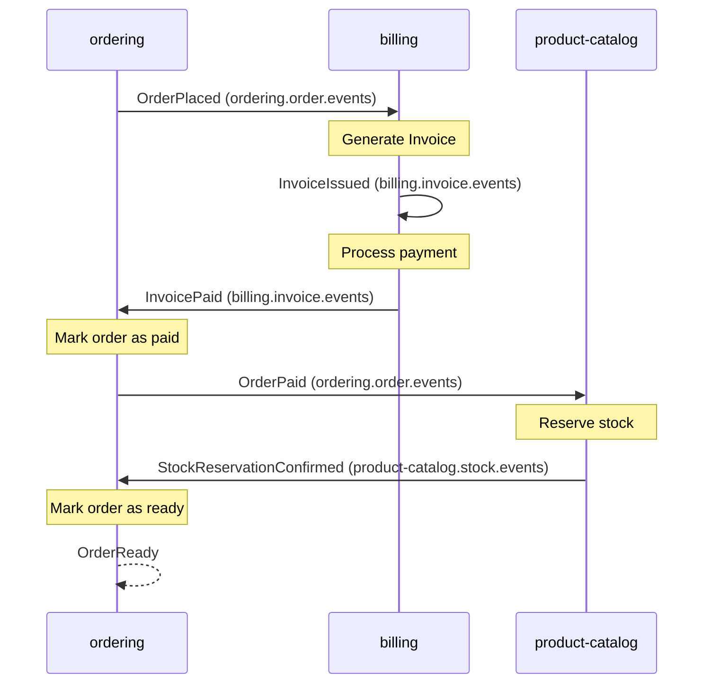
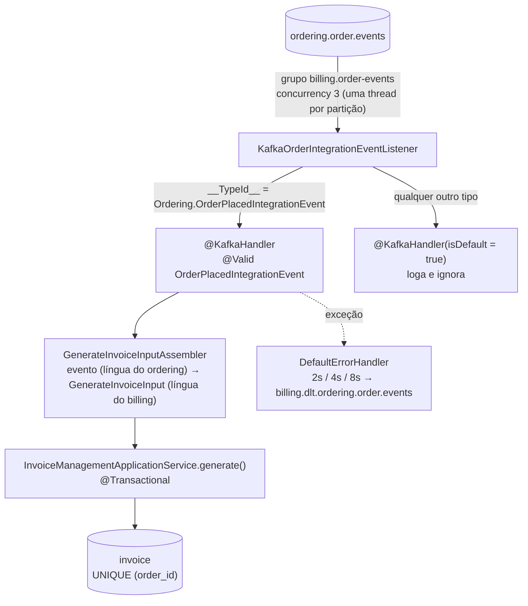

# Workflow coreografado: o pedido que atravessa serviços sem maestro

> Até aqui os eventos Kafka eram **avisos isolados**: o catálogo avisava preço, o ordering avisava a si mesmo. Este módulo encadeia avisos num **processo de negócio**: pedido → fatura → pagamento → estoque → pedido pronto. Ninguém comanda esse fluxo. Cada serviço escuta o evento anterior, faz a sua parte e publica o próximo. O fluxo existe, mas não está escrito em nenhum serviço: está no mapa abaixo, e nas assinaturas de tópico espalhadas pelo código.
> Este é um **doc vivo**: ele cresce aula a aula com o módulo 7 da trilha ("Workflow com coreografia e eventos"). A tabela de status do mapa diz até onde o código já chegou.
> Código real: `algashop-ordering/.../outbox/` (publica o `OrderPlaced`), `algashop-billing/.../infrastructure/kafka/` (`KafkaOrderIntegrationEventListener`, `KafkaConfig`), `algashop-billing/.../application/invoice/management/GenerateInvoiceInputAssembler.java`, `algashop-billing/.../application/order/` (evento e snapshots), migração `V0003__add-unique-constraint-invoice-order-id.sql`. Contrato: [`asyncapi/billing.yml`](../asyncapi/billing.yml).

---

## O mapa


### Como ler

O diagrama tem quatro faixas, e elas alternam entre **fato** e **reação**:

| Faixa | Cor | O que é |
|---|---|---|
| Success Event | azul | Fato consumado no caminho feliz, no passado: "pedido realizado", "fatura paga" |
| Handler | verde | Quem **reage** a um fato de sucesso. Faz trabalho e, ao terminar, publica o próximo fato |
| Failure Event | vermelho | Fato consumado no caminho triste: "fatura cancelada", "reserva de estoque rejeitada" |
| Handler | laranja | Quem **compensa**: desfaz o efeito de um passo anterior que já tinha dado certo |

A seta para baixo é "este handler **assina** este evento". A seta para cima é "este handler **publica** este evento". O padrão evento → handler → evento → handler é a coreografia inteira: não há outra regra.

Repare em duas coisas que o desenho já ensina antes de qualquer código:

1. **Cada handler mora num serviço diferente do evento que consome.** `Billing: Generate Invoice` reage a `Ordering: Order Placed`. Quem publica não sabe quem escuta, e é isso que torna o passo novo barato: assinar um tópico não exige mudar o produtor.
2. **As compensações são eventos, não rollbacks.** Não existe transação que abrace ordering, billing e catálogo. Se a reserva de estoque falha depois que o cartão já foi cobrado, a cobrança **já aconteceu**: o único jeito de desfazer é outro fato (`Stock Reservation Rejected`) acionar outro handler (`Refund Payment`). Isso é a semente da **saga**, tema do módulo 8.

### O caminho feliz, em sequência



Note o `B->>B`: o billing **consome o próprio evento** `InvoiceIssued` para processar o pagamento. É o mesmo Listen to Yourself da [outbox](./outbox-e-checkout-assincrono.md), agora como passo do workflow: emitir a fatura e cobrar viram duas transações separadas, cada uma com retry e DLT próprios.

### Os caminhos de falha

| Falha | Evento | Quem compensa | O que desfaz |
|---|---|---|---|
| Pagamento recusado | `Billing: Invoice Canceled` | `Ordering: mark order as canceled` | O pedido não segue |
| Estoque indisponível depois de pago | `Product Catalog: Stock Reservation Rejected` | `Billing: Refund Payment` | Estorna a cobrança; o estorno cancela a fatura, que por sua vez cancela o pedido |

O segundo caso é o mais didático: **uma falha no catálogo cancela um pedido no ordering sem que os dois se conheçam**. A cadeia passa pelo billing (`Stock Reservation Rejected` → `Refund Payment` → `Invoice Canceled` → `mark order as canceled`).

### Status no código

| # | Evento | Produtor | Consumidor (handler) | Tópico | Status |
|---|---|---|---|---|---|
| 1 | `OrderPlaced` | ordering (outbox) | billing: Generate Invoice | `ordering.order.events` | ✅ aulas 7.4–7.6 |
| 2 | `InvoiceIssued` | billing | billing: Process payment | `billing.invoice.events` | ⏳ aula 7.7 |
| 3 | `InvoicePaid` | billing | ordering: Mark order as paid | `billing.invoice.events` | ⬜ aulas 7.8–7.10 |
| 4 | `OrderPaid` | ordering | catálogo: Reserve stock | `ordering.order.events` | ⬜ |
| 5 | `StockReservationConfirmed` | catálogo | ordering: Mark order as ready | `product-catalog.stock.events` | ⬜ |
| 6 | `OrderReady` | ordering | (fim do fluxo) | `ordering.order.events` | ⬜ |
| F1 | `InvoiceCanceled` | billing | ordering: mark order as canceled | `billing.invoice.events` | ⬜ |
| F2 | `StockReservationRejected` | catálogo | billing: Refund Payment | `product-catalog.stock.events` | ⬜ módulo 8 |

---

## 7.1 — Coreografia e Event Collaboration

A teoria de "coreografia × orquestração" já está em [Fundamentos de EDA](./fundamentos-eda.md#coreografia--orquestração-quem-rege-o-fluxo). O que esta aula acrescenta é o nome do padrão que faz a coreografia funcionar: **Event Collaboration**.

Em Event Collaboration, serviços **colaboram para completar um processo** trocando eventos, e não pedidos. Compare com o que o projeto fazia antes:

| | Request/Response (antes) | Event Collaboration (agora) |
|---|---|---|
| Quem decide o próximo passo | O chamador ("billing, gere a fatura") | O receptor ("um pedido foi feito; eu, billing, faturo") |
| Acoplamento | O chamador conhece o endereço e a API do outro | O produtor conhece só o tópico dele |
| Disponibilidade | O outro precisa estar de pé **agora** | O evento espera no tópico até o consumidor voltar |
| Onde o fluxo está escrito | No código do chamador | Em lugar nenhum: emerge das assinaturas |

A última linha é o preço. "Onde parou o pedido 42?" deixa de ser uma consulta e vira uma investigação em N serviços. Por isso o `orderId` viaja como **key** de todo evento do fluxo: é ele que correlaciona as pontas e garante ordem por pedido na partição.

> **Para fixar:** o evento descreve **o que aconteceu** no serviço que o emite (`OrderPlaced`), nunca **o que o outro deve fazer** (`GenerateInvoice`). Se o nome do evento é um imperativo endereçado a alguém, ele é um comando disfarçado, e o acoplamento voltou pela porta dos fundos.

## 7.2 — O workflow da AlgaShop

É o mapa acima. A decisão de desenho que vale guardar: **cada serviço só publica fatos do próprio domínio**. O ordering fala de pedidos, o billing de faturas, o catálogo de estoque. Nenhum evento tem prefixo de outro serviço: é a mesma regra de posse de dados do banco por serviço, aplicada aos tópicos.

## 7.3 — Os contratos AsyncAPI do workflow

O contrato do billing ([`asyncapi/billing.yml`](../asyncapi/billing.yml)) já descreve o fluxo inteiro do ponto de vista dele, antes de o código existir:

| Operação | Ação | Canal | Grupo |
|---|---|---|---|
| `consumeOrderPlacedEvents` | receive | `ordering.order.events` | `billing.order-events` |
| `publishInvoiceEvents` | send | `billing.invoice.events` | — |
| `consumeInvoiceIssuedEvents` | receive | `billing.invoice.events` | `billing.invoice-events` |
| `consumeStockReservationRejectedEvents` | receive | `product-catalog.stock.events` | `billing.stock-events` |

Lendo só essa tabela dá para reconstruir o papel do billing no mapa: ele consome pedido, publica fatura, consome a **própria** fatura emitida e consome a rejeição de estoque para estornar. É o contrato fazendo o papel de documentação do fluxo, que a coreografia, por definição, não tem em outro lugar. (Como os contratos são escritos: [AsyncAPI: contratos](./asyncapi-contratos.md).)

## 7.4 — Passo 1: o pedido realizado sai do ordering

Já foi construído na Fase 41: o `OrderPlacedIntegrationEvent` é gravado na **outbox** na mesma transação em que o pedido nasce, e o polling publisher o leva a `ordering.order.events` com `key = orderId`. Detalhes em [Outbox e checkout assíncrono](./outbox-e-checkout-assincrono.md).

O que importa para o workflow é o **conteúdo**: o evento é **ECST** (Event-Carried State Transfer). Ele carrega itens, frete, dados de cobrança e forma de pagamento (`OrderItemSnapshot`, `ShippingSnapshot`, `BillingSnapshot`, `PaymentSnapshot`), tudo congelado no momento do pedido. Sem isso, o billing teria que chamar o ordering por HTTP para montar a fatura, e o desacoplamento da coreografia seria só aparente.

## 7.5 e 7.6 — Passo 2: o billing gera a fatura



### O listener: um tópico, vários tipos

O `ordering.order.events` vai carregar `OrderPlaced`, `OrderPaid`, `OrderReady`, `OrderCanceled`. O billing só se importa com o primeiro. O listener resolve isso com o mesmo par de handlers já usado no ordering ([Kafka na prática](./kafka-na-pratica.md)):

- `@KafkaHandler` tipado em `OrderPlacedIntegrationEvent`, escolhido pelo header `__TypeId__`;
- `@KafkaHandler(isDefault = true)` recebendo `Object`: **loga e ignora**. Evento novo do produtor não é erro do consumidor, é evolução normal. Sem o default, o primeiro `OrderPaid` publicado iria parar no DLT do billing.

O type mapping fica em `application-development-env.yaml`:

```yaml
spring.json.type.mapping:
  Ordering.OrderPlacedIntegrationEvent:com.algaworks.algashop.billing.application.order.event.OrderPlacedIntegrationEvent,
```

O lado esquerdo é um **nome lógico** combinado no contrato; o lado direito é a classe **do billing**. O billing tem a sua própria cópia do evento e dos snapshots (`application/order/`), e o ordering pode renomear pacotes à vontade.

### O assembler como camada anticorrupção

`GenerateInvoiceInputAssembler.toGenerateInvoiceInput(event)` é onde a linguagem do ordering vira a linguagem do billing:

| No evento (ordering) | No input (billing) | Tradução |
|---|---|---|
| `items[]` com `productName`, `quantity`, `totalAmount` | `LineItemInput` | Nome vira `"Produto - x2"`, valor é o total do item |
| `shipping.cost` | `LineItemInput "Shipping"` | Frete vira **mais uma linha** da fatura, só se for maior que zero |
| `billing` (nome, documento, e-mail, endereço) | `PayerData` | `firstName` + `lastName` viram `fullName` |
| `payment.method` (String) | `PaymentMethod` (enum) | `valueOf`: um método desconhecido estoura `IllegalArgumentException` |

O caso de uso `generate()` **não mudou** para receber o evento: é o mesmo que a API REST já chamava. O Kafka virou só mais um adaptador de entrada, como prevê a arquitetura hexagonal ([Ports & Adapters](../01-arquitetura-design/ports-hexagonal.md)).

### Idempotência pela constraint

O Kafka entrega **pelo menos uma vez**. O mesmo `OrderPlaced` pode chegar duas vezes (redelivery depois de rebalance, replay da outbox). Duas faturas para o mesmo pedido seriam cobrança dupla.

A defesa escolhida nesta aula é a mais simples possível, no banco:

```sql
alter table public.invoice
    add constraint uk_invoice_order_id unique (order_id);
```

Um pedido, uma fatura, garantido pelo Postgres. A segunda tentativa de `saveAndFlush` falha com `DataIntegrityViolationException`, e a transação inteira volta.

---

## Armadilhas

### A duplicata vai parar no DLT

No `KafkaConfig` do billing, `DataIntegrityViolationException` está na lista de **não-retryable**. Faz sentido (repetir o INSERT não muda o resultado), mas a consequência é: **toda duplicata legítima vira uma mensagem no `billing.dlt.ordering.order.events`**.

A idempotência funciona (não há fatura dupla), mas o DLT, que deveria conter só mensagens que precisam de alguém, passa a misturar "falha de verdade" com "já processei isso, tudo certo". Compare com o ordering, que usa `runOnce` (INSERT-first numa tabela de mensagens processadas) e trata a duplicata como **sucesso silencioso** ([Resiliência no consumer](./resiliencia-consumer-kafka.md)). Opções para quando isso incomodar: checar `existsByOrderId` antes de gerar, ou capturar a violação **dessa constraint específica** no listener e ignorar.

### O fluxo ainda para no billing

`Invoice.issue()` já registra o evento de domínio `InvoiceIssuedEvent`, e existe um `InvoiceEventListener` com `@EventListener` para ele. Mas o método está **vazio**: o fato acontece dentro do processo e não sai dele. O tópico `billing.invoice.events` já é criado pelo `KafkaConfig`, sem ninguém publicando. Ligar esse fio é a aula 7.7.

### Comentários herdados do ordering

O `KafkaConfig` do billing foi adaptado do ordering e ainda fala dele: "os tópicos próprios do ordering", "prefixo `ordering.dlt.`", "cria o topic de eventos produzidos em ordering". O código usa `billing.dlt.` e `billing.invoice.events`, corretamente. Mas comentário errado em configuração de resiliência é o tipo de coisa que custa uma madrugada durante um incidente.

---

## Próximas aulas (a documentar)

### 7.7 — Publicar o evento de fatura emitida
Levar o `InvoiceIssuedEvent` de domínio até `billing.invoice.events` como evento de integração. Pergunta central: o billing vai usar **outbox** (como o ordering) ou **transação estendida** (como o catálogo)? Sem nenhum dos dois, volta o dual-write: fatura commitada e evento perdido.

### 7.8 — Processar fatura emitida e webhook de pagamentos
O billing consumindo o próprio `InvoiceIssued` (grupo `billing.invoice-events`) para cobrar no gateway, e o webhook do FastPay fechando o ciclo.

### 7.9 — Preparar o ordering para consumir eventos do billing
Novo listener, type mapping e DLT no ordering para `billing.invoice.events`.

### 7.10 — Reagir à fatura paga
`InvoicePaid` → `Order.markAsPaid()` → `OrderPaid`.

### 7.11 — Corrigindo testes
O que quebra na suíte quando o fluxo deixa de ser síncrono.

---

## Checklist do workflow coreografado

- [x] Todo evento do fluxo usa `orderId` como key (ordem e correlação por pedido)
- [x] Consumidor tem handler default que ignora tipos desconhecidos
- [x] Evento carrega o estado necessário (ECST): o consumidor não chama o produtor de volta
- [x] Consumidor é idempotente (constraint única em `invoice.order_id`)
- [ ] Duplicata tratada como sucesso, não como DLT
- [ ] Cada handler publica o próximo evento sem dual-write (outbox ou transação estendida)
- [ ] Cada caminho de falha tem um handler de compensação
- [ ] Dá para responder "onde parou o pedido X?" sem abrir os logs de três serviços
