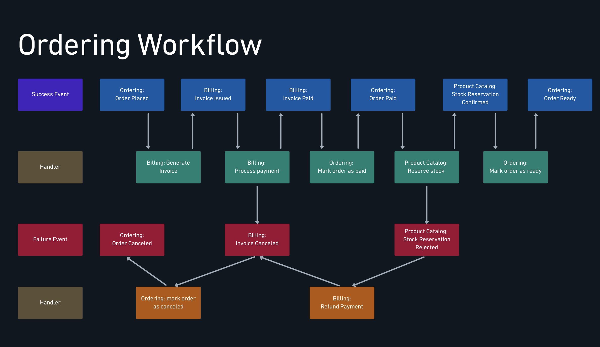
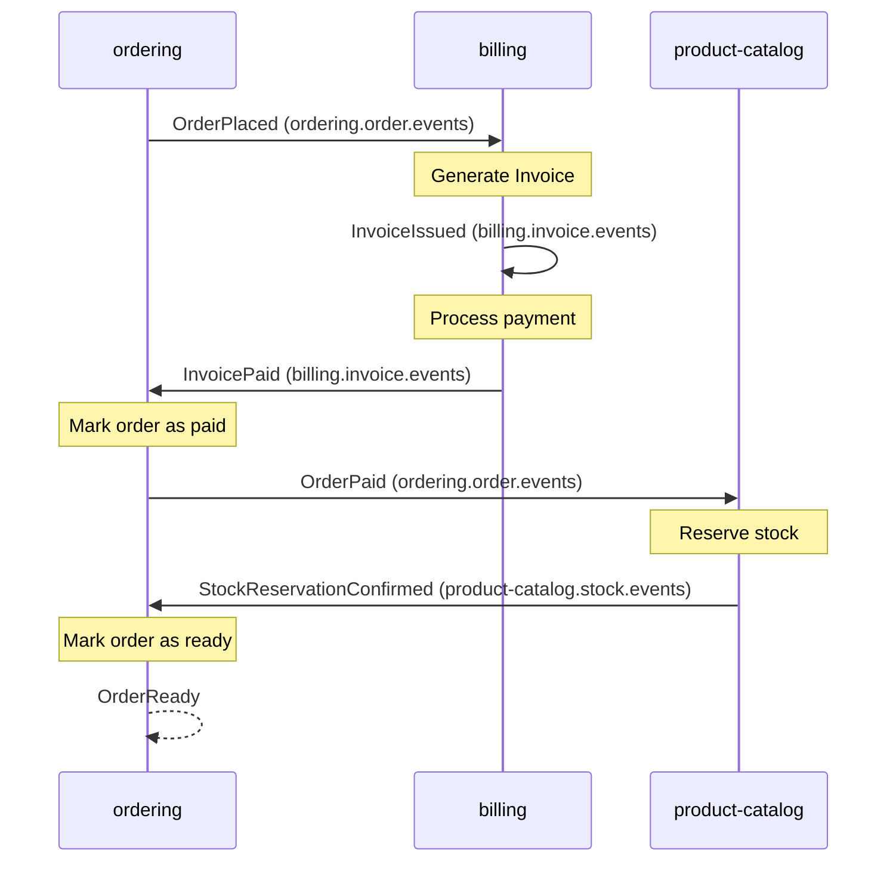
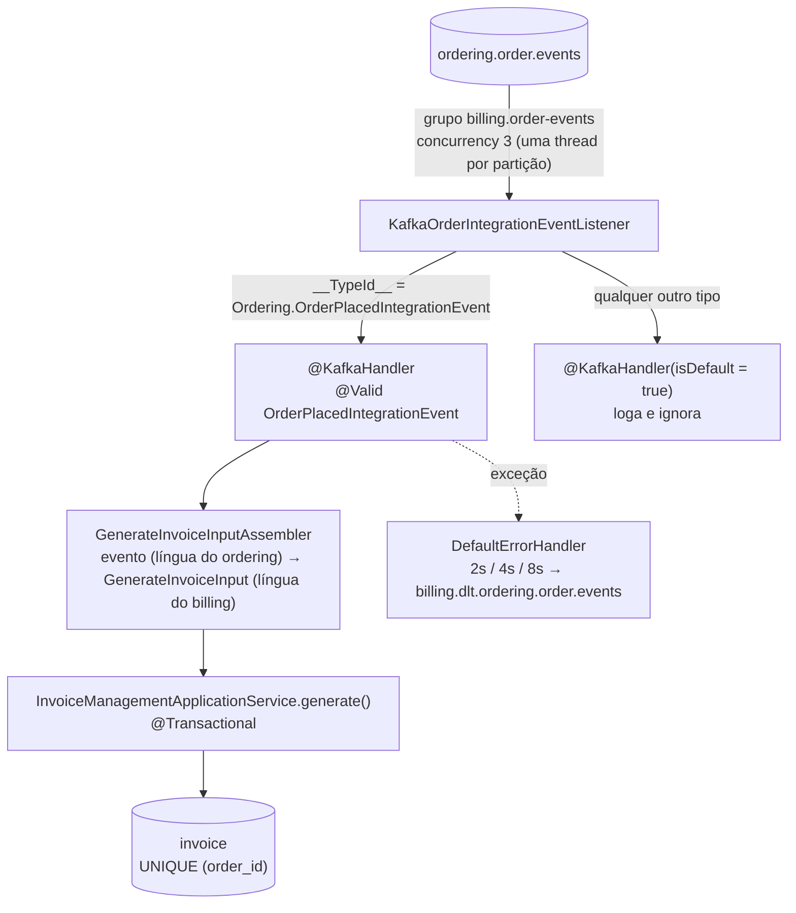
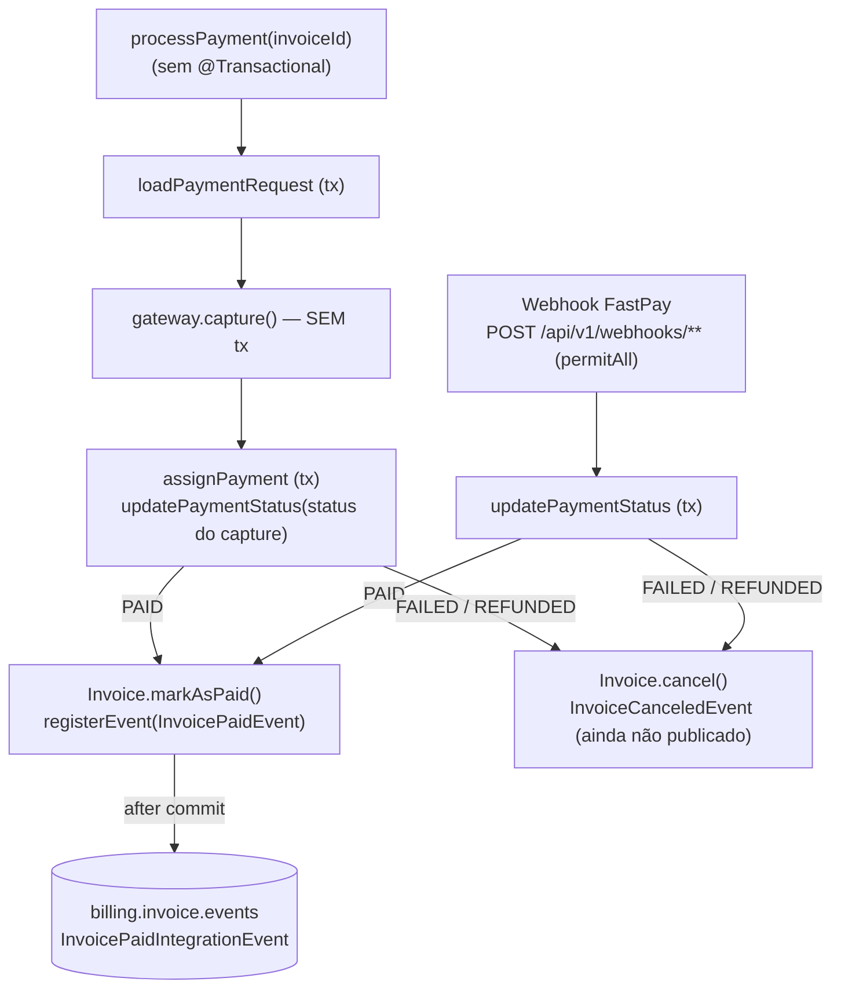

# Workflow coreografado: o pedido que atravessa serviços sem maestro

> Até aqui os eventos Kafka eram **avisos isolados**: o catálogo avisava preço, o ordering avisava a si mesmo. Este módulo encadeia avisos num **processo de negócio**: pedido → fatura → pagamento → estoque → pedido pronto. Ninguém comanda esse fluxo. Cada serviço escuta o evento anterior, faz a sua parte e publica o próximo. O fluxo existe, mas não está escrito em nenhum serviço: está no mapa abaixo, e nas assinaturas de tópico espalhadas pelo código.
> Este é um **doc vivo**: ele cresce aula a aula com o módulo 7 da trilha ("Workflow com coreografia e eventos"). A tabela de status do mapa diz até onde o código já chegou.
> Código real:
> - **ordering**: `.../outbox/` (publica `OrderPlaced` e `OrderPaid`), `infrastructure/adapters/in/messaging/kafka/invoice/KafkaInvoiceIntegrationEventListener.java`, `infrastructure/adapters/in/listerner/order/OrderEventListener.java`, `core/application/order/event/OrderPaidIntegrationEvent*.java`, `core/application/invoice/event/InvoicePaidIntegrationEvent.java`.
> - **billing**: `infrastructure/kafka/` (`KafkaOrderIntegrationEventListener`, `KafkaInvoiceIntegrationEventListener`, `KafkaInvoiceIntegrationEventPublisher`, `KafkaConfig`), `infrastructure/listener/InvoiceEventListener.java`, `application/invoice/event/`, `application/invoice/management/GenerateInvoiceInputAssembler.java`, `application/order/` (evento e snapshots), migração `V0003__add-unique-constraint-invoice-order-id.sql`.
>
> Contratos: [`asyncapi/billing.yml`](../asyncapi/billing.yml), [`asyncapi/ordering.yml`](../asyncapi/ordering.yml), [`asyncapi/product-catalog.yml`](../asyncapi/product-catalog.yml).

---

## O mapa



### Como ler

O diagrama tem quatro faixas, e elas alternam entre **fato** e **reação**:

| Faixa | Cor | O que é |
|---|---|---|
| Success Event | azul | Fato consumado no caminho feliz, no passado: "pedido realizado", "fatura paga" |
| Handler | verde | Quem **reage** a um fato de sucesso. Faz trabalho e, ao terminar, publica o próximo fato |
| Failure Event | vermelho | Fato consumado no caminho triste: "fatura cancelada", "reserva de estoque rejeitada" |
| Handler | laranja | Quem **compensa**: desfaz o efeito de um passo anterior que já tinha dado certo |

A seta para baixo é "este handler **assina** este evento". A seta para cima é "este handler **publica** este evento". O padrão evento → handler → evento → handler é a coreografia inteira: não há outra regra.

Repare em duas coisas que o desenho já ensina antes de qualquer código:

1. **Cada handler mora num serviço diferente do evento que consome.** `Billing: Generate Invoice` reage a `Ordering: Order Placed`. Quem publica não sabe quem escuta, e é isso que torna o passo novo barato: assinar um tópico não exige mudar o produtor.
2. **As compensações são eventos, não rollbacks.** Não existe transação que abrace ordering, billing e catálogo. Se a reserva de estoque falha depois que o cartão já foi cobrado, a cobrança **já aconteceu**: o único jeito de desfazer é outro fato (`Stock Reservation Rejected`) acionar outro handler (`Refund Payment`). Isso é a semente da **saga**, tema do módulo 8.

### O caminho feliz, em sequência



Note o `B->>B`: o billing **consome o próprio evento** `InvoiceIssued` para processar o pagamento. É o mesmo Listen to Yourself da [outbox](./outbox-e-checkout-assincrono.md), agora como passo do workflow: emitir a fatura e cobrar viram duas transações separadas, cada uma com retry e DLT próprios.

### Os caminhos de falha

| Falha | Evento | Quem compensa | O que desfaz |
|---|---|---|---|
| Pagamento recusado | `Billing: Invoice Canceled` | `Ordering: mark order as canceled` | O pedido não segue |
| Estoque indisponível depois de pago | `Product Catalog: Stock Reservation Rejected` | `Billing: Refund Payment` | Estorna a cobrança; o estorno cancela a fatura, que por sua vez cancela o pedido |

O segundo caso é o mais didático: **uma falha no catálogo cancela um pedido no ordering sem que os dois se conheçam**. A cadeia passa pelo billing (`Stock Reservation Rejected` → `Refund Payment` → `Invoice Canceled` → `mark order as canceled`).

### Status no código

| # | Evento | Produtor | Consumidor (handler) | Tópico | Status |
|---|---|---|---|---|---|
| 1 | `OrderPlaced` | ordering (outbox) | billing: Generate Invoice | `ordering.order.events` | ✅ aulas 7.4–7.6 |
| 2 | `InvoiceIssued` | billing (after-commit) | billing: Process payment | `billing.invoice.events` | ✅ aulas 7.7–7.8 |
| 3 | `InvoicePaid` | billing (after-commit) | ordering: Mark order as paid | `billing.invoice.events` | ✅ aulas 7.8–7.10 |
| 4 | `OrderPaid` | ordering (outbox) | catálogo: Reserve stock | `ordering.order.events` | ⏳ publicado (7.10), **sem consumidor** ainda |
| 5 | `StockReservationConfirmed` | catálogo | ordering: Mark order as ready | `product-catalog.stock.events` | ⬜ |
| 6 | `OrderReady` | ordering | (fim do fluxo) | `ordering.order.events` | ⬜ |
| F1 | `InvoiceCanceled` | billing | ordering: mark order as canceled | `billing.invoice.events` | ⬜ |
| F2 | `StockReservationRejected` | catálogo | billing: Refund Payment | `product-catalog.stock.events` | ⬜ módulo 8 |

---

## 7.1 — Coreografia e Event Collaboration

A teoria de "coreografia × orquestração" já está em [Fundamentos de EDA](./fundamentos-eda.md#coreografia--orquestração-quem-rege-o-fluxo). O que esta aula acrescenta é o nome do padrão que faz a coreografia funcionar: **Event Collaboration**.

Em Event Collaboration, serviços **colaboram para completar um processo** trocando eventos, e não pedidos. Compare com o que o projeto fazia antes:

| | Request/Response (antes) | Event Collaboration (agora) |
|---|---|---|
| Quem decide o próximo passo | O chamador ("billing, gere a fatura") | O receptor ("um pedido foi feito; eu, billing, faturo") |
| Acoplamento | O chamador conhece o endereço e a API do outro | O produtor conhece só o tópico dele |
| Disponibilidade | O outro precisa estar de pé **agora** | O evento espera no tópico até o consumidor voltar |
| Onde o fluxo está escrito | No código do chamador | Em lugar nenhum: emerge das assinaturas |

A última linha é o preço. "Onde parou o pedido 42?" deixa de ser uma consulta e vira uma investigação em N serviços. Por isso todo evento do fluxo carrega o campo **`orderId` no payload**: é ele que correlaciona as pontas.

Cuidado para não confundir correlação com **key**. A key de cada evento é o id do **agregado de quem publica**: `orderId` nos eventos do ordering, `invoiceId` nos eventos do billing (trait `KafkaInvoiceKey` em [`messages.yml`](../asyncapi/messages.yml)). A key garante ordem **por agregado** dentro do tópico do produtor: todos os eventos da fatura X caem na mesma partição de `billing.invoice.events`. Não existe garantia de ordem entre tópicos diferentes, e o workflow não precisa dela: cada passo só acontece **depois** do anterior, porque é disparado por ele.

> **Para fixar:** o evento descreve **o que aconteceu** no serviço que o emite (`OrderPlaced`), nunca **o que o outro deve fazer** (`GenerateInvoice`). Se o nome do evento é um imperativo endereçado a alguém, ele é um comando disfarçado, e o acoplamento voltou pela porta dos fundos.

## 7.2 — O workflow da AlgaShop

É o mapa acima. A decisão de desenho que vale guardar: **cada serviço só publica fatos do próprio domínio**. O ordering fala de pedidos, o billing de faturas, o catálogo de estoque. Nenhum evento tem prefixo de outro serviço: é a mesma regra de posse de dados do banco por serviço, aplicada aos tópicos.

## 7.3 — Os contratos AsyncAPI do workflow

O contrato do billing ([`asyncapi/billing.yml`](../asyncapi/billing.yml)) já descreve o fluxo inteiro do ponto de vista dele, antes de o código existir:

| Operação | Ação | Canal | Grupo |
|---|---|---|---|
| `consumeOrderPlacedEvents` | receive | `ordering.order.events` | `billing.order-events` |
| `publishInvoiceEvents` | send | `billing.invoice.events` | — |
| `consumeInvoiceIssuedEvents` | receive | `billing.invoice.events` | `billing.invoice-events` |
| `consumeStockReservationRejectedEvents` | receive | `product-catalog.stock.events` | `billing.stock-events` |

Lendo só essa tabela dá para reconstruir o papel do billing no mapa: ele consome pedido, publica fatura, consome a **própria** fatura emitida e consome a rejeição de estoque para estornar. É o contrato fazendo o papel de documentação do fluxo, que a coreografia, por definição, não tem em outro lugar. (Como os contratos são escritos: [AsyncAPI: contratos](./asyncapi-contratos.md).)

## 7.4 — Passo 1: o pedido realizado sai do ordering

Já foi construído na Fase 41: o `OrderPlacedIntegrationEvent` é gravado na **outbox** na mesma transação em que o pedido nasce, e o polling publisher o leva a `ordering.order.events` com `key = orderId`. Detalhes em [Outbox e checkout assíncrono](./outbox-e-checkout-assincrono.md).

O que importa para o workflow é o **conteúdo**: o evento é **ECST** (Event-Carried State Transfer). Ele carrega itens, frete, dados de cobrança e forma de pagamento (`OrderItemSnapshot`, `ShippingSnapshot`, `BillingSnapshot`, `PaymentSnapshot`), tudo congelado no momento do pedido. Sem isso, o billing teria que chamar o ordering por HTTP para montar a fatura, e o desacoplamento da coreografia seria só aparente.

## 7.5 e 7.6 — Passo 2: o billing gera a fatura



### O listener: um tópico, vários tipos

O `ordering.order.events` vai carregar `OrderPlaced`, `OrderPaid`, `OrderReady`, `OrderCanceled`. O billing só se importa com o primeiro. O listener resolve isso com o mesmo par de handlers já usado no ordering ([Kafka na prática](./kafka-na-pratica.md)):

- `@KafkaHandler` tipado em `OrderPlacedIntegrationEvent`, escolhido pelo header `__TypeId__`;
- `@KafkaHandler(isDefault = true)` recebendo `Object`: **loga e ignora**. Evento novo do produtor não é erro do consumidor, é evolução normal. Sem o default, o primeiro `OrderPaid` publicado iria parar no DLT do billing.

O type mapping fica em `application-development-env.yaml`:

```yaml
spring.json.type.mapping:
  Ordering.OrderPlacedIntegrationEvent:com.algaworks.algashop.billing.application.order.event.OrderPlacedIntegrationEvent,
```

O lado esquerdo é um **nome lógico** combinado no contrato; o lado direito é a classe **do billing**. O billing tem a sua própria cópia do evento e dos snapshots (`application/order/`), e o ordering pode renomear pacotes à vontade.

### O assembler como camada anticorrupção

`GenerateInvoiceInputAssembler.toGenerateInvoiceInput(event)` é onde a linguagem do ordering vira a linguagem do billing:

| No evento (ordering) | No input (billing) | Tradução |
|---|---|---|
| `items[]` com `productName`, `quantity`, `totalAmount` | `LineItemInput` | Nome vira `"Produto - x2"`, valor é o total do item |
| `shipping.cost` | `LineItemInput "Shipping"` | Frete vira **mais uma linha** da fatura, só se for maior que zero |
| `billing` (nome, documento, e-mail, endereço) | `PayerData` | `firstName` + `lastName` viram `fullName` |
| `payment.method` (String) | `PaymentMethod` (enum) | `valueOf`: um método desconhecido estoura `IllegalArgumentException` |

O caso de uso `generate()` **não mudou** para receber o evento: é o mesmo que a API REST já chamava. O Kafka virou só mais um adaptador de entrada, como prevê a arquitetura hexagonal ([Ports & Adapters](../01-arquitetura-design/ports-hexagonal.md)).

### Idempotência pela constraint

O Kafka entrega **pelo menos uma vez**. O mesmo `OrderPlaced` pode chegar duas vezes (redelivery depois de rebalance, replay da outbox). Duas faturas para o mesmo pedido seriam cobrança dupla.

A defesa escolhida nesta aula é a mais simples possível, no banco:

```sql
alter table public.invoice
    add constraint uk_invoice_order_id unique (order_id);
```

Um pedido, uma fatura, garantido pelo Postgres. A segunda tentativa de `saveAndFlush` falha com `DataIntegrityViolationException`, e a transação inteira volta. Como `DataIntegrityViolationException` está na lista de **não-retryable** do `KafkaConfig`, a duplicata não é reprocessada: vai direto para `billing.dlt.ordering.order.events`. A fatura dupla não acontece, mas o DLT recebe uma mensagem que não precisa de ninguém (ver [armadilhas](#armadilhas)).


## 7.7 — Passo 3: a fatura emitida sai do billing

Até a 7.6, `Invoice.issue()` já registrava o evento de domínio `InvoiceIssuedEvent`, mas o `InvoiceEventListener` estava vazio: o fato acontecia dentro do processo e morria ali. A aula liga esse fio, em três peças.

```mermaid
flowchart LR
    A["Invoice.issue()<br/>registerEvent(InvoiceIssuedEvent)"] --> B["saveAndFlush<br/>dentro do @Transactional"]
    B -->|"COMMIT"| C["InvoiceEventListener<br/>@TransactionalEventListener"]
    C -->|"Mapper.convert"| D["InvoiceIssuedIntegrationEvent"]
    D --> E["InvoiceIntegrationEventPublisher<br/>(porta, application)"]
    E --> F["KafkaInvoiceIntegrationEventPublisher<br/>(adaptador, infrastructure)<br/>valida → send().get(40s)"]
    F --> G[("billing.invoice.events<br/>key = invoiceId")]
```



**1. Evento de domínio ≠ evento de integração.** `InvoiceIssuedEvent` (domínio) e `InvoiceIssuedIntegrationEvent` (`application/invoice/event/`) têm os mesmos quatro campos (`invoiceId`, `orderId`, `customerId`, `issuedAt`), e mesmo assim são classes diferentes. O de domínio pode mudar quando o modelo mudar. O de integração é **contrato público**: tem Bean Validation, tem `__TypeId__` lógico (`Billing.InvoiceIssuedIntegrationEvent`) e só muda com versionamento. A conversão é uma linha (`mapper.convert(event, InvoiceIssuedIntegrationEvent.class)`), e é ela que impede o domínio de vazar para o fio.

**2. Porta e adaptador.** O listener depende de `InvoiceIntegrationEventPublisher`, uma interface na camada de aplicação. Quem fala Kafka é `KafkaInvoiceIntegrationEventPublisher`, na infraestrutura. É o mesmo desenho de [ports & adapters](../01-arquitetura-design/ports-hexagonal.md) do ordering: trocar Kafka por outbox mexeria só no adaptador. O adaptador valida o evento antes de enviar (`ConstraintViolationException` se o contrato estiver quebrado) e espera o ack do broker por até 40s, transformando falha em `EventPublishingException`.

**3. Publicar só depois do commit.** O `@EventListener` virou `@TransactionalEventListener`, cuja fase padrão é `AFTER_COMMIT`. Antes, se o evento fosse publicado dentro da transação e a transação desse rollback depois, o Kafka teria um "fatura emitida" de uma fatura que não existe: o **evento fantasma**. Publicando depois do commit, isso não acontece mais.

Com isso, o projeto tem agora os **dois desenhos de consistência** convivendo, e vale saber de cor qual serviço usa qual:

| Serviço | Estratégia | Garante | Não garante |
|---|---|---|---|
| ordering | **Outbox** (recorder `MANDATORY` + polling publisher) | Banco e evento commitam juntos; o evento sai em algum momento | Latência baixa (o dispatcher roda a cada minuto) |
| product-catalog | **After-commit** (`@TransactionalEventListener`) | Nunca há evento de algo que não foi commitado | Que o evento saia: commit feito + Kafka fora = evento perdido |
| billing | **After-commit** (mesma escolha do catálogo) | Idem | Idem |

A última coluna é o ponto fraco do after-commit, e ele aparece nas [armadilhas](#armadilhas).

## 7.8 — Passo 4: o billing cobra a própria fatura (e o webhook fecha o ciclo)

O mesmo serviço que publica `InvoiceIssued` também o consome. O `KafkaInvoiceIntegrationEventListener` do billing (grupo `billing.invoice-events`) tem um handler tipado para `InvoiceIssuedIntegrationEvent` que chama `processPayment(invoiceId)`, e um handler default que **ignora** o resto, incluindo o `InvoicePaid` que o próprio billing publica no mesmo tópico.

É o Listen to Yourself da [outbox](./outbox-e-checkout-assincrono.md), agora como passo do workflow. O ganho é separar duas coisas com riscos muito diferentes:

- **Emitir a fatura**: escrita local no Postgres, rápida, transacional.
- **Cobrar**: chamada HTTP a um gateway externo, lenta, pode dar timeout, sem transação possível.

Se as duas ficassem no mesmo handler do `OrderPlaced`, um gateway lento seguraria o consumo de pedidos. Separadas por um tópico, a cobrança ganha retry, backoff e DLT próprios, e a fatura já existe mesmo se a cobrança falhar.

### Os dois caminhos que geram `InvoicePaid`



O pagamento pode ser confirmado **na hora** (o capture já devolve `PAID`) ou **depois** (o capture devolve "em processamento" e o FastPay avisa pelo webhook). Os dois caminhos convergem para `Invoice.markAsPaid()`, que registra o `InvoicePaidEvent`, e o mesmo `InvoiceEventListener` o publica depois do commit. Para o workflow tanto faz por onde o pagamento chegou.

### O bug do webhook anônimo

O webhook é `permitAll`: quem chama é o FastPay, sem token. Quando ele passou a **gravar** a fatura, a auditoria do Spring Data (`AuditorAware`) tentou descobrir "quem alterou", chamou `getAuthenticatedUserId()` e quebrou. Para o Spring Security, uma requisição sem token em rota `permitAll` não chega "sem autenticação": chega com um `AnonymousAuthenticationToken`, e `isAuthenticated()` é **true** para ele.

A correção adiciona `isAnonymous()` ao `SecurityCheckApplicationService` e faz o `auditorProvider` devolver `Optional.empty()` também nesse caso:

```java
if (!securityCheck.isAuthenticated() ||
    securityCheck.isMachineAuthenticated() || securityCheck.isAnonymous()) {
    return Optional.empty();
}
```

A lição vai além do billing: **`isAuthenticated()` não significa "tem um usuário"**. Usuário anônimo, máquina (`client_credentials`) e pessoa são três casos diferentes, e código de auditoria precisa tratar os três. (Mais sobre os três públicos em [Recursos `/me` e IDOR](../05-seguranca/recursos-me-e-idor.md).)

## 7.9 — Preparando o ordering para consumir eventos do billing

Do lado do ordering, a aula é infraestrutura de consumidor, o mesmo kit já montado para os eventos de produto ([Resiliência no consumer](./resiliencia-consumer-kafka.md)), agora para um tópico de **outro** serviço:

| Peça | Onde | O que faz |
|---|---|---|
| Tópico e grupo | `application-development-env.yaml` | `invoice-event-topic-name: billing.invoice.events`, `invoice-events-consumer-group: ordering.invoice-events` |
| Grupos fora do código | `AlgaShopMessagingKafkaProperties` | Os três `id` de `@KafkaListener` (`productEvents`, `orderCommands`, `invoiceEvents`) saíram do código para properties via SpEL |
| DLT | `KafkaConfig.invoiceEventsDlt()` | `ordering.dlt.billing.invoice.events`, mesma topologia dos outros DLTs |
| Não-retryable | `KafkaConfig` | `DomainEntityNotFoundException` entrou na lista: pedido que não existe não vai passar a existir na quarta tentativa |
| Type mapping | `application-development-env.yaml` | Só `Billing.InvoicePaidIntegrationEvent`, nada de `InvoiceIssued` |
| Cópia do evento | `core/application/invoice/event/InvoicePaidIntegrationEvent.java` | A versão do ordering do contrato, com Bean Validation |

Dois detalhes didáticos:

- **O ordering não mapeia o `InvoiceIssued`.** O tópico entrega os dois tipos, mas só o que interessa tem classe. O resto chega ao handler default e é ignorado. O consumidor declara do que depende, e não do que o produtor publica.
- **Grupo `ordering.invoice-events` ≠ grupo `billing.invoice-events`.** O mesmo tópico tem dois consumer groups independentes, cada um com seus offsets. Os dois serviços leem **todas** as mensagens; cada um ignora o que não é seu. É o padrão "dois consumidores no mesmo tópico" de [Kafka a fundo](./kafka-fundamentos.md).

## 7.10 — Passo 5: o pedido pago, e o próximo evento

```mermaid
flowchart LR
    A[("billing.invoice.events")] -->|"InvoicePaid<br/>grupo ordering.invoice-events"| B["KafkaInvoiceIntegrationEventListener"]
    B --> C["ForManagingOrders.markAsPaid(orderId)<br/>@Transactional"]
    C --> D["Order.markAsPaid()<br/>OrderPaidEvent"]
    D --> E["OrderEventListener<br/>@EventListener (síncrono, MESMA tx)"]
    E --> F["OrderPaidIntegrationEventAssembler"]
    F --> G[("outbox<br/>Propagation.MANDATORY")]
    G -.->|"dispatcher"| H[("ordering.order.events<br/>key = orderId")]
```



O handler chama a porta de entrada `ForManagingOrders.markAsPaid(event.getOrderId())`: o campo de correlação do payload, e não a key (que é o `invoiceId`). O `OrderManagementApplicationService` carrega o pedido, chama `Order.markAsPaid()` (que valida a transição de status e registra o `OrderPaidEvent`) e salva.

**Repare no contraste com o billing.** O `OrderEventListener` continua com `@EventListener` comum, **dentro** da transação, e isso aqui é certo, não descuido: o publisher é a outbox, cujo recorder **exige** transação (`MANDATORY`). Pedido `PAID` e linha de outbox commitam juntos ou nenhum dos dois. Com outbox, publicar dentro da transação é o objetivo. Com publicação direta no Kafka, como no billing, é exatamente o que causa o evento fantasma.

**O `OrderPaid` é ECST de novo.** O `OrderPaidIntegrationEventAssembler` não manda só o id: manda `items` (produto, quantidade, preço), **ordenados pelo id do item**. O próximo consumidor é o catálogo, que precisa saber **o que** reservar sem chamar o ordering de volta. A ordenação deixa o payload determinístico: o mesmo pedido gera sempre o mesmo JSON.

É aqui que o código para por enquanto: o `OrderPaid` chega ao tópico e ninguém o consome. O contrato do catálogo já declara `consumeOrderPaidEvents` ([`product-catalog.yml`](../asyncapi/product-catalog.yml)), e o próximo elo é "Product Catalog: Reserve stock".

## 7.11 — Corrigindo testes

Não há alteração em `src/test` nos diffs do billing nem do ordering. A seção fica em aberto até as correções da suíte aparecerem no código.

---

## Armadilhas

### After-commit não é outbox: o evento pode se perder

O `@TransactionalEventListener` resolveu o evento fantasma (evento sem commit), mas deixou o problema oposto: **commit sem evento**. O listener `AFTER_COMMIT` roda na fase `afterCompletion` da transação, e o Spring **captura e só loga** exceções lançadas ali (`TransactionSynchronization.afterCompletion threw exception`). Se o Kafka estiver fora, o `EventPublishingException` não chega a ninguém:

| Passo | O que acontece se a publicação falhar depois do commit |
|---|---|
| `OrderPlaced` → `generate()` → `InvoiceIssued` | O handler termina "com sucesso", o offset do `OrderPlaced` é commitado. A fatura existe, o `InvoiceIssued` nunca saiu, **ninguém cobra**. Sem retry, sem DLT |
| `InvoiceIssued` → `processPayment()` → `InvoicePaid` | O cliente foi cobrado, a fatura está `PAID`, o offset é commitado. **O pedido nunca fica pago** |
| Webhook → `updatePaymentStatus()` → `InvoicePaid` | O FastPay recebe 2xx e não reenvia. Mesmo resultado |

A coreografia **trava em silêncio**: nenhum serviço está quebrado, só falta um evento, e o único rastro é uma linha de log. É o argumento mais forte para a outbox, e o motivo de o ordering a ter adotado. Até o billing ter uma, a defesa possível é **conciliação**: um job que procure faturas `UNPAID` antigas ou `PAID` sem pedido pago correspondente e republique.

> Vale testar para ver com os próprios olhos: derrube os três brokers depois de o `OrderPlaced` ser consumido e antes do `send()` (um breakpoint no `KafkaInvoiceIntegrationEventPublisher` resolve) e observe o log e a tabela `invoice`.

### Reentrega de `InvoiceIssued` cobra de novo

`processPayment` não verifica o status da fatura antes de cobrar: `loadPaymentRequest` só monta o pedido de pagamento, e quem rejeita fatura já paga é o `assignPayment`, **depois** do `capture()`. Então qualquer reentrega do `InvoiceIssued` chama o gateway de novo:

- **Timeout do gateway** (`GatewayTimeoutException`/`BadGatewayException`) é **retryable** no `KafkaConfig` do billing. Timeout quer dizer "não sei se cobrou"; se cobrou, as três retentativas (2s/4s/8s) cobram de novo.
- **Duplicata** do evento (rebalance, replay) faz o mesmo: captura, e só então o `assignPayment` lança `DomainException` ("cannot be edited") e a mensagem vai ao DLT. O DLT registra o erro, mas o dinheiro já saiu duas vezes.

Defesas, da mais barata à mais robusta: checar `isUnpaid()` e se já existe código de gateway **antes** do `capture()`; enviar o `invoiceId` como chave de idempotência ao gateway (se o FastPay aceitar); antes de recapturar após timeout, consultar o pagamento pelo código.

### Duplicata vira DLT, agora nos dois lados

O padrão da [7.6](#idempotência-pela-constraint) se repetiu no ordering: um `InvoicePaid` duplicado chama `markAsPaid()` num pedido já `PAID`; `changedStatus` lança `OrderStatusCannotBeChanged`, que é `DomainException`, que é **não-retryable**, então a mensagem vai ao DLT. A cobrança dupla é evitada, mas o DLT passa a misturar falha real com "já processei". A correção é a mesma nos dois serviços: tratar "já está no estado alvo" como sucesso idempotente (ou usar `runOnce` com uma chave).

Os eventos de fatura também não carregam o header `idempotency-key`: o `IntegrationEvent` do billing devolve `null` por padrão, e o contrato só exige o header nos eventos que saem pela outbox. Coerente com o desenho, mas significa que o consumidor não tem uma chave pronta para deduplicar.

### Comentários e logs copiados

- O handler de `InvoiceIssued` no billing tem o comentário "recebemos o evento de order placed para gerar invoice", copiado do listener de pedidos. O código cobra uma fatura; o comentário fala de outra coisa.
- O `logReceived` do listener de fatura no ordering escreve `partiton`.
- O `KafkaConfig` do billing ainda menciona "os tópicos próprios do ordering" e o prefixo `ordering.dlt.` (o código usa `billing.dlt.`).

### O `InvoiceCanceled` ainda não sai

O `InvoiceEventListener.listen(InvoiceCanceledEvent)` continua vazio e com `@EventListener`. Pagamento recusado cancela a fatura no billing, mas o ordering nunca fica sabendo, e o pedido fica `PLACED` para sempre. É o caminho de falha F1 do mapa, que pertence ao módulo de saga.

---

## O que vem depois

- **Módulo 8 — Saga com coreografia**: o catálogo consumindo `OrderPaid` para reservar estoque, e os caminhos vermelhos e laranja do mapa (`InvoiceCanceled` → cancelar pedido; `StockReservationRejected` → estornar pagamento). As compensações vão entrar aqui ou num doc próprio de saga.
- **Módulo 9 — Saga com orquestração**: o mesmo fluxo com um coordenador, para comparar com este.

---

## Checklist do workflow coreografado

- [x] Correlação por `orderId` no payload de todo evento do fluxo; key = id do agregado do produtor
- [x] Consumidores com handler default que ignora tipos desconhecidos (billing e ordering)
- [x] Evento carrega o estado necessário (ECST): `OrderPlaced` com snapshot, `OrderPaid` com itens
- [x] Evento de domínio separado do evento de integração (contrato público próprio)
- [x] Nenhum evento fantasma: billing e catálogo publicam after-commit, ordering via outbox
- [ ] Nenhum evento perdido: o billing ainda publica direto no Kafka, sem outbox
- [x] Fatura única por pedido (constraint `UNIQUE (order_id)`)
- [ ] Duplicata tratada como sucesso, não como DLT (billing e ordering)
- [ ] Cobrança idempotente no retry do `processPayment`
- [ ] Cada caminho de falha tem um handler de compensação (`InvoiceCanceled` ainda não é publicado)
- [ ] Dá para responder "onde parou o pedido X?" sem abrir os logs de três serviços
