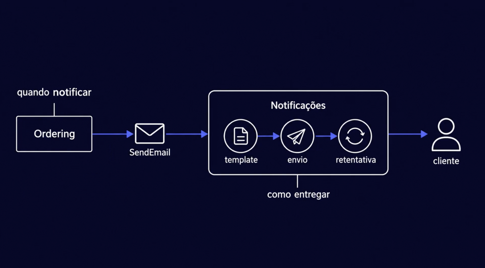
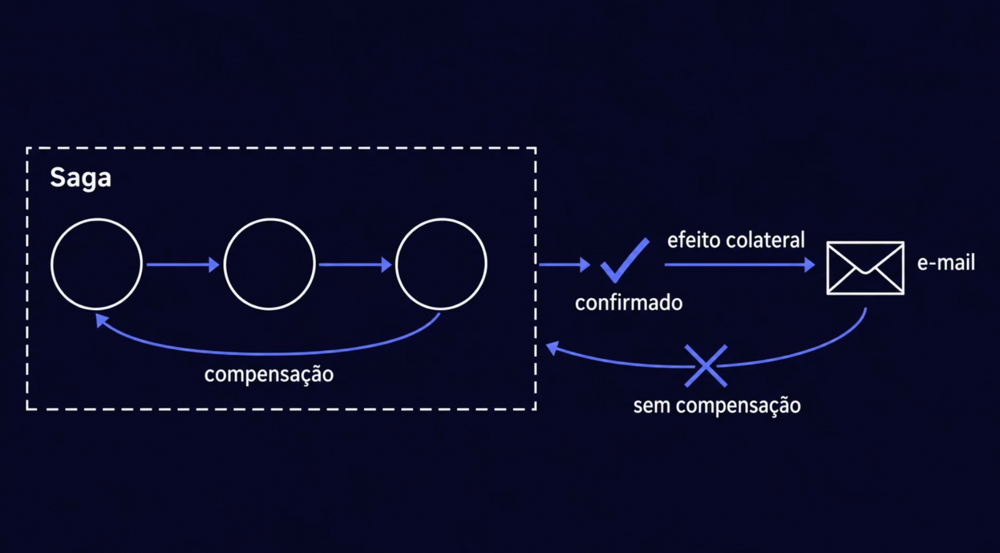
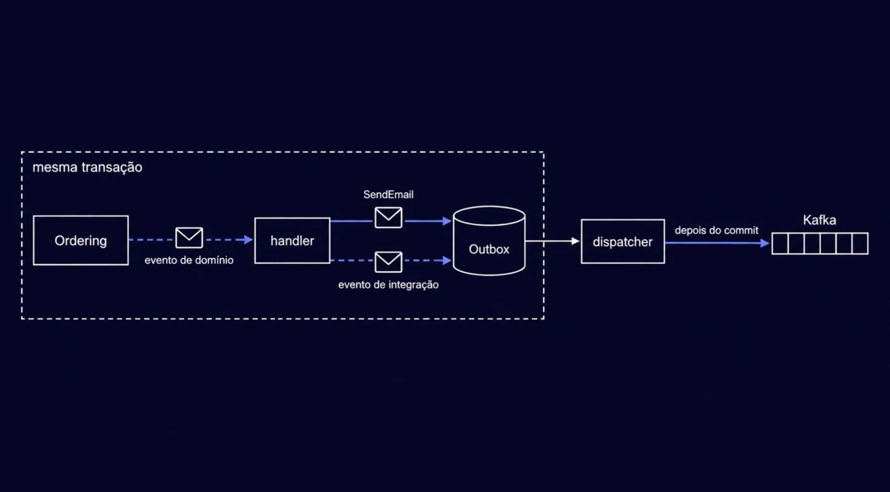
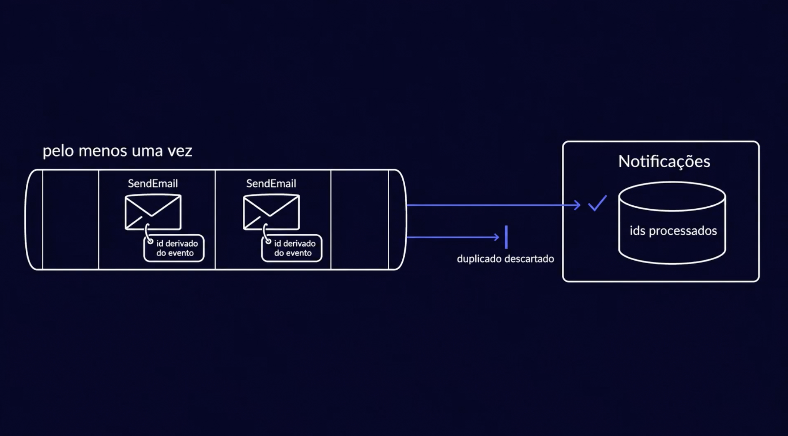

# Serviço de notificações: o conceito

> **Em uma frase:** o `ordering` decide **quando** avisar o cliente; o `notifications` decide **como** entregar o e-mail — e os dois conversam por um comando `SendEmail` que sai pela outbox e é processado no máximo uma vez por notificação.

⬅️ Anterior: [Saga orquestrada: robustez](../06-mensageria/16-saga-orquestrada-robustez.md) · ➡️ Próximo: [Validação do HTML do template](./02-validacao-de-html-do-template.md) · 🧭 Trilha: [README](../README.md#trilha-de-leitura)

---

## O problema

O pedido foi confirmado. O cliente precisa receber um e-mail.

O jeito mais rápido seria o `ordering` montar o HTML e chamar o SMTP ali mesmo. Mas isso traz três problemas:

- **Acoplamento:** o serviço de pedidos passa a saber de template, servidor de e-mail e retentativa. Não é o negócio dele.
- **Falha que contamina:** se o SMTP cair, o checkout falha junto — ou o e-mail se perde.
- **Repetição:** cada serviço que quiser mandar e-mail (billing, autorização…) teria que fazer tudo de novo.

## A ideia

Separar duas perguntas:

| Pergunta | Quem responde | Exemplo |
|---|---|---|
| **Quando** notificar? | O serviço dono do fato (`ordering`) | "o pedido ficou pronto" |
| **Como** entregar? | O `notifications` | qual template, qual servidor, quantas tentativas |



O `ordering` só manda um **comando** `SendEmail` com o destinatário, o id do template e as variáveis. Dentro do `notifications` acontecem três coisas, nesta ordem:

1. **Template:** o HTML guardado é preenchido com as variáveis (Thymeleaf).
2. **Envio:** o e-mail sai pelo SMTP.
3. **Retentativa:** se o envio falhar, tenta de novo; se não der, vai para a DLT.

O comando já leva o nome e o e-mail do cliente. Por isso o `notifications` **não chama nenhum outro serviço** para montar a mensagem.

## E-mail é efeito colateral, não passo da saga

Na saga orquestrada, todo passo tem uma **compensação**: se a reserva falha, a fatura é cancelada. E-mail não tem volta. Não existe "desmandar" um e-mail.



Por isso o e-mail fica **fora da saga**:

- ele só sai **depois** que o pedido está confirmado;
- a saga **não espera** a resposta do e-mail;
- se o e-mail falhar, o pedido continua confirmado.

O contrato do `ordering` diz isso com todas as letras: *"The Place Order Saga does not depend on them."*

## Como funciona no AlgaShop

### 1. O comando nasce na mesma transação (outbox)



O agregado `Order` publica um **evento de domínio**. Um handler no `ordering` o transforma em mensagens de saída — o evento de integração e o comando `SendEmail` — e grava as duas na **outbox**, na **mesma transação** do pedido.

Depois do commit, o dispatcher lê a outbox e publica no Kafka. É o mesmo motivo da [Outbox](../06-mensageria/08-outbox.md): sem dual-write. Ou o pedido e o e-mail ficam gravados juntos, ou nenhum dos dois.

### 2. Pelo menos uma vez → idempotência no consumidor



A outbox e o Kafka garantem entrega **pelo menos uma vez**. Isso quer dizer que o mesmo `SendEmail` pode chegar duas vezes. Para mensagem de banco, repetir costuma ser inofensivo. Para e-mail, não: o cliente recebe dois.

A defesa:

- cada comando leva um header `idempotency-key`, um **id derivado do evento** de origem (o mesmo evento gera sempre o mesmo id);
- o `notifications` guarda os **ids já processados**;
- se o id já está lá, o comando é **descartado** sem enviar.

```mermaid
sequenceDiagram
    participant O as ordering
    participant K as Kafka (notifications.email.commands)
    participant N as notifications
    participant S as SMTP
    O->>O: pedido + SendEmail na outbox (1 transação)
    O->>K: dispatcher publica depois do commit
    K->>N: SendEmail (idempotency-key)
    N->>N: id já processado? então descarta
    N->>N: renderiza o template com as variáveis
    N->>S: envia
    Note over N: falhou? retentativa; esgotou → DLT
```

### 3. Templates cadastrados por API

Os templates ficam no banco do `notifications` e são mantidos pela API `/api/v1/email-templates` (escopos `email-templates:read` e `email-templates:write`). Criar ou trocar um template com HTML inválido responde **422**. A validação desse HTML é o assunto do [próximo doc](./02-validacao-de-html-do-template.md).

## O que já existe e o que vem

| Peça | Situação |
|---|---|
| Contratos OpenAPI e AsyncAPI | escritos |
| Esqueleto do serviço (portas, stubs, exceções) | pronto |
| Validação do HTML do template (jsoup) | pronta, com testes |
| Render com Thymeleaf | pronto, com testes |
| Envio por SMTP (JavaMail + Mailpit) | pronto, com teste de integração |
| CRUD de templates | stub |
| Consumidor do `SendEmail`, idempotência e DLT | ainda não existe |
| `ordering` publicando `SendEmail` pela outbox | ainda não existe |

## Como aplicar

1. Separe **quando** (serviço dono do fato) de **como** (serviço de notificação).
2. Mande um **comando** com tudo que o e-mail precisa; evite que o notificador consulte outros serviços.
3. Publique o comando pela **outbox**, na transação do fato.
4. Deixe o e-mail **fora da saga**: só depois do confirmado, sem esperar resposta.
5. Dê ao comando um **id derivado do evento** e descarte repetidos no consumidor.
6. Guarde o template no notificador e **valide na entrada**.

## Para lembrar

- `ordering` = quando; `notifications` = como.
- E-mail não tem compensação. Por isso fica fora da saga e só sai depois do confirmado.
- Outbox: o comando nasce na mesma transação do pedido.
- Kafka entrega pelo menos uma vez. Sem idempotência, o cliente recebe e-mail duplicado.
- O id de idempotência vem do evento, não é gerado na hora (senão cada repetição teria um id novo).
- O comando carrega os dados do destinatário: o notificador não chama ninguém.

## Cuidados

- **Id aleatório na idempotência** não protege nada: duas publicações do mesmo evento teriam ids diferentes.
- **Gravar o id processado e enviar** não são atômicos (SMTP não participa da transação). Sempre sobra uma janela pequena de duplicado; o objetivo é reduzi-la, não zerá-la.
- **Não ponha o e-mail como passo da saga**: um SMTP fora do ar travaria pedidos que já estão pagos.

## Onde ver no código e nos contratos

- [`openapi/notifications.yml`](../openapi/notifications.yml): API de e-mails e de templates.
- [`asyncapi/notifications.yml`](../asyncapi/notifications.yml): canal `notifications.email.commands` e a DLT.
- [`asyncapi/messages.yml`](../asyncapi/messages.yml): o `SendEmailCommand` e o header `idempotency-key`.
- `SendEmailApplicationService` (notifications): caso de uso do envio (stub por enquanto).
- `EmailTemplateRenderer` e `EmailSender` (notifications): portas de render e de envio.
