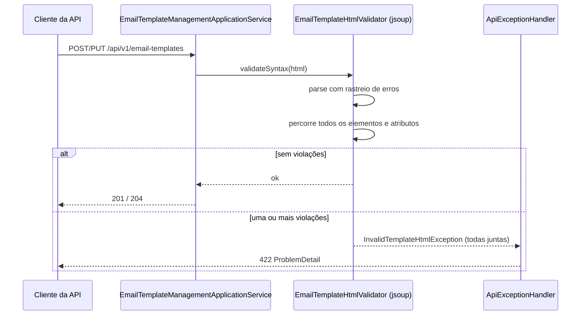

# Validação do HTML do template

> **Em uma frase:** o HTML de um template é checado **antes de ser salvo** — sintaxe com o parser do jsoup e segurança com uma lista de bloqueio — para que nenhum e-mail quebrado ou perigoso chegue ao cliente.

⬅️ Anterior: [Serviço de notificações: o conceito](./01-servico-de-notificacoes-conceito.md) · ➡️ Próximo: [Renderização do template com Thymeleaf](./03-renderizacao-do-template-com-thymeleaf.md) · 🧭 Trilha: [README](../README.md#trilha-de-leitura)

---

## O problema

Um template de e-mail é um HTML que **uma pessoa cadastra** pela API. Depois, o sistema preenche as variáveis e manda esse HTML para a caixa de milhares de clientes.

Dois riscos:

1. **HTML quebrado:** `

Olá
`. Cada leitor de e-mail "conserta" de um jeito. O cliente recebe um layout torto.
2. **HTML perigoso:** `<script>`, `onclick="..."`, `href="javascript:..."`, um `<form>` pedindo senha. É a porta para phishing com a marca da loja.

Se o problema só aparecer na hora do envio, é tarde: o template já está salvo e o e-mail já saiu.

## A ideia

**Validar na entrada.** O template só é salvo se passar.

| Abordagem | O que faz | Por que (não) aqui |
|---|---|---|
| **Validar e recusar** (escolhida) | Aponta o erro e devolve 422 | Quem cadastra vê o problema e corrige; o banco só tem HTML bom |
| Sanitizar em silêncio | Remove o que é perigoso e salva | O template salvo fica diferente do que a pessoa escreveu, sem ela saber |
| Validar no envio | Checa a cada e-mail | Erro descoberto tarde, e repetido a cada envio |

Arquitetura: a **porta** `EmailTemplateHtmlValidator` fica na camada de aplicação (ela só diz *o que* validar). O **adapter** `EmailTemplateHtmlValidatorJsoupImpl` fica na infraestrutura (ele sabe *como*, com jsoup). Trocar de biblioteca não mexe no caso de uso.

## Como funciona no AlgaShop

> O cadastro de templates chama o validador antes de gravar ([API de cadastro de templates](./05-api-de-templates.md)).

### Etapa 1 — sintaxe

O jsoup **sempre** consegue montar uma árvore, mesmo de HTML ruim: ele conserta em silêncio. Por isso o parser é criado com `setTrackErrors(10)`. Assim ele **anota** cada conserto que fez. Qualquer erro anotado vira violação: `Malformed HTML at position N: ...`.

O `10` não é tolerância: **um erro já reprova**. É só o máximo de erros que entram na mensagem, para ela não ficar gigante.

### Etapa 2 — segurança (lista de bloqueio)

Depois do parse, o validador percorre **todos** os elementos e checa:

| Regra | O que barra | Por quê |
|---|---|---|
| Tags proibidas | `script`, `noscript`, `iframe`, `frame`, `frameset`, `object`, `embed`, `applet`, `base`, `form`, `input`, `button`, `textarea`, `select` | Executam código, carregam conteúdo de fora ou coletam dados do cliente |
| Atributos de evento | tudo que começa com `on` (`onclick`, `onload`…) e `th:on…` | São JavaScript embutido |
| Esquema de URL | `javascript:`, `vbscript:`, `livescript:`, `mocha:`, `data:text/html`, `data:image/svg+xml`, `data:application/javascript` | Transformam um link ou imagem em código |

Os esquemas só são checados em **atributos que carregam URL** (`href`, `src`, `action`, `srcset`…). Um `title="javascript:..."` é só texto e passa.

### Truques de ofuscação que o validador pega

- **Maiúsculas:** `JavaScript:` → tudo vai para minúsculas antes de comparar.
- **Espaços e controles:** `java\tscript:` e `   javascript:` → o navegador ignora esses caracteres, então o validador também tira.
- **Entidades:** `java&#x09;script:` → o jsoup decodifica a entidade ao ler o atributo; depois vale a regra anterior.

### Por que os `th:*` estão nas listas

O template é **Thymeleaf**. No render, `th:href="..."` vira `href="..."`, e `th:onclick` vira `onclick`. Se o validador olhasse só os atributos HTML puros, bastaria escrever `th:href="javascript:..."` para passar. Por isso `th:href`, `th:src`, `th:action`, `th:background` e `th:on*` estão nas listas.

Já `th:text`, `th:if` e `data-*` passam: não carregam URL nem código.

### O que continua liberado

`https:`, `http:`, `mailto:`, links relativos, `#âncora`, `cid:` (imagem anexada ao e-mail), `data:image/png` e `data:image/jpeg` (imagem inline), `style` e tabelas — o básico de um e-mail.

## Como aplicar

1. Crie a porta na aplicação (`validateSyntax(String html)`).
2. Implemente com um parser de verdade (jsoup), **nunca com regex** sobre o HTML.
3. Ligue o rastreio de erros do parser: sem ele, HTML quebrado parece válido.
4. Percorra a árvore e aplique a lista de bloqueio (tags, eventos, esquemas).
5. Normalize antes de comparar (minúsculas, sem espaços/controles).
6. Inclua os atributos do motor de template (`th:*`).
7. Junte **todas** as violações numa exceção só e devolva 422.

## Para lembrar

- Validar na entrada: o banco só guarda template bom.
- O jsoup conserta em silêncio; `setTrackErrors` é o que faz o erro aparecer.
- Lista de bloqueio em três frentes: tags, atributos de evento, esquemas de URL.
- Normalize antes de comparar: maiúsculas, espaços, controles e entidades.
- O motor de template também gera atributos: `th:href` é um `href` disfarçado.
- Uma exceção com todas as violações: quem cadastra corrige tudo de uma vez.

## Cuidados

- **Lista de bloqueio nunca é completa.** Ela barra os ataques conhecidos. Uma lista de permissão (só tags e atributos liberados) é mais segura, mas mais trabalhosa.
- **`th:utext` e `th:attr`** conseguem montar HTML e atributos no render. A validação olha o template, não o resultado do render.
- **Validar o template não valida as variáveis.** O Thymeleaf escapa `th:text`; nunca use `th:utext` com dado vindo do cliente ([detalhes](./03-renderizacao-do-template-com-thymeleaf.md#escape-automático)).

## Pendências

- `th:utext`, `th:attr="href=javascript:..."` e `th:attrappend` não são cobertos.
- `style` com `url(javascript:)` ou `expression()`, e as tags `<svg>`, `<math>`, `<link>` e `<meta http-equiv="refresh">` não são barrados.
- `srcset` com várias URLs: só o começo do valor é checado.
- ~~O validador ainda não é chamado~~ — o cadastro valida antes de gravar e o `ApiExceptionHandler` devolve 422 ([doc 05](./05-api-de-templates.md)).
- ~~O render é stub~~ — pronto com Thymeleaf ([doc 03](./03-renderizacao-do-template-com-thymeleaf.md)).

## Testes

- `EmailTemplateHtmlValidatorJsoupImplTest`: **79 testes, 0 falhas** (`./gradlew check`, 08/11/2026).
- Cobrem: entrada nula e vazia; HTML bem e mal formado; as 14 tags proibidas (15 casos, com `SCRIPT` em maiúsculas); 6 atributos de evento (inclusive `th:onclick`); os 18 atributos de URL; 14 esquemas proibidos e ofuscados; 13 casos seguros; um documento de e-mail completo; agregação de violações e o limite de 10 erros de parse.
- Cobertura (jacoco) da classe: **100% das linhas e dos ramos**.

## Onde ver no código

- `EmailTemplateHtmlValidator` (notifications, aplicação): a porta.
- `EmailTemplateHtmlValidatorJsoupImpl` (notifications, infraestrutura): sintaxe + lista de bloqueio com jsoup.
- `InvalidTemplateHtmlException` (notifications, aplicação): junta as violações numa mensagem só.
- `EmailTemplateHtmlValidatorJsoupImplTest` (notifications): os cenários acima.
