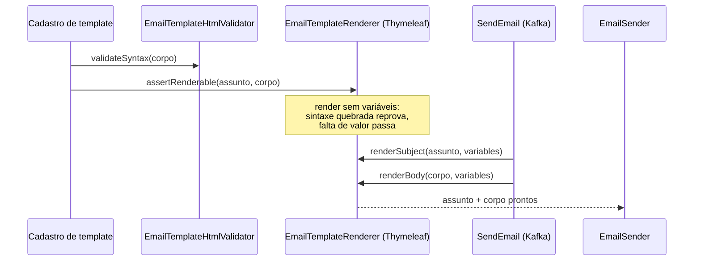

# Renderização do template com Thymeleaf

> **Em uma frase:** o template guardado no banco é preenchido pelo Thymeleaf com as variáveis do `SendEmail` — o assunto como texto, o corpo como HTML com escape automático — e, no cadastro, um render "a seco" reprova erro de sintaxe sem exigir valores.

⬅️ Anterior: [Validação do HTML do template](./02-validacao-de-html-do-template.md) · ➡️ Próximo: [Envio de e-mail por SMTP](./04-envio-de-email-por-smtp.md) · 🧭 Trilha: [README](../README.md#trilha-de-leitura)

---

## O problema

O comando `SendEmail` chega com três coisas: o destinatário, o id do template e as **variáveis**.

```json
{ "recipient": { "name": "John Doe" }, "templateId": "...", "variables": { "orderId": "ORD-1", "items": [ ... ] } }
```

O template é um texto guardado no banco, cheio de marcações como `${recipient.name}`. Alguém precisa juntar os dois e produzir o e-mail final: um assunto e um corpo HTML.

E há dois riscos:

- uma variável com `<script>` no nome do produto virar código dentro do e-mail;
- um template salvo com expressão quebrada (`${`) só falhar na hora de mandar, para todos os clientes.

## A ideia

Usar o **Thymeleaf** fora do Spring MVC, como um "preenchedor de texto".

O Thymeleaf costuma ler arquivos de `src/main/resources/templates`. Aqui o template vem do **banco**, como string. Por isso o resolver é o `StringTemplateResolver`: ele trata o próprio texto recebido como o template.

São **duas engines**, uma para cada parte do e-mail:

| | Assunto | Corpo |
|---|---|---|
| Modo | `TemplateMode.TEXT` | `TemplateMode.HTML` |
| Por quê | Assunto é texto puro, sem tags | Corpo é HTML, com `th:*` nos elementos |
| Sintaxe típica | `Order [[${orderId}]] received` | `<span th:text="${recipient.name}">customer</span>` |
| Saída | `Order ORD-1 received` | `<span>John Doe</span>` |

### Escape automático

No modo HTML, `th:text` e `[[...]]` **escapam** o valor. Um produto chamado `<script>alert(1)</script>` vira `&lt;script&gt;...` e aparece como texto, sem executar.

| Escapa (use) | Não escapa (evite com dado de fora) |
|---|---|
| `th:text`, `[[${...}]]` | `th:utext`, `[(${...})]` |

É a segunda metade da segurança. A [validação do HTML](./02-validacao-de-html-do-template.md) olha o **template**; o escape protege contra as **variáveis**.

## Como funciona no AlgaShop



> Quem chama o renderer: o cadastro de templates ([doc 05](./05-api-de-templates.md)) e o envio ([doc 06](./06-api-de-envio-de-emails.md)).

### `assertRenderable`: render "a seco"

No cadastro ainda não existem valores. Então o renderer processa o template com **variáveis vazias** e olha **por que** falhou:

| Falha | Exemplo | Resultado |
|---|---|---|
| Sintaxe | `th:text="${"` | **reprova** (`TemplateRenderException`) |
| Avaliação | `${order.id}` com `order` nulo | **passa**: só falta o valor, que chega no envio |

Para saber qual é qual, ele percorre a cadeia de causas da exceção atrás de uma `EvaluationException` do SpEL.

Assunto e corpo são checados **cada um no seu try**. Se fosse um só, a falta de valor no assunto pararia tudo e um corpo quebrado passaria sem ser lido.

### Variáveis que vêm de JSON

As variáveis atravessam o Kafka como JSON. No Java elas viram `Map`, `List`, `String` e números — não `LocalDate` nem objetos de domínio. Isso muda como o template é escrito:

- **Objeto aninhado:** `${recipient.name}` funciona em `Map` (o SpEL lê a chave).
- **Lista:** `th:each="item : ${items}"` repete a linha da tabela.
- **Data:** chega como string ISO (`2026-10-15`). O template monta `dd/MM/yyyy` com `#strings.substring`.
- **Dinheiro:** `${#numbers.formatCurrency(totalAmount)}` usa o `Locale` da engine.

O `Locale` é fixo em `Locale.US` (contratos e templates em inglês): `$1,234.50`.

## Como aplicar

1. Crie a porta na aplicação com `renderSubject`, `renderBody` e `assertRenderable`.
2. Use `StringTemplateResolver` quando o template vier do banco.
3. Uma engine `TEXT` para o assunto e uma `HTML` para o corpo.
4. Fixe o `Locale` no `Context` (senão vale o da máquina, e o e-mail muda de servidor para servidor).
5. No cadastro, renderize sem variáveis e só reprove erro de sintaxe.
6. Embrulhe as exceções do Thymeleaf numa exceção da aplicação (`TemplateRenderException`).
7. Teste com templates reais (Welcome, Order Placed), não só com `<p>[[${x}]]</p>`.

## Para lembrar

- Template no banco → `StringTemplateResolver`.
- Assunto = `TEXT`; corpo = `HTML`.
- `th:text` e `[[...]]` escapam; `th:utext` e `[(...)]` não.
- Variável ausente vira vazio, não erro: `Hi [[${name}]]!` → `Hi !`.
- No cadastro: sintaxe reprova, falta de valor passa.
- Variáveis de JSON são `Map`/`List`/`String`: formate data e dinheiro no template.

## Cuidados

- **O template é código.** Quem tem `email-templates:write` escreve expressões SpEL. O Thymeleaf 3.1 bloqueia `T(...)` e classes `java.*`, e a engine não tem `ApplicationContext` (sem acesso a beans), mas o escopo de escrita continua sendo de confiança.
- **Render a seco não cobre tudo.** Se a avaliação falha no começo do corpo, o resto não é processado naquela chamada; um erro de sintaxe mais abaixo pode passar.
- **Variável ausente não avisa.** Um nome errado no template (`${recipent.name}`) gera um e-mail com buraco, sem erro.
- **Sem cache** (`setCacheable(false)`): cada envio reparsa o template. Simples e sem memória presa a textos antigos, mas custa CPU.

## Pendências

- ~~Ligar o renderer ao `SendEmailApplicationService`~~ — feito ([doc 06](./06-api-de-envio-de-emails.md)). ~~E o `assertRenderable` ao cadastro~~ — feito ([doc 05](./05-api-de-templates.md)).
- ~~Mapear `TemplateRenderException` para 422~~ — o `ApiExceptionHandler` já mapeia.
- Decidir se o `Locale` deve vir do destinatário (hoje é fixo em `US`).
- Detectar variável usada no template e ausente no comando (hoje vira vazio em silêncio).

## Testes

- `./gradlew check` no notifications, 09/11/2026: **103 testes, 0 falhas**.
  - `EmailTemplateRendererThymeleafImplTest`: 7 (variável simples, aninhada, ausente; `assertRenderable` com falta de valor, com sintaxe quebrada e com falta de valor no assunto + corpo quebrado).
  - `OrderPlacedEmailTemplateTest`: 9 (assunto, saudação, data `dd/MM/yyyy`, tabela vazia, separador de milhar, escape de `<script>`, sem `th:*` na saída, `assertRenderable` e validação do HTML).
  - `WelcomeEmailTemplateTest`: 8.
  - `EmailTemplateHtmlValidatorJsoupImplTest`: 79.
- Cobertura (jacoco) do `EmailTemplateRendererThymeleafImpl`: **100% das linhas e dos ramos**.

## Onde ver no código

- `EmailTemplateRenderer` (notifications, aplicação): a porta.
- `EmailTemplateRendererThymeleafImpl` (notifications, infraestrutura): as duas engines, o `Context` com `Locale` e o render a seco.
- `TemplateRenderException` (notifications, aplicação): a falha de render vista pela aplicação.
- `OrderPlacedEmailTemplateTest` e `WelcomeEmailTemplateTest`: os dois templates reais do contrato, ponta a ponta.
