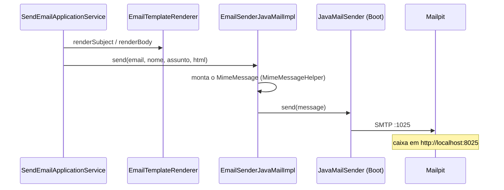

# Envio de e-mail por SMTP

> **Em uma frase:** o e-mail já renderizado sai por SMTP pelo `JavaMailSender` do Spring Boot, atrás da porta `EmailSender`; em desenvolvimento, o servidor é o Mailpit, que aceita tudo, não entrega nada e mostra a caixa de entrada no navegador.

⬅️ Anterior: [Renderização do template com Thymeleaf](./03-renderizacao-do-template-com-thymeleaf.md) · ➡️ Próximo: [API de cadastro de templates](./05-api-de-templates.md) · 🧭 Trilha: [README](../README.md#trilha-de-leitura)

---

## O problema

Depois do render, o `notifications` tem um assunto e um corpo HTML prontos. Falta **entregar**.

E-mail sai por um protocolo próprio, o **SMTP**: o serviço conversa com um servidor de e-mail, e é esse servidor que leva a mensagem até a caixa do cliente.

Em desenvolvimento, aparece um segundo problema: não dá para mandar e-mail de verdade. Endereços de teste (`john@email.com`) existem de verdade em algum lugar, e um bug num laço mandaria centenas de mensagens.

## A ideia

Duas peças:

1. **Porta e adapter.** A aplicação só conhece a porta `EmailSender.send(toEmail, toName, subject, htmlBody)`. Quem sabe falar SMTP é o adapter `EmailSenderJavaMailImpl`, na infraestrutura. Trocar SMTP por uma API (SES, SendGrid) mexe só no adapter.
2. **SMTP falso em desenvolvimento.** O **Mailpit** é um servidor SMTP que aceita qualquer mensagem e não entrega nenhuma. Ele guarda tudo numa caixa de entrada que você abre no navegador. É o mesmo que o authorization server já usa para a [verificação de e-mail](../05-seguranca/09-verificacao-de-email-e-troca-de-senha.md).

| Porta | Para quê |
|---|---|
| **1025** | SMTP: onde o serviço entrega |
| **8025** | Web e API: <http://localhost:8025> |

O Mailpit sobe com o `docker-compose.tools.yml` (veja [Ambiente local](../04-infraestrutura/01-ambiente-local.md)).

## Como funciona no AlgaShop

> O `SendEmailApplicationService` junta render e envio na [API de envio](./06-api-de-envio-de-emails.md).

### Montar a mensagem

O `MimeMessageHelper` monta o e-mail com quatro escolhas:

- **UTF-8:** acento no assunto e no nome ("João") chega certo.
- **Destinatário com nome:** `InternetAddress(email, nome)`. O cliente vê `John Doe <john@...>`, não só o endereço.
- **Corpo HTML:** `setText(html, true)`; o `true` diz "isto é HTML".
- **Multipart:** abre espaço para anexo e imagem inline (`cid:logo`), que o template já pode citar.

### Duas configurações, dois donos

| Propriedade | Dono | Exemplo (dev) | Para quê |
|---|---|---|---|
| `spring.mail.host` / `port` | Spring Boot | `localhost` / `1025` | Onde fica o servidor SMTP; o Boot cria o `JavaMailSender` a partir delas |
| `algashop.notifications.mail.from` | Nosso (`MailProperties`) | `no-reply@algashop.local` | Quem aparece como remetente |

O remetente muda por ambiente, por isso é config e não constante no código. `MailProperties` tem `@Validated` e `@NotBlank`: se o `from` faltar, a aplicação **nem sobe**. O erro aparece no boot, não no primeiro e-mail do cliente.

### Falha ao montar × falha ao enviar

O código separa as duas de propósito:

| Falha | Exemplo | Exceção | Repetir resolve? |
|---|---|---|---|
| Montar | endereço inválido, encoding | `MailPreparationException` | Não: o dado está ruim |
| Enviar | SMTP fora do ar, timeout | `MailException` do próprio `send` | Talvez: vale retentativa |

Essa diferença vai importar quando o consumidor do `SendEmail` existir: a primeira deve ir direto para a DLT, a segunda merece retry com backoff (o mesmo raciocínio de [Resiliência no consumer](../06-mensageria/07-resiliencia-no-consumer.md)).

## Como aplicar

1. Adicione `spring-boot-starter-mail` e configure `spring.mail.host`/`port`.
2. Crie a porta `EmailSender` na aplicação e o adapter com `JavaMailSender` na infraestrutura.
3. Monte com `MimeMessageHelper` em UTF-8, com nome no destinatário e `setText(html, true)`.
4. Ponha o remetente numa classe `@ConfigurationProperties` validada.
5. Separe falha de montagem (não retentável) de falha de envio (retentável).
6. Em desenvolvimento, aponte para o Mailpit e confira em `:8025`.

## Para lembrar

- A aplicação conhece a porta `EmailSender`; o SMTP fica no adapter.
- `spring.mail.*` é do Boot; `algashop.notifications.mail.from` é nosso.
- `@Validated` no `from`: falha no boot, não no envio.
- Mailpit: SMTP em 1025, caixa em 8025, nada sai para fora.
- Falha de montagem não se repete; falha de envio pode ser repetida.

## Cuidados

- **`localhost` dentro do compose** é o próprio container. Quando o notifications rodar em Docker, o host do SMTP precisa ser `algashop-mailpit` no perfil `docker-env`.
- **"Não lançou exceção" não é "chegou".** O SMTP aceitar a mensagem não prova que ela está na caixa; para isso existe a API do Mailpit.
- **SMTP é lento e externo.** Não deixe o envio dentro de uma transação de banco: ele segura a conexão enquanto espera o servidor.

## Pendências

- Perfis `docker-env` e `production-env` vazios: falta `spring.mail.host: algashop-mailpit` (e o datasource) no Docker; o notifications ainda não está no compose.
- O teste de integração prova só que o SMTP aceitou. Falta conferir a mensagem na API do Mailpit (`/api/v1/search?query=to:...`); o destinatário com UUID já prepara isso.
- Sem versão em texto puro (`multipart/alternative`): alguns clientes de e-mail preferem.
- ~~Ligar render + envio no `SendEmailApplicationService`~~ — feito ([doc 06](./06-api-de-envio-de-emails.md)). Retentativa e DLT chegam com o consumidor do `SendEmail`.

## Testes

- `./gradlew check`, 09/11/2026: **103 testes unitários, 0 falhas** (o `*IT` fica fora do `test`).
- `./gradlew integrationTest --tests '*EmailSenderJavaMailImplIT'` com o Mailpit no ar: **1 teste, passou**.
- Conferência manual na API do Mailpit (`GET :8025/api/v1/messages?limit=1`): chegou de `no-reply@algashop.local` para `John Doe <john-<uuid>@email.com>`, assunto `Order confirmed`.

## Onde ver no código

- `EmailSender` (notifications, aplicação): a porta.
- `EmailSenderJavaMailImpl` (notifications, infraestrutura): monta o `MimeMessage` e envia pelo `JavaMailSender`.
- `MailProperties` (notifications, infraestrutura): o remetente, validado na subida.
- `application-development-env.yml` (notifications): `spring.mail` apontando para o Mailpit e o `from`.
- `EmailSenderJavaMailImplIT` (notifications): envio real contra o Mailpit.
- `docker-compose.tools.yml` (meta): o serviço `algashop-mailpit`.
