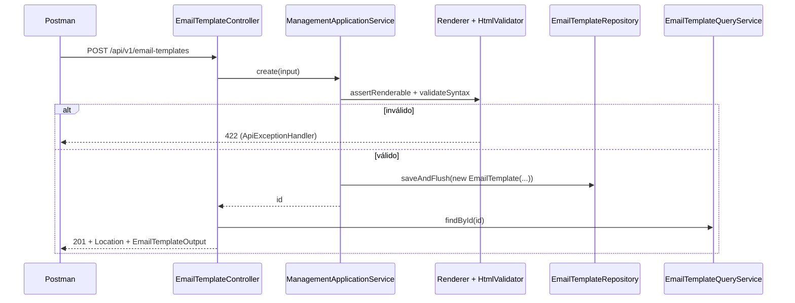

# API de cadastro de templates

> **Em uma frase:** os templates de e-mail ganham uma API REST que **valida antes de gravar** — o HTML pelo jsoup e a sintaxe pelo Thymeleaf — e guarda o assunto e o corpo no PostgreSQL, com id UUIDv7 gerado pela aplicação.

⬅️ Anterior: [Envio de e-mail por SMTP](./04-envio-de-email-por-smtp.md) · ➡️ Próximo: [API de envio de e-mails](./06-api-de-envio-de-emails.md) · 🧭 Trilha: [README](../README.md#trilha-de-leitura)

---

## O problema

As aulas anteriores criaram as peças soltas: o validador de HTML, o renderer e o sender. Mas um template ainda não tinha onde morar, nem por onde entrar.

O comando `SendEmail` chega com um `templateId`. Alguém precisa cadastrar esse template antes. E o cadastro é exatamente o lugar onde um template ruim deve ser barrado: depois de salvo, ele vai para todos os clientes.

## A ideia

Um CRUD comum, com uma regra que não é comum: **nada é gravado sem passar pelas duas validações**.

| Validação | Quem faz | O que pega | Resposta |
|---|---|---|---|
| Sintaxe do assunto e do corpo | `EmailTemplateRenderer.assertRenderable` | `th:text="${"`, expressão quebrada | 422 |
| HTML do corpo | `EmailTemplateHtmlValidator.validateSyntax` | HTML malformado, `<script>`, `onclick`, `javascript:` | 422 |
| Formato do pedido | Bean Validation (`@Valid`) | `name` em branco, mais de 100/255 caracteres | 400 |

O controller não sabe nada de validação de template: ele chama o serviço de aplicação, e as exceções viram status no `ApiExceptionHandler`.

## Como funciona no AlgaShop



### Escrita e leitura separadas

- **Escrita:** `EmailTemplateManagementApplicationService` (`create`, `update`, `delete`), cada método numa transação.
- **Leitura:** `EmailTemplateQueryService` (`findById`, `findAll`), `readOnly`, que **nunca devolve a entidade**, só o `EmailTemplateOutput`. A API não fica presa ao modelo JPA.

O controller junta os dois: depois de criar ou alterar, ele lê de novo pelo query service e devolve o resultado.

### A ordem dentro do `update`

1. **Procura** o template. Não existe? 404 — mesmo que o corpo também esteja inválido.
2. **Valida** o conteúdo novo. Falhou? 422, e o agregado **nem foi tocado**.
3. Só então troca nome, assunto e corpo e salva.

Validar antes dos setters é o que garante que um PUT inválido não muda o que já está salvo.

### O id nasce na aplicação: UUIDv7

O id é gerado no **construtor** da entidade, com `Generators.timeBasedEpochRandomGenerator().generate()`:

| | UUID gerado pelo banco | UUIDv7 na aplicação |
|---|---|---|
| Quando existe | Só depois do `INSERT` | Assim que o objeto nasce |
| Ordem | Aleatório (v4) | Cresce com o tempo, como um serial |
| Índice da PK | Inserção espalhada | Inserção no fim |

Tem uma pegadinha. O Spring Data decide entre `persist` (novo) e `merge` (existente) olhando o id. Se o id já vem preenchido, ele acharia que a entidade existe. Quem desempata é o `version`: na `AbstractAuditableAggregateRoot` ele é `Long`, e **`null` quer dizer "novo"**. Por isso ele não pode virar `long` primitivo (que começa em 0).

### Página no formato do contrato

`Page` direto vira um JSON enorme e instável. O `PagedModel` devolve o formato do contrato:

```json
{ "content": [ ... ], "page": { "size": 20, "number": 0, "totalElements": 1, "totalPages": 1 } }
```

### Banco e dados de teste

- `V001__create-table-email-template.sql` cria a tabela (`body` é `text`).
- `db/testdata/afterMigrate.sql` só entra no perfil de desenvolvimento: a cada subida, limpa a tabela e insere o **Order Placed** (`0198d0a1-2c44-7d0b-8e11-9a0b7c5d3f21`). Template criado pelo Postman some no próximo restart.
- `placeholder-replacement: false` no Flyway: os templates têm `${...}`, que o Flyway tentaria trocar como se fossem placeholders dele.
- O Postgres do compose escuta na **5433** do host (`5433:5432`); o datasource de desenvolvimento aponta para ela.

## Os endpoints

| Método | Rota | Sucesso | Erros |
|---|---|---|---|
| GET | `/api/v1/email-templates?page&size&sort` | 200 + página | 400 (`sort` por campo inexistente) |
| GET | `/api/v1/email-templates/{id}` | 200 | 404 |
| POST | `/api/v1/email-templates` | 201 + `Location` | 400, 422 |
| PUT | `/api/v1/email-templates/{id}` | 200 | 400, 404, 422 |
| DELETE | `/api/v1/email-templates/{id}` | 204 | 404 |

## Como aplicar

1. Crie a migration e a entidade estendendo a base auditável, com o id gerado no construtor.
2. Mantenha o `version` como `Long` para o Spring Data saber o que é novo.
3. No serviço de escrita: procure (404), valide (422), só então altere e salve.
4. No serviço de leitura: devolva DTO, nunca a entidade.
5. No controller: `@Valid` no corpo, `PagedModel` na listagem, `Location` com `ServletUriComponentsBuilder`.
6. Deixe o `ApiExceptionHandler` traduzir exceção em status.

## Para lembrar

- Template ruim é barrado na entrada: sintaxe (renderer) + HTML (validator).
- 400 = pedido malformado; 404 = não existe; 422 = existe/está bem formado, mas o conteúdo não presta.
- No `update`, 404 vem antes de 422, e validação falha **antes** de mexer no agregado.
- UUIDv7 nasce na aplicação; `version` nulo é o que marca "novo".
- Leitura devolve `EmailTemplateOutput`; a página sai no formato `content` + `page`.

## Cuidados

- **O 422 mostra só a primeira família de erros.** O renderer roda antes do validator; um corpo com sintaxe quebrada **e** `<script>` só reporta a sintaxe.
- **`sort` vem do cliente.** Um campo que não existe faz o Spring Data falhar ao montar o `ORDER BY` com `PropertyReferenceException`. Sem tratamento, vira 500; o `ApiExceptionHandler` devolve **400** citando só o nome pedido, sem expor a classe JPA. No Spring Data 4 a classe mora em `org.springframework.data.core` (antes era `data.mapping`).
- **`afterMigrate.sql` apaga a tabela** a cada subida em desenvolvimento. Nunca leve esse arquivo para outro perfil.
- **Não troque `Long version` por `long`:** o `save` passaria a fazer `merge` e uma busca extra a cada criação.

## Pendências

- ~~`sort` por campo inexistente responde 500~~ — corrigido: `PropertyReferenceException` → **400** `Invalid sort property: foo`.
- Sem segurança por enquanto (fora do desafio): o contrato pede `email-templates:read` e `email-templates:write`.
- Sem teste de integração do controller nem do repositório (o comportamento foi conferido à mão, abaixo).

## Testes

- `./gradlew check`, 09/11/2026: **112 testes, 0 falhas**. `EmailTemplateControllerSortTest` (`@WebMvcTest`, 1 teste): `?sort=foo` → 400 com `title` e `detail`. Novo: `EmailTemplateManagementApplicationServiceTest` (Mockito, 8 testes) — create válido salva e devolve um UUID versão 7 com `version` nulo; HTML proibido e sintaxe inválida não salvam; update e delete de id inexistente dão 404 sem validar; update inválido não altera a entidade; update válido troca os três campos; delete remove.
- Roteiro do enunciado contra o serviço rodando na 8084 (09/11/2026):

| # | Cenário | Esperado | Obtido |
|---|---|---|---|
| 1 | GET lista | 200 com Order Placed | 200, `['Order Placed']`, `page` no formato |
| 2 | POST válido | 201 + Location | 201, UUID v7, Location = id do corpo |
| 3 | GET Location | 200 | 200 |
| 4 | PUT válido + GET | 200, alterado | 200, `Welcome v2` |
| 5 | PUT com `<script>` | 422, nada muda | 422 `Element <script> is not allowed`; GET segue `Welcome v2` |
| 6 | POST com `<script>` e `onclick` | 422 listando | 422 com as duas violações |
| 7 | POST `th:text="${"` | 422 | 422 `template parsing` |
| 8 | POST do Order Placed (variáveis) | 201 | 201 |
| 9 | POST `name` em branco | 400 | 400 |
| 10 | DELETE + GET | 204, depois 404 | 204, 404 |
| 11 | PUT/DELETE de id removido | 404 | 404, 404 (PUT com `<script>` também 404) |
| 12 | `?size=1&sort=name,asc` | página de 1 | `size: 1` |
| 13 | `?sort=foo` | 400 | 400 `Invalid sort property: foo` (instância temporária na 18084 com o código novo; `?sort=name,desc` segue 200) |

## Dados de teste (Postman)

Base: `http://localhost:8084/api/v1/email-templates`, `Content-Type: application/json`, sem token.

**Criar (201):**
```json
{
  "name": "Welcome",
  "subject": "Welcome to AlgaShop, [[${recipient.name}]]!",
  "body": "<p>Hello, <span th:text=\"${recipient.name}\">customer</span>! Use <strong th:text=\"${couponCode}\">COUPON</strong> on your first order.</p>"
}
```

**Alterar (PUT no Location, 200):**
```json
{ "name": "Welcome v2", "subject": "Hi [[${recipient.name}]]", "body": "<p>Hi again, <span th:text=\"${recipient.name}\">customer</span>!</p>" }
```

**HTML com conteúdo ativo (POST/PUT, 422):**
```json
{ "name": "Bad", "subject": "Hi", "body": "<p onclick=\"alert(1)\">Hi</p><script>alert(1)</script>" }
```

**Sintaxe inválida (422):**
```json
{ "name": "Bad", "subject": "Hi", "body": "<p th:text=\"${\">x</p>" }
```

**Corpo inválido (400):**
```json
{ "name": "", "subject": "Hi", "body": "<p>x</p>" }
```

**Template com variáveis:** faça `GET /0198d0a1-2c44-7d0b-8e11-9a0b7c5d3f21` (Order Placed), copie `subject` e `body` e mande num POST com outro `name`.

## Onde ver no código

- `EmailTemplate` e `EmailTemplateRepository` (notifications, domínio): o agregado e o repositório JPA.
- `EmailTemplateManagementApplicationService` (notifications, aplicação): escrita com validação antes de gravar.
- `EmailTemplateQueryServiceImpl` (notifications, infraestrutura/persistência): leitura que devolve `EmailTemplateOutput`.
- `EmailTemplateController` (notifications, apresentação): os cinco endpoints.
- `ApiExceptionHandler` (notifications, apresentação): 404, 422 e 400 para `sort` inválido.
- `V001__create-table-email-template.sql` e `db/testdata/afterMigrate.sql`: tabela e o Order Placed.
- [`openapi/notifications.yml`](../openapi/notifications.yml): o contrato.
