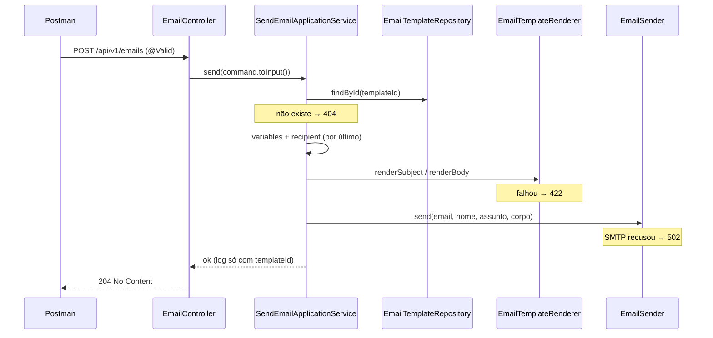

# API de envio de e-mails

> **Em uma frase:** `POST /api/v1/emails` recebe um **comando** de envio (destinatário, template e variáveis), carrega o template salvo, renderiza assunto e corpo com o destinatário protegido e entrega ao SMTP — respondendo 204, e cada falha com o seu status.

⬅️ Anterior: [API de cadastro de templates](./05-api-de-templates.md) · ➡️ Próximo: — · 🧭 Trilha: [README](../README.md#trilha-de-leitura)

---

## O problema

Todas as peças existem: o template está no banco, o renderer preenche, o sender entrega. Falta o **caso de uso** que junta tudo, e uma porta para chamá-lo.

E três cuidados aparecem quando as peças se juntam:

- o template precisa do destinatário (`${recipient.name}`), mas o cliente **não pode** trocá-lo por outro via `variables`;
- um pedido malformado não pode nem chegar ao caso de uso;
- o log não pode guardar e-mail nem variáveis: são dados pessoais.

## A ideia

### Comando, não requisição

O corpo do POST é o `SendEmailIntegrationCommand`. O nome é de **comando** ("envie este e-mail"), não de requisição HTTP, porque o mesmo tipo vai chegar pelo Kafka, no tópico `notifications.email.commands`. A API REST é só a primeira porta de entrada.

O caso de uso **não conhece** esse DTO. Ele recebe o `SendEmailInput`, e o DTO se converte com `toInput()`. Trocar a porta (REST → Kafka) não mexe no caso de uso.

### Validação que desce para dentro

| Campo | Regra |
|---|---|
| `recipient` | obrigatório, e `@Valid` para validar o que tem dentro |
| `recipient.email` | obrigatório, endereço válido, até 254 caracteres |
| `recipient.name` | obrigatório |
| `templateId` | obrigatório (UUID) |
| `variables` | opcional |

A Bean Validation **não desce sozinha** para objetos aninhados. Sem o `@Valid` no `recipient`, um `email` em branco passaria.

### O destinatário sempre vence

O template enxerga as `variables` do comando **mais** a variável `recipient` (`email` e `name`). O `recipient` é colocado **por último** no mapa: se `variables` trouxer uma chave `recipient`, ela é sobrescrita.

Sem isso, alguém mandaria o e-mail para João com `variables.recipient.name = "Equipe de Segurança"` na saudação.

## Como funciona no AlgaShop



A ordem importa: **nada é enviado** antes de o template existir e de assunto **e** corpo estarem renderizados. Um corpo que falha no meio nunca vira e-mail pela metade.

O caso de uso **não captura** exceções. Quem traduz em status é o `ApiExceptionHandler`; no consumidor Kafka, quem vai decidir entre retry e DLT é o error handler.

| Status | Quando | Exceção |
|---|---|---|
| **204** | o SMTP aceitou o e-mail | — |
| **400** | corpo inválido | Bean Validation |
| **404** | template não existe | `TemplateNotFoundException` |
| **422** | assunto ou corpo não renderizam | `TemplateRenderException` |
| **502** | SMTP fora do ar ou recusou | `MailException` |

Todos os erros saem em `application/problem+json`.

### Variáveis que vêm do JSON

O Jackson converte o JSON em `Map`, `List`, `String` e números. Números viram números (`49.9` → `Double`), e datas continuam **texto**. Por isso o Order Placed formata `placedAt` com `#strings.substring` e o dinheiro com `#numbers.formatCurrency` (veja [Renderização](./03-renderizacao-do-template-com-thymeleaf.md)).

## Como aplicar

1. Modele o corpo como **comando** e reaproveite o tipo nas outras portas.
2. `@Valid` no objeto aninhado, além de `@Valid` no `@RequestBody`.
3. Converta o DTO no input do caso de uso; o caso de uso não importa nada da apresentação.
4. Carregue o recurso, prepare tudo, e só então faça o efeito colateral (enviar).
5. Ponha os dados do sistema **depois** dos dados do cliente no mapa de variáveis.
6. Não capture exceções no caso de uso; deixe a borda traduzir.
7. Logue identificadores, nunca dados pessoais.

## Para lembrar

- `SendEmailIntegrationCommand` = comando; serve à API e ao Kafka.
- Sem `@Valid` no `recipient`, os campos dele não são validados.
- `recipient` entra por último: o destinatário real sempre vence.
- Ordem: template (404) → render (422) → envio (502) → 204.
- Log com `templateId`, sem e-mail e sem variáveis.

## Cuidados

- **204 quer dizer "o SMTP aceitou"**, não "chegou na caixa". Um endereço que não existe só falha depois, no servidor de destino.
- **Uma variável que falta não dá erro.** Sem `variables`, o Order Placed é enviado com campos vazios (testado: 204). O e-mail sai feio, mas sai.
- **Falha de montagem também vira 502.** `MailPreparationException` é uma `MailException`, então um problema de dado na mensagem responde como se fosse o SMTP.
- **Sem idempotência na API.** Dois POSTs iguais mandam dois e-mails. A deduplicação vem com o consumidor Kafka.

## Pendências

- Diferenciar `MailPreparationException` (dado ruim) de `MailSendException` (SMTP) no `ApiExceptionHandler`.
- Sem segurança por enquanto (fora do desafio): o contrato pede o escopo `emails:send`.
- Sem teste de integração do controller; o roteiro abaixo foi conferido à mão.

## Testes

- `./gradlew check`, 10/11/2026: **118 testes, 0 falhas**. Novo: `SendEmailApplicationServiceTest` (Mockito, 6): template inexistente → 404 sem renderizar nem enviar; envio feliz usa o que está salvo e o destinatário do comando; `recipient` falso em `variables` não sobrescreve; `variables` nulo expõe só `recipient`; falha de render não envia; falha de SMTP propaga.
- Roteiro do enunciado numa instância temporária na 18084 (código novo, banco `notifications_test`), com o Mailpit:

| Cenário | Resultado |
|---|---|
| Envio completo | 204; no Mailpit: para `John Doe`, assunto `Order ORD-1001 received`, saudação, os 2 itens, `$2,500.00`, `$50.00`, `$49.90`, `$2,599.90`, `09/10/2026` e `15/10/2026` |
| `recipient` falso em `variables` | 204; e-mail para o destinatário do comando, saudação "John Doe", nada para `evil@example.com` |
| Template inexistente | 404, `application/problem+json` |
| E-mail inválido / em branco, nome em branco, sem `recipient`, sem `templateId` | 400 nos cinco, `application/problem+json` |
| Sem `variables` | 204 |
| Mailpit parado | 502 `Email delivery failed` |
| Mailpit de volta | 204, e-mail chegou |
| Log | `Email sent: templateId=0198d0a1-...`, sem endereço nem variáveis |

## Dados de teste (Postman)

`POST http://localhost:8084/api/v1/emails`, `Content-Type: application/json`, sem token. Caixa em <http://localhost:8025>.

**Envio completo (204):**
```json
{
  "recipient": { "email": "john.doe@example.com", "name": "John Doe" },
  "templateId": "0198d0a1-2c44-7d0b-8e11-9a0b7c5d3f21",
  "variables": {
    "orderId": "ORD-1001",
    "placedAt": "2026-10-09T14:30:00.123-03:00",
    "expectedDeliveryDate": "2026-10-15",
    "shippingCost": 49.9,
    "totalAmount": 2599.9,
    "items": [
      { "productName": "Notebook Alga", "quantity": 1, "price": 2500.0, "totalAmount": 2500.0 },
      { "productName": "Mouse Pro", "quantity": 2, "price": 25.0, "totalAmount": 50.0 }
    ]
  }
}
```

**Destinatário protegido:** o mesmo corpo, com `"recipient": { "email": "evil@example.com", "name": "Mallory" }` **dentro de `variables`**. O e-mail vai para John Doe e diz "Hello, John Doe".

**404:** troque o `templateId` por `00000000-0000-7000-8000-000000000000`.

**400:** `"email": "nao-e-email"`, `"email": ""`, `"name": ""`, sem `recipient` ou sem `templateId`.

**502:** `docker compose -f docker-compose.tools.yml stop algashop-mailpit`, repita o envio; depois `start algashop-mailpit` e repita (204).

## Onde ver no código

- `SendEmailIntegrationCommand` (notifications, `application.email.command`): o comando e a validação.
- `EmailController` (notifications, apresentação): `POST /api/v1/emails` → 204.
- `SendEmailApplicationService` (notifications, aplicação): carrega, monta variáveis, renderiza, envia, loga.
- `SendEmailInput` (notifications, aplicação): o que o caso de uso recebe.
- `ApiExceptionHandler` (notifications, apresentação): 404, 422 e 502.
- [`openapi/notifications.yml`](../openapi/notifications.yml): o schema `SendEmail`.
