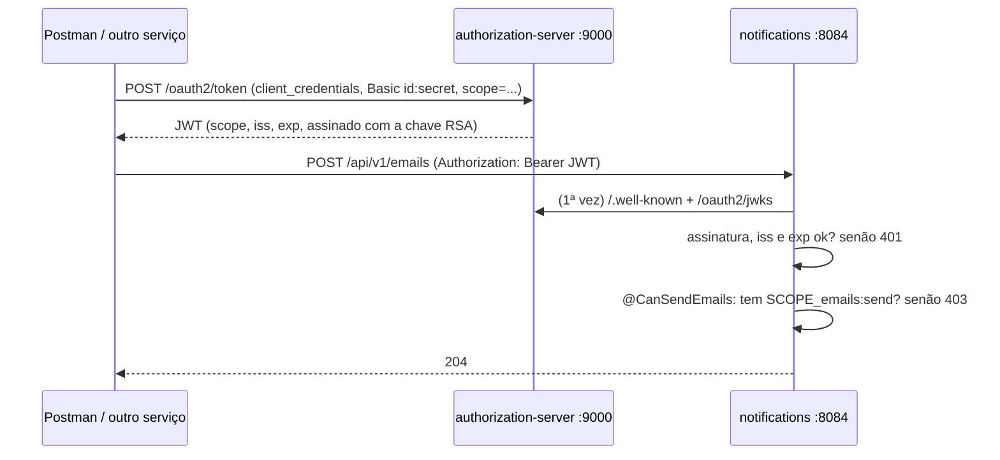

# Segurança: o notifications como resource server

> **Em uma frase:** a porta 8084 fecha. Toda chamada precisa de um JWT válido, emitido pelo authorization server, e cada endpoint exige o seu escopo — `emails:send`, `email-templates:read` ou `email-templates:write`.

⬅️ Anterior: [API de envio de e-mails](./06-api-de-envio-de-emails.md) · ➡️ Próximo: — · 🧭 Trilha: [README](../README.md#trilha-de-leitura)

---

## O problema

Até aqui a API do notifications estava aberta. Qualquer um que alcançasse a 8084 podia:

- mandar e-mail em nome da loja (`POST /api/v1/emails`);
- trocar o HTML de um template que vai para todos os clientes.

Os outros serviços já exigem token desde o [módulo de segurança](../05-seguranca/03-resource-server-e-escopos.md). O notifications precisa entrar no mesmo padrão.

## A ideia

São **duas pontas**:

| Ponta | Papel | O que muda |
|---|---|---|
| `authorization-server` | **emite** o token | conhece o cliente `algashop-notifications-service` e os três escopos novos |
| `notifications` | **exige e valida** o token | vira resource server: confere assinatura, emissor e validade, e exige um escopo por endpoint |

O notifications nunca vê senha nem secret. Ele só baixa a **chave pública** do authorization server (`/oauth2/jwks`) e confere a assinatura do JWT.

## Como funciona no AlgaShop



### Ponta 1: o cliente no authorization server

O cliente `algashop-notifications-service` é **de máquina** (`client_credentials`), autentica com `client_secret_basic`, tem os três escopos e recebe um JWT de 1 hora.

O secret **não fica no YAML**. O YAML referencia `${auth.params.clients.algashop-notifications-service.secret}`, que vem do Parameter Store (LocalStack). O valor fica em `etc/aws/parameters.csv`, já com hash:

```
/config/algashop/authorization-server/clients/algashop-notifications-service/secret,SecureString,{bcrypt}$2a$12$...
```

- `{bcrypt}` diz ao `DelegatingPasswordEncoder` qual algoritmo usar.
- O CSV só é lido quando o **LocalStack inicia**. Linha nova = reiniciar o LocalStack e depois o authorization server.

### Ponta 2: o notifications valida

**Issuer:** o `issuer-uri` vem de `algashop.integrations.authorization-server.url`, que lê o parâmetro compartilhado `/config/algashop/shared/auth-server-url` (`http://auth.algashop.local:9000`). É a mesma fonte dos outros serviços: o endereço muda num lugar só.

> O enunciado do curso fala em 8081. No AlgaShop o authorization server roda na **9000**, e o `iss` do token precisa bater com o `issuer-uri` letra por letra.

**Filtro (`NotificationsSecurityConfig`):** stateless, sem CSRF e sem CORS, toda requisição autenticada por JWT, exceto `/actuator/health/**` e `/actuator/info/**`.

**Escopo por método:** `@EnableMethodSecurity` liga o `@PreAuthorize`. Para não repetir a SpEL, há meta-anotações com nome de negócio:

| Endpoint | Anotação | Escopo |
|---|---|---|
| `POST /api/v1/emails` | `@CanSendEmails` | `emails:send` |
| `GET /api/v1/email-templates` e `/{id}` | `@CanReadEmailTemplates` | `email-templates:read` |
| `POST`, `PUT`, `DELETE /api/v1/email-templates` | `@CanWriteEmailTemplates` | `email-templates:write` |

O escopo chega no claim `scope` do JWT e vira a autoridade `SCOPE_<escopo>`.

### 401 × 403

| Status | Quando | Quem responde |
|---|---|---|
| **401** | sem token, token adulterado ou expirado | Spring Security, **sem corpo**, com `WWW-Authenticate: Bearer ...` |
| **403** | token válido, mas sem o escopo da operação | Spring Security, **sem corpo** |

O `ApiExceptionHandler` **não** trata essas exceções de propósito: se tratasse, o 403 sairia em `application/problem+json`, fora do contrato.

### Ordem: 400 antes de 403

O `@Valid` do corpo e a conversão do `{id}` acontecem **antes** do `@PreAuthorize`. Um corpo inválido com o escopo errado responde 400, não 403. Para testar o 403, mande corpo válido e id em formato UUID.

## Como aplicar

1. No authorization server: registre o cliente com grant, autenticação, escopos e TTL; o secret vai para o Parameter Store com `{bcrypt}`.
2. Reinicie o LocalStack (carrega o CSV) e depois o authorization server.
3. No serviço: starter `oauth2-resource-server` e `issuer-uri` lido da mesma fonte dos outros serviços.
4. `SecurityFilterChain` stateless, autenticado por padrão, só o health/info abertos.
5. `@EnableMethodSecurity` + meta-anotações de escopo em cada endpoint.
6. Teste a matriz: sem token (401), escopo errado (403), escopo certo (passa).

## Para lembrar

- Authorization server **emite**; resource server **valida e exige**.
- Secret no Parameter Store, com `{bcrypt}`; nunca no YAML.
- `issuer-uri` igual ao `iss` do token (aqui: 9000).
- Sem `@EnableMethodSecurity`, as anotações não fazem nada — e nada avisa.
- 401 = quem é você?; 403 = sei quem é, mas não pode. Os dois sem corpo.
- `@Valid` roda antes do escopo: 400 pode esconder um 403.

## Cuidados

- **Um `$` a mais estraga o hash.** O CSV chegou com `{bcrypt}$$2a$12$...`; o BCrypt não reconhece e o cliente nunca autentica. O certo é `{bcrypt}$2a$...`.
- **Não copie o `config.import` de outro serviço.** Importar `/config/algashop/ordering` no notifications traz parâmetros que não são dele; aqui só o `shared` interessa.
- **Reiniciar o LocalStack gera uma chave RSA nova.** Serviços que já estavam no ar guardaram a chave antiga e passam a recusar tokens novos com 401 até reiniciarem.
- **Teste não pode depender do LocalStack.** Os testes do notifications usam o perfil `test` (base + test-env), que não importa nada da AWS; nos testes de MVC o `JwtDecoder` é mock.
- **O LocalStack separa os dados por conta.** Com a chave `LSIAQ...` os parâmetros ficam na conta `000000000042`; um `awslocal` com a chave padrão consulta outra conta e "não acha" nada.

## Pendências

- Os 16 testes de integração do authorization server (`AuthUserQueryServiceIT`, `LoginPageIT`) falham ao subir o contexto: `jwk.privateKey` e `jwk.privateKeyId` chegam nulos. A falha **já existia antes** deste desafio (conferido sem a mudança); causa ainda não investigada.
- Validação de audiência (`aud`): um token do notifications com o escopo certo vale em qualquer resource server que aceite esse escopo.
- Perfil `docker-env` do notifications segue vazio.

## Testes

- `notifications`, `./gradlew check`, 10/11/2026: **137 testes, 0 falhas**. Novo: `NotificationsAuthorizationMatrixTest` (`@WebMvcTest` + `jwt()`, 19): para os 6 endpoints, sem token → 401 com `WWW-Authenticate` e sem corpo; com os outros escopos → 403 sem corpo; com o escopo certo → 204/200/201; `/actuator/health` não é bloqueado. O `EmailTemplateControllerSortTest` passou a mandar token.
- `authorization-server`, `./gradlew check`: 39 unitários, 0 falhas; 16 de integração falhando (pendência acima, anterior ao desafio).
- Roteiro do enunciado, com o authorization server reiniciado e o notifications novo numa instância na 18084:

| Cenário | Resultado |
|---|---|
| Sem token: GET templates e POST emails | 401, sem corpo, `WWW-Authenticate: Bearer ...` |
| Token com um caractere trocado | 401 `invalid_token` (`Invalid signature`) |
| Três escopos | token 200 (`expires_in` 3599); GET 200; POST emails 204 e e-mail no Mailpit |
| Só `email-templates:read` | os dois GET 200; POST/PUT/DELETE de templates e POST emails 403, sem corpo |
| Só `emails:send` | POST emails 204; GET templates 403 |
| `scope=orders:read` | authorization server responde 400 `invalid_scope` |

## Dados de teste (Postman)

**Token:** `POST http://auth.algashop.local:9000/oauth2/token`
- Authorization: Basic Auth, usuário `algashop-notifications-service`, senha `123456`;
- Body `x-www-form-urlencoded`: `grant_type=client_credentials` e `scope=emails:send email-templates:read email-templates:write` (ou só o escopo do cenário).

**Chamada:** `Authorization: Bearer <access_token>` em `http://localhost:8084/api/v1/...`. Os corpos são os dos docs [05](./05-api-de-templates.md) e [06](./06-api-de-envio-de-emails.md).

## Onde ver no código

- `etc/aws/parameters.csv` (meta): o secret com `{bcrypt}`.
- `application-development-env.yaml` (authorization-server): o cliente `algashop-notifications-service`.
- `NotificationsSecurityConfig` (notifications, `infrastructure.security`): o filtro.
- `SecurityAnnotations` (notifications, `infrastructure.security.check`): as meta-anotações de escopo.
- `application-development-env.yml` (notifications): Parameter Store compartilhado e `issuer-uri`.
- `NotificationsAuthorizationMatrixTest` (notifications): a matriz de 401/403/2xx.
- Fundamentos: [Resource servers e escopos](../05-seguranca/03-resource-server-e-escopos.md) · [Segredos centralizados e a chave RSA](../05-seguranca/13-segredos-centralizados-e-chave-rsa.md).
