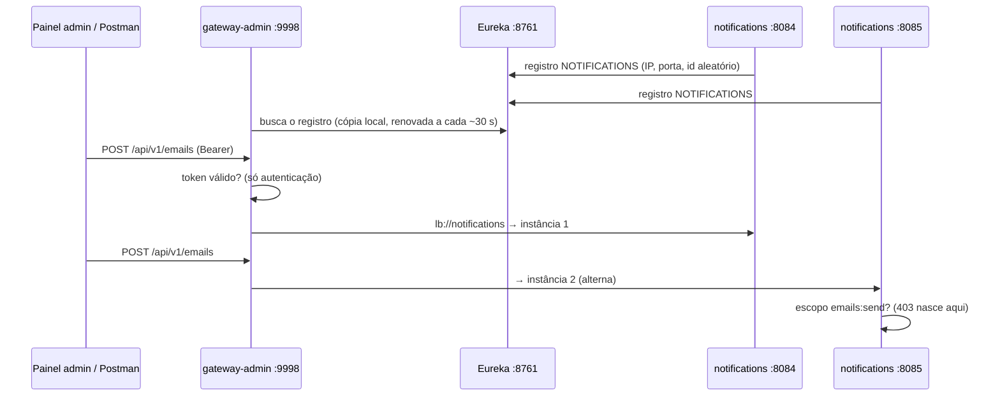

# Eureka e gateway-admin: o notifications entra na rede

> **Em uma frase:** o notifications se registra no Eureka como `NOTIFICATIONS`, e o gateway-admin passa a rotear `/api/v1/emails` e `/api/v1/email-templates` para `lb://notifications` — pelo nome, sem saber IP nem porta, e balanceando entre as instâncias.

⬅️ Anterior: [Segurança: resource server](./07-seguranca-resource-server.md) · ➡️ Próximo: — · 🧭 Trilha: [README](../README.md#trilha-de-leitura)

---

## O problema

Até aqui o notifications era chamado direto na `localhost:8084`. Isso tem três custos:

- quem chama precisa saber o endereço e a porta;
- uma segunda instância (8085) não recebe nada, porque ninguém sabe que ela existe;
- o painel admin teria uma porta de entrada a mais, fora do gateway.

Os outros serviços já resolveram isso com [service discovery](../04-infraestrutura/09-service-discovery.md) e com o [gateway por cliente](../04-infraestrutura/12-bff-e-gateways-por-cliente.md).

## A ideia

Duas pontas, de novo:

| Ponta | O que faz |
|---|---|
| **notifications** | se **anuncia** no Eureka: "sou `notifications`, estou no IP x, porta y" |
| **gateway-admin** | **procura** no Eureka: `lb://notifications` vira uma das instâncias vivas, escolhida pelo balanceador |

O gateway não conhece endereço. Ele conhece um **nome**.

## Como funciona no AlgaShop

### Ponta 1: o registro

- **Dependência:** `spring-cloud-starter-netflix-eureka-client`. Com ela no classpath, o serviço se registra sozinho.
- **Nome:** vem do `spring.application.name: notifications` e aparece em maiúsculas no painel (`NOTIFICATIONS`).
- **Onde fica o Eureka:** `defaultZone: ${shared.params.service-registry-url}/eureka`, o mesmo parâmetro compartilhado dos outros serviços (`http://algashop-service-registry:8761`, que o arquivo hosts aponta para `127.0.0.1`).
- **`instanceId: ${random.uuid}`:** duas instâncias na mesma máquina teriam o mesmo hostname; com um id aleatório, uma não sobrescreve a outra.
- **`prefer-ip-address: true`:** registra o IP, não o hostname. Dentro do Docker, o hostname do container não é alcançável de fora; o IP é.
- **Sem `healthcheck.enabled`:** ele só tem efeito com o Actuator, que ainda não existe no notifications.
- **Nos testes:** `eureka.client.enabled: false` no `test-env`. Teste que sobe contexto não tenta se registrar.

### Ponta 2: as rotas

| Rota | Path | Métodos | Por quê |
|---|---|---|---|
| `emails-route` | `/api/v1/emails` | `POST`, `OPTIONS` | o contrato só define POST |
| `email-templates-route` | `/api/v1/email-templates` e `/**` | `GET`, `POST`, `PUT`, `DELETE`, `OPTIONS` | listagem/criação na raiz, busca/troca/remoção no `/{id}` |

- O `OPTIONS` é o **preflight** de CORS do painel admin: o navegador pergunta antes de mandar o POST de verdade.
- Um método fora da lista **não casa** a rota: o gateway responde 404 e o notifications nem é chamado.
- `Path=/api/v1/email-templates` sozinho **não** casa `/api/v1/email-templates/{id}`. Por isso a rota tem os dois padrões: a raiz e o `/**`.

### Quem responde o quê

| Situação | Status | Quem responde |
|---|---|---|
| Sem token | 401 | **gateway** (ele só exige autenticação em `/api/**`) |
| Token válido sem o escopo | 403 | **notifications** (`insufficient_scope`): o gateway não olha escopo |
| Método fora da rota | 404 | **gateway** |
| Nenhuma instância no ar | 503 | **gateway** (depois que a cópia do registro atualiza) |

### Retry e e-mail duplicado

O gateway-admin aplica por padrão o filtro **Retry**, mas só para `GET` e `PUT`. Um `POST /api/v1/emails` que falha **não** é repetido pelo gateway, e por isso não gera e-mail em dobro. A garantia de verdade contra duplicidade (idempotência) vem depois.

## Como aplicar

1. No serviço: dependência do eureka-client, `defaultZone`, id aleatório e IP; cliente desligado nos testes.
2. No gateway: uma rota por recurso, `uri: lb://<spring.application.name>`, `Path` com a raiz **e** o `/**` quando houver `/{id}`.
3. Métodos da rota = métodos do contrato + `OPTIONS`.
4. Reinicie o gateway (o refresh de rotas está desligado).
5. Confira em `/actuator/gateway/routes` e no painel do Eureka.

## Para lembrar

- O gateway roteia por **nome**: `lb://notifications` precisa bater com o `spring.application.name`.
- `/x` não casa `/x/{id}`: use `/x` e `/x/**`.
- Gateway = autenticação; serviço = escopo. Por isso o 403 vem do notifications.
- Método fora do contrato para no gateway (404).
- O gateway trabalha com uma **cópia** do registro: instância nova ou morta leva até ~1 minuto para ser percebida.

## Cuidados

- **Um "s" a menos derruba tudo.** A rota chegou com `lb://notification`; o Eureka não tem esse nome, e toda chamada daria 503.
- **Arquivo de teste com o mesmo nome do main o esconde.** Um `src/test/resources/application-base.yml` sombreia o `application-base.yml` de `src/main` nos testes, e somem `placeholder-replacement: false`, `ddl-auto: none` e `open-in-view: false`. O arquivo foi removido.
- **Enquanto a cópia do registro não atualiza, a instância morta ainda é escolhida.** No teste, com todas paradas, o gateway respondeu **500** por ~37 s antes do **503**.
- **Instância nova também demora a receber tráfego.** Logo depois de subir a 8085, 10 POSTs foram todos para a 8084; um minuto depois, 5 e 5.

## Pendências

- Actuator no notifications e `eureka.client.healthcheck.enabled: true`, para o Eureka saber se a instância está saudável, e não só viva.
- O 500 da janela de registro desatualizado: avaliar retry/circuit breaker na rota do notifications (os do ordering já existem).
- Idempotência do `SendEmail`.
- O cliente `algashop-test` não tem os escopos do notifications; os testes usam `algashop-notifications-service`.

## Testes

- `notifications`, `./gradlew check`, 10/11/2026: **137 testes, 0 falhas** (o Eureka desligado no perfil de teste).
- `api-gateway-admin`: compila; não tem testes automatizados.
- Roteiro do enunciado, com registry, gateway-admin, authorization server, LocalStack, Postgres e Mailpit no ar (token do `algashop-notifications-service`):

| Cenário | Resultado |
|---|---|
| Registro | `NOTIFICATIONS` com 2 instâncias `UP` (8084 e 8085), registradas por IP |
| Rotas | `emails-route` e `email-templates-route` em `/actuator/gateway/routes`, ambas `lb://notifications` |
| GET templates pelo gateway | 200 com `Order Placed`; GET `/{id}` 200 |
| POST emails pelo gateway | 204; e-mail `Order ORD-1001 received` no Mailpit |
| Sem token | 401 no gateway |
| Só `email-templates:read` + PUT válido | 403 sem corpo, `insufficient_scope` (o gateway só exige autenticação: o 403 é do notifications) |
| DELETE `/api/v1/emails` | 404 do gateway |
| Duas instâncias, 10 POSTs | 5 na 8085 e 5 na 8084 (depois de a cópia do registro atualizar) |
| Todas paradas | 500 por ~37 s, depois 503 |

## Dados de teste (Postman)

- **Token:** igual ao [doc 07](./07-seguranca-resource-server.md) (cliente `algashop-notifications-service`, secret `123456`).
- **Chamadas:** troque `http://localhost:8084` por `http://localhost:9998`. Os corpos são os dos docs [05](./05-api-de-templates.md) e [06](./06-api-de-envio-de-emails.md).
- **Conferir:** <http://localhost:8761> (Eureka) e <http://localhost:9998/actuator/gateway/routes>.
- **Segunda instância:** `./gradlew bootRun --args='--server.port=8085'`.

## Onde ver no código

- `build.gradle` e `application-development-env.yml` (notifications): eureka-client e o bloco `eureka`.
- `src/test/resources/application-test-env.yml` (notifications): `eureka.client.enabled: false`.
- `application-base.yml` (api-gateway-admin): `emails-route` e `email-templates-route`.
- `GatewayAdminSecurityConfig` (api-gateway-admin): `/api/**` só autenticado — por isso o escopo é do serviço.
