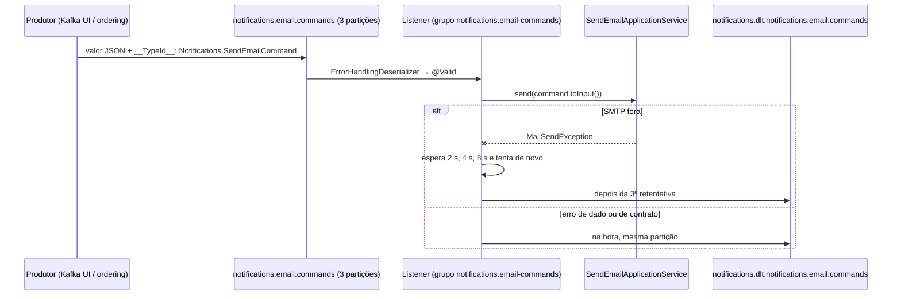

# Comandos de e-mail pelo Kafka

> **Em uma frase:** o notifications passa a receber o `SendEmail` também pelo tópico `notifications.email.commands`, entrega ao **mesmo** `SendEmailApplicationService` da API REST e decide, para cada falha, se vale tentar de novo (SMTP fora do ar) ou mandar direto para a DLT (todo o resto).

⬅️ Anterior: [Eureka e gateway-admin](./08-eureka-e-gateway-admin.md) · ➡️ Próximo: [Comando de e-mail a partir do ordering](./10-comando-de-email-a-partir-do-ordering.md) · 🧭 Trilha: [README](../README.md#trilha-de-leitura)

---

## O problema

A API REST obriga quem chama a esperar o SMTP responder. Para o ordering, isso é ruim:

- o checkout ficaria preso no servidor de e-mail;
- se o notifications estiver fora do ar, a chamada falha e o e-mail se perde.

O [conceito do módulo](./01-servico-de-notificacoes-conceito.md) já previa o caminho certo: o ordering publica um **comando** num tópico, e o notifications consome quando puder. O contrato está em [`asyncapi/notifications.yml`](../asyncapi/notifications.yml).

## A ideia

**Muda só a porta de entrada.** O comando é o mesmo `SendEmailIntegrationCommand` da [API de envio](./06-api-de-envio-de-emails.md), com a mesma Bean Validation, e o caso de uso é o mesmo. O listener só converte (`toInput()`) e delega.

A decisão nova é a das falhas. **Só vale retentar o que pode dar certo na próxima tentativa:**

| Falha | Exemplo | Destino | Por quê |
|---|---|---|---|
| SMTP fora do ar | `MailSendException` | **3 retentativas** (2 s, 4 s, 8 s) e depois DLT | pode ser temporário |
| Comando inválido | e-mail mal formado, `templateId` ausente | DLT **imediata** | o dado não vai mudar |
| Template inexistente | `TemplateNotFoundException` | DLT imediata | repetir não cria o template |
| Render quebrado | `TemplateRenderException` | DLT imediata | o template não vai se consertar |
| Mensagem que não monta | `MailParseException`, `MailPreparationException` | DLT imediata | dado ruim |
| Tipo desconhecido ou sem `__TypeId__` | `Notifications.Other` | DLT imediata | erro de contrato |
| Não é JSON | `isto não é json` | DLT imediata | ilegível |

## Como funciona no AlgaShop



### As peças

- **`__TypeId__` lógico:** o produtor grava `Notifications.SendEmailCommand` no header (o nome do contrato), e o `spring.json.type.mapping` traduz para a classe local. Produtor e consumidor não compartilham nomes de classe.
- **`KafkaConsumerTypeIdIdentifier`:** lê o header. Sem header ou com tipo não mapeado, devolve um `ObjectNode`, que cai no `@KafkaHandler(isDefault = true)`. Lá o comando **não é ignorado**: o handler lança `IllegalArgumentException`, que está na lista de não retentáveis.
- **`ErrorHandlingDeserializer`:** JSON ilegível vira `DeserializationException` e vai para a DLT, em vez de travar a partição.
- **`auto-offset-reset: earliest`:** um grupo que ainda não tem offset começa do início. Sem isso, os comandos publicados antes da primeira atribuição de partições se perderiam.
- **`KafkaBeanValidationConfigurer`:** sem um validator no `KafkaListenerEndpointRegistrar`, o `@Valid` do handler é ignorado, e um e-mail inválido só falharia no SMTP.
- **`KafkaConfig`:** declara os dois tópicos (3 partições, 3 réplicas, `min.insync.replicas=2`; a DLT com 30 dias de retenção), o `DeadLetterPublishingRecoverer` (prefixo `notifications.dlt.` e **mesma partição** de origem) e o `DefaultErrorHandler` (backoff exponencial e não retentáveis).
- **Produtor só para a DLT:** JSON, `acks=all` e idempotência, como nos outros serviços.
- **Listener:** `concurrency = 3`, uma thread por partição. A chave do registro é do produtor: aparece no log, mas o consumo não depende dela.

Validação do payload e desserialização **já são** não retentáveis no Spring Kafka. Por isso a lista do projeto declara só as exceções dele.

## Como aplicar

1. Reaproveite o DTO e o caso de uso da API; o listener só converte e delega.
2. `__TypeId__` lógico + mapping; handler default que **lança**, nunca que ignora.
3. `ErrorHandlingDeserializer` e `auto-offset-reset: earliest`.
4. Validator no registrar, para o `@Valid` funcionar.
5. Classifique as falhas: retentável só o que é temporário.
6. DLT com o mesmo número de partições e o registro na mesma partição de origem.

## Para lembrar

- Mesma regra, outra porta: REST e Kafka chegam ao mesmo `SendEmailApplicationService`.
- Retentar só o temporário (SMTP); o resto vai direto para a DLT.
- Tipo desconhecido é erro de contrato: vai para a DLT, não some.
- Sem validator no registrar, `@Valid` em Kafka é enfeite.
- A DLT guarda o conteúdo original + `kafka_dlt-*` (exceção, tópico, partição, offset e grupo de origem).

## Cuidados

- **Copiar do billing exige trocar os nomes.** O YAML chegou com `spring.json.value.type.method` apontando para `com.algaworks.algashop.billing...KafkaConsumerTypeIdIdentifier`, classe que não existe aqui: nenhuma mensagem seria lida.
- **O alias é o do contrato.** `Notifications.SendEmailIntegrationCommand` (nome da classe) no lugar de `Notifications.SendEmailCommand` (nome do contrato) faria **todo** comando válido cair no handler default e ir para a DLT.
- **Prefixo das propriedades.** `AlgaShopMessagingKafkaProperties` lê `algashop.messaging.kafka`; os nomes estavam em `algashop.integrations.messaging.kafka`, e o serviço não subia (`@NotBlank`).
- **Duas instâncias dividem as partições.** Com duas instâncias no ar, o grupo tem 6 consumidores (3 de cada), e cada partição vai para uma só thread.

## Pendências

- **Dado pessoal no log de erro:** quando a validação falha, o Spring Kafka registra o stack trace com o `failedMessage`, e o `toString()` do comando (Lombok `@Data`) mostra o e-mail e as variáveis. O log de **recebimento** está limpo; o de erro, não.
- Idempotência pelo header `idempotency-key` (desafio posterior): hoje um comando entregue duas vezes manda dois e-mails.
- Externalizar partições, réplicas e retenção (hoje fixos no `KafkaConfig`).
- ~~O produtor de verdade (ordering)~~ — feito no [doc 10](./10-comando-de-email-a-partir-do-ordering.md).

## Testes

- `./gradlew check`, 10/11/2026: **139 testes, 0 falhas**. Novo: `KafkaSendEmailIntegrationCommandListenerTest` (2): o handler converte e delega; o default lança e não envia.
- Roteiro do enunciado com uma instância minha (código novo) e o Kafka UI, publicando na partição 1 (a da instância):

| Cenário | Resultado |
|---|---|
| Tópicos | comandos: 3 partições, 3 réplicas, `min.insync.replicas=2`; DLT: idem + `retention.ms=2592000000` (30 dias) |
| Grupo | `notifications.email-commands` com 3 consumidores por instância |
| Comando válido | e-mail `Order ORD-1001 received` no Mailpit; log `templateId=… key=… partition=1 offset=0`, sem e-mail |
| Sem chave | entregue (`key=null` no log) |
| E-mail inválido / sem `templateId` | DLT imediata (`MethodArgumentNotValidException`), nada no Mailpit, nem chegou ao handler |
| Template inexistente | DLT imediata (`TemplateNotFoundException`), uma única execução |
| `Notifications.Other` / sem `__TypeId__` | DLT (`IllegalArgumentException`) |
| Não é JSON | DLT (`DeserializationException`), consumo seguiu |
| Mailpit parado | 4 execuções com intervalos de **2,1 s, 4,1 s e 8,1 s**, depois DLT (`MailSendException`) |
| Mailpit de volta | o comando seguinte foi entregue |
| DLT | partição 1 (a de origem), conteúdo original, `__TypeId__` preservado e `kafka_dlt-exception-*`, `kafka_dlt-original-topic/partition/offset/consumer-group` |

## Dados de teste (Kafka UI)

<http://localhost:9084> → Topics → `notifications.email.commands` → Produce Message.

- **Header:** `__TypeId__` = `Notifications.SendEmailCommand`.
- **Valor:** o payload do contrato:

```json
{
  "recipient": { "email": "john.doe@example.com", "name": "John Doe" },
  "templateId": "0198d0a1-2c44-7d0b-8e11-9a0b7c5d3f21",
  "variables": {
    "orderId": "ORD-1001", "placedAt": "2026-10-09T14:30:00-03:00", "expectedDeliveryDate": "2026-10-15",
    "shippingCost": 9.9, "totalAmount": 129.9,
    "items": [ { "productName": "Mouse", "quantity": 2, "price": 60.0, "totalAmount": 120.0 } ]
  }
}
```

- **Falhas:** `"email": "nao-e-email"`; sem `templateId`; `templateId` `00000000-0000-7000-8000-000000000000`; header `Notifications.Other` ou sem header; valor `isto não é json`.
- **SMTP:** `docker compose -f docker-compose.tools.yml stop algashop-mailpit` e depois `start`.
- **DLT:** Topics → `notifications.dlt.notifications.email.commands` → Messages → abra o registro e veja os headers.

## Onde ver no código

- `KafkaSendEmailIntegrationCommandListener` (notifications, `infrastructure.kafka`): os dois `@KafkaHandler`.
- `KafkaConfig`: tópicos, DLT e `DefaultErrorHandler`.
- `KafkaConsumerTypeIdIdentifier`: `__TypeId__` → classe.
- `KafkaBeanValidationConfigurer`: validator no registrar.
- `AlgaShopMessagingKafkaProperties` e `application-development-env.yml`: brokers, serializadores, `earliest`, nomes de tópico e grupo.
- Fundamentos: [Kafka na prática](../06-mensageria/03-kafka-na-pratica.md) · [Resiliência no consumer](../06-mensageria/07-resiliencia-no-consumer.md).
