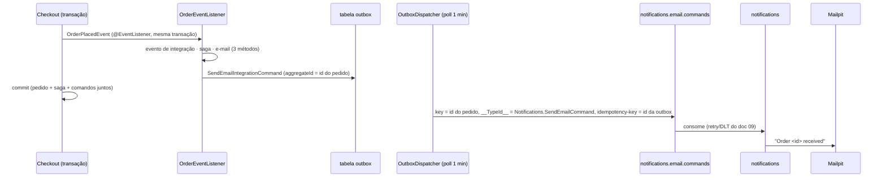

# Comando de e-mail a partir do ordering

> **Em uma frase:** quando um pedido é realizado, o `ordering` grava um `SendEmail` na **outbox**, na mesma transação do pedido, para o tópico `notifications.email.commands`. Ele só diz **para quem**, **qual template** e **com quais variáveis**. Não espera resposta: é "dispare e esqueça".

⬅️ Anterior: [Comandos de e-mail pelo Kafka](./09-comandos-de-email-pelo-kafka.md) · ➡️ Próximo: [Relatórios e métricas: o conceito](../08-relatorios/01-relatorios-e-metricas-conceito.md) · 🧭 Trilha: [README](../README.md#trilha-de-leitura)

---

## O problema

O notifications já sabe receber o `SendEmail` pelo Kafka ([doc 09](./09-comandos-de-email-pelo-kafka.md)). Faltava quem mandasse.

O jeito ingênuo seria publicar no Kafka logo depois do checkout. Isso é **dual-write**:

- o pedido grava e o Kafka cai → o cliente não recebe e-mail, e ninguém percebe;
- o Kafka recebe e o pedido é desfeito → o cliente recebe e-mail de um pedido que não existe.

## A ideia

O mesmo desenho dos comandos da saga ([Outbox](../06-mensageria/08-outbox.md)):

| Camada | Peça | O que sabe |
|---|---|---|
| core | porta `ForPublishingNotificationCommands` | só "envie este comando" |
| core | `OrderPlacedEmailCommandAssembler` | monta destinatário, template e variáveis a partir do pedido e do cliente |
| infraestrutura | `OutboxNotificationIntegrationCommandPublisher` | grava na outbox, para o tópico do notifications |
| infraestrutura | `OrderEventListener.onOrderPlacedSendConfirmationEmail` | reage ao `OrderPlacedEvent` |

O ordering **não renderiza nem envia nada**. Como o notifications não responde, o comando vai **sem** `correlationId` e **sem** tópico de reply. Essa é a diferença em relação aos comandos da saga.

## Como funciona no AlgaShop

### As peças

- **Mesma transação:** um `@EventListener` comum roda **dentro** da transação de quem publicou o evento, que é o checkout. O `OutboxRecorder` exige essa transação. Se o pedido não confirma, o comando some junto. Se confirma, o comando fica na tabela, mesmo com o Kafka ou o notifications fora do ar.
- **Uma reação por método:** `onOrderPlacedPublishIntegrationEvent`, `onOrderPlacedStartSaga` e `onOrderPlacedSendConfirmationEmail`. Cada nome diz o que faz, e uma reação não mexe nas outras.
- **Destinatário:** e-mail e nome completo do cliente do pedido. Se o cliente não existe, a reação lança `CustomerNotFoundExceptionDomain`, que desfaz o checkout.
- **Template por configuração:** `NotificationsProperties` (`algashop.notifications.email-templates.order-placed`), com `@Validated` e `@NotNull`. Sem o id, o serviço nem sobe. No `development-env` o id é `0198d0a1-2c44-7d0b-8e11-9a0b7c5d3f21`, que o notifications recria a cada subida. Fora dele, o template precisa ser criado pela API.
- **Tópico por configuração:** `notifications-email-commands-topic-name` em `AlgaShopMessagingKafkaProperties`, obrigatório, como os outros tópicos.
- **`__TypeId__` lógico:** o alias `Notifications.SendEmailCommand` no `spring.json.type.mapping` aponta para a classe do ordering. No header viaja o nome do contrato, nunca o nome da classe.
- **Chave do registro = id do pedido:** o `aggregateId` vira a chave do Kafka, e com isso a mensagem fica ordenada junto com os outros registros do mesmo pedido. Como ele é `@JsonIgnore` na interface `OutboundIntegrationCommand`, não aparece no corpo.
- **`idempotency-key`:** o `OutboxKafkaSender` já manda o id da mensagem da outbox nesse header. O notifications ainda não usa; ele entra no próximo desafio.

### As variáveis (contrato com o template Order Placed)

| Variável | Valor | Tipo no JSON |
|---|---|---|
| `orderId` | id do pedido | texto |
| `placedAt` | quando foi realizado | texto ISO-8601 |
| `totalAmount` | total do pedido | número |
| `shippingCost` | frete | número |
| `expectedDeliveryDate` | previsão de entrega | texto ISO-8601 |
| `items[]` | `productName`, `quantity`, `price`, `totalAmount` | lista, ordenada pelo id do item |

As datas vão como texto porque o template recebe JSON puro e formata lá. Os itens são ordenados porque o `Set` não tem ordem, e o mesmo pedido deve gerar sempre o mesmo e-mail.

### Outbox desligado: o par Kafka

O adapter da outbox só existe com `algashop.messaging.outbox.enabled=true`. Sem um par, desligar o outbox para um teste manual derrubaria o ordering: o listener ficaria sem implementação da porta. Por isso há o `KafkaNotificationIntegrationCommandPublisher` (`enabled=false` ou propriedade ausente), igual ao par da saga: ele publica direto e de forma bloqueante, com a mesma chave e o mesmo `__TypeId__`. Ele tem duas limitações: **não é atômico** com o pedido e **não tem** `idempotency-key`, porque não existe id de outbox. É um modo de teste.

## Como aplicar

1. Comando + porta na camada core; o core não conhece Kafka nem outbox.
2. Adapter da outbox ativo só com o outbox ligado (e, se quiser, um par Kafka para quando ele está desligado).
3. Chave = `aggregateId` do comando; sem reply nem correlation quando ninguém responde.
4. Reaja ao evento de domínio com `@EventListener` comum, para ficar na transação do fato.
5. Ids e nomes de tópico em propriedades validadas, também no perfil de teste.
6. Alias no `spring.json.type.mapping` com o nome do contrato (e a vírgula no alias anterior).

## Para lembrar

- O ordering decide **quando**; ele não renderiza nem envia.
- Outbox = o comando nasce e morre com o pedido.
- `@EventListener` comum roda na transação de quem publica; `@TransactionalEventListener` rodaria depois, fora dela.
- Dispare e esqueça: sem `correlationId`, sem reply.
- Chave = id do pedido; `idempotency-key` = id da outbox.
- O e-mail pode demorar até 1 minuto: é o `poll-interval` do dispatcher em desenvolvimento.

## Cuidados

- **O assembler chegou sem compilar.** O parâmetro era do tipo `OrderPlacedEmailCommandAssembler` em vez de `Order`, e os valores usavam `.value()`, mas o `Money` do projeto é `Money(BigDecimal money)`. O certo é `.money()`.
- **Nome da propriedade é contrato do enunciado.** A propriedade chegou como `email-commands-topic-name`; o pedido era `notifications-email-commands-topic-name`.
- **Propriedade obrigatória também no teste.** Sem `algashop.notifications.email-templates.order-placed` no `application-test-env.yaml`, nenhum teste de integração subiria o contexto.
- **Renomear uma variável quebra o e-mail em silêncio.** As chaves do mapa não são checadas pelo compilador; o teste do assembler as fixa.
- **Toda subida no `development-env` apaga o banco do ordering.** O `afterMigrate.sql` limpa `order`, `outbox` e `saga_instance`. Uma segunda instância (por exemplo, para testar o boot) apagou um pedido recém-feito e as mensagens dele antes do dispatcher publicar. Para testar o boot, use outro banco, ou não suba nada enquanto o fluxo roda.

## Pendências

- ~~Roteiro ponta a ponta incompleto~~ — confirmado pelo usuário em 10/11/2026 (ver Testes).
- O `CheckoutApplicationServiceIT` citado no enunciado **já estava corrigido** (commit `c9a4aaa`): ele verifica `onOrderPlacedPublishIntegrationEvent` e `onOrderPlacedStartSaga`. Agora ele verifica também o e-mail.
- Idempotência no notifications pelo `idempotency-key` (próximo desafio).
- Dado pessoal do comando no log de erro do notifications (pendência do [doc 09](./09-comandos-de-email-pelo-kafka.md)).

## Testes

- `ordering`, `./gradlew check`, 10/11/2026: **514 testes, 0 falhas** (inclui `compileTestJava`). Novo: `OrderPlacedEmailCommandAssemblerTest` (3, sem Spring nem banco). Ele confere o destinatário, o template, o `aggregateId`, as seis variáveis com os valores e tipos, os itens ordenados pelo id com as quatro chaves, e os argumentos nulos lançando exceção. O `CheckoutApplicationServiceIT` agora verifica as três reações.
- Boot do jar com o perfil de desenvolvimento: sobe com `outbox.enabled=true` (adapter da outbox) e com `false` (par Kafka).
- Checkout do usuário (pedido `0S6HDDGP3V0WE`), pelo log do ordering: na mesma requisição, `IssueInvoiceIntegrationCommand` → `billing.invoice.commands`, `SendEmailIntegrationCommand` → `notifications.email.commands` e `OrderPlacedIntegrationEvent` → `ordering.order.events`, os três com `aggregateId=0S6HDDGP3V0WE`. As três reações rodaram, e a saga e o evento de integração continuam.
- Roteiro ponta a ponta **confirmado pelo usuário** (10/11/2026). Conferido por mim no pedido `0S6HE51GZV0ZT`:
  - `notifications.email.commands`, partição 2: chave `0S6HE51GZV0ZT`, `__TypeId__` = `Notifications.SendEmailCommand` e `idempotency-key` = UUID;
  - o corpo vai só com `recipient`, `templateId` e `variables` (sem `aggregateId` nem `idempotencyKey`);
  - as datas vão em ISO-8601 e os valores numéricos como número;
  - Mailpit: `Order 0S6HE51GZV0ZT received` para John Doe;
  - `Ordering.OrderPlacedIntegrationEvent` publicado em `ordering.order.events` com a mesma chave;
  - a saga foi criada (no momento da conferência, `RUNNING` / `INVOICING`);
  - nenhuma mensagem do pedido na DLT do notifications.

## Roteiro ponta a ponta (para rodar)

No ar: LocalStack, authorization server, Kafka, Kafka UI, Postgres, Mailpit, registry, billing, product-catalog, ordering e notifications. Faça o checkout como `6e148bd5-47f6-4022-b9da-07cfaa294f7a` (John Doe), com o Visa final 1022 (`creditCardId` `0199deda-9486-7d27-b40c-761f561a24d8`).

| Cenário | O que conferir |
|---|---|
| Comando na outbox | no log do ordering: `Recorder SendEmailIntegrationCommand on outbox: channel=notifications.email.commands aggregateId=<id do pedido>` |
| Mensagem no Kafka (depois de até 1 min) | Kafka UI → `notifications.email.commands`: chave = id do pedido; `__TypeId__` = `Notifications.SendEmailCommand`; `idempotency-key` é um UUID; o corpo **não** tem `aggregateId` nem `idempotencyKey` |
| E-mail | Mailpit: para John Doe, assunto `Order <id> received`, com os itens, o frete, o total e as datas formatadas |
| Fluxo anterior | `Ordering.OrderPlacedIntegrationEvent` em `ordering.order.events`; saga `SUCCEEDED` e pedido `READY` |
| Notifications parado | outro pedido: a mensagem fica no tópico (lag no grupo `notifications.email-commands`); suba o notifications e o e-mail sai |
| Template inexistente | suba o ordering com `--algashop.notifications.email-templates.order-placed=00000000-0000-7000-8000-000000000000`: o pedido é criado e o comando vai para `notifications.dlt.notifications.email.commands` sem retentativa (`TemplateNotFoundException`). Depois volte ao id certo |

Consulta da outbox (antes do dispatcher; enviada, a linha é apagada): `select channel_name, aggregate_id, message_type, attempts from outbox order by created_at desc limit 5;`

## Onde ver no código

- `SendEmailIntegrationCommand` (ordering, `core.application.notification.command`): o comando.
- `OrderPlacedEmailCommandAssembler` (ordering, `core.application.order.event`): as variáveis.
- `ForPublishingNotificationCommands` (ordering, `core.ports.out.notification`): a porta.
- `OutboxNotificationIntegrationCommandPublisher` (`infrastructure.adapters.out.messaging.outbox`) e `KafkaNotificationIntegrationCommandPublisher` (`...messaging.kafka.notification`): os dois adapters.
- `OrderEventListener.onOrderPlacedSendConfirmationEmail` (`infrastructure.adapters.in.listerner.order`): a reação.
- `NotificationsProperties` (`infrastructure.config.email`) e `AlgaShopMessagingKafkaProperties`: template e tópico.
- `application-development-env.yaml` e `application-test-env.yaml`: id do template, tópico e alias.
- Fundamentos: [Outbox](../06-mensageria/08-outbox.md) · [Saga: comandos e respostas](../06-mensageria/14-saga-orquestrada-comandos-e-respostas.md).
