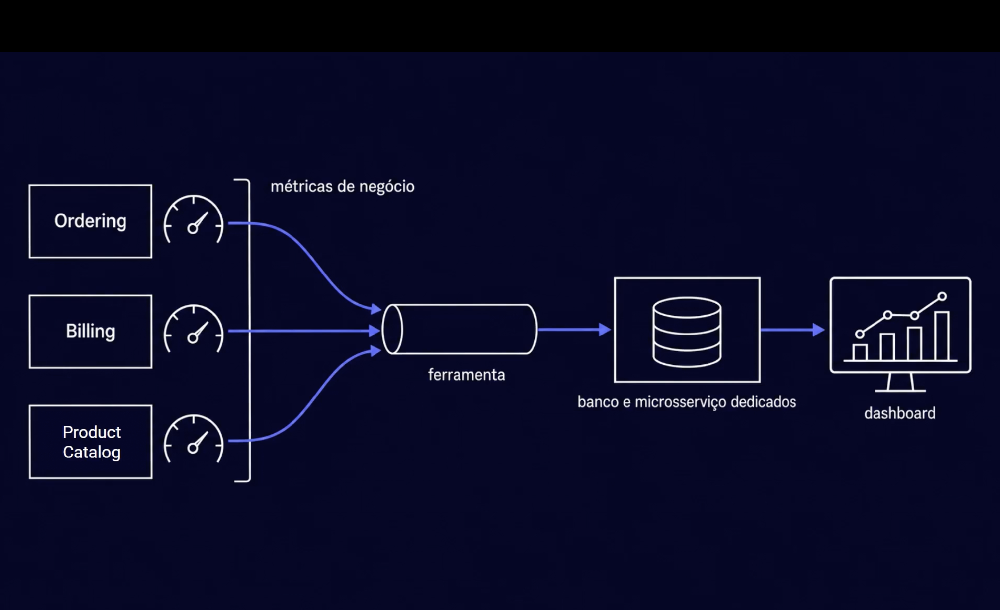
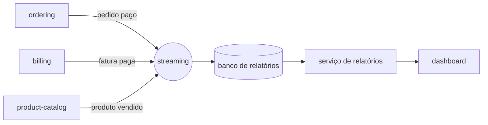

# Relatórios e métricas: o conceito

> **Em uma frase:** relatório é uma pergunta que alguém do negócio faz aos dados. Existem três tipos, conforme a pergunta: o **operacional** ("o que está acontecendo agora?"), o **tático** ("como foi o mês?") e o **estratégico** ("para onde estamos indo?"). Em microsserviços, cada resposta mora num banco diferente, e juntar tudo é o desafio deste módulo.

⬅️ Anterior: [Comando de e-mail a partir do ordering](../07-notificacoes/10-comando-de-email-a-partir-do-ordering.md) · ➡️ Próximo: [Primeira métrica: vendas por mês](./02-primeira-metrica-vendas-por-mes.md) · 🧭 Trilha: [README](../README.md#trilha-de-leitura)

---

## O problema

Até aqui o AlgaShop aprendeu a **fazer** coisas: criar pedido, cobrar, reservar estoque, mandar e-mail. Agora o dono da loja quer **entender** o que aconteceu:

- Quantos pedidos estão esperando pagamento agora?
- Quanto vendemos em julho?
- Quais produtos vendem mais? As vendas estão subindo?

Essas perguntas não mudam nada no sistema. Elas só **leem**. Mesmo assim, elas são difíceis, por dois motivos:

- **Os dados estão espalhados.** Pedidos estão no banco do ordering, pagamentos no do billing, produtos no do product-catalog. Não dá para fazer um `join` entre bancos de serviços diferentes.
- **Ler muito pesa.** Somar um ano de pedidos no mesmo banco que está recebendo pedidos novos deixa o checkout mais lento.

## A ideia: três tipos de relatório

O tipo do relatório é decidido pela **pergunta**, não pela tela.

| Tipo | Pergunta | Quem usa | Janela de tempo | Com que frequência | No AlgaShop |
|---|---|---|---|---|---|
| **Operacional** | O que está acontecendo **agora**? | atendente, operador | hoje, este instante | o tempo todo | lista de pedidos aguardando pagamento; pedido travado na saga |
| **Tático** | Como foi um **período fechado**? | gerente | uma semana, um mês | todo fim de período | vendas por mês; pagamentos do mês por meio de pagamento; clientes e carrinhos ativos |
| **Estratégico** | Para **onde** estamos indo? | diretoria, dono | meses, anos | de vez em quando | produtos mais vendidos; vendas crescendo ou caindo |

Um jeito fácil de lembrar:

- **Operacional** olha **cada item**: este pedido, aquele cliente.
- **Tático** olha **totais de um período**: soma, contagem, média do mês.
- **Estratégico** olha a **tendência**: compara períodos e procura padrões.

Quanto mais estratégico, mais dados antigos ele precisa, e mais serviços ele precisa cruzar.

## Como funciona no AlgaShop

### Caminho 1: perguntar ao próprio serviço

Quando a resposta está toda dentro de **um** serviço, o mais simples é o próprio serviço responder. O ordering sabe quantos pedidos foram pagos em cada mês, então ele mesmo pode devolver "vendas por mês". Foi o primeiro passo do módulo ([doc 02](./02-primeira-metrica-vendas-por-mes.md)).

Esse caminho é bom para relatórios **operacionais** e **táticos simples**. Ele tem dois limites:

- só enxerga o banco daquele serviço;
- a consulta pesada roda no mesmo banco que atende os clientes.

### Caminho 2: mandar as métricas para um lugar dedicado

Para os relatórios **estratégicos**, que cruzam serviços e olham anos de dados, o caminho é outro:

1. Cada serviço publica **métricas de negócio** quando algo acontece: pedido pago, fatura paga, produto vendido.
2. Uma **ferramenta de streaming** transporta esses dados continuamente, sem que alguém precise pedir.
3. Um **banco e um microsserviço dedicados** recebem tudo e guardam do jeito mais fácil de consultar, já somado e organizado para relatório.
4. O **dashboard** consulta só esse lugar.

Por que vale o trabalho:

- **O checkout não sente o relatório.** A consulta pesada roda em outro banco.
- **Cruzar serviços fica fácil.** Os dados chegam juntos ao mesmo lugar.
- **Cada serviço segue dono do seu banco.** Ninguém lê o banco de ninguém; cada um só publica o que aconteceu.

O preço é que o relatório fica **um pouco atrasado**: ele mostra o que já chegou pelo streaming, não o que aconteceu neste milissegundo. Para "como foi o mês" e "qual a tendência", isso não faz diferença.

## Como aplicar

1. Comece pela pergunta e classifique: é operacional, tático ou estratégico?
2. Se a resposta está toda num serviço e a consulta é leve, deixe o próprio serviço responder.
3. Se precisa cruzar serviços ou olhar muito histórico, publique métricas e monte um banco de relatórios.
4. Proteja o acesso: relatório de vendas é informação de gestão, não de qualquer usuário.

## Para lembrar

- Relatório só **lê**, mas ler muito também pesa.
- **Operacional** = agora, item por item. **Tático** = período fechado, totais. **Estratégico** = tendência, comparação.
- Em microsserviços não existe `join` entre bancos de serviços diferentes.
- Relatório simples: o próprio serviço responde. Relatório que cruza serviços: streaming até um banco dedicado.
- O banco de relatórios aceita estar um pouco atrasado em troca de não pesar no sistema.

## Cuidados

- **Não leia o banco de outro serviço** "só para o relatório". Isso acopla os dois: uma mudança de tabela no billing quebraria o relatório do ordering.
- **Não ponha relatório pesado no banco transacional** sem medir. Um ano de pedidos somado a cada clique no painel compete com o checkout.
- **Defina o que conta.** "Venda" é o pedido feito ou o pedido pago? E o cancelado? Sem essa regra escrita, dois relatórios mostram números diferentes para a mesma pergunta.

## Onde ver

- [Primeira métrica: vendas por mês](./02-primeira-metrica-vendas-por-mes.md) e [Totais de clientes e carrinhos](./03-totais-de-clientes-e-carrinhos.md): o caminho 1 no ordering.
- [Pagamentos por mês no billing](./04-pagamentos-por-mes-no-billing.md): o caminho 1 no billing, e por que o número mora com o dono do fato.
- [Mensageria](../06-mensageria/03-kafka-na-pratica.md): o Kafka que o projeto já usa é uma ferramenta de streaming.
- [Relatórios estratégicos: reporting database e ETL](./05-relatorios-estrategicos-e-reporting-database.md): o caminho 2, com a cópia feita por ETL.
