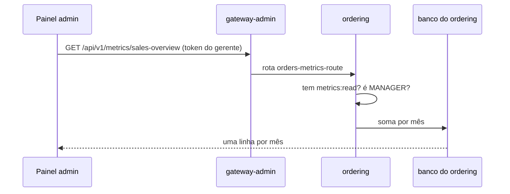

# Primeira métrica: vendas por mês

> **Em uma frase:** o ordering responde "quantos pedidos foram pagos e quanto entrou em cada mês" num endpoint só para gerentes. É um relatório **tático**, feito pelo caminho mais simples: o próprio serviço consulta o próprio banco.

⬅️ Anterior: [Relatórios e métricas: o conceito](./01-relatorios-e-metricas-conceito.md) · ➡️ Próximo: [Totais de clientes e carrinhos](./03-totais-de-clientes-e-carrinhos.md) · 🧭 Trilha: [README](../README.md#trilha-de-leitura)

---

## O problema

O gerente quer ver as vendas mês a mês, para comparar julho com agosto. A resposta está toda no ordering: ele sabe quando cada pedido foi pago, quanto custou e se foi cancelado. Não precisa de outro serviço.

## A ideia

Um endpoint de leitura, `GET /api/v1/metrics/sales-overview`, que devolve uma linha por mês:

```json
[
  { "yearMonth": "2026-07", "quantity": 40, "revenue": 499881.89 },
  { "yearMonth": "2026-08", "quantity": 42, "revenue": 530218.87 }
]
```

- **`quantity`:** quantos pedidos foram pagos no mês.
- **`revenue`:** quanto esses pedidos somaram.
- **Período:** `yearMonthStart` e `yearMonthEnd` (formato `2026-07`). Sem eles, vale o ano atual inteiro.

## Como funciona no AlgaShop



### As regras do número

As regras importam mais que o código, porque decidem o que o gerente vê:

| Regra | Por quê |
|---|---|
| Conta pela **data do pagamento**, não pela do pedido | receita é o dinheiro que entrou. Pedido feito e não pago não é venda |
| Pedido **cancelado** não conta | mesmo que tenha sido pago, o dinheiro voltou |
| **Mês sem venda aparece com zero** | num gráfico, um mês que some engana mais que um mês zerado |

O último ponto tem um truque: o banco primeiro cria uma lista com **todos** os meses do período, e só depois procura os pedidos de cada um. Assim novembro aparece com `0`, em vez de não aparecer.

### Quem pode ver

> **A regra mudou no [doc 03](./03-totais-de-clientes-e-carrinhos.md#quem-pode-ver-a-regra-mudou):** hoje é escopo `metrics:read` e **não ser CUSTOMER**, porque o token de máquina do `algashop-test` não tem papel e era barrado. Abaixo, a regra como foi feita nesta aula.

Duas condições, as **duas** obrigatórias:

- **escopo `metrics:read`:** o aplicativo (painel admin) recebeu permissão para ler métricas;
- **papel `MANAGER`:** a pessoa logada é gerente.

O painel admin é usado por gerentes e por operadores com o mesmo cliente OAuth. Só o escopo deixaria o operador ver as vendas; o papel separa os dois. O authorization server passou a conhecer o escopo, e só o MANAGER do painel admin o recebe.

O gateway-admin tem uma rota só para esse endereço, só leitura. Outros serviços terão as suas métricas no mesmo prefixo `/api/v1/metrics/` (o billing já tem o contrato de pagamentos por mês), e cada uma vai para o seu serviço.

### Dados de exemplo

Com poucos pedidos de teste, não dá para ver um gráfico. Por isso, no ambiente de desenvolvimento, o ordering carrega **600 pedidos espalhados em 12 meses** a cada subida, com pagos, cancelados e meios de pagamento diferentes.

## Como aplicar

1. Escreva a regra do número antes da consulta: o que conta, por qual data, o que fica fora.
2. Faça os períodos vazios aparecerem com zero.
3. Proteja com escopo **e** papel quando o mesmo aplicativo atende pessoas com níveis diferentes.
4. Dê ao relatório uma massa de dados que mostre alguma coisa.

## Para lembrar

- Vendas por mês é um relatório **tático**: período fechado, totais.
- Receita conta pelo **pagamento**; cancelado fica fora.
- Mês sem venda = linha com zero.
- Escopo diz o que o **aplicativo** pode; papel diz quem a **pessoa** é.
- Esse caminho só enxerga o banco do ordering.

## Cuidados

- **Toda subida em desenvolvimento apaga e recria os pedidos.** Pedido feito à mão some no próximo restart do ordering.
- **O mês depende do fuso.** Um pagamento às 23h do dia 31 pode cair no mês seguinte, conforme o fuso em que o banco faz a conta.
- **Este caminho não cresce bem.** "Vendas por meio de pagamento" precisa do billing; "produtos mais vendidos" fica melhor com o catálogo. Aí entra o streaming do [doc 01](./01-relatorios-e-metricas-conceito.md).
- **O contrato chegou trocado.** O `ordering.yml` do curso foi colado por cima do do projeto e apagava as regras de segurança dos outros endpoints. Ele foi mesclado: ficou o do projeto, mais as métricas.

## Pendências

- ~~`payments-overview` (billing)~~ — feito no [doc 04](./04-pagamentos-por-mes-no-billing.md).
- ~~`total-overview` (ordering)~~ — feito no [doc 03](./03-totais-de-clientes-e-carrinhos.md).
- O serviço e o banco de relatórios do caminho 2.
- Os 16 testes de integração do authorization server continuam falhando pelo `jwk.privateKey` nulo, como antes deste módulo.

## Testes

- `ordering`, `./gradlew check`, 12/11/2026: **520 testes, 0 falhas**. Novo: `MetricsControllerTest` (6). Ele confere:
  - o mês sai como `"2026-01"` no JSON;
  - sem período, vale o ano atual;
  - um mês inválido (`2026-13`) responde 400 sem consultar nada;
  - sem token responde 401;
  - com o escopo mas sem ser MANAGER responde 403;
  - sendo MANAGER sem o escopo também responde 403.
- `authorization-server`, `./gradlew check`: 53 testes passam e os 16 de integração falham (pendência antiga, acima).
- `api-gateway-admin`: compila.
- A consulta, rodada no banco de desenvolvimento com a massa de 600 pedidos (de out/2025 a dez/2026): de 20 a 48 vendas por mês, e novembro e dezembro de 2026 com `0`.

## Dados de teste (Postman)

- **Token:** login no painel admin (`algashop-admin-web`, authorization code com PKCE) com um usuário **MANAGER**, pedindo o escopo `metrics:read`.
- **Chamada:** `GET http://localhost:9998/api/v1/metrics/sales-overview?yearMonthStart=2025-11&yearMonthEnd=2026-10`, com `Authorization: Bearer <token>`.
- **Conferir:** com um OPERATOR → 403; sem token → 401; `yearMonthStart=2026-13` → 400.

## Onde ver no código

- `MetricsController` (ordering, `infrastructure.adapters.in.web.metrics`): o endpoint e o período padrão.
- `MetricsQueryService` (ordering, `core.application.metrics`): de meses para datas.
- `ForObtainingMetricJdbcImpl` (ordering, `infrastructure.adapters.out.persistence.metrics`): a consulta e as regras do número.
- `SecurityAnnotations.CanReadMetrics` (ordering): escopo + papel.
- `db/testdata/afterMigrate__reports.sql` (ordering): os 600 pedidos.
- `application-development-env.yaml` e `afterMigrate.sql` (authorization-server): o escopo `metrics:read`.
- `application-base.yml` (api-gateway-admin): `orders-metrics-route`.
- [`openapi/ordering.yml`](../openapi/ordering.yml) e [`openapi/billing.yml`](../openapi/billing.yml): os contratos.
