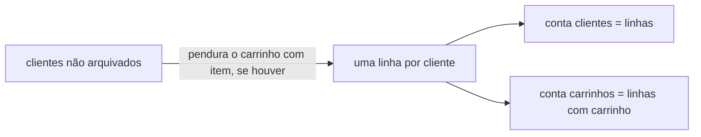

# Totais de clientes e carrinhos: contar sem errar

> **Em uma frase:** o ordering responde quantos clientes e quantos carrinhos estão **ativos** agora. O código é pequeno; o difícil é a **definição** de "ativo" e uma contagem que não engana quando junta duas tabelas.

⬅️ Anterior: [Primeira métrica: vendas por mês](./02-primeira-metrica-vendas-por-mes.md) · ➡️ Próximo: [Pagamentos por mês no billing](./04-pagamentos-por-mes-no-billing.md) · 🧭 Trilha: [README](../README.md#trilha-de-leitura)

---

## O problema

O gerente quer dois números no topo do painel: quantos clientes a loja tem e quantos carrinhos estão em uso. Parece a pergunta mais fácil do mundo, mas tem duas armadilhas:

- **O que é "ativo"?** Conta o cliente arquivado? Conta o carrinho vazio?
- **Juntar tabelas muda a contagem.** Clientes e carrinhos moram em tabelas separadas. Quando você junta as duas para contar de uma vez, um erro pequeno muda o número sem dar nenhum erro.

Relatório de contagem errado é perigoso justamente porque **parece certo**: 23 em vez de 21 não chama atenção.

## A ideia

### Primeiro a definição, depois a consulta

| Número | Conta | Não conta |
|---|---|---|
| **Clientes ativos** | todo cliente não arquivado, **tenha carrinho ou não** | o arquivado |
| **Carrinhos ativos** | carrinho com pelo menos um item, de cliente ativo | carrinho vazio; carrinho de cliente arquivado |

Escrever a regra antes evita a discussão "o relatório está errado" depois: o número sai exatamente da regra combinada.

### Uma consulta só, contando do jeito certo

As duas contagens saem de **uma** ida ao banco. Ela parte dos clientes e "pendura" o carrinho de cada um, quando existe:



Três detalhes fazem o número sair certo:

1. **Partir do cliente e manter quem não tem carrinho.** Se a junção exigisse carrinho, o cliente sem carrinho sumiria, e os clientes ativos virariam "clientes com carrinho".
2. **O "pelo menos um item" vai na regra da junção, não no filtro final.** No filtro final, ele também tiraria da conta o cliente sem carrinho e o cliente com carrinho vazio. Na junção, ele só decide se o carrinho é pendurado.
3. **Contar o carrinho, não a linha.** Quem não tem carrinho ainda gera uma linha, com o carrinho vazio (nulo). Contar linhas daria 21 carrinhos; contar só os carrinhos de verdade dá 2.

É a mesma atenção do [doc 02](./02-primeira-metrica-vendas-por-mes.md): lá, a junção trazia uma linha por mês mesmo sem venda, e por isso a conta tinha que olhar o pedido, não a linha.

## Como funciona no AlgaShop

- **Endpoint:** `GET /api/v1/metrics/total-overview`, sem parâmetros, porque é uma foto de agora.
- **Resposta:** `{ "activeCustomers": 21, "activeShoppingCarts": 2 }`, os mesmos nomes do contrato.
- **Caminho:** o mesmo do relatório de vendas. Controller → porta de entrada → serviço → porta de saída → adaptador com SQL. Nenhuma camada nova; só um método a mais em cada peça.
- **Gateway:** a rota `orders-metrics-route` passou a levar os dois endereços exatos, `sales-overview` e `total-overview`. Não leva `/api/v1/metrics/**`, porque o billing vai usar o mesmo prefixo.

### Quem pode ver: a regra mudou

No doc 02 a regra era "escopo `metrics:read` **e** papel MANAGER". Ela quebrou um caso real: o token de teste vem do cliente `algashop-test`, pelo fluxo `client_credentials`. É uma **máquina**, sem pessoa logada, então o token não tem papel nenhum. Com a regra antiga, até o relatório de vendas respondia 403.

A regra nova é a mesma da listagem de pedidos para o back-office:

| Quem | Escopo `metrics:read` | Papel | Resultado |
|---|---|---|---|
| `algashop-test` (máquina) | sim | nenhum | **passa** |
| MANAGER no painel admin | sim | MANAGER | **passa** |
| OPERATOR no painel admin | **não recebe** | OPERATOR | 403 |
| Cliente da loja | mesmo que um dia receba | CUSTOMER | **403** |
| Qualquer um sem o escopo | não | — | 403 |

- **O escopo continua obrigatório.**
- **O cliente final continua bloqueado,** mesmo que receba o escopo por engano.
- **Quem separa o operador do gerente agora é o escopo:** o authorization server só entrega `metrics:read` ao MANAGER do painel.

## Como aplicar

1. Escreva a definição de cada número antes da SQL.
2. Para contar "todos de A, e alguns de B", parta de A e mantenha quem não tem B.
3. O filtro que decide **se B entra** vai na regra da junção; o filtro que decide **se A entra** vai no filtro final.
4. Conte a coluna de B, não a linha.
5. Confira com SQL separadas, uma por número, e compare.

## Para lembrar

- A definição de "ativo" é o relatório; a SQL só obedece.
- Juntar tabelas cria linhas: conte a coisa, não a linha.
- Filtro na junção ≠ filtro no final.
- Token de máquina não tem papel: uma regra que exige papel barra a máquina.
- `not hasRole('CUSTOMER')` + escopo é a regra de leitura do back-office.

## Cuidados

- **A consulta confia em "um carrinho por cliente".** Essa regra é do domínio, e o banco não a garante (não há `UNIQUE` em `customer_id`). Se um cliente tivesse dois carrinhos com itens, ele seria contado duas vezes. Contar clientes distintos protegeria contra isso; hoje a carga não tem esse caso.
- **Secret não se copia de outro cliente.** O hash novo do `algashop-test` foi copiado do `algashop-notifications-service` (os dois usam `123456`), e o authorization server não subiu: `Registered client must be unique. Found duplicate client secret`. O Spring compara os secrets como texto. Como o bcrypt sorteia um "sal" a cada geração, o mesmo secret gera hashes diferentes: gere um novo para cada cliente. Depois de trocar o CSV, reinicie o LocalStack, depois o authorization server e então os serviços (a chave RSA muda).
- **Carrinho vazio de teste.** O SQL que cria e apaga o carrinho vazio é roteiro de teste. Ele chegou colado no fim da carga de dados, onde o insert e o delete rodavam a cada subida sem efeito nenhum, e foi tirado de lá.

## Testes

- `ordering`, `./gradlew check`, 12/11/2026: **524 testes, 0 falhas**. O `MetricsControllerTest` passou de 6 para 10. Ele confere:
  - o JSON dos totais;
  - os totais sem token respondem 401, e com `products:read` respondem 403;
  - o token de máquina com o escopo passa;
  - o CUSTOMER com o escopo recebe 403;
  - o MANAGER sem o escopo recebe 403.
- `api-gateway-admin`: compila.
- Ponta a ponta, 12/11/2026, com o token `client_credentials` do `algashop-test` (`scope: [metrics:read]`, **sem** claim `role`):

| Cenário | Resultado |
|---|---|
| `total-overview` direto (8081) | 200 `{"activeCustomers":21,"activeShoppingCarts":2}` |
| Com o carrinho vazio da Jane Smith | 200, os mesmos 21 e 2; carrinho removido depois |
| `sales-overview` com o mesmo token (antes 403) | 200; set/2026 41, out/2026 20, nov/2026 0 |
| Sem token | 401 |
| Token só com `products:read` | 403 nos dois endpoints |
| Pelo gateway (9998) | 200 nos dois, com os mesmos números; sem token 401; `products:read` 403 |
| `/api/v1/metrics/payments-overview` pelo gateway | 404: a rota só leva os dois caminhos exatos do ordering |

- SQL de conferência no banco de desenvolvimento: **22 clientes, 1 arquivado → 21 ativos**; **2 carrinhos ativos**; a consulta do relatório dá os mesmos 21 e 2; nenhum cliente com mais de um carrinho.

## Dados de teste

**Token (Postman):** `POST http://auth.algashop.local:9000/oauth2/token`, com Basic Auth do `algashop-test`, `grant_type=client_credentials` e `scope=metrics:read`. Para o 403, peça só `scope=products:read`.

**Chamadas:**
- direto: `GET http://localhost:8081/api/v1/metrics/total-overview` (no AlgaShop o ordering roda na 8081);
- pelo gateway: `GET http://localhost:9998/api/v1/metrics/total-overview`, depois de reiniciar o gateway-admin.

**Conferência (psql, banco `ordering`):**
```sql
select count(*) as active_customers from customer where archived is false;

select count(*) as active_shopping_carts
from shopping_cart sc
inner join customer c on c.id = sc.customer_id
where c.archived is false and sc.total_items > 0;
```

**Carrinho vazio** (Jane Smith, que não tem carrinho): crie, chame o relatório de novo (os totais não mudam) e apague.
```sql
insert into shopping_cart (id, created_at, last_modified_at, total_amount, total_items, version, customer_id)
values ('0198d0a1-0000-7000-8000-000000000001', now(), now(), 0, 0, 0, '3a4b5c6d-7e8f-9a0b-1c2d-3e4f5a6b7c8d');

delete from shopping_cart where id = '0198d0a1-0000-7000-8000-000000000001';
```

## Onde ver no código

- `MetricsController.getTotalOverview` (ordering, `infrastructure.adapters.in.web.metrics`).
- `ForObtainingMetricJdbcImpl` (ordering, `infrastructure.adapters.out.persistence.metrics`): a consulta e a definição de "ativo" nos comentários.
- `TotalOverviewOutput` (ordering, `core.ports.out.metrics`).
- `SecurityAnnotations.CanReadMetrics` (ordering): a regra nova.
- `application-base.yml` (api-gateway-admin): `orders-metrics-route`.
- [`openapi/ordering.yml`](../openapi/ordering.yml): schema `TotalOverview`.
