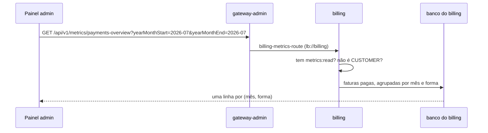

# Pagamentos por mês no billing: quem responde pelo número

> **Em uma frase:** o billing responde quantas faturas foram pagas e quanto entrou, por mês e por forma de pagamento. Antes da consulta vem uma pergunta de arquitetura: **qual serviço é o dono desse número?**

⬅️ Anterior: [Totais de clientes e carrinhos](./03-totais-de-clientes-e-carrinhos.md) · ➡️ Próximo: [Relatórios estratégicos: reporting database e ETL](./05-relatorios-estrategicos-e-reporting-database.md) · 🧭 Trilha: [README](../README.md#trilha-de-leitura)

---

## O problema

O gerente quer saber como os clientes pagam: em julho, quanto entrou no cartão e quanto pelo saldo do gateway?

Tem um atalho tentador. O pedido do ordering também guarda a forma de pagamento, e o pedido pago já aparece no relatório de vendas. Bastaria acrescentar uma coluna ao `sales-overview`.

## A ideia: o número mora com quem é dono do fato

| | ordering | billing |
|---|---|---|
| O que ele sabe da forma de pagamento | o que o cliente **escolheu** no checkout | como a fatura foi **de fato** paga |
| Sabe se foi pago? | recebe a notícia depois | é ele que registra o pagamento |
| Sabe se foi cancelado depois? | recebe a notícia depois | é ele que cancela a fatura |
| Quando o dado nasce | antes do pagamento | no pagamento |

**O billing responde.** Pagamento é um fato do billing: é lá que a fatura vira paga, com data e hora, e é lá que ela é cancelada. O ordering guarda uma **cópia** do que foi escolhido. Cópia pode atrasar (o evento ainda não chegou) ou divergir (um estorno que o ordering não soube). Um relatório de pagamentos feito no ordering mediria a intenção, não o dinheiro.

Isso também muda a consulta: ela lê a **fatura**, pela data em que **ela** foi paga.

## Como funciona no AlgaShop



### A definição do número

| Regra | Por quê |
|---|---|
| Conta a fatura **paga e não cancelada** | a fatura cancelada devolveu o dinheiro, mesmo que tenha sido paga antes |
| O mês é o do **pagamento**, não o da emissão | o gerente quer saber quando o dinheiro entrou |
| A forma é a que a fatura guarda | cartão de crédito ou saldo do gateway |
| Uma linha por **mês e forma** | julho no cartão e julho no saldo são duas linhas |
| **Sem linhas zeradas** | o contrato pede só o que existe |
| Ordem: mês, depois forma | fica fácil de ler e de montar o gráfico |

Duas comparações com o [relatório de vendas](./02-primeira-metrica-vendas-por-mes.md):

- **Lá, mês vazio aparecia com zero; aqui, some.** Não existe regra certa para todo relatório: quem decide é o contrato. Por isso aqui não há a lista de todos os meses que o relatório de vendas montava.
- **Os dois batem.** Em julho de 2026, o billing tem 26 faturas no cartão e 14 no saldo: 40 faturas e 499.881,89, os mesmos números do `sales-overview`. São dois serviços, cada um contando o seu fato, chegando ao mesmo total.

### O último dia inteiro

`paid_at` guarda data **e hora**. Comparar com "31 de julho" significa comparar com 31 de julho **à meia-noite**, e uma fatura paga às 14h do dia 31 ficaria de fora. A consulta pergunta "a partir do dia 1 do primeiro mês e **antes** do dia 1 do mês seguinte ao último". Assim o dia 31 entra até o último instante. Em janeiro de 2026, duas faturas pagas no dia 31 entram na conta.

### Mesma ideia, outra arquitetura

O ordering usa portas de entrada e de saída. O billing não usa: ele tem uma interface de consulta na aplicação e a implementação com SQL na infraestrutura, como já fazia com as faturas. O relatório segue o estilo **de cada serviço**, sem impor ao billing a arquitetura do ordering.

| Peça | ordering | billing |
|---|---|---|
| Entrada | `ForQueryingMetrics` + `MetricsQueryService` | `MetricsQueryService` (interface na aplicação) |
| SQL | `ForObtainingMetricJdbcImpl` | `MetricsQueryServiceImpl` (infraestrutura) |
| Endpoint | `MetricsController` | `MetricsController` |
| Acesso | `@CanReadMetrics` | `@CanReadMetrics`, com a mesma regra |

### O gateway

Os dois serviços publicam métricas no mesmo prefixo `/api/v1/metrics`. Por isso cada rota leva só os seus caminhos exatos:

- `orders-metrics-route` → ordering: `sales-overview` e `total-overview`;
- `billing-metrics-route` → billing: `payments-overview`.

Com `/api/v1/metrics/**` numa das rotas, ela "roubaria" os caminhos da outra.

## Como aplicar

1. Antes da SQL, pergunte: quem é o **dono** desse fato? O relatório mora lá.
2. Escreva a definição: o que conta, por qual data, o que fica fora.
3. Leia o contrato: ele quer as linhas zeradas ou não?
4. Data com hora: filtre até o **início** do dia seguinte, e não até a data final.
5. Siga a arquitetura do serviço onde o relatório mora.
6. Uma rota de gateway por serviço, com caminhos exatos.

## Para lembrar

- O número mora com o dono do fato: pagamento → billing.
- Cópia de dado em outro serviço mede outra coisa (a intenção, não o pagamento).
- Pago e depois cancelado não é pagamento.
- Zeros ou não, quem diz é o contrato.
- `paid_at < dia 1 do mês seguinte` pega o último dia inteiro.

## Cuidados

- **O nome da coluna é deste projeto, não do curso.** Aqui a forma de pagamento fica em `payment_settings.payment_method`; no curso, a coluna se chama `method`. A carga de dados e a consulta chegaram com `method`, e o billing nem subiu: o Flyway parou na carga com `column "method" of relation "payment_settings" does not exist`. Os dois foram corrigidos. A SQL de conferência abaixo já usa o nome certo.
- **Nome de método copiado.** O endpoint chegou como `getSalesOverview`, copiado do ordering. Agora é `getPaymentsOverview`.
- **O mês depende do fuso.** O banco está em UTC: um pagamento às 22h de 31/07 em Brasília já é 01/08 em UTC.
- **Subir o billing em desenvolvimento recarrega as faturas.** A carga apaga e recria tudo a cada subida.

## Testes

- `billing`, `./gradlew check`, 13/11/2026: **79 testes, 0 falhas**. Mudanças nos testes:
  - `AuthorizationMatrixTest` agora cobre o `payments-overview`: sem token, 401; escopo errado, 403; CUSTOMER com o escopo, 403; token de máquina e MANAGER passam;
  - novo `MetricsControllerTest` (3): o JSON com o mês como `"2026-07"` e a forma; sem período, o controller repassa vazio para o serviço; `2026-7` responde 400.
- `api-gateway-admin`: compila.
- SQL de conferência na carga: **510 pagas, 90 canceladas (30 delas com `paid_at`), 6 em aberto**. As 30 canceladas com data de pagamento ficam fora.
- Ponta a ponta, com o token `client_credentials` do `algashop-test`:

| Cenário | Resultado |
|---|---|
| jul/2026 | 200: CREDIT_CARD 26 / 417107.93; GATEWAY_BALANCE 14 / 82773.96 (somam 40 / 499881.89, igual ao `sales-overview`) |
| jan/2026 | 200: 32 + 16 = 48, com as 2 pagas no dia 31 |
| jun–jul/2026 | 200: 4 itens, jun CC, jun GB, jul CC, jul GB |
| Sem período | 200: 20 itens, de jan a out/2026 (nov e dez sem pagamento não aparecem) |
| `yearMonthStart=2026-7` | 400 |
| Sem token | 401 |
| Só `products:read` | 403 |
| Pelo gateway (9998) | `payments-overview` 200 com os mesmos itens; `sales-overview` e `total-overview` continuam respondendo pelo ordering; sem token 401; `POST` 404 |

## Dados de teste

**Token:** igual ao [doc 03](./03-totais-de-clientes-e-carrinhos.md#dados-de-teste) (`algashop-test`, `client_credentials`, `scope=metrics:read`).

**Chamadas:**
- direto: `GET http://localhost:8082/api/v1/metrics/payments-overview?yearMonthStart=2026-07&yearMonthEnd=2026-07`;
- pelo gateway: troque `8082` por `9998` (reinicie o gateway-admin depois de mudar a rota).

**Conferência (psql, banco `billing`):**
```sql
select status, count(*) as invoices, count(paid_at) as with_paid_at
from invoice group by status order by status;

select to_char(date_trunc('month', i.paid_at), 'yyyy-mm') as year_month,
       i.status, ps.payment_method,
       count(*) as quantity, sum(i.total_amount) as total_amount
from invoice i
inner join payment_settings ps on ps.id = i.payment_settings_id
where i.paid_at is not null
group by 1, 2, 3
order by 1, 2, 3;
```

## Onde ver no código

- `MetricsQueryService` e `PaymentsOverviewOutput` (billing, `application.metrics`).
- `MetricsQueryServiceImpl` (billing, `infrastructure.persistence.metrics`): a consulta e a definição de pagamento.
- `MetricsController` (billing, `presentation`).
- `SecurityAnnotations.CanReadMetrics` (billing, `infrastructure.security.check`).
- `db/testdata/afterMigrate__reports.sql` (billing): as faturas da carga, uma por pedido do ordering.
- `application-base.yml` (api-gateway-admin): `billing-metrics-route`.
- [`openapi/billing.yml`](../openapi/billing.yml): `PaymentsOverview`.
