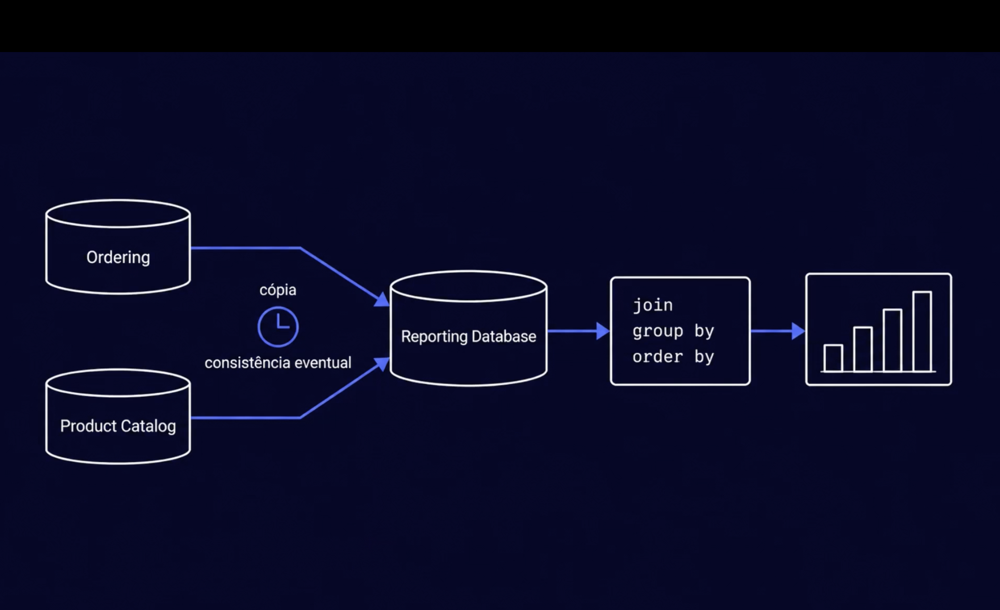
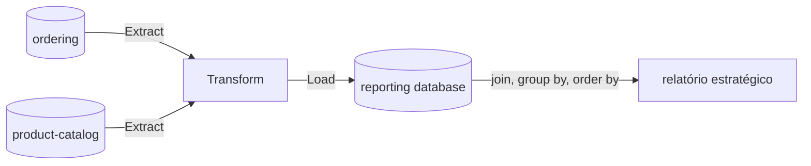
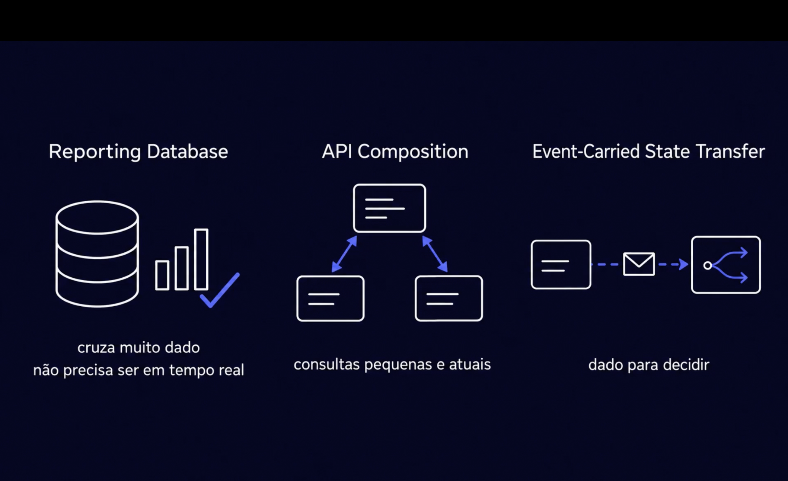

# Relatórios estratégicos: reporting database e ETL

> **Em uma frase:** a pergunta estratégica cruza serviços, e entre bancos de serviços diferentes não existe `join`. A saída é um **ETL** que copia, de tempos em tempos, os dados dos serviços para um **reporting database**, um banco só de leitura onde o `join` volta a existir. O preço é que a cópia chega um pouco atrasada.

⬅️ Anterior: [Pagamentos por mês no billing](./04-pagamentos-por-mes-no-billing.md) · ➡️ Próximo: [CDC: capturar as mudanças](./06-cdc-captura-de-mudancas.md) · 🧭 Trilha: [README](../README.md#trilha-de-leitura)

---

## O problema

Até aqui, cada relatório coube num serviço só:

- vendas por mês e totais → só o ordering ([docs 02](./02-primeira-metrica-vendas-por-mes.md) e [03](./03-totais-de-clientes-e-carrinhos.md));
- pagamentos → só o billing ([doc 04](./04-pagamentos-por-mes-no-billing.md)).

A pergunta estratégica é outra: **quais categorias de produto mais vendem, e as vendas delas estão subindo ou caindo?** Para respondê-la é preciso juntar:

- os **itens vendidos**, que estão no banco do **ordering**;
- a **categoria** de cada produto, que está no banco do **product-catalog**.

Num sistema com um banco só, seria um `join`. Aqui são dois bancos, de dois donos. Os caminhos fáceis são todos ruins:

- **um serviço lê o banco do outro** → acopla os dois, e uma mudança de tabela no catálogo quebra o relatório do ordering;
- **chamar a API do outro serviço para cada item** → para um ano de vendas, são milhares de chamadas;
- **pôr a pergunta no próprio serviço** → nenhum dos dois tem todos os dados.

## A ideia: uma cópia feita para relatório

1. Os dados que o relatório precisa são **copiados** dos bancos dos serviços para um banco separado, o **reporting database**.
2. Lá dentro estão pedidos **e** produtos juntos, então o `join`, o `group by` e o `order by` voltam a funcionar.
3. O gráfico lê **só** o reporting database.

Os serviços continuam donos dos seus dados. O reporting database é uma **cópia de leitura**: ninguém o usa para mudar nada no sistema.

### O preço: consistência eventual

O relógio da imagem diz que a cópia **não é instantânea**. Entre um pedido ser pago e ele aparecer no relatório, passa um tempo. Por um momento, o ordering e o reporting database discordam; depois de um tempo, ficam iguais. Isso é **consistência eventual**.

Para o relatório estratégico, isso não faz diferença. Ele olha meses e anos. Saber a tendência de vendas de uma categoria com uma hora de atraso não muda nenhuma decisão.

## Como a cópia chega: ETL

A cópia é feita por um **ETL**, sigla das três etapas:

| Etapa | O que faz | No AlgaShop |
|---|---|---|
| **E**xtract (extrair) | lê os dados nos bancos de origem | pedidos e itens no ordering; produtos e categorias no product-catalog |
| **T**ransform (transformar) | deixa os dados do jeito que o relatório precisa | junta o item com a categoria, achata o que estava aninhado, padroniza nomes e tipos, guarda valores já calculados |
| **L**oad (carregar) | grava no reporting database | as tabelas de relatório |

Duas regras:

- **O atraso depende de como o ETL extrai.** Uma consulta de tempos em tempos atrasa o intervalo inteiro: rodando de hora em hora, o relatório mostra o mundo de até uma hora atrás. No AlgaShop a extração será por **CDC por log** ([doc 06](./06-cdc-captura-de-mudancas.md)), que lê as mudanças continuamente, e o atraso cai para segundos. Continua sendo consistência eventual.
- **Só o ETL escreve no reporting database.** O relatório só lê, e os serviços nem sabem que ele existe.

A ferramenta do [doc 01](./01-relatorios-e-metricas-conceito.md#caminho-2-mandar-as-métricas-para-um-lugar-dedicado) era isto: o caminho 2 é o ETL levando os dados ao banco dedicado. A extração será por CDC ([doc 06](./06-cdc-captura-de-mudancas.md)); a ferramenta vem nos desafios.

## Três padrões, três perguntas

O reporting database não é a única forma de juntar dados de serviços diferentes. Cada padrão serve para um tipo de pergunta:

| Padrão | Serve para | Preço | Onde já aparece no AlgaShop |
|---|---|---|---|
| **Reporting database** | cruzar **muito** dado, sem precisar ser em tempo real | cópia atrasada; um banco e um ETL a mais | os relatórios estratégicos (a partir de agora) |
| **API composition** | consultas **pequenas e atuais**: chama alguns serviços e junta as respostas na hora | cada chamada é uma dependência; não escala para milhares de linhas | a home do e-commerce, montada pelo gateway ([BFF e gateways por cliente](../04-infraestrutura/12-bff-e-gateways-por-cliente.md)) |
| **Event-carried state transfer (ECST)** | ter o dado **para decidir**, sem chamar o dono | a cópia local pode ficar desatualizada | o evento de preço do catálogo leva os preços, e o ordering atualiza os carrinhos sem consultar ninguém ([ECST e validação de eventos](../06-mensageria/04-ecst-e-validacao-de-eventos.md)) |

Regra de bolso:

- **Cruza muito e pode atrasar?** → reporting database.
- **É pouco e precisa ser agora?** → API composition.
- **Preciso do dado para tomar uma decisão no meu serviço?** → ECST.

Os três copiam ou juntam dados de outros donos. O que muda é o **tamanho** da pergunta e **quanto atraso** ela aceita.

## Como aplicar

1. Confirme que a pergunta cruza serviços e olha muito histórico.
2. Liste só os dados que o relatório precisa; o ETL não copia o banco inteiro.
3. Desenhe o ETL: de onde extrai, o que transforma, onde carrega.
4. Defina como ele extrai e quanto atraso o relatório aceita (no AlgaShop, CDC por log).
5. Deixe o reporting database só para leitura dos relatórios.

## Para lembrar

- Estratégico cruza serviços; sem banco único, não há `join`.
- Reporting database = cópia de leitura, feita para relatório.
- ETL = extrair, transformar, carregar; ele é o único que escreve lá.
- A cópia atrasa (consistência eventual), e o estratégico aceita isso.
- Muito e atrasado → reporting database; pouco e agora → API composition; dado para decidir → ECST.

## Cuidados

- **Não é um banco compartilhado.** No anti-padrão, vários serviços escrevem e leem o mesmo banco, e um depende das tabelas do outro. Aqui, cada serviço tem o seu banco; o reporting database é uma cópia que só o ETL escreve e só o relatório lê.
- **O relatório mostra o passado recente, não o agora.** Para "o que está acontecendo neste minuto", use o próprio serviço (relatório operacional).
- **Nenhum serviço pode depender do reporting database.** Se ele cair, só os relatórios param; vendas, pagamentos e estoque seguem.
- **Mudanças na origem.** Um produto que muda de categoria ou um pedido cancelado depois de copiado precisam de uma regra no ETL: atualizar a cópia, ou guardar a história como ela foi. O CDC entrega o alterar e o apagar, e a regra decide o que fazer com eles.
- **O ETL lê os bancos dos serviços.** Faça isso sem pesar no sistema. Com CDC por log, ele lê o registro de transações que o banco já escreve, e não as tabelas.

## Pendências

- Os desafios de relatórios estratégicos: o reporting database, o ETL com CDC ([doc 06](./06-cdc-captura-de-mudancas.md)) e as primeiras consultas que cruzam ordering e product-catalog.

## Onde ver

- [Relatórios e métricas: o conceito](./01-relatorios-e-metricas-conceito.md): os três tipos de relatório e o caminho 2.
- [BFF e gateways por cliente](../04-infraestrutura/12-bff-e-gateways-por-cliente.md): API composition na home do e-commerce.
- [Fundamentos de EDA](../06-mensageria/01-fundamentos-eda.md) e [ECST e validação de eventos](../06-mensageria/04-ecst-e-validacao-de-eventos.md): ECST no AlgaShop.
