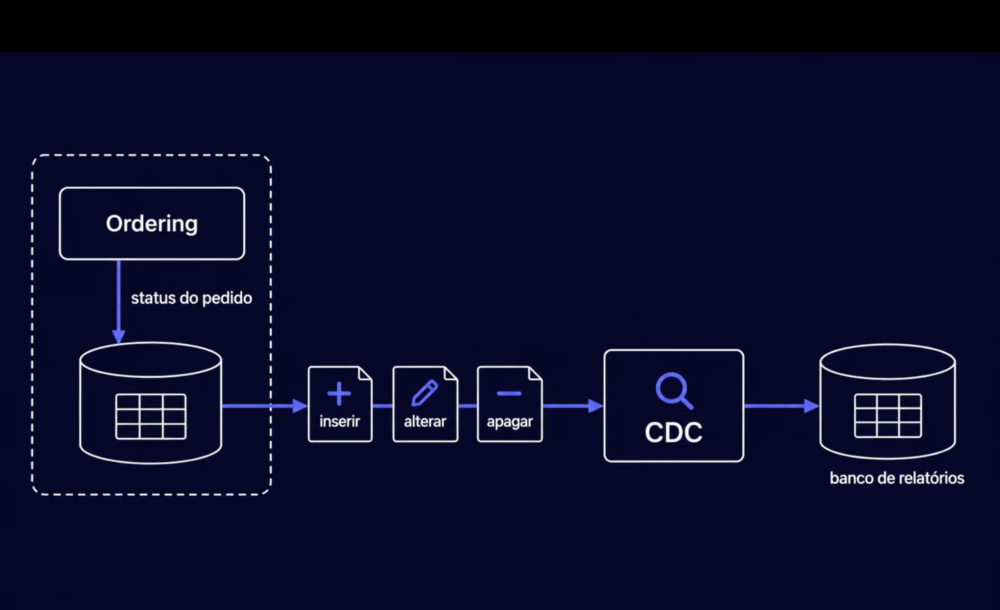
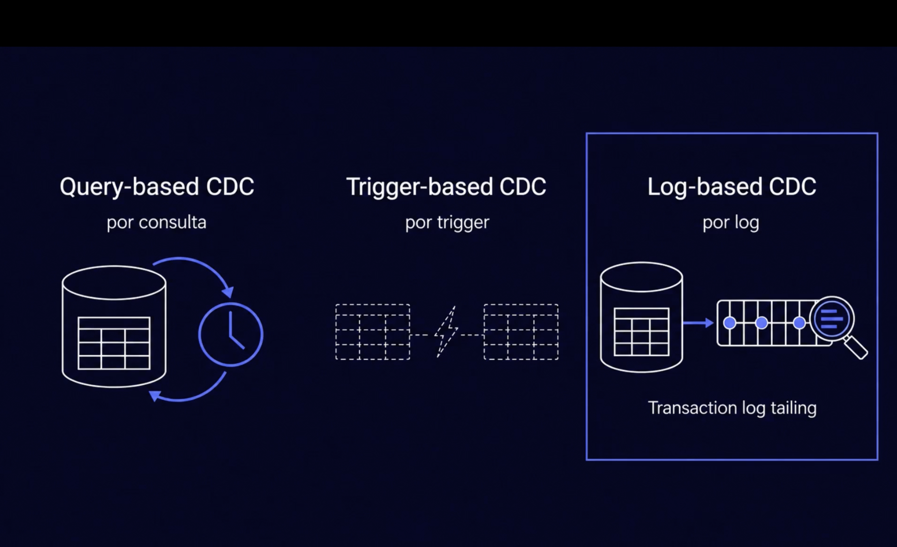
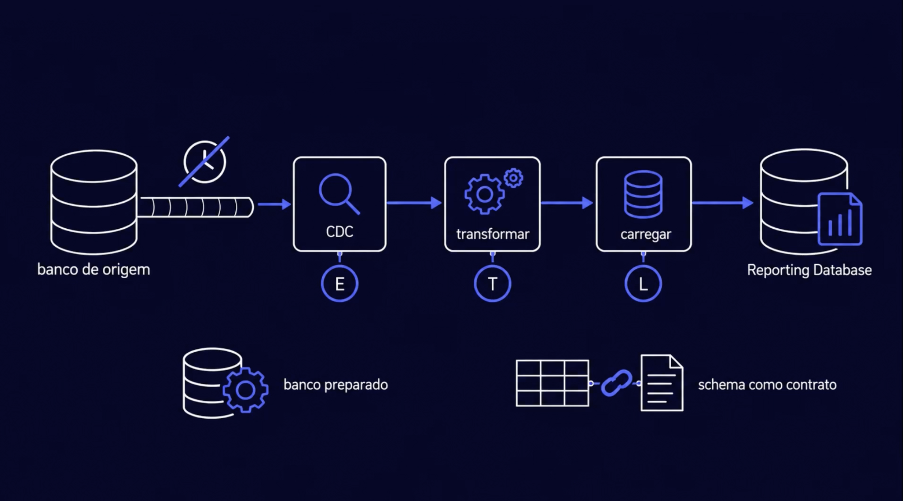

# CDC: capturar as mudanças para o reporting database

> **Em uma frase:** em vez de perguntar ao banco "como estão os dados agora?" de tempos em tempos, o **CDC** (Change Data Capture) acompanha o **registro de transações** do próprio banco e entrega cada inserir, alterar e apagar, na ordem e quase na hora. É ele que faz o **E** do ETL no AlgaShop.

⬅️ Anterior: [Relatórios estratégicos: reporting database e ETL](./05-relatorios-estrategicos-e-reporting-database.md) · ➡️ Próximo: [Kafka Connect](./07-kafka-connect.md) · 🧭 Trilha: [README](../README.md#trilha-de-leitura)

---

## O problema

O [doc 05](./05-relatorios-estrategicos-e-reporting-database.md) mostrou o ETL copiando dados para o reporting database. O jeito mais óbvio de fazer o **E** (extrair) é consultar o banco do serviço de tempos em tempos. Isso tem três custos:

- **Atrasa:** o relatório fica tão velho quanto o intervalo entre duas consultas.
- **Pesa:** cada rodada relê tabelas no banco que está atendendo os clientes.
- **Perde coisas:** a consulta vê só **como está** agora. Um registro apagado entre duas rodadas simplesmente some. Um pedido que mudou três vezes de status aparece só com o último.

Para manter uma cópia fiel, o ETL precisa saber **o que mudou**, e não só **como está**.

## A ideia: ler o que o banco já anota

Todo banco relacional anota cada mudança num **registro de transações** antes de aplicá-la nas tabelas. No Postgres, esse registro se chama **WAL** (*write-ahead log*). É com ele que o banco se recupera de uma queda sem perder nada.

O CDC lê esse registro:

1. O ordering faz o que sempre fez: grava o status do pedido no **seu** banco. A caixa tracejada é a fronteira do serviço; nada muda lá dentro.
2. Cada mudança na tabela fica no registro de transações: um **inserir**, um **alterar**, um **apagar**.
3. O **CDC** lê essas mudanças, na ordem em que aconteceram.
4. Cada mudança é aplicada no **banco de relatórios**.

O ordering **não sabe** que o CDC existe. Ninguém mudou o código dele.

## Três formas de CDC

CDC é o nome da ideia ("capturar o que mudou"). Há três formas de fazer, e o AlgaShop usa a terceira:

| Forma | Como captura | Preço |
|---|---|---|
| **Por consulta** (*query-based*) | de tempos em tempos, pergunta o que mudou desde a última vez, por uma coluna de data de alteração | atraso do intervalo; pesa no banco; **não vê o que foi apagado**; vê só o último estado |
| **Por trigger** (*trigger-based*) | um trigger em cada tabela copia a mudança para uma tabela-sombra | vê inserir, alterar e apagar, mas **cada escrita do serviço fica mais lenta**, e o banco ganha uma lógica escondida |
| **Por log** (*log-based*) | acompanha o fim do registro de transações, como quem lê as últimas linhas de um arquivo de log que não para de crescer (*transaction log tailing*) | vê tudo, na ordem e quase na hora, **sem tocar nas tabelas nem no código**; exige configurar o banco e cuidar da leitura |

A consulta periódica do começo deste doc é exatamente o CDC por consulta: ele também é CDC, só que o mais limitado.

**Por que o CDC por log:** é o único dos três que pega todas as mudanças, inclusive os apagados, sem deixar a escrita do serviço mais lenta e sem mudar o serviço. O banco já escreve o registro de qualquer jeito; o CDC só o lê.

## CDC dentro do ETL

| Etapa | Antes (consulta periódica) | Com CDC por log |
|---|---|---|
| **E**xtract | uma consulta de tempos em tempos | leitura contínua do registro de transações |
| **T**ransform | sobre a foto da tabela | sobre cada mudança |
| **L**oad | grava o lote | aplica cada mudança: insere, altera ou apaga a cópia |

O atraso cai do "intervalo do lote" para segundos. Ainda é **consistência eventual**: entre o pedido mudar no ordering e mudar no reporting database, passa um tempo. Só que agora é pouco.

### O resumo do caminho

- **Sem relógio:** o relógio riscado na imagem diz que não há mais "rodar de hora em hora". O registro de mudanças sai do banco de origem como uma fita contínua.
- **E, T e L:** o **CDC** é o E. Depois vêm o **transformar** (T) e o **carregar** (L), até o reporting database.

Embaixo da imagem estão as duas condições para isso funcionar:

| Condição | O que quer dizer | Se faltar |
|---|---|---|
| **Banco preparado** | o banco de origem precisa ser configurado para expor o registro de mudanças. No Postgres, isso quer dizer ligar a leitura lógica do WAL e liberar o CDC para lê-lo | o CDC não tem o que ler |
| **Schema como contrato** | as tabelas e colunas que o CDC lê passam a ser um contrato com o ETL, como a API é um contrato com quem a chama | uma coluna renomeada ou apagada no serviço quebra o ETL sem ninguém perceber |

## CDC não é evento de integração

O AlgaShop já publica eventos de integração pela [outbox](../06-mensageria/08-outbox.md), como o `OrderPlacedIntegrationEvent`. Parece a mesma coisa, mas não é:

| | Evento de integração | CDC |
|---|---|---|
| Quem decide o conteúdo | o serviço, de propósito | o formato da tabela |
| O que diz | um fato de negócio ("pedido realizado") | uma mudança de linha ("coluna `status` virou `PAID`") |
| Contrato | publicado e versionado (AsyncAPI) | implícito: é o esquema interno do banco |
| Bom para | outro serviço **reagir** | **copiar** dados para relatório |

Por isso o CDC serve bem para alimentar o reporting database e mal para integrar serviços. Um serviço que reagisse a mudanças de tabela de outro ficaria preso aos detalhes internos dele.

## Como aplicar

1. Escolha as tabelas (e as colunas) que o relatório precisa; não capture o banco inteiro.
2. Configure o banco para expor o registro de mudanças.
3. Faça uma **carga inicial** (foto) das tabelas e, a partir dela, siga o registro.
4. Defina o que fazer com cada tipo de mudança no reporting database, inclusive com o apagar.
5. Acompanhe a leitura: o CDC parado é relatório parado e registro crescendo.

## Para lembrar

- CDC = capturar **o que mudou**, não **como está**.
- Por consulta perde os apagados; por trigger pesa na escrita; **por log** vê tudo sem tocar no serviço.
- O banco já escreve o registro de transações (no Postgres, o WAL); o CDC só o lê.
- CDC é o **E** do ETL: contínuo, em vez de periódico.
- Duas condições: **banco preparado** (o registro de mudanças exposto) e **schema como contrato**.
- Evento de integração = contrato de negócio para outro serviço reagir; CDC = cópia de linhas para relatório.

## Cuidados

- **O schema vira contrato.** Renomear uma coluna no ordering quebra o ETL sem que o ordering perceba. Trate as tabelas lidas pelo CDC como um contrato: combine o que é lido, e mude com o mesmo cuidado de uma API (acrescentar antes de remover).
- **O CDC só vê o que vem depois que começou.** O que já estava no banco entra por uma carga inicial (*snapshot*).
- **Ele captura tudo, inclusive dados pessoais.** Escolha as tabelas e as colunas; o relatório estratégico não precisa de e-mail nem de documento do cliente.
- **Apagar precisa de regra.** Apagar a cópia também, ou só marcar como apagada e manter o histórico.
- **Leitura parada faz o registro crescer.** O banco guarda o registro até o CDC confirmar que leu. Um CDC esquecido enche o disco do banco do serviço.

## Pendências

- A ferramenta de CDC: o Kafka Connect com o Debezium ([doc 07](./07-kafka-connect.md)); a configuração do Postgres para expor o WAL vem nos desafios.
- As primeiras tabelas capturadas (pedidos e itens do ordering; produtos e categorias do product-catalog) e o reporting database.

## Onde ver

- [Relatórios estratégicos: reporting database e ETL](./05-relatorios-estrategicos-e-reporting-database.md): onde o CDC entra.
- [Outbox](../06-mensageria/08-outbox.md): o evento de integração, para comparar.
