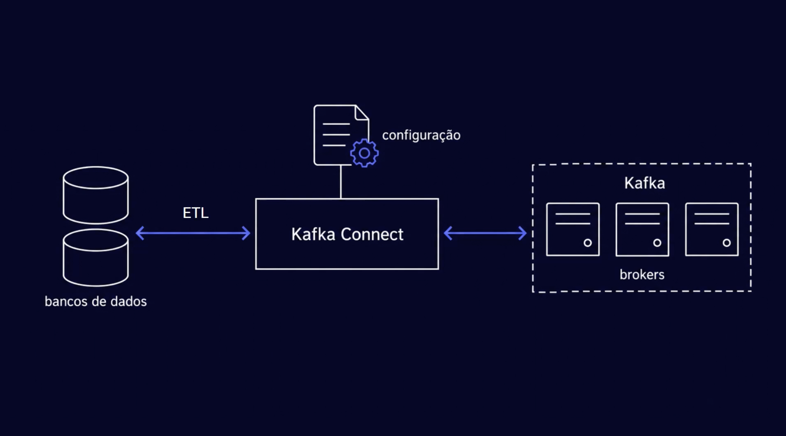
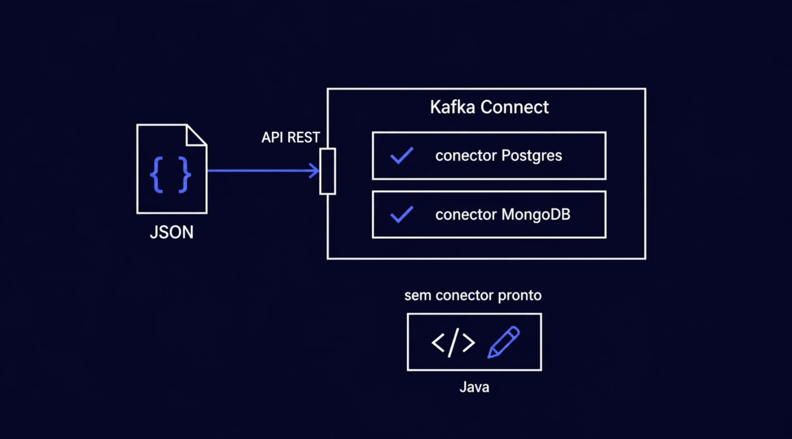
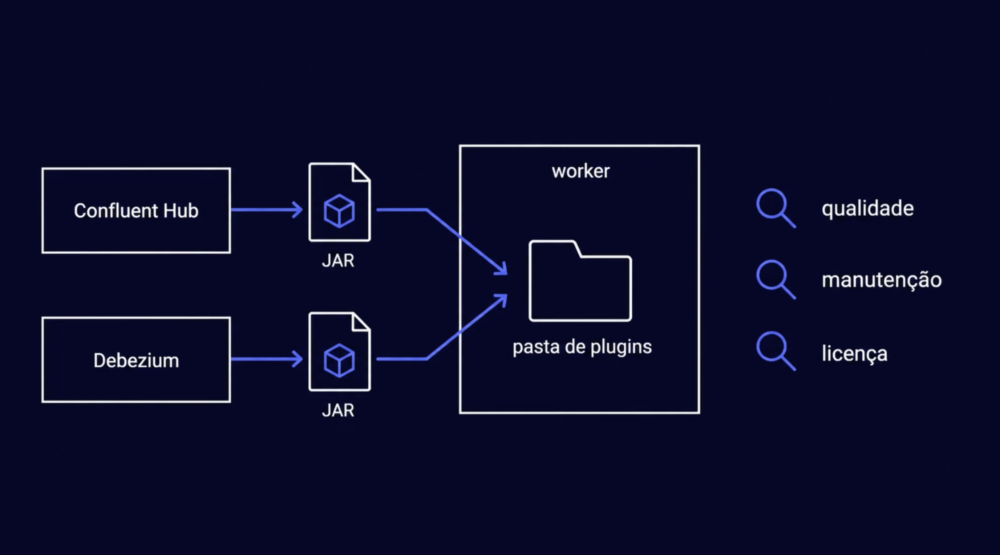
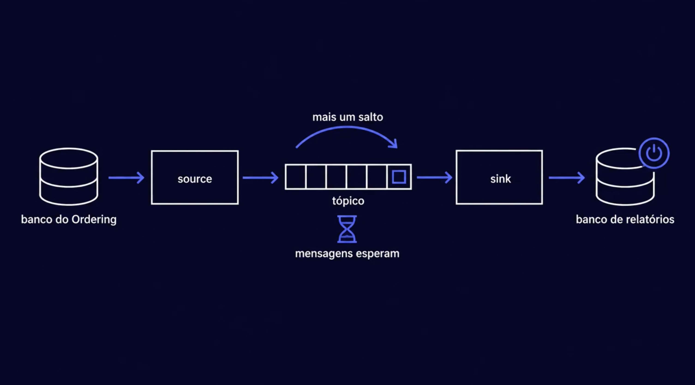
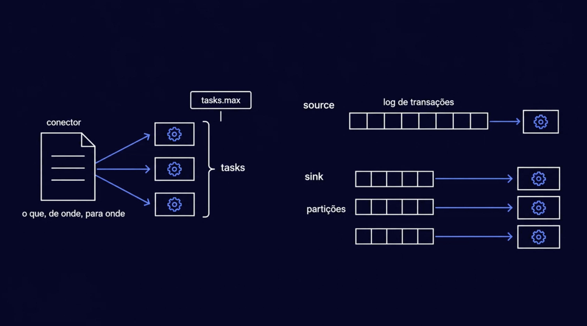
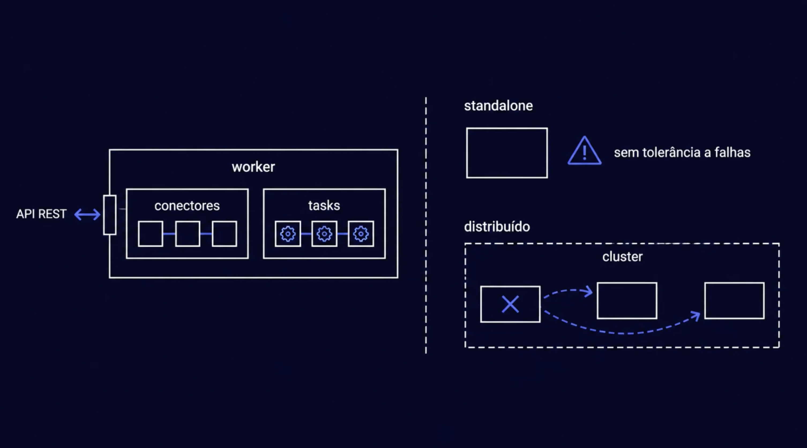
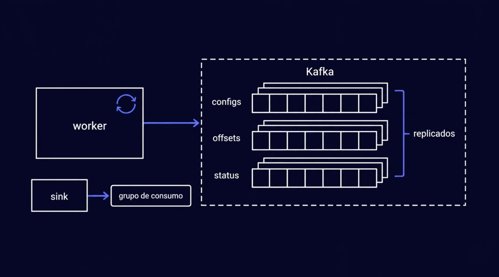
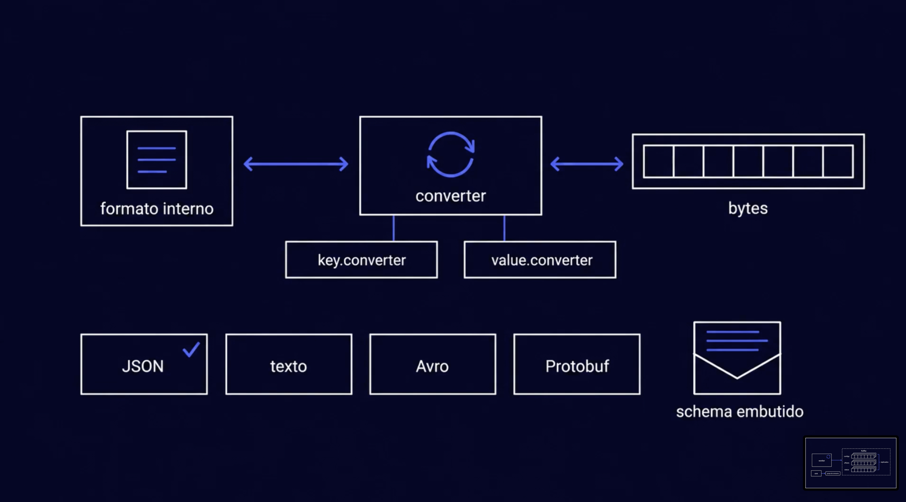
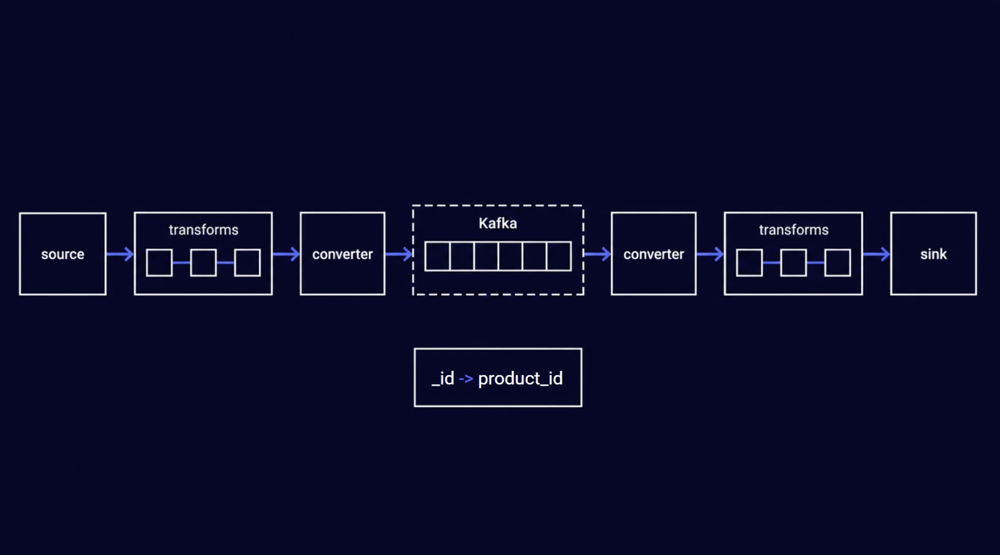
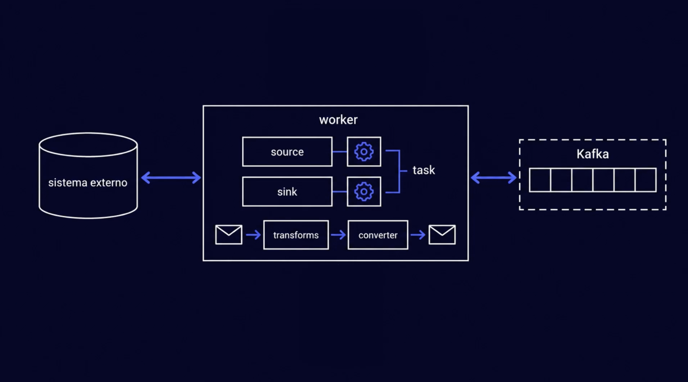

# Kafka Connect: workers, conectores, tasks, converters e transforms

> **Em uma frase:** o **Kafka Connect** é um serviço pronto, que roda ao lado do Kafka e move dados entre os bancos e os tópicos só por **configuração**. Os **conectores** dizem o quê, de onde e para onde. As **tasks** fazem o trabalho. Os **workers** são os processos que rodam tudo. Os **converters** traduzem para bytes, e os **transforms** fazem pequenos ajustes no caminho.

⬅️ Anterior: [CDC: capturar as mudanças](./06-cdc-captura-de-mudancas.md) · ➡️ Próximo: — · 🧭 Trilha: [README](../README.md#trilha-de-leitura)

---

## O problema

O [doc 06](./06-cdc-captura-de-mudancas.md) decidiu que o ETL vai ler o registro de transações do Postgres (CDC por log). Alguém precisa fazer esse trabalho, e ele não é pequeno:

- ler o WAL sem perder nenhuma mudança;
- lembrar **onde parou**, para continuar dali depois de uma queda;
- transformar cada mudança e gravar no banco de relatórios;
- não cair junto com uma máquina;
- ser ligado e desligado sem escrever um serviço novo.

Escrever isso à mão, para cada banco, seria repetir infraestrutura que não é o negócio do AlgaShop.

## A ideia

O Kafka Connect fica **entre os bancos e o Kafka**. Ele já sabe ler, guardar a posição, tentar de novo e se distribuir. Você não programa: você **configura**. A seta vai nos dois sentidos: ele traz dados para o Kafka e leva dados do Kafka para outros bancos.

## Conectores: o que mover

Um **conector** é a descrição de um trabalho de cópia: **o quê, de onde e para onde**.

- Você cria um conector mandando um **JSON** para a **API REST** do Kafka Connect.
- Existem conectores prontos para quase todo banco, como o do Postgres e o do MongoDB (o product-catalog usa MongoDB).
- Se não houver um pronto, dá para escrever um em **Java**. Na maioria dos casos não é preciso.

### De onde vêm os conectores: plugins

O Kafka Connect vem vazio. Cada tipo de conector é um **plugin**: um arquivo **JAR** colocado na **pasta de plugins**.

- **Confluent Hub:** o catálogo de conectores para Kafka.
- **Debezium:** o projeto de conectores de **CDC por log**. É ele que lê o WAL do Postgres.

Antes de instalar um plugin, olhe três coisas:

| Critério | Pergunta |
|---|---|
| **Qualidade** | ele é usado e testado por muita gente? |
| **Manutenção** | ainda recebe correções e acompanha as versões do banco? |
| **Licença** | posso usar no meu projeto sem custo nem restrição? |

## Source e sink: os dois sentidos

| Tipo | Sentido | No AlgaShop |
|---|---|---|
| **Source** | do sistema externo **para** o tópico | o Debezium lê o WAL do banco do ordering e grava as mudanças num tópico |
| **Sink** | do tópico **para** o sistema externo | lê o tópico e grava no banco de relatórios |

O tópico no meio é **mais um salto**: o dado demora um pouco mais para chegar. Em troca, os dois lados ficam **independentes**. Se o banco de relatórios estiver desligado (o botão na imagem), o source continua lendo, e **as mensagens esperam no tópico**. Quando o banco volta, o sink retoma de onde parou. É a mesma ideia de desacoplamento do [Kafka na prática](../06-mensageria/03-kafka-na-pratica.md).

## Tasks: quem faz o trabalho

O conector só **descreve** o trabalho. Quem **executa** são as **tasks**.

- `tasks.max` é o número máximo de tasks que o conector pode abrir.
- **Source de CDC:** o log de transações é uma fila **única e em ordem**. Por isso ele é lido por **uma** task; mais tasks não aceleram nada.
- **Sink:** o tópico tem partições. Cada partição pode ter a sua task, e elas trabalham em paralelo, como os consumidores de um grupo.

## Workers: onde tudo roda

O **worker** é o processo do Kafka Connect: uma JVM que expõe a API REST e roda os conectores e as tasks. Ele pode rodar de dois jeitos:

| Modo | Como é | Quando usar |
|---|---|---|
| **Standalone** | um worker sozinho | testes rápidos. **Sem tolerância a falhas:** se ele cair, a cópia para |
| **Distribuído** | vários workers formam um cluster | o normal. Se um cair, o cluster **redistribui** as tasks dele para os outros |

### Como ele lembra onde parou

O worker não guarda nada importante na própria máquina. Tudo vai para **tópicos internos do Kafka**, replicados entre os brokers:

| Tópico interno | Guarda | Para quê |
|---|---|---|
| **configs** | a configuração dos conectores | qualquer worker do cluster sabe o que rodar |
| **offsets** | até onde o source já leu | depois de uma queda, ele continua do ponto certo, sem perder nem repetir mudanças |
| **status** | se cada conector e cada task está rodando ou falhou | a API REST mostra a saúde |

O **sink** lembra a posição de outro jeito: ele é um consumidor comum, com um **grupo de consumo**, igual ao listener do notifications.

Por isso o modo distribuído funciona: um worker novo lê esses tópicos e sabe exatamente o que fazer e de onde continuar.

## Converters: de objeto para bytes

Dentro do Kafka Connect, cada registro está num **formato interno**. No tópico, só existem **bytes**. O **converter** faz a tradução, nos dois sentidos:

- `key.converter` traduz a chave, e `value.converter` traduz o valor.
- Formatos: **JSON** (o que vamos usar), texto, Avro e Protobuf.
- **Schema embutido:** no JSON, cada mensagem pode levar junto a **descrição dos seus campos** (nomes e tipos). Assim, o sink sabe montar a tabela no destino. O preço é uma mensagem maior.

O converter é o primo do `JsonSerializer` que o AlgaShop já usa nos produtores Spring.

## Transforms: ajustes no caminho

Os **transforms** (SMTs, *Single Message Transforms*) mudam **uma mensagem de cada vez**, em cadeia:

- no **source**: depois de ler e **antes** do converter;
- no **sink**: **depois** do converter e antes de gravar.

Exemplo da imagem: o MongoDB chama a chave de `_id`, e o banco de relatórios quer `product_id`. Um transform renomeia o campo no caminho.

Transforms servem para ajustes **pequenos**: renomear, tirar um campo, mudar o nome do tópico, achatar um objeto. São o **T** do ETL feito no meio do caminho. Juntar dados de vários registros (pedido com categoria) não é trabalho de transform: isso fica no banco de relatórios, com `join`.

## Resumo: o caminho de uma mudança

1. O pedido muda no banco do ordering.
2. A **task** do **source** (Debezium) lê a mudança no WAL.
3. Os **transforms** ajustam a mensagem.
4. O **converter** a transforma em bytes, e ela entra no **tópico**.
5. A **task** do **sink** lê o tópico; o **converter** traduz de volta; os **transforms** ajustam.
6. O sink grava no **banco de relatórios**.
7. Tudo isso roda dentro de **workers**, que guardam configs, offsets e status no próprio Kafka.

| Peça | O que faz | Em uma imagem |
|---|---|---|
| **Conector** | descreve o trabalho: o quê, de onde, para onde | a ordem de serviço |
| **Task** | executa o trabalho | o funcionário |
| **Worker** | roda conectores e tasks | a fábrica |
| **Converter** | traduz entre objeto e bytes | o tradutor |
| **Transform** | ajusta cada mensagem no caminho | o retoque |

## Como aplicar

1. Suba o Kafka Connect em modo **distribuído**, apontando para o cluster Kafka.
2. Instale os plugins necessários (Debezium para o source, um JDBC para o sink).
3. Prepare o banco de origem para o CDC (o "banco preparado" do doc 06).
4. Crie o conector **source** por JSON na API REST; confira o status.
5. Crie o conector **sink** para o banco de relatórios.
6. Escolha os converters e, se precisar, os transforms.

## Para lembrar

- Kafka Connect = mover dados entre sistemas e Kafka por **configuração**, sem programar.
- Conector descreve; task executa; worker roda.
- Source traz para o tópico; sink leva do tópico. No meio, as mensagens esperam.
- Source de CDC = 1 task (o log é uma fila só); sink = até uma task por partição.
- Configs, offsets e status ficam em tópicos do Kafka: por isso ele sobrevive a quedas.
- Converter = bytes; transform = pequeno ajuste em cada mensagem.

## Cuidados

- **Mais um salto, mais atraso.** O tópico entre source e sink acrescenta um pouco de tempo. Para relatório estratégico, isso não pesa.
- **`tasks.max` não acelera um source de CDC.** O log é lido em ordem, por uma task só.
- **Plugin abandonado é dívida.** Um conector sem manutenção pode parar de funcionar na próxima versão do banco.
- **Schema embutido pesa.** Cada mensagem leva a descrição dos campos. É prático para aprender e para o sink criar tabelas, mas ocupa espaço.
- **Transform não é lugar de regra de negócio.** Lógica escondida na configuração de um conector é difícil de achar e de testar.
- **Os tópicos internos precisam de réplicas.** Se o tópico de offsets se perder, o source não sabe mais onde parou. O cluster do AlgaShop tem 3 brokers: use réplicas como nos outros tópicos.
- **Standalone só para testar.** Um worker sozinho que cai para toda a cópia.

## Pendências

- Subir o Kafka Connect no `docker-compose`, ligado aos 3 brokers.
- Preparar o Postgres do ordering para o CDC (WAL lógico) e criar o conector Debezium.
- Criar o banco de relatórios e o conector sink.

## Onde ver

- [CDC: capturar as mudanças](./06-cdc-captura-de-mudancas.md): por que ler o log.
- [Relatórios estratégicos: reporting database e ETL](./05-relatorios-estrategicos-e-reporting-database.md): para onde os dados vão.
- [Kafka na prática](../06-mensageria/03-kafka-na-pratica.md): tópicos, partições e grupos de consumo.
