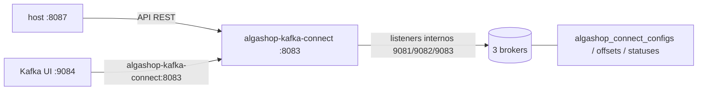

# Kafka Connect no Docker com a imagem do Debezium

> **Em uma frase:** o Kafka Connect do AlgaShop roda como mais um container no `docker-compose.tools.yml`, com a imagem do **Debezium**, que já traz os plugins de CDC. Ele roda em modo distribuído, guarda o próprio estado em três tópicos replicados nos 3 brokers e expõe a API REST na porta **8087** do host.

⬅️ Anterior: [Kafka Connect](./07-kafka-connect.md) · ➡️ Próximo: [Serviço insights e bancos preparados](./09-servico-insights-e-bancos-preparados.md) · 🧭 Trilha: [README](../README.md#trilha-de-leitura)

---

## O problema

O [doc 07](./07-kafka-connect.md) explicou as peças do Kafka Connect: workers, conectores, tasks, converters e transforms. Para usá-las, falta ter um worker **rodando**, ligado ao cluster Kafka do projeto e com os plugins de CDC instalados.

## A ideia: uma imagem que já vem com os plugins

O Kafka Connect "puro" vem com a pasta de plugins vazia. A imagem `quay.io/debezium/connect` é um Kafka Connect que já traz na pasta os conectores do **Debezium**. Não é preciso baixar nenhum JAR à mão.

Plugins que o worker carregou (conferido em `GET /connector-plugins`):

| Tipo | Conectores |
|---|---|
| **Source (CDC)** | Postgres, MongoDB, MySQL, MariaDB, Oracle, SQL Server, Db2 e outros |
| **Sink** | JDBC (grava em bancos relacionais), MongoDB |
| **Do próprio Kafka** | Mirror (cópia entre clusters Kafka) |

Para o AlgaShop importam três: o **Postgres** (ler o ordering), o **MongoDB** (ler o product-catalog) e o **JDBC sink** (gravar no banco de relatórios).

## Como funciona no AlgaShop

### Cada variável, e a peça do doc 07 que ela liga

| Variável | Valor | O que liga |
|---|---|---|
| `BOOTSTRAP_SERVERS` | `algashop-kafka-1:9081,...` | os **listeners internos** dos brokers, os mesmos que o Kafka UI usa dentro do Docker |
| `GROUP_ID` | `algashop-kafka-connect` | o **modo distribuído**: workers com o mesmo id formam um cluster e dividem as tasks |
| `CONFIG_STORAGE_TOPIC` | `algashop_connect_configs` | tópico interno com a configuração dos conectores |
| `OFFSET_STORAGE_TOPIC` | `algashop_connect_offsets` | tópico interno com **até onde** cada source já leu |
| `STATUS_STORAGE_TOPIC` | `algashop_connect_statuses` | tópico interno com o estado de cada conector e task |
| `CONNECT_*_REPLICATION_FACTOR` | `3` | os três tópicos internos **replicados nos 3 brokers** |
| `KAFKA_HEAP_OPTS` | `-Xms256m -Xmx768m` | a memória da JVM do worker, abaixo do limite de 1G do container |

### Porta do host × porta na rede do Docker

- **Dentro do Docker**, o worker escuta na **8083**, e os outros containers o chamam pelo nome: o Kafka UI usa `http://algashop-kafka-connect:8083`.
- **No host**, a API REST fica na **8087** (`8087:8083`). A 8085 é a da segunda instância do notifications ([doc 08 do módulo 07](../07-notificacoes/08-eureka-e-gateway-admin.md)) e a 8086 é a do serviço insights ([doc 09](./09-servico-insights-e-bancos-preparados.md)). O Connect começou na 8086 e mudou quando o insights chegou.

### O Kafka UI enxerga o Connect

O Kafka UI ganhou duas variáveis (`KAFKA_CLUSTERS_0_KAFKACONNECT_0_NAME` e `..._ADDRESS`). Em <http://localhost:9084>, o menu **Kafka Connect** mostra o worker `algashop-connect`, e é por lá que os conectores vão aparecer.

### A API REST e o contrato

Tudo no Kafka Connect se faz pela API REST: criar, ver, pausar e apagar conectores. O contrato está em [`openapi/apache-kafka-connect.yml`](../openapi/apache-kafka-connect.yml), com `servers` apontando para a 8087. As chamadas mais úteis:

| Chamada | Para quê |
|---|---|
| `GET /` | versão do worker e id do cluster Kafka |
| `GET /connector-plugins` | quais plugins estão instalados |
| `GET /connectors` | quais conectores existem |
| `POST /connectors` | criar um conector (o JSON do doc 07) |
| `GET /connectors/{nome}/status` | se o conector e as tasks estão rodando |

## Como aplicar

1. Suba os brokers, o Kafka UI e o Connect: `docker compose -f docker-compose.tools.yml up -d algashop-kafka-1 algashop-kafka-2 algashop-kafka-3 algashop-kafka-ui algashop-kafka-connect`.
2. Espere a API responder: `GET http://localhost:8087/`.
3. Confira os plugins (`/connector-plugins`) e se os tópicos internos estão com réplica 3.
4. Abra o Kafka UI e veja o worker no menu Kafka Connect.

## Para lembrar

- A imagem do Debezium = Kafka Connect + plugins de CDC já na pasta.
- `GROUP_ID` liga o modo distribuído; os três tópicos internos guardam o estado.
- Réplica 3 nos tópicos internos, porque são 3 brokers.
- 8083 dentro do Docker (pelo nome); 8087 no host.
- Tudo se faz pela API REST; o contrato está no OpenAPI.

## Cuidados

- **Memória no limite.** Logo depois de subir, ainda sem conectores, o container já usava **~965 MiB de 1 GiB (94%)**. O heap é de 768m, e a JVM usa mais memória além dele. Com conectores rodando, o container pode ser morto por falta de memória (OOM). Fique de olho no `docker stats` e, se precisar, aumente o limite ou reduza o heap.
- **Um worker só.** O modo é distribuído, mas há um único worker. Se ele cair, a cópia para até ele voltar; não há outro para assumir. Para estudo, basta.
- **Os tópicos internos não se apagam.** Apagar o `algashop_connect_offsets` faz o source esquecer onde parou e reler tudo. Eles são compactados (`cleanup.policy=compact`): o Kafka guarda o último valor de cada chave.
- **`min.insync.replicas=1` nos tópicos internos.** Eles foram criados com o padrão dos brokers. Os tópicos do projeto usam 2; vale alinhar quando o CDC for para valer.
- **Imagem de outro registro, com versão fixa.** Ela vem do `quay.io`, e não do Docker Hub. A versão `3.7.0.Final` está fixa, como nos outros serviços: atualizar é uma decisão, não um acidente.

## Pendências

- ~~Preparar o Postgres para o CDC (`wal_level=logical`)~~ — feito no [doc 09](./09-servico-insights-e-bancos-preparados.md).
- O primeiro conector source (Postgres do ordering) e o JSON dele guardado no repositório.
- O banco de relatórios e o conector sink (JDBC).
- Avaliar o limite de memória do container.

## Testes

Conferido em 13/11/2026, com os 3 brokers no ar:

| Verificação | Resultado |
|---|---|
| `GET /` (na 8086 da época; hoje 8087) | 200: `{"version":"4.3.1", ...}`; o worker roda o Kafka Connect 4.3.1 |
| `GET /connector-plugins` | 17 plugins: os sources do Debezium 3.7.0 (Postgres, MongoDB...), os sinks JDBC e MongoDB e os 3 Mirror do Kafka |
| `GET /connectors` | `[]` (nenhum conector ainda) |
| Tópicos internos | `configs` (1 partição), `offsets` (25), `statuses` (5); todos com **ReplicationFactor 3** e `cleanup.policy=compact` |
| Kafka UI | `/api/clusters/algashop-kafka-cluster/connects` lista o `algashop-connect` em `http://algashop-kafka-connect:8083` |
| Memória | ~965 MiB de 1 GiB, sem OOM e sem reinício |

## Onde ver

- `docker-compose.tools.yml` (meta): os serviços `algashop-kafka-connect` e `algashop-kafka-ui`.
- [`openapi/apache-kafka-connect.yml`](../openapi/apache-kafka-connect.yml): a API REST do Connect.
- [Kafka Connect](./07-kafka-connect.md): as peças que essas variáveis configuram.
