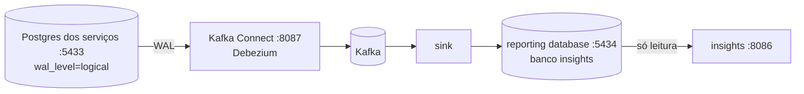

# Serviço insights e bancos preparados

> **Em uma frase:** nasce o **insights**, o microsserviço dos relatórios estratégicos, com um **Postgres só dele** (o reporting database, na 5434). E o Postgres dos serviços passa a escrever o WAL em modo **lógico**, para que o Debezium consiga ler as mudanças.

⬅️ Anterior: [Kafka Connect no Docker com Debezium](./08-kafka-connect-no-docker-com-debezium.md) · ➡️ Próximo: [Extraindo pedidos com Debezium](./10-extraindo-pedidos-com-debezium.md) · 🧭 Trilha: [README](../README.md#trilha-de-leitura)

---

## O problema

Os docs 05 a 08 montaram o caminho do dado: CDC por log, Kafka Connect, Debezium. Faltavam as duas pontas:

- **a origem não estava preparada:** o Postgres dos serviços escrevia o WAL só para se recuperar de quedas, sem a informação que o Debezium precisa;
- **o destino não existia:** não havia o banco de relatórios nem um serviço dono dele.

## A ideia



| Peça | Papel |
|---|---|
| **Postgres dos serviços** (5433) | a origem. Agora escreve o WAL em modo **lógico** |
| **Kafka Connect** (8087) | o ETL: lê o WAL (source) e grava no banco de relatórios (sink) |
| **Reporting database** (5434) | a cópia, feita para relatório. Só o ETL escreve nela |
| **insights** (8086) | o serviço dos relatórios estratégicos. Só **lê** o banco de relatórios |

## Como funciona no AlgaShop

### O banco preparado: `wal_level=logical`

O Postgres sempre escreve o WAL. No modo padrão (`replica`), o WAL serve para recuperar o próprio banco e para réplicas idênticas. Ele não diz, de um jeito fácil de ler, "a linha X da tabela `order` mudou de `PLACED` para `PAID`".

Com `wal_level=logical`, o WAL passa a levar informação suficiente para **reconstruir cada linha alterada**. É isso que o Debezium lê. É o "banco preparado" do [doc 06](./06-cdc-captura-de-mudancas.md#o-resumo-do-caminho).

No compose, é uma linha no `algashop-postgres`:

```yaml
command: >
  postgres
  -c wal_level=logical
```

Duas coisas vêm junto:

- **Slots de replicação:** cada conector Debezium abre um **slot**, que marca até onde ele já leu. O Postgres guarda o WAL a partir dali. O padrão é até 10 slots (`max_replication_slots`) e 10 conexões de leitura (`max_wal_senders`), o que basta para o projeto.
- **Recriar o container:** o `command` só vale quando o container é criado. É preciso um `up -d` que o recrie; não basta reiniciar.

### O reporting database: um Postgres separado

O banco de relatórios **não** é mais um banco dentro do Postgres dos serviços. É outro container, o `algashop-insights-postgres`, na porta **5434** (a 5433 já é do Postgres dos serviços), com volume próprio e 512M de memória.

Por que separado:

- **Isolamento de carga:** um relatório que soma um ano de pedidos não disputa CPU, memória e disco com o checkout.
- **Dono claro:** o banco é do insights; nenhum outro serviço o usa.
- **Falha isolada:** se o banco de relatórios cair, vendas e pagamentos seguem.

### O serviço insights

Um Spring Boot 4 com o mínimo para começar:

| Dependência | Para quê |
|---|---|
| JDBC (`NamedParameterJdbcTemplate`) | consultas de relatório com SQL (`join`, `group by`), como as métricas dos docs 02–04 |
| Flyway | criar as tabelas do banco de relatórios (ainda sem migrations); `placeholder-replacement: false` |
| Web MVC + Validation | a API dos relatórios; já há um `ApiExceptionHandler` com `ProblemDetail` |

Os pacotes seguem o estilo do billing: `application`, `infrastructure` e `presentation`. Os perfis são os mesmos dos outros serviços (`development`, `docker`, `production`).

### As portas, agora

| Porta no host | O quê |
|---|---|
| 5433 | Postgres dos serviços (origem do CDC) |
| 5434 | reporting database (banco `insights`) |
| 8085 | segunda instância do notifications (quando houver) |
| 8086 | **insights** |
| 8087 | **Kafka Connect** (API REST; antes 8086) |

O Connect saiu da 8086 para o insights ficar com a porta do curso.

## Como aplicar

1. Ligue o `wal_level=logical` no Postgres de origem e **recrie** o container.
2. Crie um banco de relatórios separado, com porta e volume próprios.
3. Crie o serviço dono do banco de relatórios e aponte o datasource para ele.
4. Confirme: `show wal_level` → `logical`; o banco de relatórios responde; o serviço sobe.

## Para lembrar

- `wal_level=logical` é o "banco preparado": sem ele, o Debezium não tem o que ler.
- Mudou o `command` do container? Recrie, não só reinicie.
- Cada conector tem um slot, e o slot segura o WAL até ser lido.
- Reporting database separado = carga isolada, dono claro e falha isolada.
- O insights só **lê**; quem escreve no banco de relatórios é o ETL.

## Cuidados

- **Slot esquecido enche o disco.** Se um conector for apagado sem remover o slot, o Postgres guarda o WAL para sempre. Apagou o conector? Confira `pg_replication_slots`.
- **O WAL lógico escreve um pouco mais.** Para o projeto, a diferença não se nota.
- **O datasource chegou apontando para a 5433.** Era o Postgres dos serviços, que nem tem o banco `insights`. Agora aponta para a 5434.
- **Porta repetida.** O insights e o Connect queriam a 8086; o Connect foi para a 8087.
- **`docker compose down -v` apaga todos os volumes.** Bancos, Kafka e MongoDB voltam vazios. Os serviços recriam as tabelas e a massa de desenvolvimento quando sobem (Flyway e `afterMigrate`), mas o que foi criado à mão se perde.

## Pendências

- Subir e testar o insights depois de recriar o ambiente (ver Testes).
- As primeiras migrations do banco de relatórios.
- ~~O conector source do Postgres (Debezium)~~ — feito no [doc 10](./10-extraindo-pedidos-com-debezium.md); falta o sink JDBC para a 5434.
- Eureka, segurança (resource server) e rota no gateway-admin para o insights.

## Testes

13/11/2026:

| Verificação | Resultado |
|---|---|
| `docker compose config` | válido |
| `show wal_level` (5433, recriado) | `logical`; `max_replication_slots` 10 e `max_wal_senders` 10 |
| Bancos na 5433 depois de recriar | os 11 bancos do script de inicialização, **sem tabelas** (o ambiente tinha sido recriado com volumes novos) |
| Banco `insights` na 5434 | existe; Postgres 17.10 (`wal_level` `replica`, o padrão: ele não é origem de CDC) |
| Kafka Connect na 8087 | `GET /` 200 |
| `insights`, `./gradlew check bootJar` | BUILD SUCCESSFUL; **sem testes ainda** |
| `insights` rodando | **não confirmado**: os containers foram parados durante o teste, e o serviço não achou o banco na 5434 |

## Dados de teste

- **Bancos:** `docker compose -f docker-compose.tools.yml up -d algashop-postgres algashop-insights-postgres`.
- **WAL:** `docker exec algashop-meta-algashop-postgres-1 psql -U postgres -c "show wal_level"`.
- **Relatórios:** `psql -h localhost -p 5434 -U postgres -d insights` (senha `postgres`).
- **Serviço:** `./gradlew bootRun` no `microservices/insights`, e depois a porta 8086.

## Onde ver no código

- `docker-compose.tools.yml` (meta): `algashop-postgres` (o `command` do WAL), `algashop-insights-postgres` e `algashop-kafka-connect` (8087).
- `microservices/insights`: `application-base.yml` (nome, Flyway), `application-development-env.yml` (porta 8086, datasource 5434), `ApiExceptionHandler`.
- [Kafka Connect no Docker com Debezium](./08-kafka-connect-no-docker-com-debezium.md): o worker que vai ligar as duas pontas.
