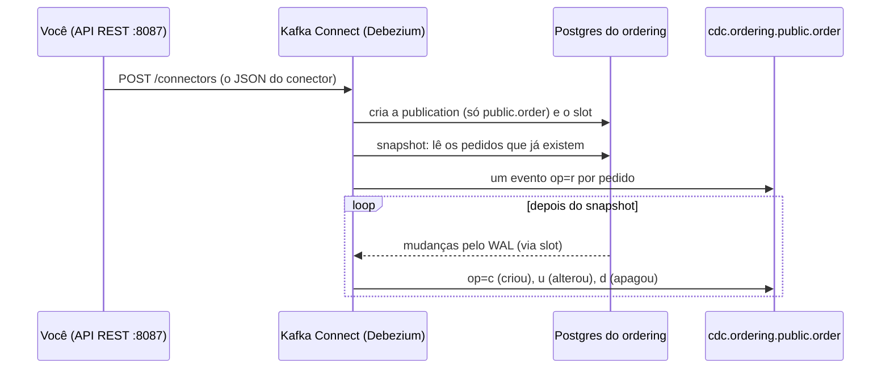

# Extraindo pedidos com Debezium: o primeiro conector source

> **Em uma frase:** um JSON enviado ao Kafka Connect cria o conector `cdc.source.ordering.order`. Ele tira uma foto inicial da tabela `order` do ordering e depois segue o WAL, publicando cada mudança no tópico `cdc.ordering.public.order`, só com as 12 colunas que o relatório precisa. É o **E** do ETL funcionando.

⬅️ Anterior: [Serviço insights e bancos preparados](./09-servico-insights-e-bancos-preparados.md) · ➡️ Próximo: — · 🧭 Trilha: [README](../README.md#trilha-de-leitura)

---

## O problema

Já temos o banco preparado (`wal_level=logical`), o Kafka Connect com o plugin do Debezium e o banco de relatórios ([docs 08](./08-kafka-connect-no-docker-com-debezium.md) e [09](./09-servico-insights-e-bancos-preparados.md)). Falta dizer ao Connect **o que** extrair: de qual banco, de qual tabela, quais colunas e para qual tópico.

## A ideia



1. **Publication e slot:** o Debezium pede ao Postgres uma *publication* (a lista de tabelas que interessam) e um *slot* (o marcador de até onde ele já leu).
2. **Snapshot:** o slot só vê o que acontece **depois** de criado. Por isso o Debezium primeiro lê os pedidos que já existem: é a carga inicial do [doc 06](./06-cdc-captura-de-mudancas.md).
3. **Streaming:** dali em diante, ele segue o WAL e publica cada mudança, na ordem.

## Como funciona no AlgaShop

### As propriedades, uma a uma

O arquivo `etc/kafka-connect/cdc.source.ordering.order.json` (no meta) tem o conector:

| Propriedade | Valor | O que faz |
|---|---|---|
| `connector.class` | `...PostgresConnector` | qual plugin usar (o source de Postgres do Debezium) |
| `tasks.max` | `1` | uma task: o WAL é uma fila só, em ordem ([doc 07](./07-kafka-connect.md#tasks-quem-faz-o-trabalho)) |
| `database.hostname` / `port` | `algashop-postgres` / `5432` | o Postgres **pela rede do Docker**: nome do container e porta de dentro (não a 5433 do host) |
| `database.user` / `password` | `postgres` | quem conecta |
| `database.dbname` | `ordering` | qual banco do Postgres |
| `topic.prefix` | `cdc.ordering` | começo do nome do tópico: `prefixo.schema.tabela` → `cdc.ordering.public.order` |
| `plugin.name` | `pgoutput` | o decodificador do WAL que já vem no Postgres (não precisa instalar extensão) |
| `slot.name` | `cdc_ordering_order` | o nome do slot de replicação |
| `publication.name` | `cdc_ordering_order` | o nome da publication |
| `publication.autocreate.mode` | `filtered` | cria a publication só com as tabelas do `table.include.list`, e não com o banco inteiro |
| `table.include.list` | `public.order` | só a tabela de pedidos |
| `column.include.list` | 12 colunas | só o que o relatório precisa (veja abaixo) |
| `snapshot.mode` | `initial` | faz a foto inicial na primeira vez e depois só segue o WAL |
| `custom.metric.tags` | `table=order` | uma etiqueta nas métricas do conector, para achar fácil |

### Só as colunas do relatório

A tabela `order` tem 40 colunas. O conector manda 12:

`id`, `customer_id`, `status`, `total_amount`, `total_items`, `payment_method`, `placed_at`, `paid_at`, `ready_at`, `canceled_at`, `shipping_address_city`, `shipping_address_state`

Ficam de fora nomes, documentos, telefones, e-mails, rua e número. O relatório estratégico não precisa deles, e dado pessoal que não sai do serviço não vaza. É o cuidado do [doc 06](./06-cdc-captura-de-mudancas.md#cuidados) na prática.

A publication do Postgres continua com todas as colunas. **Quem corta é o Debezium**, antes de publicar no Kafka.

### Validar, criar e atualizar

A API REST tem três jeitos de mandar uma configuração:

| Chamada | Corpo | Para quê |
|---|---|---|
| `PUT /connector-plugins/{classe}/config/validate` | as propriedades, planas | conferir **antes** de criar; devolve os erros campo por campo |
| `POST /connectors` | `{"name": ..., "config": {...}}` | **criar**. Se o nome já existe, responde 409 |
| `PUT /connectors/{nome}/config` | as propriedades, planas; o nome vai na URL | **atualizar** um conector que existe (e, se não existir, cria) |

O arquivo do repositório está no formato do **POST**. Para o PUT, use o mesmo conteúdo sem o `config` em volta e com o nome na URL.

**O validate na prática.** Com uma configuração incompleta (só classe, host, porta, usuário, senha e tabela), ele respondeu 3 erros:

- `name`: falta;
- `database.dbname`: obrigatório;
- `topic.prefix`: obrigatório.

É um jeito barato de achar o erro antes que o conector falhe rodando.

### Anatomia de uma mensagem

Cada mudança vira uma mensagem no tópico:

- **Chave:** `{"id": 1727196000001}`, o id do pedido. Mudanças do mesmo pedido caem na mesma partição, em ordem.
- **Valor:**

| Campo | O que traz |
|---|---|
| `before` | a linha **antes** da mudança (veja os Cuidados) |
| `after` | a linha **depois** da mudança (nulo quando a linha foi apagada) |
| `source` | de onde veio: conector, banco, schema, tabela, posição no WAL (`lsn`) e se veio do snapshot |
| `op` | o tipo de mudança (tabela abaixo) |
| `ts_ms` | quando o Debezium processou |

| `op` | Significa | Quando |
|---|---|---|
| `r` | *read* | linha lida no snapshot |
| `c` | *create* | `insert` |
| `u` | *update* | `update` |
| `d` | *delete* | `delete` (o `after` vem nulo) |

O JSON leva o **schema embutido**: cada mensagem descreve os próprios campos e tipos (os converters do [doc 07](./07-kafka-connect.md#converters-de-objeto-para-bytes)). É por isso que ela é grande.

## Como aplicar

1. Valide a configuração (`.../config/validate`) até o `error_count` dar 0.
2. Crie com `POST /connectors` (ou `PUT .../config`).
3. Confira `GET /connectors/{nome}/status`: o conector e a task precisam estar `RUNNING`.
4. Confira no Postgres o slot (`pg_replication_slots`) e a publication (`pg_publication_tables`).
5. Leia o tópico: um `op=r` por linha que já existia; depois, os `c`, `u` e `d`.

## Para lembrar

- Conector = um JSON na API REST; o arquivo fica no repositório (`etc/kafka-connect`).
- Ele cria a publication (as tabelas) e o slot (a posição) no Postgres.
- Snapshot primeiro (`op=r`), depois o WAL (`c`, `u`, `d`).
- `topic.prefix` + schema + tabela = nome do tópico.
- Só as colunas do `column.include.list` saem do serviço.
- POST cria; PUT `/config` atualiza (e cria se não existir); validate confere antes.

## Cuidados

- **O `before` vem vazio no update.** O Postgres, por padrão, só guarda no WAL a chave da linha antiga. Para ter o `before` completo, a tabela precisa de `REPLICA IDENTITY FULL`, que tem um custo: o WAL fica maior. Para copiar o estado atual, o `after` basta.
- **Decimal vira bytes.** O `total_amount` sai como texto em base64 (`"AYag"`). É o modo `precise` do Debezium, que não perde casas, mas não dá para ler sem o schema. A propriedade `decimal.handling.mode` (`string` ou `double`) muda isso; decida antes de montar o sink.
- **Senha no arquivo e superusuário.** O conector usa o usuário `postgres`, com a senha no JSON. Para estudo, serve. Em produção, use um usuário só com permissão de replicação e a senha fora do arquivo.
- **Apagar o conector não apaga o slot.** O slot continua segurando o WAL ([doc 09](./09-servico-insights-e-bancos-preparados.md#cuidados)). Se o conector sair de vez, apague o slot também (`pg_drop_replication_slot`).
- **O slot confirma de tempos em tempos.** O `confirmed_flush_lsn` não anda a cada mensagem; o worker grava a posição em intervalos (60 s por padrão).
- **`order` é palavra reservada.** No SQL, a tabela precisa de aspas (`"order"`); na configuração do Debezium, não.
- **O arquivo foi para o stage vazio.** Ele foi adicionado ao git antes de receber o conteúdo. É preciso dar `git add` de novo, senão o commit leva um arquivo em branco.

## Pendências

- O sink JDBC para o reporting database (5434), que vai gravar a cópia dos pedidos.
- Os conectores dos itens do pedido e dos produtos (product-catalog, no MongoDB).
- Decidir o `decimal.handling.mode`.

## Testes

13/11/2026, com o Connect na 8087:

| Verificação | Resultado |
|---|---|
| `GET /connectors?expand=status` | `cdc.source.ordering.order`: conector `RUNNING`, task 0 `RUNNING` (Debezium 3.7.0.Final) |
| Slot | `cdc_ordering_order`, `pgoutput`, ativo |
| Publication | `cdc_ordering_order`, só `public.order` |
| Tópico `cdc.ordering.public.order` | 6 mensagens `op=r` (snapshot `first` … `last`), uma por pedido do banco, chave `{id}`, 12 colunas no `after` |
| Update ao vivo (`set status = status`) | mais 1 mensagem: `op=u`, `snapshot=false`, `after.status=PLACED`, `before` nulo |
| Validate incompleto | `error_count` 3: `name`, `database.dbname`, `topic.prefix` |

## Dados de teste

**Criar** (`POST http://localhost:8087/connectors`): o conteúdo de `etc/kafka-connect/cdc.source.ordering.order.json`.

**Atualizar** (`PUT http://localhost:8087/connectors/cdc.source.ordering.order/config`): as mesmas propriedades, sem o `config` em volta.

**Validar** (`PUT http://localhost:8087/connector-plugins/io.debezium.connector.postgresql.PostgresConnector/config/validate`):
```json
{
  "connector.class": "io.debezium.connector.postgresql.PostgresConnector",
  "database.hostname": "algashop-postgres",
  "database.port": "5432",
  "database.user": "postgres",
  "database.password": "postgres",
  "table.include.list": "public.order"
}
```

**Conferir no Postgres** (banco `ordering`):
```sql
select slot_name, plugin, active, confirmed_flush_lsn from pg_replication_slots;
select * from pg_publication_tables;
```

**Ver as mensagens:** Kafka UI (<http://localhost:9084>) → Topics → `cdc.ordering.public.order` → Messages.

## Onde ver

- `etc/kafka-connect/cdc.source.ordering.order.json` (meta): o conector.
- [`openapi/apache-kafka-connect.yml`](../openapi/apache-kafka-connect.yml): os endpoints de validate, POST e PUT.
- [CDC: capturar as mudanças](./06-cdc-captura-de-mudancas.md) e [Kafka Connect](./07-kafka-connect.md): os conceitos por trás.
