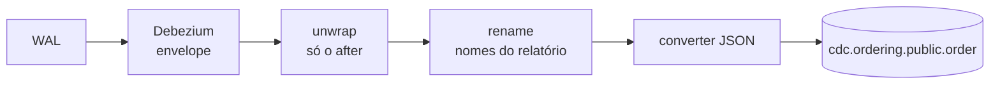

# Simplificando e renomeando a mensagem com transforms

> **Em uma frase:** dois transforms em cadeia mudam a mensagem do Debezium antes de ela chegar ao tópico. O `unwrap` tira o envelope e deixa só a linha como ela está. O `rename` troca nomes de colunas internos do ordering por nomes do relatório. E o `decimal.handling.mode` decide como o dinheiro viaja.

⬅️ Anterior: [Extraindo pedidos com Debezium](./10-extraindo-pedidos-com-debezium.md) · ➡️ Próximo: [Carregando pedidos no reporting database](./12-carregando-pedidos-no-reporting-database.md) · 🧭 Trilha: [README](../README.md#trilha-de-leitura)

---

## O problema

O [doc 10](./10-extraindo-pedidos-com-debezium.md#anatomia-de-uma-mensagem) mostrou a mensagem do Debezium: um **envelope** com `before`, `after`, `source`, `op` e `ts_ms`. Ele é ótimo para auditoria ("o que mudou, quando e de onde"), mas ruim para quem só quer copiar a linha:

- o banco de relatórios quer o pedido **como ele está**, e não "antes, depois e de onde";
- os nomes das colunas são os do ordering (`shipping_address_city`). Se o ordering renomear uma coluna, o relatório quebra junto.

## A ideia: ajustar no caminho

Os transforms do [doc 07](./07-kafka-connect.md#transforms-ajustes-no-caminho) fazem pequenos ajustes em cada mensagem. No source, eles rodam **depois** que o Debezium lê o WAL e **antes** do converter gravar no tópico.



### Antes e depois (mensagens reais do tópico)

**Antes** (doc 10), resumido:
```json
{
  "before": null,
  "after": { "id": 1727196000001, "status": "PLACED", "shipping_address_city": "North Ville", "...": "..." },
  "source": { "connector": "postgresql", "db": "ordering", "table": "order", "lsn": 62986608, "...": "..." },
  "op": "u",
  "ts_ms": 1794608344792
}
```

**Depois** (`unwrap` + `rename`):
```json
{
  "id": 1727196000001,
  "customer_id": "6e148bd5-47f6-4022-b9da-07cfaa294f7a",
  "status": "PLACED",
  "total_amount": "AYag",
  "total_items": 1,
  "canceled_at": null,
  "paid_at": null,
  "payment_method": "CREDIT_CARD",
  "placed_at": "2025-09-24T14:20:01.000000Z",
  "ready_at": null,
  "shipping_city": "North Ville",
  "shipping_state": "New Orleans"
}
```

Uma linha, do jeito que o banco de relatórios vai guardar.

## Como funciona no AlgaShop

### A cadeia de transforms

```json
"transforms": "unwrap,rename",
"transforms.unwrap.type": "io.debezium.transforms.ExtractNewRecordState",
"transforms.rename.type": "org.apache.kafka.connect.transforms.ReplaceField$Value",
"transforms.rename.renames": "shipping_address_city:shipping_city,shipping_address_state:shipping_state"
```

- `transforms` é uma **lista de apelidos**, na ordem em que rodam. `unwrap` e `rename` são nomes que nós escolhemos.
- Cada apelido ganha suas propriedades: `transforms.<apelido>.type` diz **qual** transform é, e as demais o configuram.

### 1. `unwrap`: só o `after`

O `ExtractNewRecordState` é um transform **do Debezium**. Ele pega o `after` do envelope e o transforma na mensagem inteira. Saem o `before`, o `source`, o `op` e o `ts_ms`.

O que acontece com cada operação:

| Operação | Depois do unwrap |
|---|---|
| snapshot (`r`), insert (`c`), update (`u`) | a linha nova, plana |
| delete (`d`) | por padrão, só o **tombstone**: a chave com valor nulo. É o sinal de "esta linha não existe mais" |

O sink JDBC entende o tombstone e apaga a linha no destino, quando configurado para isso. Se um dia o relatório precisar saber a operação ou a hora da mudança, o unwrap pode devolvê-las como colunas (`add.fields`).

### 2. `rename`: os nomes do relatório

O `ReplaceField` é um transform **do próprio Kafka Connect**, e não do Debezium. Com `renames`, ele troca nomes de campos:

| No ordering | No relatório |
|---|---|
| `shipping_address_city` | `shipping_city` |
| `shipping_address_state` | `shipping_state` |

- **`$Value`** quer dizer que ele mexe no **valor** da mensagem; `$Key` mexeria na chave.
- É o mesmo tipo de ajuste do exemplo `_id → product_id` do [doc 07](./07-kafka-connect.md#transforms-ajustes-no-caminho).

**A ordem importa.** O `rename` vem **depois** do `unwrap`. Antes do unwrap, `shipping_address_city` está dentro de `after`, e o `ReplaceField` só enxerga o primeiro nível: ele não acharia o campo.

**Por que renomear já na origem:** o nome no relatório fica independente do nome interno do ordering. O [doc 06](./06-cdc-captura-de-mudancas.md#o-resumo-do-caminho) disse que, com CDC, o schema vira contrato. O transform é uma camada de proteção: se o ordering renomear uma coluna, ajusta-se uma linha no conector, e o relatório não muda.

### 3. `decimal.handling.mode`: como o dinheiro viaja

O `total_amount` é `numeric(…, 2)` no Postgres. O Debezium tem três jeitos de colocá-lo no JSON:

| Modo | Como aparece | Precisão | Quando usar |
|---|---|---|---|
| **`precise`** (padrão) | `"AYag"`: bytes em base64, com o schema `Decimal` (escala 2) | exata | quando o destino lê o schema, como o sink JDBC, que cria a coluna `numeric` certa |
| `string` | `"1000.00"` | exata | para ler a mensagem à mão ou para depurar |
| `double` | `1000.0` | **pode perder centavos** | nunca para dinheiro |

O teste com `string` foi feito pelo PUT, só para ver o número. O arquivo do conector ficou com `precise`, porque quem vai ler é o sink, e ele usa o schema embutido para gravar o valor exato.

## Como aplicar

1. Acrescente `unwrap` para entregar a linha, e não o envelope.
2. Renomeie depois do unwrap, com `ReplaceField$Value`.
3. Escolha o `decimal.handling.mode` pensando em quem lê: o sink com schema → `precise`.
4. Aplique com o PUT `/connectors/{nome}/config` e confira o status.
5. Gere uma mudança e leia o tópico: a mensagem nova precisa vir plana e com os nomes novos.

## Para lembrar

- `unwrap` (Debezium) = só o `after`; o delete vira tombstone.
- `rename` (`ReplaceField`, do Kafka) = troca nomes; `$Value` mexe no valor.
- A cadeia roda na ordem da lista: primeiro achatar, depois renomear.
- Renomear na origem protege o relatório de mudanças de nome no serviço.
- Dinheiro: `precise` (com schema) ou `string`; nunca `double`.

## Cuidados

- **Mudar a config não muda o passado.** O PUT vale para as mensagens **novas**; o que já está no tópico continua no formato antigo. No teste, um tópico recriado com um snapshot novo veio todo plano. Um tópico antigo misturaria os dois formatos.
- **Teste não vai para o arquivo.** O `decimal.handling.mode: string` foi temporário, só pelo PUT. O arquivo ficou com `precise`.
- **Sem `op` na mensagem, o delete é só o tombstone.** O sink precisa estar configurado para apagar ao ver um tombstone; senão, o pedido apagado fica no relatório.
- **O tópico tem 1 partição.** Ele foi criado automaticamente pelo Connect. A ordem por pedido continua garantida (chave = id), mas o sink não vai ter paralelismo. Para o volume do projeto, basta.
- **Transform não é lugar de regra de negócio.** Achatar e renomear, sim; calcular regra do pedido, não.

## Pendências

- ~~O sink JDBC para o reporting database (5434)~~ — feito no [doc 12](./12-carregando-pedidos-no-reporting-database.md); falta decidir o apagar por tombstone.
- Decidir se o relatório precisa de `op` ou da hora da mudança (`add.fields`).
- Os conectores dos itens e dos produtos.

## Testes

14/11/2026, com o Connect na 8087:

| Verificação | Resultado |
|---|---|
| Config ao vivo (`GET .../config`) | igual ao arquivo: `transforms=unwrap,rename`, `ReplaceField$Value`, os 2 renames, `decimal.handling.mode=precise` |
| Tópico (recriado com snapshot novo) | 7 registros, **todos planos**: 6 do snapshot + 1 do update de teste |
| Update ao vivo (`set status = status`) | mensagem plana com 12 campos, chave `{"id": 1727196000001}` |
| Campos renomeados | `shipping_city` e `shipping_state` presentes; os nomes antigos não aparecem |
| `total_amount` | `"AYag"`, schema `bytes` / `org.apache.kafka.connect.data.Decimal` (modo `precise`) |
| Offsets do conector | snapshot `INITIAL` completo (`snapshot_completed: true`) |

## Dados de teste

- **Atualizar o conector:** `PUT http://localhost:8087/connectors/cdc.source.ordering.order/config`, com as propriedades planas.
- **Ver só o decimal como texto (teste):** acrescente `"decimal.handling.mode": "string"` no PUT; depois volte ao `precise`.
- **Gerar uma mudança:** `update "order" set status = status where id = 1727196000001;` no banco `ordering`.
- **Ler:** Kafka UI → Topics → `cdc.ordering.public.order` → Messages.

## Onde ver

- `etc/kafka-connect/cdc.source.ordering.order.json` (meta): o conector com os transforms.
- [Kafka Connect](./07-kafka-connect.md): o que são transforms e converters.
- [Extraindo pedidos com Debezium](./10-extraindo-pedidos-com-debezium.md): o envelope antes dos transforms.
