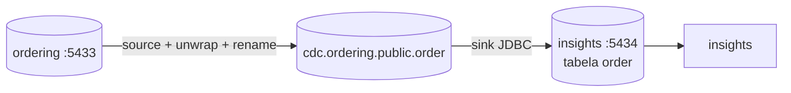

# Carregando pedidos no reporting database: o conector sink

> **Em uma frase:** o conector `cdc.sink.insights.order` lê o tópico `cdc.ordering.public.order` e grava cada pedido na tabela `order` do banco de relatórios (5434), com upsert pela chave. É o **L** do ETL, e fecha o caminho: o pedido muda no ordering e aparece, segundos depois, no banco do insights.

⬅️ Anterior: [Simplificando e renomeando com transforms](./11-simplificando-e-renomeando-com-transforms.md) · ➡️ Próximo: — · 🧭 Trilha: [README](../README.md#trilha-de-leitura)

---

## O problema

Os pedidos já chegam ao tópico planos e com os nomes do relatório ([doc 11](./11-simplificando-e-renomeando-com-transforms.md)). Falta tirá-los do tópico e gravá-los no reporting database, onde o insights vai fazer os `join` e `group by`.

## A ideia



O **sink JDBC do Debezium** é um consumidor do tópico (com o grupo `connect-cdc.sink.insights.order`). Para cada mensagem, ele faz um `insert ... on conflict (id) do update`: se o pedido não existe, insere; se existe, atualiza.

## Como funciona no AlgaShop

### A tabela é do insights (migration), não do sink

A tabela `order` do banco de relatórios é criada pela migration `V001__create-table-order.sql` **do insights**:
- as 12 colunas que o source manda, com os nomes já renomeados (`shipping_city`, `shipping_state`);
- `total_amount numeric(38, 2)`, para casar com o `Decimal` do modo `precise`;
- chave primária `id`;
- índices em `customer_id` e `paid_at`, os campos que os relatórios vão filtrar.

O sink tem `schema.evolution: none`: ele **não** cria nem altera tabela. Quem manda no formato do banco de relatórios é o insights, com versionamento pelo Flyway, e não o conector, no improviso.

### As propriedades

| Propriedade | Valor | O que faz |
|---|---|---|
| `connector.class` | `io.debezium.connector.jdbc.JdbcSinkConnector` | o sink JDBC (já vem na imagem do Debezium) |
| `connection.url` | `jdbc:postgresql://algashop-insights-postgres:5432/insights` | o banco de relatórios, pela rede do Docker (não a 5434 do host) |
| `topics` | `cdc.ordering.public.order` | de onde ler |
| `collection.name.format` | `order` | para qual tabela gravar (sem isso, ele usaria o nome do tópico) |
| `insert.mode` | `upsert` | insere ou atualiza: repetir uma mensagem não duplica nada |
| `primary.key.mode` | `record_key` | a chave primária vem da **chave** da mensagem (`{"id": ...}`) |
| `schema.evolution` | `none` | não mexe na estrutura da tabela |
| `quote.identifiers` | `true` | põe aspas nos nomes. Sem isso, `order` (palavra reservada) não é encontrada |

### O erro do `order`: "Could not find table"

O sink chegou sem `quote.identifiers` e falhou na primeira mensagem:

```
Table 'order' cannot be created because schema evolution is disabled.
Table 'order' does not exist and cannot be altered.
java.sql.SQLException: Could not find table: order
```

A tabela **existia**: o Flyway a criou às 01:06, e o sink rodou às 04:04. O problema é o nome. `order` é palavra reservada do SQL (o `ORDER BY`), e por isso a migration o escreve com aspas (`"order"`). Sem `quote.identifiers`, o sink procura a tabela de um jeito que não casa com esse nome e conclui que ela não existe. Como `schema.evolution` está em `none`, ele não pode criá-la, e a task morre.

Com `"quote.identifiers": "true"`, o sink usa `"order"`, entre aspas, e acha a tabela. Foi testado num conector temporário antes de mexer no seu.

Uma task que morre **não volta sozinha**: depois de corrigir a config, é preciso reiniciá-la (`POST /connectors/{nome}/restart?includeTasks=true&onlyFailed=true`).

### Upsert: por que repetir não estraga

O Kafka entrega **pelo menos uma vez**. Se o sink cair depois de gravar e antes de confirmar o offset, ele relê mensagens. Com `upsert` pela chave, gravar o mesmo pedido de novo só sobrescreve com o mesmo valor. É a mesma ideia de idempotência do consumidor do [doc 07 da mensageria](../06-mensageria/07-resiliencia-no-consumer.md), agora resolvida pelo banco.

## Como aplicar

1. Crie a tabela de destino por migration no serviço dono do banco de relatórios.
2. Configure o sink: conexão pela rede do Docker, tópico, tabela, `upsert` e a chave pela `record_key`.
3. Nome reservado ou com maiúsculas? Use `quote.identifiers: true`.
4. Confira o status, o lag do grupo `connect-<nome>` e a contagem de linhas.
5. Corrigiu uma config de uma task que falhou? Reinicie a task.

## Para lembrar

- Sink = consumidor do tópico que grava no banco; é o **L** do ETL.
- `upsert` + chave da mensagem = repetir não duplica.
- A tabela é do insights (Flyway); o sink só grava (`schema.evolution: none`).
- Palavra reservada como nome de tabela pede `quote.identifiers: true`.
- Task que falhou fica parada até alguém reiniciar.

## Cuidados

- **Apagar no ordering não apaga no relatório (ainda).** O source manda o delete como tombstone ([doc 11](./11-simplificando-e-renomeando-com-transforms.md#1-unwrap-só-o-after)), mas o sink só apaga com `delete.enabled: true` (que exige `primary.key.mode: record_key`, já configurado). Hoje, um pedido apagado continua no relatório. Decida se o relatório quer manter o histórico ou espelhar o delete.
- **Senha no arquivo e superusuário:** igual ao source; serve para estudo.
- **Arquivos novos em stage vazios.** O JSON do sink e a `V001` do insights foram adicionados ao git antes de receber o conteúdo. Foi preciso dar `git add` de novo (já feito).
- **Os dados de teste entraram.** O teste com o conector temporário gravou os pedidos no banco de relatórios antes do seu sink. Como é upsert pela mesma chave, o resultado é o mesmo; não há duplicata.

## Pendências

- Decidir o delete (`delete.enabled`).
- Os conectores dos itens do pedido e dos produtos, e as tabelas deles no insights.
- O primeiro relatório estratégico no insights, lendo essa tabela.

## Testes

14/11/2026:

| Verificação | Resultado |
|---|---|
| Sink sem `quote.identifiers` | task `FAILED`: `Could not find table: order` (a tabela existia desde 01:06) |
| Conector temporário igual + `quote.identifiers: true` | `RUNNING`; 606 linhas gravadas, `total_amount` exato (`1000.00`), `shipping_city` renomeado. Depois foi apagado, junto com o grupo de consumo |
| Seu sink com o PUT + restart | conector e task `RUNNING` |
| Update de teste no ordering | grupo `connect-cdc.sink.insights.order`: offset 620 de 620, **lag 0** |
| Contagem | 606 pedidos no ordering = 606 no banco de relatórios (540 com `paid_at`) |

## Dados de teste

- **Criar:** `POST http://localhost:8087/connectors` com `etc/kafka-connect/cdc.sink.insights.order.json`.
- **Atualizar:** `PUT http://localhost:8087/connectors/cdc.sink.insights.order/config` (propriedades planas).
- **Reiniciar a task que falhou:** `POST http://localhost:8087/connectors/cdc.sink.insights.order/restart?includeTasks=true&onlyFailed=true`.
- **Conferir:** `psql -h localhost -p 5434 -U postgres -d insights -c 'select count(*) from "order"'`.
- **Lag:** Kafka UI → Consumers → `connect-cdc.sink.insights.order`.

## Onde ver

- `etc/kafka-connect/cdc.sink.insights.order.json` (meta): o sink.
- `V001__create-table-order.sql` (insights, `db/migration`): a tabela de destino.
- [Simplificando e renomeando com transforms](./11-simplificando-e-renomeando-com-transforms.md): de onde vem a mensagem.
