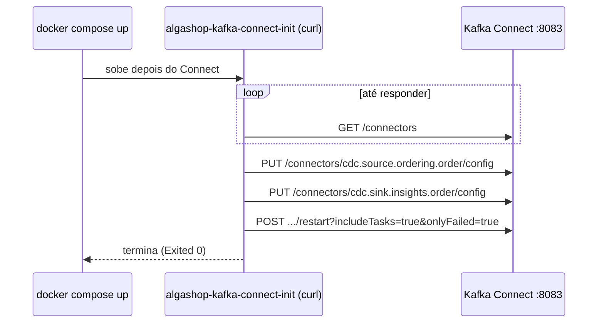

# Automatizando a criação dos conectores

> **Em uma frase:** os conectores deixam de ser criados à mão pela API. Um script (`apply-connectors.sh`) aplica todos os JSON de `etc/kafka-connect` com **PUT**, que cria ou atualiza, e um container de uma execução só (`algashop-kafka-connect-init`) roda esse script quando o compose sobe. Os arquivos do repositório viram a fonte da verdade.

⬅️ Anterior: [Carregando pedidos no reporting database](./12-carregando-pedidos-no-reporting-database.md) · ➡️ Próximo: — · 🧭 Trilha: [README](../README.md#trilha-de-leitura)

---

## O problema

Os conectores moram no Kafka Connect, nos tópicos internos (o `configs` do [doc 07](./07-kafka-connect.md#como-ele-lembra-onde-parou)). Num `docker compose down -v`, esses tópicos somem junto com o Kafka, e os conectores também. Recriá-los à mão é fácil de esquecer e de errar: qual JSON, qual ordem, POST ou PUT?

## A ideia



- **Os arquivos mandam:** `etc/kafka-connect/*.json` é o que deveria estar rodando.
- **O script compara nada e aplica tudo:** o PUT deixa o Connect igual ao arquivo, exista o conector ou não.
- **O init é descartável:** ele sobe, aplica e sai.

## Como funciona no AlgaShop

### Por que PUT, e não POST

| | `POST /connectors` | `PUT /connectors/{nome}/config` |
|---|---|---|
| Conector não existe | cria (201) | cria (201) |
| Conector já existe | **erro 409** | atualiza (200) |
| Rodar duas vezes | quebra na segunda | dá o mesmo resultado |

O PUT é **idempotente**: rodar uma ou dez vezes deixa o Connect no mesmo estado. É isso que permite que o script rode sempre, sem perguntar se o conector já existe.

Por isso os dois JSON mudaram para o **formato plano do PUT**: as propriedades soltas, sem o `config` em volta. O `name` pode ficar dentro, desde que seja igual ao da URL. Os [docs 10](./10-extraindo-pedidos-com-debezium.md#validar-criar-e-atualizar) e [12](./12-carregando-pedidos-no-reporting-database.md) mostravam o formato do POST; agora o arquivo é o do PUT.

### O script, passo a passo

1. **Espera o Connect:** repete `GET /connectors` a cada 3 segundos até responder. O worker leva alguns segundos para subir.
2. **Sources antes dos sinks:** primeiro os `cdc.source.*.json`, depois os `cdc.sink.*.json`. O source é quem cria o tópico que o sink vai ler.
3. **O nome vem do arquivo:** `cdc.source.ordering.order.json` vira `PUT /connectors/cdc.source.ordering.order/config`.
4. **Reinicia o que falhou:** no fim, `restart?includeTasks=true&onlyFailed=true` em cada conector. Só reinicia task com falha; as que estão rodando ficam como estão.

A URL é o `CONNECT_URL`: dentro do Docker, `http://algashop-kafka-connect:8083`; no host, o padrão é `http://localhost:8087`.

### O container de init

```yaml
algashop-kafka-connect-init:
  image: curlimages/curl:8.23.0
  depends_on: [algashop-kafka-connect]
  environment:
    CONNECT_URL: http://algashop-kafka-connect:8083
  volumes:
    - ./etc/kafka-connect:/connectors:ro
  entrypoint: [ "sh", "/connectors/apply-connectors.sh" ]
```

- **Imagem mínima:** só tem `sh` e `curl`, que é tudo o que o script usa.
- **A pasta montada como `ro` (só leitura):** o container lê os JSON do repositório e não pode alterá-los.
- **Roda uma vez:** depois de aplicar, ele termina com `Exited (0)`. Isso é o esperado, não uma falha.

### A corrida: o init é mais rápido que as tabelas

O init roda assim que o Connect responde. Mas a tabela `order` do ordering só existe depois que **o ordering sobe** e o Flyway roda. Num ambiente zerado:

1. o init cria o source;
2. o Debezium tenta criar a publication filtrada para `public.order`, que ainda não existe;
3. a task fica `FAILED`: `Unable to create filtered publication cdc_ordering_order`.

Foi exatamente o que aconteceu no teste. A saída é **rodar de novo depois que os serviços subirem**. O PUT não muda nada (a config é a mesma), e o restart revive só a task que falhou:

```
docker compose -f docker-compose.tools.yml up algashop-kafka-connect-init
```

ou, no host, `sh etc/kafka-connect/apply-connectors.sh`.

## Como aplicar

1. Um JSON plano por conector em `etc/kafka-connect`, com o nome no arquivo.
2. Um script que espera o Connect, aplica com PUT (sources antes dos sinks) e reinicia o que falhou.
3. Um container de init com a pasta montada só para leitura.
4. Ambiente zerado? Suba os serviços e rode o init de novo.

## Para lembrar

- Os arquivos do repositório são a fonte da verdade dos conectores.
- PUT `/config` é idempotente: cria ou atualiza; o POST quebra na segunda vez.
- Source antes de sink.
- `restart?onlyFailed=true` revive só o que falhou.
- O init termina com `Exited (0)` de propósito.
- As tabelas nascem com os serviços: rode o init de novo depois deles.

## Cuidados

- **A URL padrão do script estava errada.** Ela chegou como `localhost:8085`, que é a da segunda instância do notifications. O Connect está na **8087** desde o [doc 09](./09-servico-insights-e-bancos-preparados.md#as-portas-agora). Corrigida.
- **Pasta sem sink.** Sem nenhum `cdc.sink.*.json`, o `sh` mantém o padrão literal e o script faria um PUT em `cdc.sink.*`. Agora ele pula (`[ -f "$file" ] || continue`).
- **O script não para em erro.** Um PUT que volta 400 ou 500 só é impresso (`-> HTTP 400`). Leia o log do init (`docker logs algashop-meta-algashop-kafka-connect-init-1`).
- **`restart: no` sem aspas.** No YAML, `no` sem aspas vira o booleano *falso*. O Compose aceita e trata como "não reiniciar", mas `"no"`, entre aspas, evita a dúvida.
- **Senha nos arquivos.** Os JSON levam a senha do Postgres. Para estudo, serve. Em produção, use os *config providers* do Connect para ler a senha de fora do arquivo.
- **O script entrou vazio no stage.** Como os outros arquivos novos, ele foi adicionado antes de receber o conteúdo; foi preciso dar `git add` de novo.

## Pendências

- Fazer o init esperar os serviços (por healthcheck), em vez de depender de rodá-lo de novo.
- O script falhar (exit ≠ 0) quando algum PUT der erro.

## Testes

14/11/2026:

| Verificação | Resultado |
|---|---|
| `docker compose config` | válido (o `restart: no` sem aspas é aceito) |
| Log do init (ambiente recém-criado) | `cdc.source.ordering.order -> HTTP 201`, `cdc.sink.insights.order -> HTTP 201`; container `Exited (0)` |
| Status logo depois | source com task `FAILED` (`Unable to create filtered publication`), porque a tabela ainda não existia; sink `RUNNING` |
| `sh -n` no script corrigido | sintaxe ok |
| Script de novo, pelo host (padrão 8087), depois dos serviços | PUT 200 e 200; as duas tasks `RUNNING` |
| Dados | 606 pedidos no ordering = 606 no banco de relatórios; lag 0 |

## Onde ver

- `etc/kafka-connect/apply-connectors.sh` (meta): o script.
- `etc/kafka-connect/*.json` (meta): os conectores, no formato do PUT.
- `docker-compose.tools.yml` (meta): o serviço `algashop-kafka-connect-init`.
- [`openapi/apache-kafka-connect.yml`](../openapi/apache-kafka-connect.yml): o PUT `/config` e o `restart`.
