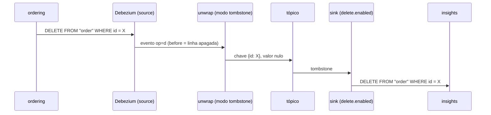

# Deletes, tombstones e tipos de dados

> **Em uma frase:** agora um pedido apagado no ordering também some do relatório. O `unwrap` entrega o delete como um **tombstone** (a chave com o valor nulo), e o sink, com `delete.enabled`, transforma esse tombstone num `delete` no banco de relatórios. No caminho, cada tipo do Postgres de origem chega certo ao destino: dinheiro exato, uuid nativo e data com fuso.

⬅️ Anterior: [Automatizando a criação dos conectores](./13-automatizando-a-criacao-dos-conectores.md) · ➡️ Próximo: [Replicando os clientes](./15-replicando-os-clientes.md) · 🧭 Trilha: [README](../README.md#trilha-de-leitura)

---

## O problema

Até o [doc 13](./13-automatizando-a-criacao-dos-conectores.md), a cópia só **crescia**: insert e update chegavam ao banco de relatórios, mas um pedido apagado no ordering continuava lá. Era a pendência do [doc 12](./12-carregando-pedidos-no-reporting-database.md#cuidados). Um relatório que conta pedidos que não existem mais mente.

## A ideia: o tombstone é o "apague" do Kafka

No Kafka, uma mensagem **com chave e sem valor** quer dizer "esta chave não existe mais". Esse é o **tombstone** (lápide). O sink sabe ler isso.



## Como funciona no AlgaShop

### Lado do source: `delete.tombstone.handling.mode`

```json
"transforms.unwrap.delete.tombstone.handling.mode": "tombstone"
```

O `unwrap` do [doc 11](./11-simplificando-e-renomeando-com-transforms.md) recebe um evento de delete. Esse modo diz o que fazer com ele:

| Modo | O que sai no tópico | Para quê |
|---|---|---|
| `drop` | nada | quando o destino nunca deve apagar |
| **`tombstone`** | só o tombstone (chave + valor nulo) | **espelhar o delete no destino**: o escolhido |
| `rewrite` | a linha apagada, com uma coluna `__deleted = true` | delete lógico: o destino marca em vez de apagar |
| `rewrite-with-tombstone` | a linha marcada **e** o tombstone | as duas coisas |

### Lado do sink: `delete.enabled`

```json
"delete.enabled": "true"
```

Com isso, o sink JDBC transforma o tombstone num `DELETE ... WHERE id = ?`. Ele usa a **chave** da mensagem para saber qual linha apagar. Por isso o delete só funciona com `primary.key.mode: record_key`, que já estava configurado ([doc 12](./12-carregando-pedidos-no-reporting-database.md#as-propriedades)).

A ordem fica garantida: o tombstone tem a mesma chave do pedido, então cai na mesma partição, **depois** dos inserts e updates daquele pedido. Não tem como o delete passar na frente do insert.

### O tombstone daqui não é "puro"

No teste, o registro do delete chegou ao tópico assim:

```json
{ "schema": { "name": "cdc.ordering.public.order.Value", "optional": true, "...": "..." }, "payload": null }
```

O **valor da linha** é nulo (`payload: null`), mas a mensagem **não** é vazia: o JsonConverter, com o schema embutido ([doc 07](./07-kafka-connect.md#converters-de-objeto-para-bytes)), escreve o schema mesmo sem valor. Para o sink, que lê com o mesmo converter, isso é um tombstone, e ele apaga a linha. Para o Kafka, os bytes não são nulos. Se um dia o tópico usar compactação (`cleanup.policy=compact`), esse registro **não** vai remover a chave. Hoje o tópico usa a política padrão, que apaga por tempo, então isso não importa.

### `field.exclude.list`: nomes antigos no tópico

```json
"field.exclude.list": "shipping_address_city,shipping_address_state"
```

O `rename` do source passou a trocar `shipping_address_*` por `shipping_*`. Mensagens **mais antigas**, de antes do rename, ainda podem estar no tópico com os nomes velhos. Se o sink as relesse (um sink novo, ou um offset voltando ao começo), tentaria gravar colunas que a tabela não tem. Com `schema.evolution: none`, ele não cria colunas: a task falharia. A lista de exclusão faz o sink **ignorar** esses dois campos.

No tópico atual, todas as mensagens já têm os nomes novos (ele foi recriado), então a exclusão é uma proteção, não uma correção.

### Tipos de dados: da origem ao destino

O schema embutido em cada mensagem diz o tipo de cada campo. O sink usa isso para gravar na coluna certa:

| Campo | No Postgres do ordering | Na mensagem (schema) | No insights | Por quê |
|---|---|---|---|---|
| `id` | `bigint` | `int64` | `bigint` | o TSID do pedido cabe em 64 bits |
| `customer_id` | `uuid` | `string` + `io.debezium.data.Uuid` | `uuid` | o nome lógico diz "é uuid": vira uuid nativo, não texto |
| `total_amount` | `numeric` | `bytes` + `Decimal` (escala 2, precisão 38) | `numeric(38,2)` | dinheiro exato: `"AYag"` vira `1000.00` (modo `precise`, [doc 11](./11-simplificando-e-renomeando-com-transforms.md#3-decimalhandlingmode-como-o-dinheiro-viaja)) |
| `total_items` | `integer` | `int32` | `integer` | — |
| `placed_at`, `paid_at`, `ready_at`, `canceled_at` | `timestamptz` | `string` + `io.debezium.time.ZonedTimestamp` | `timestamptz` | data e hora **com fuso** (ISO‑8601 em UTC); o instante não muda |
| `status`, `payment_method`, `shipping_*` | `varchar` | `string` | `varchar` | — |

Exemplo real: na mensagem, `total_amount = "AYag"`, `placed_at = "2025-09-24T14:20:01.000000Z"`. No insights, `1000.00` e `2025-09-24 14:20:01+00`.

A tabela de destino é criada pelo insights (migration `V001`) com esses tipos de propósito. Se o tipo da migration não casar com o da mensagem, o sink falha, porque ele não altera tabela.

## Como aplicar

1. No source: `delete.tombstone.handling.mode` de acordo com o que o destino deve fazer (apagar → `tombstone`).
2. No sink: `delete.enabled: true` com `primary.key.mode: record_key`.
3. Proteja o sink contra campos que mudaram de nome com `field.exclude.list`.
4. Crie as colunas de destino com os tipos que a mensagem carrega (`numeric` para Decimal, `uuid` para Uuid, `timestamptz` para ZonedTimestamp).
5. Aplique pelo script (`apply-connectors.sh`) e teste com um registro de teste, não com dado real.

## Para lembrar

- Tombstone = chave com valor nulo = "apague esta chave".
- `unwrap` em modo `tombstone` → o delete vira tombstone; `delete.enabled` → o sink apaga.
- O delete precisa da chave: `primary.key.mode: record_key`.
- Mesma chave, mesma partição: o delete nunca passa na frente do insert.
- Os tipos viajam no schema: Decimal → `numeric`, Uuid → `uuid`, ZonedTimestamp → `timestamptz`.

## Cuidados

- **Espelhar o delete apaga a história.** Com `tombstone`, o pedido apagado some do relatório. Se o negócio quiser saber "quantos pedidos foram apagados", use `rewrite` (delete lógico, com `__deleted`) e uma coluna para isso no insights.
- **Tombstone com schema não serve para compactação.** Veja acima: o sink entende, mas o Kafka não remove a chave num tópico compactado.
- **Config nova vale para as mensagens novas.** Deletes feitos antes desta mudança não viraram tombstone e não serão reaplicados.
- **Tipo errado na migration derruba o sink.** Com `schema.evolution: none`, o sink não ajusta coluna; ele falha.
- **No ordering, o delete é raro.** O pedido normalmente muda de status (`CANCELED`) em vez de ser apagado. O delete aparece no `afterMigrate` de desenvolvimento, que apaga e recria tudo a cada subida, e cada subida gera centenas de tombstones seguidos de inserts.

## Pendências

- Os conectores dos itens do pedido e dos produtos, com as mesmas regras de delete e tipos.
- Decidir se o relatório precisa de delete lógico (`rewrite`).

## Testes

14/11/2026, aplicado com `sh etc/kafka-connect/apply-connectors.sh` (PUT 200 nos dois):

| Verificação | Resultado |
|---|---|
| Config ativa | source com `transforms.unwrap.delete.tombstone.handling.mode = tombstone`; sink com `delete.enabled = true` e `field.exclude.list`; as duas tasks `RUNNING` |
| Insert de uma **cópia de teste** (id `9999999999001`) no ordering | apareceu no insights: `PLACED`, `1000.00`, `North Ville` |
| Delete da cópia | sumiu do insights (0 linhas) |
| Tópico | só 2 registros da cópia: o insert (plano) e o delete (`payload: null`, schema do valor), **sem** a mensagem de delete com `op` |
| Contagem final | 606 no ordering = 606 no insights |
| Tipos | as 12 colunas do insights batem com o schema da mensagem (tabela acima) |
| `field.exclude.list` | aceita (task `RUNNING`); não exercitada, porque o tópico atual não tem mensagens com os nomes antigos |

## Dados de teste

Gerar um insert e um delete sem tocar em pedidos reais (banco `ordering`):

```sql
-- cópia de um pedido com id de teste (todas as colunas, menos o id)
insert into "order" (id, customer_id, status, ...)  -- liste as colunas
select 9999999999001, customer_id, status, ... from "order" where id = 1727196000001;

delete from "order" where id = 9999999999001;
```

Conferir no insights: `select * from "order" where id = 9999999999001;` (aparece e some).

## Onde ver

- `etc/kafka-connect/cdc.source.ordering.order.json` (meta): `transforms.unwrap.delete.tombstone.handling.mode`.
- `etc/kafka-connect/cdc.sink.insights.order.json` (meta): `delete.enabled` e `field.exclude.list`.
- `V001__create-table-order.sql` (insights): os tipos de destino.
