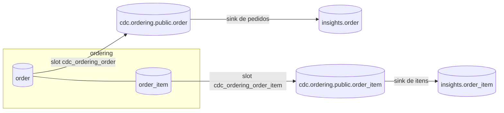

# Replicando os itens dos pedidos (desafio)

> **Em uma frase:** os itens dos pedidos ganham o próprio source, o próprio sink e a tabela `order_item` no insights. A lição é o que acontece quando duas tabelas que dependem uma da outra chegam por **caminhos separados**: o item pode chegar **antes** do pedido. Por isso o insights não tem chave estrangeira entre eles, e as consultas sabem lidar com o item que ainda está sozinho.

⬅️ Anterior: [Replicando os clientes](./15-replicando-os-clientes.md) · ➡️ Próximo: — · 🧭 Trilha: [README](../README.md#trilha-de-leitura)

---

## O problema

No ordering, o pedido e os itens são gravados na **mesma transação**, e uma chave estrangeira garante que todo item tem um pedido. No insights, eles chegam por caminhos diferentes:



São dois conectores, dois slots, dois tópicos e dois sinks, cada um no seu ritmo. **Nada garante** que o pedido chegue antes dos itens, nem que os dois cheguem juntos. Basta um sink estar um pouco mais lento, parado ou reiniciando.

## A ideia: aceitar o item que chega primeiro

### Sem chave estrangeira no insights

A `V003__create-table-order-item.sql` cria a tabela **sem** FK para `"order"`:

- **Com FK:** o item que chega antes do pedido violaria a chave, o sink falharia (ou a mensagem iria para a DLQ, e o item se perderia do relatório). A carga pararia por uma questão de ordem que se resolve sozinha em segundos.
- **Sem FK:** o item é gravado normalmente e fica esperando. Quando o pedido chega, os dois passam a se encontrar no `join`, **sem nenhuma ação** no insights.

Na origem, a FK continua. Lá quem garante a consistência é a transação; no destino, é o tempo (consistência eventual, [doc 05](./05-relatorios-estrategicos-e-reporting-database.md#o-preço-consistência-eventual)).

### O item sem pedido é passageiro

O item sem pedido é o item cujo `order_id` não encontra nenhuma linha na tabela `order` do insights:

```sql
select count(*)
from order_item i
left join "order" o on o.id = i.order_id
where o.id is null;
```

Essa consulta é o **monitor**: em situação normal, ela devolve 0. Um número acima de 0 por pouco tempo é normal (um sink atrás do outro). Um número que não volta a 0 indica um sink parado ou em erro.

### As consultas toleram o item sozinho

Uma **venda** é o pedido pago e não cancelado, como no relatório de vendas do [doc 02](./02-primeira-metrica-vendas-por-mes.md#as-regras-do-número). Então a soma de vendas por produto **precisa** do pedido:

```sql
select i.product_name, sum(i.quantity) as quantidade, sum(i.total_amount) as total
from order_item i
join "order" o on o.id = i.order_id
where o.paid_at is not null
  and o.canceled_at is null
group by i.product_id, i.product_name
order by total desc;
```

O `join` (inner) **deixa de fora** o item sem pedido. Isso não é um erro, é a regra: sem o pedido, não dá para saber se aquele item foi pago nem se foi cancelado. Ele ainda não é uma venda **conhecida**. Quando o pedido chegar, o item entra na soma.

## Como funciona no AlgaShop

### A tabela

| Coluna | Tipo | Por quê |
|---|---|---|
| `id` | `bigint`, PK | o mesmo id do item no ordering; o item tem chave própria, então não precisa de chave composta |
| `order_id` | `bigint not null` | liga o item ao pedido (sem FK) |
| `product_id` | `uuid` | o produto, para agrupar |
| `product_name` | `varchar` | o nome como estava na compra |
| `price`, `total_amount` | `numeric(38,2)` | dinheiro exato (`decimal.handling.mode: precise`, [doc 11](./11-simplificando-e-renomeando-com-transforms.md#3-decimalhandlingmode-como-o-dinheiro-viaja)) |
| `quantity` | `integer` | — |

A tabela do ordering só tem colunas de negócio, sem dado pessoal e sem auditoria. Por isso as 7 vão todas: a lista do conector é igual às colunas da V003.

**Índices**, pensando nas consultas que vêm pela frente:
- `idx_order_item_order_id`: o `join` com o pedido acha os itens de um pedido sem ler a tabela inteira;
- `idx_order_item_product_id`: o `group by` por produto e os filtros por produto.

### Três conectores, o mesmo prefixo

| O quê | Pedidos | Clientes | Itens |
|---|---|---|---|
| Conector | `cdc.source.ordering.order` | `cdc.source.ordering.customer` | `cdc.source.ordering.order_item` |
| Slot e publication | `cdc_ordering_order` | `cdc_ordering_customer` | `cdc_ordering_order_item` |
| `custom.metric.tags` | `table=order` | `table=customer` | `table=order_item` |
| Tópico | `cdc.ordering.public.order` | `cdc.ordering.public.customer` | `cdc.ordering.public.order_item` |

Nada é compartilhado, pelo motivo do [doc 15](./15-replicando-os-clientes.md#dois-conectores-do-postgres-com-o-mesmo-topicprefix).

### Parar e retomar um sink

Para ver o item chegar antes do pedido sem depender da sorte, o teste para o sink de pedidos:

- `PUT /connectors/cdc.sink.insights.order/stop`: o sink para de ler. O **source continua publicando**, e as mensagens esperam no tópico;
- `PUT /connectors/cdc.sink.insights.order/resume`: o sink volta do offset onde parou e grava o que se acumulou.

É a independência do tópico no meio, do [doc 07](./07-kafka-connect.md#source-e-sink-os-dois-sentidos): um lado parado não perde nada do outro.

### Os três sinks com DLQ

Depois do desafio, os sinks de clientes e de itens ganharam as mesmas três linhas que o sink de pedidos já tinha ([doc 15](./15-replicando-os-clientes.md#o-sink-de-pedidos-ganhou-uma-dlq)):

| Sink | DLQ |
|---|---|
| `cdc.sink.insights.order` | `dlt.cdc.sink.insights.order` |
| `cdc.sink.insights.customer` | `dlt.cdc.sink.insights.customer` |
| `cdc.sink.insights.order_item` | `dlt.cdc.sink.insights.order_item` |

```json
"errors.tolerance": "all",
"errors.deadletterqueue.topic.name": "dlt.cdc.sink.insights.order_item",
"errors.deadletterqueue.context.headers.enable": "true"
```

**O que ela protege.** Uma mensagem que o sink não consegue **ler** (um valor que não é JSON, um schema que não converte) não derruba mais a task. Ela vai para a DLT com o motivo nos headers (`__connect.errors.exception.class.name`, `...exception.message`, o tópico e o offset de origem), e o sink segue para a próxima.

**O que ela não troca.** O DLQ do Connect cobre os erros de **conversão e de transform**. A regra do desafio continua valendo: o item que chega antes do pedido não é erro (não há FK), então ele nunca vai para a DLT. Ele é gravado e espera o pedido.

**O preço.** O erro não aparece mais no status: o conector fica `RUNNING`. Alguém precisa olhar as DLTs; uma mensagem lá é uma linha que **faltou** no relatório.

## Como aplicar

1. Tabelas que dependem uma da outra, mas chegam por conectores diferentes: **sem FK no destino**.
2. Crie uma consulta de "órfãos" (`left join ... is null`) e use-a como monitor.
3. Nas consultas de negócio, decida o que fazer com o órfão. Se a regra depende do pai (pago, cancelado), use `join` e deixe-o de fora até o pai chegar.
4. Índices pensando no `join` e no `group by` dos relatórios.
5. Migration antes do init; o init aplica os 6 conectores.

## Para lembrar

- Mesma transação na origem **não** garante a ordem no destino.
- Sem FK no destino: o item é gravado e espera o pedido.
- O órfão é passageiro; a consulta `left join ... is null` mostra quantos há.
- Venda precisa do pedido (pago e não cancelado): o `join` deixa o órfão de fora até o pedido chegar.
- Sink parado não perde mensagem: o tópico guarda.

## Cuidados

- **Órfão que não some é sintoma.** Ele indica um sink de pedidos parado, `FAILED` ou atrasado. Monitore a consulta.
- **Contagens em momentos diferentes não batem.** Durante a cópia, o insights pode ter itens de pedidos que ainda não chegaram. Compare as contagens depois que os sinks terminarem.
- **Remover no ordering gera tombstones nos dois tópicos.** O item e o pedido somem do insights cada um no seu tempo. Durante um instante, pode haver pedido sem itens (e, do outro lado, item sem pedido).
- **A mensagem do teste da DLQ ficou no tópico de itens.** O registro `isto nao e json` (chave `teste-dlq`) continua em `cdc.ordering.public.order_item` até a retenção apagá-lo. Se um sink novo ler o tópico desde o começo, ele vai de novo para a DLT, sem quebrar nada.
- **Os arquivos entraram vazios no stage.** Os dois JSON e a V003 foram adicionados antes do conteúdo; foi preciso dar `git add` de novo.

## Pendências

- O teste pelo ecommerce (o John Doe compra dois produtos) e a remoção pelo restart do ordering: ficam para você, veja abaixo.
- Os produtos (product-catalog, MongoDB).
- O relatório estratégico no insights (vendas por produto e por categoria).

## Testes

14/11/2026:

| Verificação | Resultado |
|---|---|
| V003 | aplicada pelo insights (`flyway_schema_history` com 001–003) |
| Log do init | `cdc.source.ordering.order_item` e `cdc.sink.insights.order_item` → **201**; os 4 outros → **200** |
| Status | os 6 conectores e as 6 tasks `RUNNING`; nenhum `Unable to register metrics` |
| Snapshot | **1.206** itens no ordering = 1.206 no insights; nenhuma coluna nula; soma dos `total_amount` igual nos dois (7.170.298,18) |
| Itens sem pedido | 0 |
| Sink de pedidos parado (`stop` 204, `STOPPED`) + pedido de teste com 2 itens inserido no ordering (numa transação) | os 2 itens chegaram ao insights; o pedido **não**; pedidos 607 (ordering) × 606 (insights); itens sem pedido = **2** |
| `resume` (202) | o pedido chegou; 607 = 607; itens sem pedido = **0** |
| Limpeza (apagar o pedido e os itens de teste no ordering) | os tombstones os tiraram do insights: 606 pedidos, 1.206 itens, 22 clientes, nos dois lados |
| Vendas por produto (`join` + pago e não cancelado) | ok; o primeiro é o `StellarMatrix Tower Server`, com 158 unidades e 1.580.000,00 |
| DLQ nos sinks de clientes e de itens (pelo init) | os 6 PUT com 200; os 3 sinks com `errors.tolerance=all` e a sua DLT; `RUNNING` |
| Mensagem que não é JSON (`isto nao e json`) publicada em `cdc.ordering.public.order_item` | foi para `dlt.cdc.sink.insights.order_item` (`DataException`, offset 1210, réplica 3); o sink seguiu `RUNNING`; um update real depois dela foi gravado (lag 0) |
| Ecommerce (John Doe compra 2 produtos) e restart do ordering | **não rodados** (sem o front no ar) |

O pedido de teste foi uma **cópia** de um pedido do seed, com o id `9999999999101`, e os itens foram cópias dos itens dele, com ids de teste. Nenhum dado real foi alterado.

## Dados de teste

**O roteiro do enunciado (ecommerce):**
1. `PUT http://localhost:8087/connectors/cdc.sink.insights.order/stop`.
2. No ecommerce, entre como John Doe, coloque dois produtos no carrinho e finalize a compra.
3. Insights: os 2 itens aparecem, o pedido não; 606 × 607; itens sem pedido = 2.
4. `PUT http://localhost:8087/connectors/cdc.sink.insights.order/resume` → o pedido aparece; 607; itens sem pedido = 0.
5. Reinicie o ordering → o pedido novo e os itens somem; 606 pedidos e 1.206 itens (espere os sinks terminarem).

## Onde ver

- `etc/kafka-connect/cdc.source.ordering.order_item.json` e `cdc.sink.insights.order_item.json` (meta).
- `V003__create-table-order-item.sql` (insights, `db/migration`): a tabela, sem FK e com os índices.
